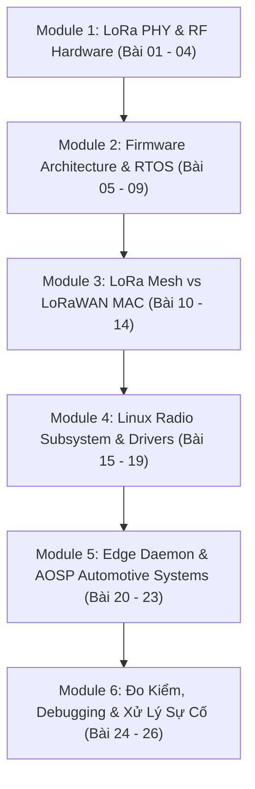

# Lập Trình & Tích Hợp LoRa / LoRaWAN Chuyên Sâu
## Mastering LoRa & LoRaWAN: From Silicon Register to Linux Kernel and AOSP Architecture

> Bộ giáo trình và tài liệu kỹ thuật chuyên sâu về công nghệ không dây tầm xa LoRa / LoRaWAN, được thiết kế theo tiêu chuẩn công nghiệp: đi từ bản chất lớp vật lý sóng vô tuyến (RF PHY), lập trình thanh ghi vi điều khiển (Bare-Metal / RTOS), phát triển Linux SPI Subsystem & Kernel Driver, cho đến tích hợp tầng cao trên Android Open Source Project (AOSP) phục vụ hệ thống viễn thông nhúng xe điện thông minh (Connected EV Telematics).

---

## 1. Cấu Trúc Thư Mục Dự Án (Repository Structure)

Dự án được tổ chức theo tiêu chuẩn song ngữ (Tiếng Việt và Tiếng Anh) tương thích hoàn toàn với các nền tảng CMS tài liệu kỹ thuật, GitHub Pages và hệ thống LMS:

```text
lora-embedded-linux-mastery/
├── vi/                                 # Toàn bộ 26 bài giảng tiếng Việt chuyên sâu
│   ├── Bai 01. Tong quan LoRa LoRaWAN va He sinh thai Ket noi Khong day Cong nghiep.md
│   ├── Bai 02. Phan tich Chuyen sau LoRa PHY Spreading Factor Bandwidth va Link Budget.md
│   ├── Bai 03. Giai ma Transceiver Semtech SX1276 SX1278 va SX1262.md
│   └── ... (đến Bài 26)
├── en/                                 # 26 bài giảng tiếng Anh tương ứng (Bilingual mapping)
│   ├── Lesson 01. Overview of LoRa LoRaWAN and Industrial LPWAN Ecosystem.md
│   ├── Lesson 02. Deep-Dive LoRa PHY Spreading Factor Bandwidth and Link Budget.md
│   ├── Lesson 03. Demystifying Semtech SX1276 SX1278 and SX1262 Transceivers.md
│   └── ... (đến Lesson 26)
├── images/                             # Kho tài nguyên sơ đồ khối, timing diagram, hardware schematics SVG/WebP
│   ├── bai01_lora_topology_comparison.svg
│   ├── bai02_css_chirp_modulation.svg
│   ├── bai03_sx1276_spi_state_machine.svg
│   ├── bai15_linux_lora_end_to_end_arch.svg
│   └── ...
├── labs/                               # Mã nguồn thực hành mẫu (Clean, Modular Code)
│   ├── 01_baremetal_sx127x_spi/        # Driver C bare-metal cho SX1276/78 qua SPI
│   ├── 02_freertos_lora_fsm/           # State machine điều khiển radio trên FreeRTOS
│   ├── 03_radiohead_mesh_routing/      # Mô hình định tuyến nhiều chặng RHMesh
│   ├── 04_linux_spidev_daemon/         # Daemon C/C++ điều khiển radio qua spidev + libgpiod
│   ├── 05_linux_spi_kernel_driver/     # Driver kernel module (spi_driver, char dev, threaded IRQ)
│   └── 06_android_aidl_hal_mock/       # Lớp Radio HAL và AIDL giả lập trên AOSP
└── README.md                           # Tài liệu tổng quan lộ trình và quy chuẩn dự án
```

---

## 2. Lộ Trình 26 Bài Học Chuyên Sâu (Curriculum Roadmap)



### Module 1: LoRa PHY, Bản Chất Vật Lý & Transceiver Silicon
- **Bài 01 / Lesson 01**: Tổng quan LoRa, LoRaWAN và Hệ sinh thái Kết nối Không dây Công nghiệp
- **Bài 02 / Lesson 02**: Phân tích Chuyên sâu LoRa PHY: Spreading Factor, Bandwidth và Link Budget
- **Bài 03 / Lesson 03**: Giải mã Transceiver Semtech SX1276/78 và SX1262: Kiến trúc và Bản đồ Thanh ghi
- **Bài 04 / Lesson 04**: Kỹ thuật Channel Activity Detection (CAD) và Tối ưu Năng lượng Lớp Vật lý

### Module 2: Kiến Trúc Firmware & Điều Khiển Không Chặn (MCU & FreeRTOS)
- **Bài 05 / Lesson 05**: Giao tiếp SPI Tốc độ cao với Radio Transceiver: Master Mode, Burst FIFO và Polling an toàn
- **Bài 06 / Lesson 06**: Thiết kế Finite State Machine (FSM) Điều khiển Radio Non-blocking
- **Bài 07 / Lesson 07**: Quản lý Ngắt Ngoại vi (DIO Interrupts), Xử lý Sự kiện và Đồng bộ ISR
- **Bài 08 / Lesson 08**: Tích hợp LoRa Driver vào Hệ điều hành Thời gian thực FreeRTOS
- **Bài 09 / Lesson 09**: Chiến lược Quản lý Nguồn điện Cực thấp (Low-Power & Sleep Modes)

### Module 3: LoRa Mesh vs LoRaWAN Protocol Stack
- **Bài 10 / Lesson 10**: Phân tích Giải pháp Mạng LoRa Mesh (RadioHead RHMesh) và Bẫy ACK Từng chặng
- **Bài 11 / Lesson 11**: Kiến trúc Mạng LoRaWAN Toàn diện (Star-of-Stars Topology & Network Entities)
- **Bài 12 / Lesson 12**: Cơ chế Kích hoạt Thiết bị: OTAA vs ABP, Hệ thống Khóa và Mã hóa AES-128
- **Bài 13 / Lesson 13**: Vận hành LoRaWAN: Thiết bị Lớp A, Lớp B, Lớp C và Timing Cửa sổ RX1/RX2
- **Bài 14 / Lesson 14**: Kỹ thuật Adaptive Data Rate (ADR) và Quy chuẩn Tần số Khu vực (Regional Parameters)

### Module 4: Tích Hợp LoRa Trên Embedded Linux Subsystem
- **Bài 15 / Lesson 15**: Cấu hình Device Tree (DTS) cho Giao diện SPI, Pinmux và GPIO Ngắt Radio
- **Bài 16 / Lesson 16**: Linux SPI Subsystem: Kiến trúc `spi_driver`, `probe()`, `spi_sync()` và Quản lý Bus
- **Bài 17 / Lesson 17**: Xử lý Ngắt Radio trong Linux: Top-Half và Threaded IRQ (`request_threaded_irq`)
- **Bài 18 / Lesson 18**: Xây dựng Character Device Driver: `read`, `write`, `ioctl` và Non-blocking `poll`
- **Bài 19 / Lesson 19**: So sánh Kiến trúc: Kernel Driver Chuyên dụng vs Userspace SPI (`spidev` + `libgpiod`)

### Module 5: Edge Daemon, AOSP HAL & Hệ Thống Nhúng Xe Điện Thông Minh
- **Bài 20 / Lesson 20**: Thiết kế LoRa Edge Daemon trên Linux: Vòng lặp `epoll`, Packet Queue và Backoff
- **Bài 21 / Lesson 21**: Kiến trúc Tích hợp Android / AOSP: Radio HAL, AIDL Interface và Chính sách SELinux
- **Bài 22 / Lesson 22**: Thiết kế Hệ thống Telematics Fallback cho Smart EV khi Mất Sóng Cellular
- **Bài 23 / Lesson 23**: Kiến trúc Đánh thức Từ xa (Remote Wake-up) và Quản lý Miền Nguồn (Power Domains)

### Module 6: Kỹ Thuật Đo Kiểm, Debugging Thực Chiến & Sổ Tay Xử Lý Sự Cố Hệ Thống
- **Bài 24 / Lesson 24**: Kỹ thuật Đo kiểm & Debugging Phần cứng: Logic Analyzer, Phân tích Bus SPI và Đo RF
- **Bài 25 / Lesson 25**: Root Cause Analysis: Phương pháp Điều tra và Khắc phục Sự cố Mất gói & Trôi tần số
- **Bài 26 / Lesson 26**: Sổ Tay Kỹ Sư Cao Cấp: 30 Câu Hỏi Phản Biện Kiến Trúc & Xử Lý Sự Cố Hệ Thống

---

## 3. Quy Chuẩn Kỹ Thuật Khi Đóng Góp Bài Viết

Mọi tài liệu trong kho lưu trữ này phải tuân thủ nghiêm ngặt **Web Markdown Authoring Standard**:
1. **Khung tóm tắt**: Mỗi bài học có thể mở đầu bằng `> Tóm tắt: ...` (hoặc `> Summary: ...`) viết thuần túy 1–2 câu, không in đậm lồng ghép.
2. **Ký hiệu kỹ thuật**: Luôn sử dụng ký tự Unicode nguyên bản (`→`, `⇒`, `≤`, `≥`, `µA`, `dBm`, `kHz`, `MHz`). Tuyệt đối không dùng LaTeX inline dạng `→` gây lỗi hiển thị trên CMS.
3. **GFM Callouts**: Sử dụng chuẩn 5 thẻ: `> [!NOTE]`, `> [!TIP]`, `> [!IMPORTANT]`, `> [!WARNING]`, `> [!CAUTION]`. Tên thẻ đặt riêng tại dòng 1.
4. **Hình ảnh**: Lưu tập trung tại thư mục `images/` và tải lên thư mục lưu trữ tĩnh `/uploads/` của hệ thống qua API. Chèn ảnh bằng cú pháp: `&lt;img src="/uploads/ten_anh.svg" width="900" alt="Mô tả hình ảnh"&gt;`.
5. **Khối mã nguồn**: Luôn khai báo định danh ngôn ngữ rõ ràng (`c`, `cpp`, `bash`, `dts`, `mermaid`).

