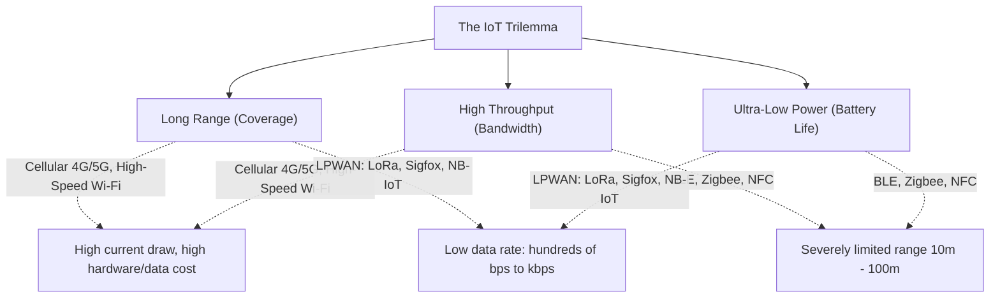
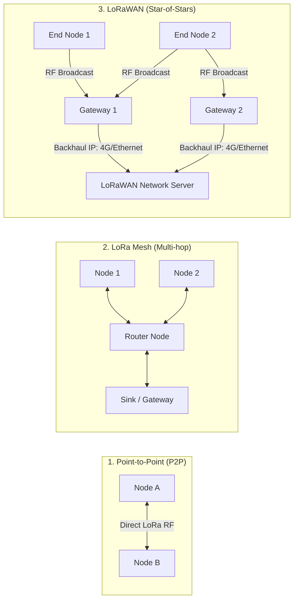
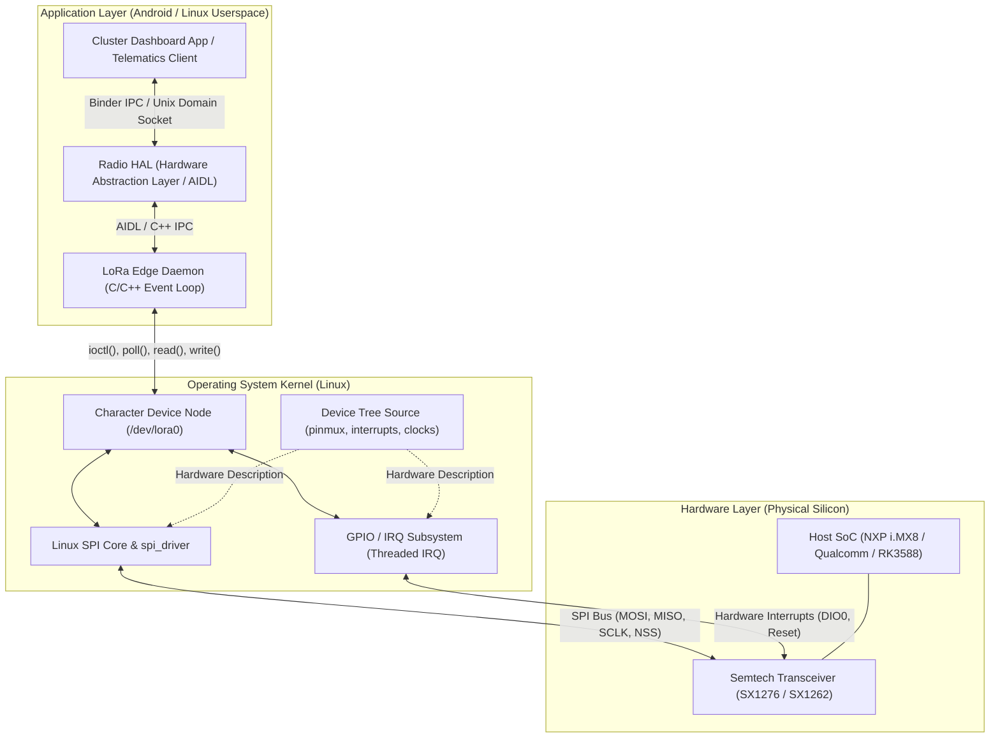

# LESSON 01: OVERVIEW OF LORA, LORAWAN, AND INDUSTRIAL LPWAN ECOSYSTEM

> Summary: A comprehensive examination of the Low-Power Wide-Area Network (LPWAN) landscape, establishing explicit technical boundaries between the LoRa physical layer and the LoRaWAN MAC protocol, alongside an architectural evaluation of Point-to-Point, Mesh, and Star-of-Stars wireless network topologies in industrial and connected electric vehicle telematics.

---

## 1. The Genesis of LPWAN and the IoT Trilemma

In embedded wireless systems engineering, designers continuously balance **The IoT Trilemma** across three interdependent parameters:
1. **Transmission Range (Coverage)**.
2. **Data Throughput (Bandwidth)**.
3. **Power Consumption (Energy Budget)**.

Prior to the inception of **LPWAN (Low-Power Wide-Area Network)** technology:
- Short-range wireless technologies such as **Bluetooth/BLE**, **Zigbee**, and **Z-Wave** delivered exceptional battery longevity but were constrained by short operational distances (typically under 100 meters).
- Conventional **Cellular technologies (2G/3G/4G LTE)** bridged tens of kilometers with abundant data throughput; however, the hardware modems required hundreds of milliamperes during active transmission, demanded constant battery replenishment, and carried recurring subscriber identity (SIM) recurring costs.

**LPWAN was engineered specifically to occupy this crucial niche**: Providing long-range connectivity spanning 10–15 km (line-of-sight in rural zones) or 2–5 km (dense urban canyons) while maintaining deep-sleep quiescent currents below a few microamperes (µA). This enables battery-powered field edge devices to operate reliably for 5 to 10 years on a single primary lithium cell, accepting the engineering trade-off of low payload bandwidth.

| Technical Metric | Short-Range (BLE / Zigbee) | Cellular (4G / 5G) | LPWAN (LoRa / LoRaWAN) |
| :--- | :---: | :---: | :---: |
| **Transmission Range** | 10 m – 100 m | Regional (Carrier Tower Dependent) | 2 km – 15 km (LOS) |
| **Payload Throughput** | 250 kbps – 2 Mbps | 10 Mbps – 1 Gbps | 300 bps – 50 kbps |
| **Peak TX Current** | 10 mA – 30 mA | 200 mA – 2000 mA | 20 mA – 120 mA (during TX) |
| **Quiescent Sleep Current** | 1 µA – 5 µA | 10 mA – 50 mA | < 1 µA – 2 µA |
| **Battery Life Expectancy** | Months – 2 years | Days – Weeks | 3 years – 10 years |
| **Infrastructure Overhead** | Localized indoor / factory nodes | Monthly carrier data plans | Private Gateways or public LPWAN operators |

---

## 2. Technical Demarcation: LoRa PHY vs LoRaWAN MAC vs LoRa Mesh

A frequent misconception in technical interviews and system architectural reviews is treating **LoRa** and **LoRaWAN** as interchangeable terms. In embedded telecommunications, they inhabit completely independent layers of the protocol stack:

  

### 2.1 LoRa (Physical Layer - PHY)
- **Nature**: LoRa (abbreviation for **Long Range**) is a proprietary wireless modulation technique originally conceived by Cycleo and acquired by Semtech Corporation in 2012.
- **OSI Classification**: Resides strictly at **Layer 1 (Physical Layer)**.
- **Core Mechanism**: Leverages **Chirp Spread Spectrum (CSS)** modulation, sweeping frequencies continuously over time to yield link budgets exceeding 148–157 dB. This permits the demodulation of packets deep below the ambient RF thermal noise floor (Negative SNR).
- **Silicon Implementation**: Directly implemented within Semtech RF transceiver hardware (e.g., SX1272, SX1276, SX1278, SX1261, SX1262).
- **Scope**: Converts binary bytes into modulated analog RF chirps and vice-versa. LoRa **has zero awareness** of network addresses, packet routing, collision handling algorithms, or destination topology.

### 2.2 LoRaWAN (Data Link & Network Layer Protocol - MAC)
- **Nature**: An open networking specification governed, maintained, and certified by the international **LoRa Alliance**.
- **OSI Classification**: Governs **Layer 2 (Data Link / MAC Layer)** and **Layer 3 (Network Layer)** operating directly on top of the LoRa physical radio layer.
- **Core Features**: Enforces a multi-tenant **Star-of-Stars** network topology. It standardizes device activation handshakes (OTAA / ABP), dual-layer AES-128 cryptographic authentication (`NwkSKey` and `AppSKey`), downlink scheduling classes (Class A, Class B, Class C), and channel adaptation algorithms (ADR - Adaptive Data Rate).
- **Network Entities**: Explicitly defines the interactions between End Devices, transparent Gateways (Packet Forwarders), LoRaWAN Network Servers (LNS), Join Servers, and Application Servers.

### 2.3 LoRa Mesh (Proprietary Ad-Hoc Multi-Hop Networking)
- **Nature**: An ad-hoc, self-organizing multi-hop networking layer constructed over standard LoRa physical modulation, most commonly exemplified by the open-source **RadioHead RHMesh** library (utilizing simplified AODV routing).
- **Core Features**: Every participant node functions simultaneously as an edge sensor (End Node) and an active packet forwarder (Router / Relay).
- **Separation from LoRaWAN**: LoRa Mesh does not interact with LoRaWAN Gateways or Cloud Network Servers. It is a strictly localized, self-contained mesh network suitable for subterranean mines, dense reinforced concrete shafts, or mountainous terrains where deploying elevated central gateways is impractical.

> [!IMPORTANT]
> **Core Architectural Distinction:**
> - LoRa is the **proprietary RF modulation technology (PHY)** owned by Semtech.
> - LoRaWAN is the **standardized networking protocol (MAC)** governed by the LoRa Alliance.
> - RadioHead RHMesh is an **independent multi-hop routing protocol** that utilizes LoRa PHY, but is **fundamentally incompatible** with standard LoRaWAN infrastructure.

---

## 3. Comparative Analysis of Wireless Network Topologies

Selecting the optimal communication topology requires understanding the inherent performance trade-offs across three primary paradigms:

### 3.1 Point-to-Point (P2P)
* **Mechanism**: Two transceivers configured with identical carrier frequency, Spreading Factor, Bandwidth, Coding Rate, and Preamble Sync Words exchange raw binary frames directly.
* **Advantages**:
  * Negligible software complexity; minimal footprint on MCU Flash and SRAM.
  * Instantaneous packet dispatch with near-zero software latency.
* **Limitations**:
  * Zero scalability. Channel contention and packet collisions escalate exponentially as node counts grow.
  * Absence of standardized encryption, frame integrity, and frequency-hopping coordination.
* **Industrial Application**: Long-range industrial crane pendants, dedicated remote telemetry triggers.

### 3.2 Mesh Networks (Multi-Hop - RHMesh)
* **Mechanism**: Packets traverse from an originator node across intermediate router hops via routing tables established by dynamic route discovery protocols (such as AODV) until reaching a designated coordinator (Sink).
* **Advantages**:
  * Eliminates line-of-sight dead zones by routing packets around massive geographical and structural obstacles.
  * Self-healing capabilities automatically re-route traffic if an intermediate relay node fails.
* **Critical Technical Drawbacks**:
  * **Severe Energy Depletion on Relays**: To forward unsolicited frames from neighboring nodes at any instant, router nodes must maintain an active receiver (RX continuous or frequent duty-cycled listening), negating the primary power-saving benefit of LoRa.
  * **Cumulative Packet Latency**: Each relay hop incurs additional Time-on-Air, queuing delays, and CSMA channel checks.
  * **Co-Channel Interference**: Retransmissions by relay nodes elevate RF channel noise and risk colliding with transmissions from nearby child nodes.
  * **Throughput Collapse**: Due to LoRa's limited physical airtime, multi-hop routing causes rapid congestion across dense node clusters.

### 3.3 Star-of-Stars (Standard LoRaWAN)
* **Mechanism**: End devices broadcast packets omnidirectionally over pseudo-random channel frequencies. **Every gateway within reception range** that successfully demodulates the packet forwards it alongside metadata (RSSI, SNR, timestamp) over an IP backhaul (Ethernet, Cellular, Satellite) to a central **Network Server**. The server handles packet de-duplication, cryptographic checks (MIC), and downlinks.
* **Advantages**:
  * **Optimal End-Node Energy Preservation**: Transmitting nodes can enter deep sleep (< 1 µA) immediately following uplink completion without maintaining mesh routing states or listening for neighbors.
  * **Spatial Macro-Diversity**: Uplinks received concurrently by multiple physical gateways increase packet arrival probability without requiring end-device retries.
  * **Massive Scalability**: A commercial eight-channel gateway cluster can seamlessly support tens of thousands of edge sensors across several square kilometers.
* **Limitations**:
  * Dependent on Internet-connected gateway backhaul infrastructure.
  * Higher deployment complexity compared to standalone peer-to-peer radios.

---

## 4. Industrial Architecture: From Silicon to Linux & AOSP

In mission-critical automotive installations, such as a **Connected EV Smart Instrument Cluster**, the LoRa transceiver does not merely interface with a lightweight microcontroller; it forms a critical hardware link within an extensive multi-tier software architecture:

### Automotive Telematics Applications in Connected Electric Vehicles (EVs)
1. **Emergency & SOS Telematics**: In catastrophic incidents occurring within subterranean parking garages or remote mountain highways lacking cellular coverage, the system transmits GPS coordinates and emergency crash flags via long-range LoRa safety frequencies.
2. **Cellular Failover Channel**: During 4G/5G signal loss, vital telemetry parameters (battery State of Charge [SOC], tire pressure, Diagnostic Trouble Codes [DTC]) are serialized into compact binary payloads (< 50 bytes) and routed over private LoRa roadside gateways.
3. **Ultra-Low-Power Remote Wake-up**: While the main automotive processor (running Android or Automotive Linux) enters total deep-sleep or suspend-to-RAM to protect the vehicle battery, an auxiliary low-power microcontroller or radio subsystem monitors LoRa preamble events, waking the central SoC via PMIC trigger lines upon receiving validated cryptographic tokens.

---

## 5. Self-Assessment & Hands-On Exercises

1. **System Architecture Evaluation**: Design a wireless telemetry system for 500 intelligent streetlighting controllers deployed across a 10 km expressway segment. Compare P2P, LoRa Mesh, and LoRaWAN across latency, device bill-of-materials, power overhead, and maintenance complexity.
2. **Linux Stack Comprehension**: Trace the path of an incoming radio frame from the Semtech RF input pin up through the SPI controller, Linux kernel IRQ thread, Character Device node, and into a userspace daemon.
3. **Verbal Articulation**: Practice articulating the foundational distinction between LoRa and LoRaWAN in under 60 seconds without hesitation.

