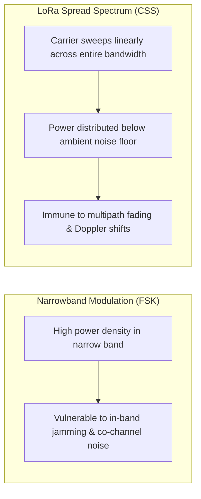
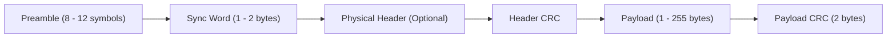
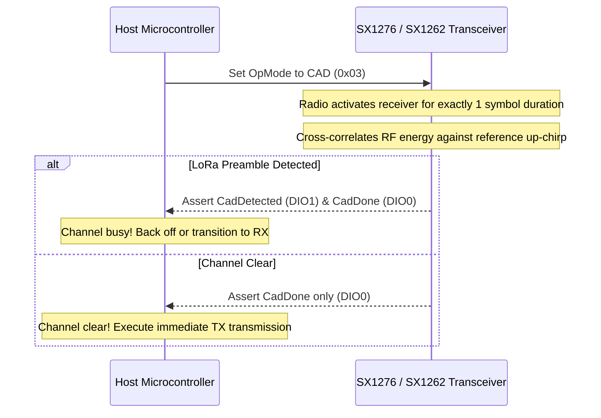

# LESSON 02: DEEP-DIVE LORA PHY: SPREADING FACTOR, BANDWIDTH, AND LINK BUDGET

> Summary: A rigorous mathematical and physical analysis of Chirp Spread Spectrum (CSS) modulation, quantifying the architectural trade-offs among Spreading Factor, Bandwidth, and Coding Rate, accompanied by precise methodologies for computing Time-on-Air and Link Budget in real-world embedded radio deployments.

---

## 1. Technical Foundations of Chirp Spread Spectrum (CSS) Modulation

Unlike conventional narrowband RF modulation schemes such as Frequency Shift Keying (FSK) or On-Off Keying (OOK), which concentrate transmission energy into a fixed, narrow carrier frequency, **LoRa exploits Chirp Spread Spectrum (CSS) modulation**.

### 1.1 The Anatomy of a Chirp Signal
A **chirp** is a sinusoidal signal whose instantaneous frequency sweeps continuously across a designated bandwidth ($BW$) over a finite duration:
- **Up-chirp**: The instantaneous frequency sweeps linearly upward from the lower band edge ($f_c - BW/2$) to the upper band edge ($f_c + BW/2$).
- **Down-chirp**: The instantaneous frequency sweeps linearly downward from the upper band edge to the lower band edge.
- **Data Modulation Mechanism**: In a LoRa symbol, binary information is encoded by shifting the initial frequency (cyclically wrapping the phase). When an ascending chirp hits the maximum frequency threshold ($f_c + BW/2$), it wraps instantaneously down to the lower boundary ($f_c - BW/2$) and continues sweeping upward.

  

### 1.2 Physical Principles Behind LoRa's Range and Noise Immunity
1. **Demodulation Below the Thermal Noise Floor (Negative SNR)**: The LoRa receiver applies cross-correlation processing. By spreading signal energy across a wide RF bandwidth, the total signal power can sit significantly below ambient thermal noise ($SNR < 0\text{ dB}$). The correlation engine extracts and reconstructs the original payload with remarkable fidelity.
2. **Immunity to Multipath Fading**: In urban canyons or factory floors, multi-reflected RF signals arrive with differential propagation delays. Because a chirp's frequency constantly shifts over time, delayed reflections present a distinct frequency offset relative to the incoming direct signal. The correlation filter naturally rejects these reflections as uncorrelated background noise.
3. **Robustness Against Doppler Shifts**: Frequency offsets induced by relative motion (such as a moving connected vehicle) produce a minor temporal shift along the time axis rather than causing symbol demodulation collapse.

---

## 2. The Core Parameters: SF, BW, and CR

The throughput, transmission distance, and link reliability of a LoRa transceiver are governed by three primary physical layer configurations:

### 2.1 Spreading Factor (SF)
- **Definition**: The Spreading Factor ($SF$) defines the number of raw bits encoded within a single chirp symbol. Values typically span **SF7 to SF12** (certain specialized modems extend support to SF5–SF6).
- **Physical Chip Count per Symbol**:
  
  $$\text{Chips per Symbol} = 2^{SF}$$

  *For instance:*
  * At $SF7$: Each symbol conveys $7\text{ bits}$ synthesized across $2^7 = 128\text{ chips}$.
  * At $SF12$: Each symbol conveys $12\text{ bits}$ synthesized across $2^{12} = 4096\text{ chips}$.
- **Architectural Trade-Off**:
  - Increasing $SF$ dramatically escalates the radiated energy per bit, augmenting receiver sensitivity (recovering weaker signals across greater distances).
  - Conversely, symbol duration expands exponentially, penalizing bitrates and significantly expanding RF channel occupancy (Time-on-Air).

### 2.2 Channel Bandwidth (BW)
- Standard Semtech bandwidth settings include: **125 kHz**, **250 kHz**, and **500 kHz**.
- The physical chip transmission rate is locked directly to bandwidth:
  
  $$R_c = BW \quad (\text{chips/second})$$

- Fundamental Symbol Duration ($T_s$):
  
  $$T_s = \frac{2^{SF}}{BW}$$

  *Example:* At $BW = 125\text{ kHz}$:
  * $SF7$: $T_s = \frac{128}{125000} \approx 1.024\text{ ms}$.
  * $SF12$: $T_s = \frac{4096}{125000} \approx 32.768\text{ ms}$ (a 32-fold airtime expansion).

### 2.3 Coding Rate (CR)
LoRa employs **Forward Error Correction (FEC)** to detect and reconstruct corrupted data bits caused by transient RF interference bursts without triggering end-to-end packet retransmissions:
- Expression: $CR = 4/(4 + n)$ where $n \in \{1, 2, 3, 4\}$, yielding configurations: **4/5, 4/6, 4/7, 4/8**.
- Semantics: For every 4 information bits transmitted, $n$ parity bits are inserted.
- Standard Baseline: **CR 4/5** adds a modest 25% protocol overhead while substantially hardening packet recovery.

### 2.4 Nominal Bitrate Calculation

$$R_b = SF \times \frac{BW}{2^{SF}} \times CR \quad (\text{bps})$$

| Physical Config (BW = 125 kHz, CR = 4/5) | Symbol Duration ($T_s$) | Nominal Bitrate ($R_b$) | Sensitivity (SX1276) | Minimum Demodulation SNR |
| :--- | :---: | :---: | :---: | :---: |
| **SF7 / 125 kHz** | 1.024 ms | 5469 bps (~5.47 kbps) | -123 dBm | -7.5 dB |
| **SF8 / 125 kHz** | 2.048 ms | 3125 bps (~3.13 kbps) | -126 dBm | -10.0 dB |
| **SF9 / 125 kHz** | 4.096 ms | 1758 bps (~1.76 kbps) | -129 dBm | -12.5 dB |
| **SF10 / 125 kHz** | 8.192 ms | 977 bps (~0.98 kbps) | -132 dBm | -15.0 dB |
| **SF11 / 125 kHz** | 16.384 ms | 537 bps (~0.54 kbps) | -134.5 dBm | -17.5 dB |
| **SF12 / 125 kHz** | 32.768 ms | 293 bps (~0.29 kbps) | -137 dBm | -20.0 dB |

> [!NOTE]
> Transitioning from SF7 to SF12 delivers a **14 dB gain in receiver sensitivity** (effectively doubling coverage range in free space), but throttles channel throughput from **5.47 kbps down to a mere 293 bps**.

---

## 3. Frame Architecture and Time-on-Air (ToA) Analysis

Mastering packet structure is critical for optimizing transmission efficiency and maintaining compliance with regional RF spectrum regulations.

### 3.1 LoRa Frame Composition
1. **Preamble**: A sequence of unmodulated up-chirps (typically 8 to 12 symbols) enabling the receiver's phase-locked loop (PLL) and timing engine to achieve receiver synchronization.
2. **Sync Word**:
   - `0x12` (Default): Designated for private LoRa ad-hoc installations (P2P / RadioHead).
   - `0x34`: Reserved exclusively for public **LoRaWAN Networks**.
   - Frames bearing mismatched sync words are filtered directly in hardware, preventing unnecessary host MCU interrupt wakeups.
3. **Physical Header**:
   - **Explicit Header Mode**: Incorporates payload length, coding rate, and 16-bit CRC inclusion flags. Utilized when packet lengths vary dynamically.
   - **Implicit Header Mode**: Omits the header entirely to conserve airtime milliseconds; requires transmitter and receiver to possess identical pre-compiled configurations.
4. **Payload & Payload CRC**: User data bytes (1 to 255 bytes) terminated by an optional 16-bit CRC for packet integrity verification.

### 3.2 Low Data Rate Optimization (LDRO)
When the symbol duration exceeds **16 ms** (encountered when operating at **SF11 and SF12 with BW = 125 kHz**), thermal frequency drift in local crystal oscillators (XTAL) can degrade symbol timing synchronization.
- Enabling the LDRO bit (`LowDataRateOptimize` in register `RegModemConfig3`) inserts an intentional 2-bit frequency modulation shift per symbol.
- **Golden Rule**: Both transmitter and receiver must match their LDRO register state identically whenever $T_s > 16\text{ ms}$.

### 3.3 Time-on-Air (ToA) Computation
Total RF channel occupancy is the sum of preamble duration and payload symbol duration:

$$ToA = T_{preamble} + T_{payload}$$

Where:
- $T_{preamble} = (N_{preamble} + 4.25) \times T_s$
- $T_{payload} = N_{payload\_symbols} \times T_s$

The payload symbol count ($N_{payload\_symbols}$) follows Semtech's official formulation:

$$N_{payload\_symbols} = 8 + \max\left( \left\lceil \frac{8PL - 4SF + 28 + 16CRC - 20IH}{4(SF - 2DE)} \right\rceil \times (CR + 4), 0 \right)$$

*Parameter Definitions:*
- $PL$: Payload byte length (e.g., 20 bytes).
- $CRC$: 1 if payload CRC is enabled; 0 otherwise.
- $IH$: 1 if implicit header mode is configured; 0 for explicit header.
- $DE$: 1 if LDRO is active; 0 otherwise.
- $CR$: Coding rate index (1 for 4/5, up to 4 for 4/8).

> [!WARNING]
> **Legal Spectrum Enforcement (1% Duty Cycle Limits):**
> Unlicensed sub-GHz ISM bands (such as 868 MHz in Europe) strictly mandate a **1% maximum transmission duty cycle** (no more than 36 seconds of cumulative airtime per hour).
> * If a sensor payload transmitted at **SF12** consumes $ToA = 1.4\text{ seconds}$, the firmware must enforce a mandatory **silent channel blackout of at least 138.6 seconds** prior to transmitting the subsequent packet!

---

## 4. Signal Characterization: RSSI, SNR, and Receiver Saturation

RF performance is quantified via two diagnostic values extracted from transceiver registers immediately following packet reception:

### 4.1 Received Signal Strength Indicator (RSSI)
- **Unit**: dBm (logarithmic decibel-milliwatts), quantifying gross RF power incident upon the receiver antenna.
- **Dynamic Range**: Typically spans **-30 dBm** (extreme proximity saturation) to **-135 dBm** (sensitivity floor).
- **Semtech SX1276 Calculation**: Raw values in `RegPktRssiValue` require a high/low band baseline offset:
  
  $$RSSI\ (\text{dBm}) = -157 + \text{RegPktRssiValue} \quad (\text{High-Frequency Band: 868/915 MHz})$$
  
  $$RSSI\ (\text{dBm}) = -164 + \text{RegPktRssiValue} \quad (\text{Low-Frequency Band: 433 MHz})$$

### 4.2 Signal-to-Noise Ratio (SNR)
- **Unit**: dB, expressing the logarithmic ratio of signal power to background thermal noise power:
  - $SNR > 0\text{ dB}$: Signal power exceeds the ambient noise floor.
  - $SNR < 0\text{ dB}$: Signal power is **submerged beneath the thermal noise floor**.
- At **SF12**, the SX1276 reliably demodulates frames when $SNR = -20\text{ dB}$, meaning background noise is 100 times stronger than the incoming radio packet!

### 4.3 Link Budget Estimation
The Link Budget represents the maximum permissible RF path loss over which communication remains viable:

$$\text{Link Budget}\ (\text{dB}) = P_{TX} - \text{Sensitivity}_{RX}$$

*Example:*
- SX1276 Output Power: $P_{TX} = +14\text{ dBm}$ (up to $+20\text{ dBm}$ using PA_BOOST).
- Sensitivity at SF12/125 kHz: $\text{Sensitivity}_{RX} = -137\text{ dBm}$.
- **Link Budget**: $14 - (-137) = 151\text{ dB}$.
- A Link Budget exceeding $150\text{ dB}$ provides sufficient margin to penetrate structural obstacles and sustain multi-kilometer links.

### 4.4 Receiver Saturation and Front-End Swamping

> [!CAUTION]
> **Lab Bench Testing Trap:**
> Positioning two LoRa test benches within 1 meter while radiating at maximum power (+14 to +20 dBm) can drive receiver antenna power beyond **-30 dBm**.
> This drives the receiver Low Noise Amplifier (LNA) into non-linear gain saturation, distorting chirp linearity and producing massive **packet drops**. Engineers frequently mistake this for SPI bus corruptions or damaged firmware. Always throttle TX power to minimal settings (2–5 dBm) or maintain physical antenna separation of at least 2 to 3 meters during bench experiments!

---

## 5. Channel Activity Detection (CAD) Architecture

In standard RF transceivers, Energy Detection (RSSI thresholding) evaluates channel availability (CSMA/CA). Because LoRa signals frequently operate **beneath the ambient noise floor**, energy detection fails completely.

Semtech engineered **Channel Activity Detection (CAD)** as a dedicated silicon feature to resolve this challenge.

### 5.1 Energy Conservation Advantages of CAD
- A CAD cycle executes in the time span of **one chirp symbol ($T_s$) plus 32 chips** (a few milliseconds).
- Rather than sustaining active RX (~11 mA continuous draw), an ultra-low-power battery node wakes up, executes a 2 ms CAD scan, and immediately re-enters deep sleep if no preamble is detected.
- This architectural design extends field operational life from months to years.

### 5.2 Does CAD Provide a 100% Collision-Free Guarantee?
The definitive engineering answer is: **NO**.
1. **Preamble Misalignment**: CAD exhibits optimal sensitivity during the unmodulated preamble. If a colliding node has already advanced into the payload phase, detection confidence decreases.
2. **Concurrent Contention (Race Conditions)**: Two edge nodes executing CAD concurrently will both identify the channel as unoccupied and dispatch their packets simultaneously, resulting in destructive RF collisions.
3. **Hidden Node Problem**: Two spatially isolated nodes communicating with a single central gateway cannot hear each other's transmissions. Both will sense a clear channel, creating collisions at the receiver gateway.

---

## 6. Technical Summary & Practical Exercises

### Top 5 Technical Takeaways
1. **Higher Spreading Factors** expand link margin and coverage, but increase Time-on-Air exponentially while drastically reducing bitrates.
2. **Sub-noise demodulation** is achieved via CSS correlation down to $-20\text{ dB}$ SNR at SF12.
3. **Low Data Rate Optimization (LDRO)** is mandatory whenever symbol duration $T_s > 16\text{ ms}$ (SF11 and SF12 at 125 kHz BW).
4. **CAD** detects LoRa preambles using matched waveform correlation rather than raw RSSI power, saving over 90% receiver energy.
5. In close-range laboratory setups, always **attenuate transmission power** to avoid front-end LNA saturation.

### Calculation Exercise
Consider an edge telemetry node transmitting a payload of $PL = 24\text{ bytes}$ under the following RF configuration:
- Carrier: 433 MHz, $SF = 7$, $BW = 125\text{ kHz}$, $CR = 4/5$, Preamble = 8 symbols, Explicit Header, CRC Enabled.
- **Tasks:**
  1. Determine the fundamental symbol duration $T_s$.
  2. Compute the nominal bitrate $R_b$.
  3. Calculate the total Time-on-Air (ToA).
  4. Under a 1% Duty Cycle legal constraint, compute the minimum mandatory silent sleep duration before the subsequent transmission is permitted.

