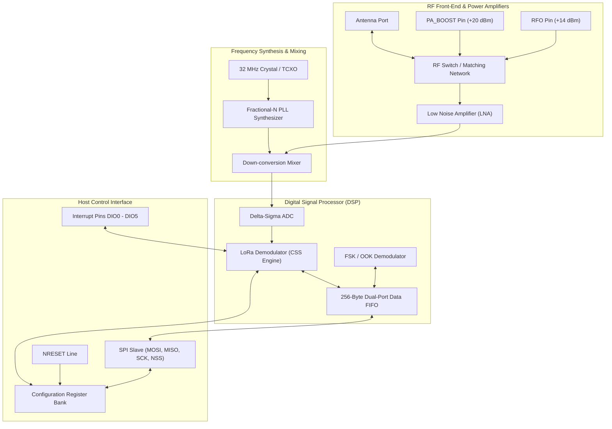
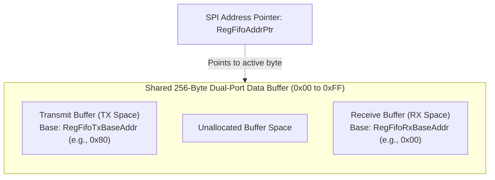
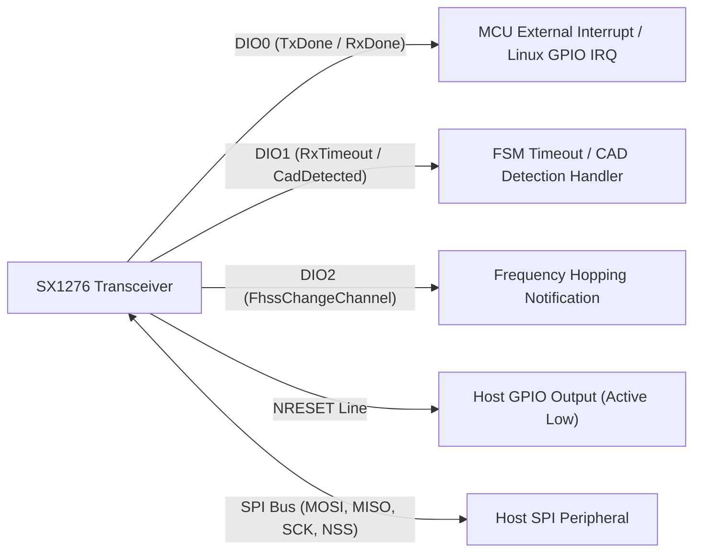

# LESSON 03: DEMYSTIFYING SEMTECH SX1276, SX1278, AND SX1262 TRANSCEIVERS

> Summary: An architectural deep-dive into the silicon design of Semtech SX1276/78 and next-generation SX1262 LoRa transceivers, dissecting critical control registers, RF power path topologies, and the hardware management of the 256-byte data FIFO over the SPI bus.

---

## 1. Silicon Architecture of Semtech Transceivers

Developing low-level peripheral drivers and diagnosing hardware bring-up failures requires an intimate understanding of the transceiver's internal functional blocks.



### 1.1 RF Output Path Topologies: RFO vs PA_BOOST
The SX1276/78 architecture incorporates two physically distinct transmitter output ports:
1. **RFO Pins (`RFO_HF` / `RFO_LF`)**:
   - Maximum Output Power: $+14\text{ dBm}$ (nominal $25\text{ mW}$).
   - High power efficiency with modest current draw (~$28\text{ mA}$).
2. **PA_BOOST Pin**:
   - Maximum Output Power: $+20\text{ dBm}$ (nominal $100\text{ mW}$).
   - Peak current demands up to $120\text{ mA}$.
   - Requires explicit activation of the high-power regulator circuit via the `RegPaDac` register.

> [!CAUTION]
> **RF Power Amplifier Destruction Hazard:**
> Never initiate high-power RF transmission (+20 dBm via PA_BOOST) without a matched antenna connected to the RF port. High Voltage Standing Wave Ratio ($VSWR$) causes radiated energy to reflect back into the silicon, permanently destroying the output power stage.

---

## 2. Core Register Map of SX1276/78

Hardware control is executed via 8-bit SPI memory-mapped registers. The following table highlights critical registers essential for driver development:

| Hex Address | Register Name | Critical Bitfields | Functional Description |
| :---: | :--- | :---: | :--- |
| `0x01` | `RegOpMode` | `[7]: LongRangeMode`<br>`[2:0]: Mode` | `0`: FSK/OOK, `1`: LoRa Mode.<br>`000`: Sleep, `001`: Standby, `011`: FSTX, `010`: TX, `101`: RXContinuous. |
| `0x06` - `0x08` | `RegFrfMsb/Mid/Lsb` | `[23:0]: Frf` | Carrier RF frequency setting ($F_{RF}$).<br>$F_{RF} = F_{XOSC} \times \text{Frf} / 2^{19}$ where $F_{XOSC} = 32\text{ MHz}$. |
| `0x09` | `RegPaConfig` | `[7]: PaSelect`<br>`[6:4]: MaxPower`<br>`[3:0]: OutputPower` | Selects output pin (`0`: RFO, `1`: PA_BOOST) and configures output power from $2\text{ dBm}$ to $17\text{ dBm}$. |
| `0x0D` | `RegFifoAddrPtr` | `[7:0]: FifoAddrPtr` | Dedicated SPI pointer into the 256-byte dual-port data buffer. |
| `0x0E` | `RegFifoTxBaseAddr` | `[7:0]: FifoTxBaseAddr` | Starting base memory address for packet transmission. |
| `0x0F` | `RegFifoRxBaseAddr` | `[7:0]: FifoRxBaseAddr` | Starting base memory address for packet reception. |
| `0x10` | `RegFifoRxCurrentAddr`| `[7:0]: FifoRxCurrentAddr` | Starting memory address of the most recently received packet. |
| `0x11` | `RegIrqFlagsMask` | `[7:0]: IrqFlagsMask` | Interrupt mask register. Setting a bit to `1` disables the interrupt. |
| `0x12` | `RegIrqFlags` | `[6]: TxDone`<br>`[5]: RxDone`<br>`[4]: PayloadCrcError` | Interrupt flags. Active bits are cleared by writing a `1` (Clear-on-Write-1). |
| `0x13` | `RegRxNbBytes` | `[7:0]: RxNbBytes` | Number of payload bytes captured in the last packet reception. |
| `0x1D` | `RegModemConfig1` | `[7:4]: Bw`<br>`[3:1]: CodingRate` | Sets bandwidth ($BW$) and Forward Error Correction Coding Rate ($CR$). |
| `0x1E` | `RegModemConfig2` | `[7:4]: SpreadingFactor`<br>`[2]: RxPayloadCrcOn` | Sets Spreading Factor ($SF7$ – $SF12$) and enables payload CRC check. |
| `0x26` | `RegModemConfig3` | `[3]: LowDataRateOptimize` | Enables LDRO (mandatory when symbol duration $T_s > 16\text{ ms}$). |
| `0x42` | `RegVersion` | `[7:0]: Version` | Silicon version identity. The SX1276/78 returns constant value `0x12`. |

---

## 3. FIFO Memory Management Architecture

The SX1276 integrates a **256-byte dual-port static RAM (SRAM)** partitioned dynamically between transmit (TX) and receive (RX) buffers.



### 3.1 Transmit (TX) Data Flow Sequence
1. Set transceiver operational mode to `STANDBY` via `RegOpMode`.
2. Read the transmit base address from `RegFifoTxBaseAddr` (commonly default `0x80`).
3. Write this value into `RegFifoAddrPtr` to position the SPI pointer at the start of the TX allocation.
4. Program payload length into `RegPayloadLength`.
5. Execute an SPI burst write stream into data register `RegFifo` (`0x00`). The silicon automatically increments `RegFifoAddrPtr` following each transmitted byte.
6. Switch `RegOpMode` to `TX` (`0x03`). Upon packet airtime completion, the transceiver asserts `TxDone` on pin `DIO0`.

### 3.2 Receive (RX) Data Extraction Sequence
1. Upon valid packet reception, hardware asserts the `RxDone` interrupt on pin `DIO0`.
2. Inspect `PayloadCrcError` in `RegIrqFlags`. If CRC error is flagged, clear interrupts and discard the corrupted packet.
3. Read `RegFifoRxCurrentAddr` to retrieve the buffer starting address of the captured packet.
4. Program this address into `RegFifoAddrPtr` to relocate the SPI pointer to the packet payload.
5. Read `RegRxNbBytes` to determine the precise payload byte count.
6. Execute an SPI burst read from `RegFifo` (`0x00`) to transfer packet bytes into host microcontroller RAM.
7. Clear interrupt status by writing a binary `1` to the `RxDone` bitfield in `RegIrqFlags`.

---

## 4. Hardware Interfaces and DIO Interrupt Mapping

The SX1276 provides 6 software-configurable Digital I/O lines (`DIO0` through `DIO5`), mapped dynamically via `RegDioMapping1` and `RegDioMapping2`:



| Pin Name | LoRa Default Mapping (`00`) | Embedded Driver Role |
| :---: | :--- | :--- |
| **DIO0** | `RxDone` (RX Mode) / `TxDone` (TX Mode) | **Primary interrupt line**, connected to host external interrupt (EXTI) or Linux GPIO IRQ. |
| **DIO1** | `RxTimeout` (RX Mode) / `CadDetected` (CAD Mode) | Critical for state machine timeouts and preamble channel checks. |
| **DIO2** | `FhssChangeChannel` | Frequency Hopping Spread Spectrum channel switch trigger. |
| **DIO3** | `CadDone` / `ValidHeader` | Preamble search termination notification. |

---

## 5. Architectural Comparison: Semtech SX1262 vs SX1276/78

The next-generation **SX1261/SX1262** transceivers introduce substantial hardware refinements:

| Silicon Specification | Previous Generation (SX1276 / SX1278) | Modern Generation (SX1261 / SX1262) | Architectural Advantage |
| :--- | :---: | :---: | :--- |
| **SPI Interface Model** | Direct register read/write (`0x00` - `0x7F`) | Command-oriented protocol API | Higher functional abstraction |
| **Hardware BUSY Line** | None (requires SPI polling) | **Dedicated hardware BUSY pin** | Prevents race conditions during internal PLL calibration |
| **Internal Power Converter**| Linear low-dropout (LDO) regulator only | **Integrated DC-DC Buck Converter** | Reduces RX current from **11 mA down to 4.2 mA** (>50% energy savings!) |
| **Max Radiated Power** | +20 dBm (PA_BOOST) | **+22 dBm** (Direct internal PA) | Extended RF link margin |
| **Wakeup Latency** | ~1.6 ms from Cold Sleep | ~100 µs from Cold Sleep | Drastically reduces energy consumed during wake-up |

---

## 6. Benchtop Hardware Bring-Up Checklist

When validating a newly manufactured PCB populated with an SX1276 transceiver over an SPI bus, follow this systematic procedure:

```text
[Step 1] Verify VDD = 3.3V power rails and ensure 32 MHz crystal oscillator clock activity.
[Step 2] Assert NRESET low for 1 ms, release high, and delay 5 ms for power-on reset (POR).
[Step 3] Assert NSS low -> Transmit opcode 0x42 (read RegVersion) -> Read response byte -> Deassert NSS.
         -> Received 0x12: SPI communication and silicon integrity confirmed!
         -> Received 0x00 or 0xFF: Check SPI clock polarity, broken traces, or cold solder joints.
[Step 4] Write RegOpMode with 0x80 to lock internal DSP into LoRa operating mode.
[Step 5] Configure RF carrier frequency, TX power, SF, BW, CR, and unmask DIO0 interrupt.
```

