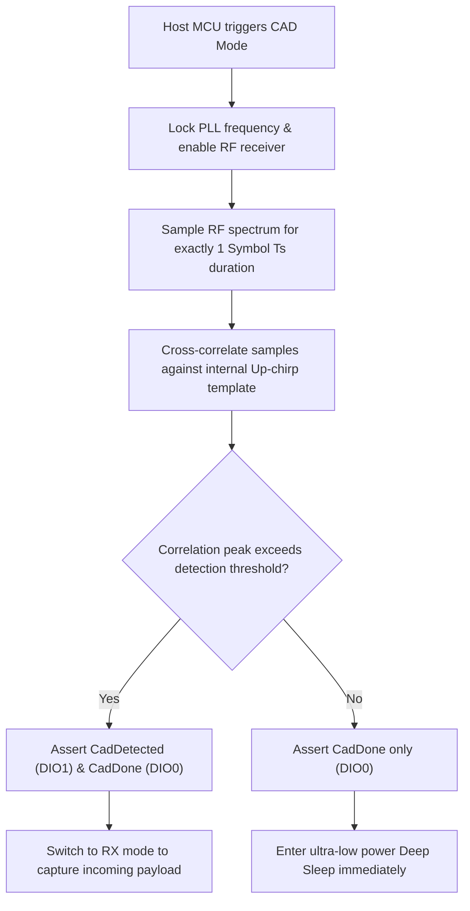

# LESSON 04: CHANNEL ACTIVITY DETECTION (CAD) AND PHYSICAL LAYER ENERGY OPTIMIZATION

> Summary: A comprehensive examination of Channel Activity Detection (CAD) mechanics in Semtech LoRa transceivers, deriving mathematical formulations for scan airtime and energy conservation, accompanied by production-grade C driver implementations for non-blocking carrier detection.

---

## 1. Technical Nature of Channel Activity Detection (CAD)

In battery-constrained IoT installations, the radio receiver represents a primary consumer of finite energy reserves.
- Maintaining continuous reception (**Continuous RX**) demands **~11 mA** of continuous quiescent current, depleting a standard 2000 mAh lithium battery in less than 8 days.
- In conventional short-range protocols such as Wi-Fi or Zigbee, devices determine channel occupancy using Received Signal Strength Indicator (RSSI) power thresholds within microseconds (Clear Channel Assessment - CCA).
- **The LoRa Challenge**: Because LoRa signals routinely operate **submerged beneath the thermal noise floor** ($SNR < 0\text{ dB}$), raw RSSI thresholding is ineffective. An energy detector cannot differentiate between ambient RF noise and a valid modulated LoRa packet propagating through the air.

To overcome this limitation, Semtech incorporated an on-chip matched filter correlator termed **Channel Activity Detection (CAD)**:



---

## 2. Mathematical Modeling of CAD Airtime and Energy Consumption

The temporal footprint of a CAD scan cycle is governed directly by the Spreading Factor ($SF$) and Bandwidth ($BW$):

### 2.1 CAD Cycle Timing Formulation ($T_{CAD}$)
The CAD process comprises an active RF reception window spanning exactly one symbol duration ($T_s$) followed by internal digital signal processing correlation over approximately 32 chip periods:

$$T_{CAD} = \frac{2^{SF} + 32}{BW} \quad (\text{seconds})$$

| Channel Configuration (BW = 125 kHz) | Raw Symbol Window ($T_s$) | Cumulative CAD Cycle Duration ($T_{CAD}$) | Operational Current Draw |
| :---: | :---: | :---: | :---: |
| **SF7 / 125 kHz** | 1.024 ms | **~1.28 ms** | 10.8 mA over 1.28 ms |
| **SF8 / 125 kHz** | 2.048 ms | **~2.30 ms** | 10.8 mA over 2.30 ms |
| **SF9 / 125 kHz** | 4.096 ms | **~4.35 ms** | 10.8 mA over 4.35 ms |
| **SF10 / 125 kHz** | 8.192 ms | **~8.45 ms** | 10.8 mA over 8.45 ms |
| **SF11 / 125 kHz** | 16.384 ms | **~16.64 ms** | 10.8 mA over 16.64 ms |
| **SF12 / 125 kHz** | 32.768 ms | **~33.02 ms** | 10.8 mA over 33.02 ms |

### 2.2 Quantitative Energy Evaluation: Periodic CAD vs Continuous RX
Consider an edge sensor monitoring the RF spectrum **once every 1 second** at SF7 / 125 kHz:
- **Approach 1 (Continuous RX Listening)**:
  - Constant Current: $I_{avg} = 11\text{ mA}$.
  - Daily Energy Depletion: $11\text{ mA} \times 24\text{ h} = 264\text{ mAh}$.
  - Usable Life on 2000 mAh Cell: **~7.5 days**.
- **Approach 2 (Periodic 1 Hz CAD Scan + Quiescent Deep Sleep)**:
  - Active Window: $1.28\text{ ms}$ at $10.8\text{ mA}$.
  - Sleep Window: $998.72\text{ ms}$ at $0.2\text{ µA}$.
  - Average System Current:
    
    $$I_{avg} = \frac{(10.8\text{ mA} \times 1.28\text{ ms}) + (0.0002\text{ mA} \times 998.72\text{ ms})}{1000\text{ ms}} \approx 0.014\text{ mA} = 14\text{ µA}$$
  
  - Daily Energy Depletion: $0.014\text{ mA} \times 24\text{ h} \approx 0.336\text{ mAh}$.
  - Projected Battery Life: **~5950 days (> 16 years)**!

> [!TIP]
> Implementing duty-cycled CAD sweeps yields an astonishing **99.8% reduction in system energy consumption** relative to continuous receiver operation.

---

## 3. Production C Driver Implementation: Non-Blocking CAD Execution

The following C implementation demonstrates a robust, non-blocking CAD routine for Semtech transceivers:

```c
#include <stdint.h>
#include <stdbool.h>

// SX1276 Hardware Register Mapping
#define REG_OP_MODE       0x01
#define REG_IRQ_FLAGS     0x12
#define REG_DIO_MAPPING_1 0x40

#define MODE_LORA_STANDBY 0x81
#define MODE_LORA_CAD     0x83

#define IRQ_CAD_DONE_MASK 0x04
#define IRQ_CAD_DET_MASK  0x01

typedef enum {
    CAD_CHANNEL_FREE = 0,
    CAD_CHANNEL_BUSY = 1,
    CAD_TIMEOUT_ERROR = 2
} lora_cad_result_t;

// Hardware Abstraction Layer SPI prototypes
extern void lora_spi_write_reg(uint8_t addr, uint8_t val);
extern uint8_t lora_spi_read_reg(uint8_t addr);
extern void delay_ms(uint32_t ms);

lora_cad_result_t lora_perform_cad_scan(uint32_t timeout_ms) {
    // 1. Force transceiver into STANDBY mode for register access
    lora_spi_write_reg(REG_OP_MODE, MODE_LORA_STANDBY);

    // 2. Map DIO0 to assert on CadDone event (Map 10 into bits [7:6])
    uint8_t dio_map = lora_spi_read_reg(REG_DIO_MAPPING_1);
    dio_map = (dio_map & 0x3F) | (0x02 << 6);
    lora_spi_write_reg(REG_DIO_MAPPING_1, dio_map);

    // 3. Clear pending interrupt flags
    lora_spi_write_reg(REG_IRQ_FLAGS, 0xFF);

    // 4. Trigger on-chip CAD engine
    lora_spi_write_reg(REG_OP_MODE, MODE_LORA_CAD);

    // 5. Poll for CadDone assertion or timeout expiration
    uint32_t elapsed = 0;
    while (elapsed < timeout_ms) {
        uint8_t irq_flags = lora_spi_read_reg(REG_IRQ_FLAGS);

        if (irq_flags & IRQ_CAD_DONE_MASK) {
            // Evaluate if valid preamble chirp was correlated
            if (irq_flags & IRQ_CAD_DET_MASK) {
                // Clear flags by writing 1s
                lora_spi_write_reg(REG_IRQ_FLAGS, IRQ_CAD_DONE_MASK | IRQ_CAD_DET_MASK);
                return CAD_CHANNEL_BUSY; // Preamble detected; channel occupied
            } else {
                lora_spi_write_reg(REG_IRQ_FLAGS, IRQ_CAD_DONE_MASK);
                return CAD_CHANNEL_FREE; // Channel clear
            }
        }
        delay_ms(1);
        elapsed++;
    }

    return CAD_TIMEOUT_ERROR;
}
```

---

## 4. Physical Limitations of CAD in Real-World Systems

While CAD delivers remarkable power savings, embedded systems architects must account for physical boundary conditions:

1. **Preamble-Centric Correlation**: The matched filter correlator is specifically tuned to recognize ascending up-chirp preamble sequences. If a foreign transmitter has already completed the preamble and is actively transmitting payload data, CAD detection probability degrades sharply.
2. **Mandatory Preamble Elongation**: To ensure a periodically sleeping receiver captures incoming traffic via CAD, the transmitting station must extend its preamble airtime to exceed the receiver's sleep interval, increasing transmitter airtime.
3. **Channel Race Conditions**:
   - Node A performs CAD: Senses free channel.
   - Node B performs CAD concurrently: Senses free channel.
   - Both nodes simultaneously initiate TX: Catastrophic RF collision occurs.
   - **Mitigation**: Implement **pseudo-random backoff jitter** (delaying transmission by an arbitrary 5–50 ms window).

---

## 5. Core Engineering Notes & Best Practices

> [!IMPORTANT]
> **Industrial Interview Scenario:** *"How would you architect a battery-powered sensor node capable of receiving unsolicited downlinks at any time while preserving a 5-year battery operating lifespan?"*
> 
> **Authoritative Technical Response:**
> Employ **Preamble Sampling Architecture backed by CAD**:
> 1. Receiver Node: Program an on-chip RTC timer to trigger wakeups at 1-second intervals. Upon wake-up, execute a single non-blocking CAD sweep (~$1.3\text{ ms}$ at SF7). If `CadDetected` is not asserted, immediately return the SoC and transceiver to deep sleep.
> 2. Transmitting Gateway: When dispatching a command, transmit with an extended preamble duration exceeding $1.2\text{ seconds}$ (~1200 symbols at SF7).
> 3. Regardless of when the receiving node wakes up within its 1-second cadence, it will reliably intercept the elongated preamble, trigger a `CadDetected` interrupt, transition to continuous RX mode, and demodulate the command payload.

