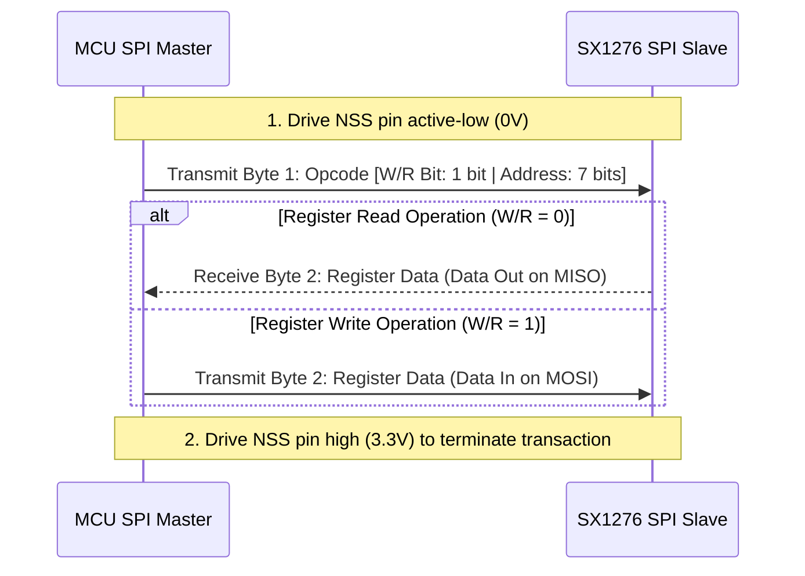
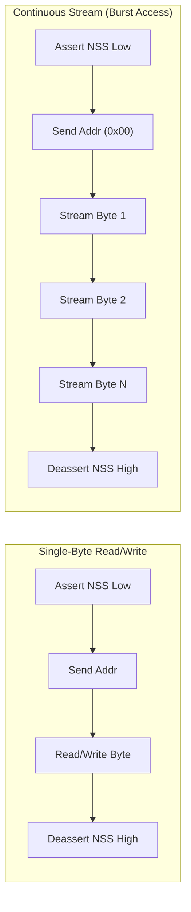

# LESSON 05: HIGH-SPEED SPI COMMUNICATION WITH RADIO TRANSCEIVER

> Summary: A signal-level analysis of the Serial Peripheral Interface (SPI) protocol for Semtech LoRa silicon, detailing high-throughput FIFO burst access, software-managed Chip Select (NSS) timing, and portable, production-ready C hardware abstraction routines.

---

## 1. SPI Signal Protocol for Semtech LoRa Silicon

The Serial Peripheral Interface (SPI) bus serves as the sole high-speed communication conduit between the host microcontroller (Master) and the LoRa transceiver (Slave). Mastering hardware waveform timing constraints is indispensable during initial board bring-up.



### 1.1 SPI Mode Configuration: CPOL and CPHA
- Semtech SX1276 natively operates under **SPI Mode 0**:
  - **CPOL = 0 (Clock Polarity)**: Serial Clock line (SCK) remains low (0V) while the bus resides in the idle state.
  - **CPHA = 0 (Clock Phase)**: Data bits are sampled on the **first rising edge** of SCK and shifted out on the falling edge.
- **Clock Frequency Constraints**:
  - Control register operations: Up to **10 MHz**.
  - Dual-port FIFO operations: Up to **10 MHz**.
  - Practical Engineering Recommendation: Maintain clock frequencies between **1 MHz and 8 MHz** to preserve signal integrity across prototype jumpers, PCB vias, and test pin headers.

### 1.2 The 1-Byte Command Opcode Structure
On the initial byte clocked across the MOSI line:
- **Bit 7 (MSB - Read/Write Selector)**:
  - Bit `7 = 0`: Designates a **Read** transaction.
  - Bit `7 = 1`: Designates a **Write** transaction.
- **Bits [6:0] (Register Memory Address)**: 7-bit register address ranging from `0x00` to `0x7F`.

---

## 2. High-Throughput Burst FIFO Access Mechanics

When streaming packet payloads up to 255 bytes, toggling NSS for every individual byte introduces crippling timing overhead.



### Auto-Increment Behavior in Semtech Transceivers
1. **Control Registers (`0x01` through `0x7F`)**: If NSS remains asserted low while SCK pulses continue, the internal SPI controller automatically increments the target register address ($Addr + 1$).
2. **Dedicated FIFO Data Register (`0x00`)**: When initialized at address `0x00`, the address pointer **DOES NOT** roll forward to `0x01`. Instead, the register address remains clamped at `0x00` while automatically incrementing the internal **SRAM buffer pointer `RegFifoAddrPtr`**. This allows hundreds of bytes to be streamed into or out of the radio at maximum bus bandwidth in a single continuous burst!

---

## 3. Managing Chip Select (NSS) via Software GPIO Control

> [!IMPORTANT]
> **Critical Firmware Architecture Rule:**
> Many microcontrollers (such as STM32 and ESP32) offer Hardware Auto-NSS modes that momentarily release the NSS line between transmitted bytes.
> **Never enable Hardware Auto-NSS with the SX1276!** Deasserting NSS mid-transmission aborts the internal burst engine and resets the transceiver's SPI state machine.
> **Industry Best Practice**: Configure the NSS pin as a standard **Software-Controlled GPIO Output**, explicitly driving it low prior to byte transmission and pulling it high only after the final byte transaction concludes.

---

## 4. Hardware Abstraction Layer (HAL) Driver Implementation in C

The following portable C implementation demonstrates clean hardware abstraction suitable for bare-metal ARM Cortex-M or RTOS environments:

```c
#include <stdint.h>
#include <stddef.h>

// Platform-specific low-level BSP drivers
extern void bsp_spi_nss_low(void);
extern void bsp_spi_nss_high(void);
extern uint8_t bsp_spi_transfer_byte(uint8_t tx_byte);

// Read a single 8-bit register
uint8_t lora_spi_read_reg(uint8_t reg_addr) {
    bsp_spi_nss_low();
    // Bit 7 = 0 designates Read
    bsp_spi_transfer_byte(reg_addr & 0x7F);
    uint8_t reg_value = bsp_spi_transfer_byte(0x00); // Clock out dummy byte
    bsp_spi_nss_high();
    return reg_value;
}

// Write a single 8-bit register
void lora_spi_write_reg(uint8_t reg_addr, uint8_t value) {
    bsp_spi_nss_low();
    // Bit 7 = 1 designates Write
    bsp_spi_transfer_byte(reg_addr | 0x80);
    bsp_spi_transfer_byte(value);
    bsp_spi_nss_high();
}

// Burst stream read from contiguous registers or FIFO buffer
void lora_spi_burst_read(uint8_t start_addr, uint8_t *buffer, size_t length) {
    if (buffer == NULL || length == 0) return;

    bsp_spi_nss_low();
    bsp_spi_transfer_byte(start_addr & 0x7F);
    for (size_t i = 0; i < length; i++) {
        buffer[i] = bsp_spi_transfer_byte(0x00);
    }
    bsp_spi_nss_high();
}

// Burst stream write into contiguous registers or FIFO buffer
void lora_spi_burst_write(uint8_t start_addr, const uint8_t *buffer, size_t length) {
    if (buffer == NULL || length == 0) return;

    bsp_spi_nss_low();
    bsp_spi_transfer_byte(start_addr | 0x80);
    for (size_t i = 0; i < length; i++) {
        bsp_spi_transfer_byte(buffer[i]);
    }
    bsp_spi_nss_high();
}
```

---

## 5. Diagnostic Matrix for SPI Bus Anomalies

| Symptom | Root Cause | Corrective Action |
| :--- | :--- | :--- |
| **Reading `RegVersion` returns `0x00`** | MISO trace shorted to Ground, or the transceiver lacks VDD power. | Measure VDD with a digital multimeter directly at transceiver pins; inspect MISO continuity. |
| **Reading `RegVersion` returns `0xFF`** | MISO line is floating/open, or NSS fails to pull down to 0V. | Inspect the NSS trace with an oscilloscope to confirm true 0V logic transitions during transfers. |
| **Transferred register bytes shifted by 1 bit** | SPI Mode mismatch (e.g., Master configured in Mode 1 or Mode 3 instead of Mode 0). | Reconfigure host SPI controller to strict **SPI Mode 0 (CPOL=0, CPHA=0)**. |
| **Burst FIFO corruption beginning at byte 2** | Hardware Auto-NSS toggling high between successive bytes. | Switch NSS configuration to manual **Software GPIO Control**. |

