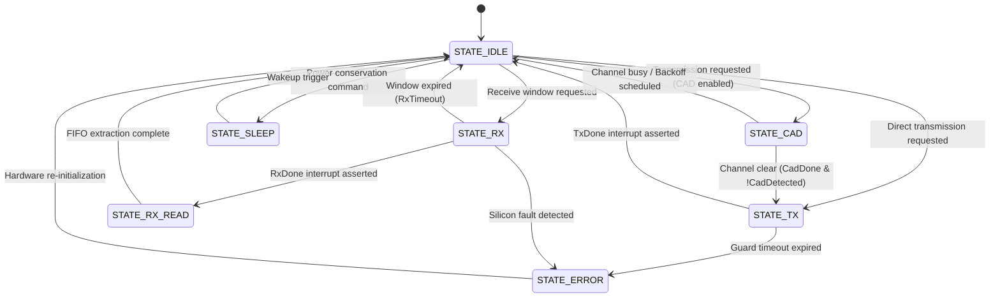

# LESSON 06: NON-BLOCKING FINITE STATE MACHINE (FSM) DESIGN FOR RADIO CONTROL

> Summary: Architectural design and C implementation of an asynchronous, event-driven Finite State Machine (FSM) to manage LoRa transceiver lifecycles without blocking delay loops, featuring guard timers and fault-recovery states for industrial resilience.

---

## 1. The Perils of Blocking Firmware Architecture

In rudimentary code examples, packet transmission routines routinely resemble the following pattern:

```c
// ❌ HIGH-RISK CODE PATTERN: BLOCKS ENTIRE CPU EXECUTION
void bad_lora_send(uint8_t *data, uint8_t len) {
    lora_load_fifo(data, len);
    lora_set_mode_tx();
    while (lora_read_dio0() == 0) {
        // CPU spun in tight blocking busy-wait loop
    }
    lora_clear_txdone();
}
```

### Detrimental Consequences in Industrial Applications
1. **CPU Starvation**: At Spreading Factor 12, physical Time-on-Air ($ToA$) frequently exceeds **1.5 seconds**. For that entire 1500 ms duration, the core is completely incapacitated; it cannot sample critical sensor streams, service user interfaces, or handle real-time CAN bus frames.
2. **Catastrophic Deadlock**: Should the transceiver experience an Electrostatic Discharge (ESD) latch-up or an unseated DIO0 jumper trace, the `while` loop spins indefinitely, tripping hardware Watchdog Timers (IWDG) and rebooting the product.

---

## 2. Event-Driven State Machine Architectural Design

The industry-standard solution decouples RF radio operations into an **Asynchronous Event-Driven Finite State Machine**:



---

## 3. Production C Driver Implementation

The following modular C implementation runs seamlessly within bare-metal super-loops or dedicated FreeRTOS threads:

```c
#include <stdint.h>
#include <stdbool.h>

typedef enum {
    LORA_STATE_IDLE,
    LORA_STATE_TX_BUSY,
    LORA_STATE_RX_LISTENING,
    LORA_STATE_ERROR
} lora_fsm_state_t;

typedef struct {
    lora_fsm_state_t current_state;
    uint32_t state_start_time;
    uint32_t state_timeout_ms;
    bool is_tx_done;
    bool is_rx_done;
    bool is_crc_error;
} lora_controller_t;

static lora_controller_t g_lora_fsm;

extern uint32_t bsp_get_system_tick_ms(void);
extern void lora_hardware_reset(void);
extern void lora_start_tx_hardware(const uint8_t *payload, uint8_t len);
extern void lora_read_rx_fifo(void);

// Initialize the state engine
void lora_fsm_init(void) {
    g_lora_fsm.current_state = LORA_STATE_IDLE;
    g_lora_fsm.is_tx_done = false;
    g_lora_fsm.is_rx_done = false;
    g_lora_fsm.is_crc_error = false;
}

// Asynchronous non-blocking transmission request
bool lora_fsm_send_async(const uint8_t *payload, uint8_t len, uint32_t timeout_ms) {
    if (g_lora_fsm.current_state != LORA_STATE_IDLE) {
        return false; // Radio busy executing previous transaction
    }

    g_lora_fsm.is_tx_done = false;
    lora_start_tx_hardware(payload, len);
    
    g_lora_fsm.current_state = LORA_STATE_TX_BUSY;
    g_lora_fsm.state_start_time = bsp_get_system_tick_ms();
    g_lora_fsm.state_timeout_ms = timeout_ms;
    return true;
}

// Top-half external interrupt handler for DIO0
void lora_fsm_dio0_isr_handler(void) {
    if (g_lora_fsm.current_state == LORA_STATE_TX_BUSY) {
        g_lora_fsm.is_tx_done = true;
    } else if (g_lora_fsm.current_state == LORA_STATE_RX_LISTENING) {
        g_lora_fsm.is_rx_done = true;
    }
}

// Non-blocking cyclic FSM process routine
void lora_fsm_process(void) {
    uint32_t now = bsp_get_system_tick_ms();
    uint32_t elapsed = now - g_lora_fsm.state_start_time;

    switch (g_lora_fsm.current_state) {
        case LORA_STATE_IDLE:
            // Quiescent state; await external requests
            break;

        case LORA_STATE_TX_BUSY:
            if (g_lora_fsm.is_tx_done) {
                // Successful packet dispatch
                g_lora_fsm.current_state = LORA_STATE_IDLE;
                // Dispatch transmission confirmation callback to upper layers
            } else if (elapsed > g_lora_fsm.state_timeout_ms) {
                // Hardware execution timeout fault
                g_lora_fsm.current_state = LORA_STATE_ERROR;
            }
            break;

        case LORA_STATE_RX_LISTENING:
            if (g_lora_fsm.is_rx_done) {
                lora_read_rx_fifo(); // Stream packet out of FIFO
                g_lora_fsm.current_state = LORA_STATE_IDLE;
            } else if (elapsed > g_lora_fsm.state_timeout_ms) {
                g_lora_fsm.current_state = LORA_STATE_IDLE; // RX window closed normally
            }
            break;

        case LORA_STATE_ERROR:
            // Enforce hardware recovery: Pulse NRESET and re-initialize registers
            lora_hardware_reset();
            g_lora_fsm.current_state = LORA_STATE_IDLE;
            break;
    }
}
```

---

## 4. Guard Timers and Hardware Fault Containment

> [!WARNING]
> **Deterministic Guard Timeout Formulation:**
> Program `state_timeout_ms` dynamically using the calculated physical Time-on-Air plus a generous safety guard band:
> 
> $$\text{Timeout} = ToA + 100\text{ ms}$$
> 
> If `TxDone` fails to trigger prior to this deadline, the driver must transition immediately into `STATE_ERROR` and assert a hardware reset on `NRESET`. Never allow firmware to wait indefinitely for hardware flags.

