# LESSON 07: PERIPHERAL DIO INTERRUPT MANAGEMENT AND ISR SYNCHRONIZATION

> Summary: An architectural exploration of Semtech LoRa hardware interrupt dynamics, designing two-tier interrupt architectures (Top-Half and Bottom-Half), analyzing why SPI transactions are strictly prohibited within Interrupt Service Routines (ISRs), and engineering deterministic inter-context synchronization.

---

## 1. Electrical Dynamics of SX1276 DIO Interrupt Lines

The digital input/output pins `DIO0` through `DIO5` on the SX1276 operate as **Active-High** CMOS logic outputs:
- When internal silicon events (such as `TxDone` or `RxDone`) occur, the physical DIO output transitions rapidly from $0\text{V}$ up to $3.3\text{V}$.
- **Host MCU EXTI Configuration**: The host external interrupt controller (e.g., STM32 EXTI or ESP32 GPIO Interrupts) must be programmed exclusively for **Rising Edge Triggering**.
- **Interrupt Latching Mechanism**: The asserted DIO line **remains locked high** until the host microcontroller actively writes a binary `1` into the corresponding bitfield of register `RegIrqFlags` over the SPI bus.

---

## 2. The Two-Tier Paradigm: Top-Half vs Bottom-Half

A catastrophic architectural error in firmware design is executing synchronous SPI transactions directly inside an Interrupt Service Routine (ISR).

```mermaid
flowchart TD
    subgraph WRONG["❌ FATAL PATTERN: SPI TRANSACTIONS IN ISR"]
        A1["EXTI Rising Edge Trigger"] --> A2["Enter Hardware ISR"]
        A2 --> A3["Execute lora_spi_burst_read() inside ISR"]
        A3 --> A4["Heavy application payload processing in ISR"]
        A4 --> A5["Exit ISR (Interrupt locks CPU for milliseconds)"]
    end

    subgraph CORRECT["✅ PRODUCTION PATTERN: TWO-TIER DECOUPLING"]
        B1["EXTI Rising Edge Trigger"] --> B2["Top-Half (ISR): Sub-microsecond execution"]
        B2 --> B3["Set Atomic Flag / Post RTOS Task Notification"]
        B3 --> B4["Exit ISR immediately!"]
        B4 --> B5["Bottom-Half (Thread Context) wakes up"]
        B5 --> B6["Execute SPI FIFO extraction safely"]
    end
```



### Why SPI Transactions Are Strictly Prohibited Inside ISRs
1. **Unacceptable Interrupt Latency**: Reading 256 bytes from an SPI bus clocked at 1 MHz demands approximately **2.5 ms**. Locking the processor in an ISR for 2.5 ms blindfolds the MCU from servicing mission-critical tasks (e.g., motor inverter PWM triggers, safety watchdogs, CAN bus real-time frames).
2. **Resource Inversion & Deadlocks**: SPI buses are frequently shared across multiple onboard peripherals (NOR Flash, LCD, LoRa). If the main thread holds an SPI Mutex lock when an interrupt preempts it and attempts an SPI transfer, the core deadlocks permanently.
3. **Operating System Inviolability**: In real-time operating systems (FreeRTOS) and operating system kernels (Linux), blocking/sleeping functions such as `vTaskDelay()` or `spi_sync()` are **fundamentally illegal inside atomic interrupt contexts**.

---

## 3. Production C Implementation: Two-Tier Decoupling

The following code illustrates safe, low-overhead interrupt synchronization utilizing compiler memory barriers:

```c
#include <stdint.h>
#include <stdbool.h>

// Event flags marked volatile to inhibit aggressive compiler register caching
static volatile bool g_lora_dio0_event_flag = false;
static volatile uint32_t g_dio0_timestamp_ms = 0;

extern uint32_t bsp_get_tick_ms(void);
extern void lora_handle_rx_packet_bottom_half(void);
extern void lora_handle_tx_complete_bottom_half(void);

// ========================================================
// 1. TOP-HALF: RUNS IN INTERRUPT CONTEXT (< 2 microseconds)
// ========================================================
void EXTI_DIO0_IRQHandler(void) {
    // Record deterministic hardware trigger timestamp
    g_dio0_timestamp_ms = bsp_get_tick_ms();
    
    // Assert event flag for bottom-half consumption
    g_lora_dio0_event_flag = true;

    // Clear host microcontroller EXTI pending register
    // EXTI->PR = (1 << DIO0_PIN);
}

// ========================================================
// 2. BOTTOM-HALF: RUNS IN MAIN THREAD CONTEXT
// ========================================================
void lora_event_dispatcher_process(void) {
    if (g_lora_dio0_event_flag) {
        // Critical Section: Atomically clear event flag
        __disable_irq();
        g_lora_dio0_event_flag = false;
        __enable_irq();

        // 100% safe to execute synchronous SPI operations in thread context
        uint8_t irq_flags = lora_spi_read_reg(0x12); // Read RegIrqFlags

        if (irq_flags & 0x40) { // Bit 6: TxDone
            lora_spi_write_reg(0x12, 0x40); // Clear TxDone flag
            lora_handle_tx_complete_bottom_half();
        }

        if (irq_flags & 0x20) { // Bit 5: RxDone
            lora_handle_rx_packet_bottom_half(); // Stream burst FIFO over SPI
            lora_spi_write_reg(0x12, 0x20);      // Clear RxDone flag
        }
    }
}
```

---

## 4. Spurious Interrupt Mitigation & Glitch Filtering

In noisy automotive and industrial environments containing traction inverters, solenoids, and high-current relays, Electromagnetic Interference (EMI) easily induces false voltage spikes on external interrupt lines:
- **Hardware Filtering**: Place an RC low-pass filter or small ceramic capacitor ($10\text{ pF}$ to $47\text{ pF}$) adjacent to the MCU pin to attenuate high-frequency spikes.
- **Software Validation in Bottom-Half**: Upon servicing an interrupt, the Bottom-Half must verify internal transceiver registers via SPI. If `RegIrqFlags == 0x00`, the trigger was a transient EMI glitch on the PCB trace; the driver quietly discards the event without faulting.

---

## 5. Core Engineering Notes & Best Practices

> [!IMPORTANT]
> **Advanced Linux Driver Interview Question:** *"Why does an embedded Linux engineer bind LoRa radio interrupts with `request_threaded_irq()` rather than standard `request_irq()`?"*
> 
> **Authoritative Technical Response:**
> When the radio asserts a hardware interrupt, the Linux driver must execute synchronous SPI transfers (`spi_sync()`) to inspect status registers and empty the FIFO.
> Under Linux, `spi_sync()` puts the caller thread to sleep while waiting for DMA/SPI hardware completion. Standard top-half handlers registered via `request_irq()` run in HardIRQ atomic context where **sleeping is strictly forbidden and results in an immediate Kernel Panic**. `request_threaded_irq()` cleanly splits execution, allowing a dedicated kernel thread running in process context to sleep safely during blocking SPI operations.

