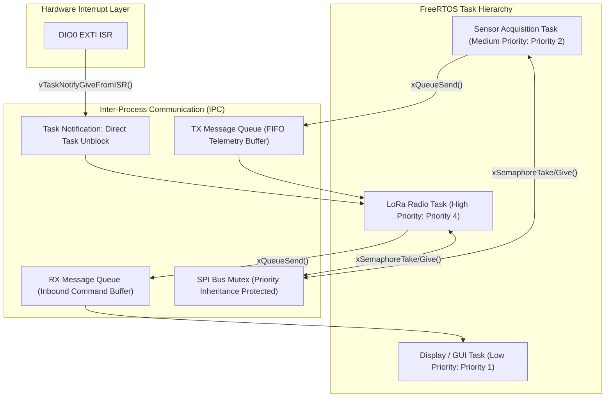

# LESSON 08: INTEGRATING LORA DRIVER INTO FREERTOS REAL-TIME OPERATING SYSTEM

> Summary: Architecting a robust, multi-tasking FreeRTOS environment for LoRa transceivers, leveraging lightweight Task Notifications for sub-microsecond ISR unblocking, thread-safe Queues for telemetry serialization, and Mutexes featuring priority inheritance to secure shared SPI buses.

---

## 1. Multi-Tasking Architectural Hierarchy

In sophisticated edge appliances (such as vehicular smart clusters or rugged telematics gateways), the microcontroller concurrently orchestrates diverse subsystems: sampling high-frequency inertial sensors, servicing graphical user interfaces, managing CAN bus controllers, and streaming long-range LoRa packets.



---

## 2. FreeRTOS Inter-Process Synchronization Primitives

### 2.1 Task Notifications (High-Efficiency Event Unblocking)
- Rather than allocating standalone Binary Semaphores that demand additional RAM allocations for OS Control Blocks, modern FreeRTOS implementations leverage **Task Notifications** integrated directly inside each Task Control Block (TCB).
- Inside the hardware interrupt `DIO0_IRQHandler`:
  ```c
  BaseType_t xHigherPriorityTaskWoken = pdFALSE;
  vTaskNotifyGiveFromISR(g_lora_task_handle, &xHigherPriorityTaskWoken);
  portYIELD_FROM_ISR(xHigherPriorityTaskWoken);
  ```
- This unblocks `vLoRaRadioTask` instantaneously with negligible instruction overhead.

### 2.2 Telemetry Buffering via FreeRTOS Queues
- When external telemetry generators (e.g., GPS, Battery Management Systems) produce packets, they do not invoke radio APIs directly. Instead, they format an atomic `lora_packet_t` struct and push it into `g_lora_tx_queue`.
- The dedicated radio task dequeues packets in strict FIFO sequence, eliminating bus collisions between asynchronous application threads.

### 2.3 Shared SPI Bus Protection via Mutexes
- When the high-speed SPI bus is multiplexed between the LoRa transceiver and secondary devices (such as SPI NOR Flash or display controllers):
  - Always instantiate the synchronization lock using `xSemaphoreCreateMutex()`.
  - FreeRTOS Mutexes implement **Priority Inheritance**, structurally eliminating catastrophic **Priority Inversion** deadlocks.

---

## 3. Production C Implementation on FreeRTOS

```c
#include "FreeRTOS.h"
#include "task.h"
#include "queue.h"
#include "semphr.h"
#include <string.h>

#define LORA_MAX_PAYLOAD_SIZE 64
#define LORA_QUEUE_LENGTH     8

typedef struct {
    uint8_t length;
    uint8_t data[LORA_MAX_PAYLOAD_SIZE];
} lora_packet_t;

static TaskHandle_t      g_lora_task_handle = NULL;
static QueueHandle_t     g_lora_tx_queue    = NULL;
static SemaphoreHandle_t g_spi_mutex        = NULL;

extern void lora_hardware_init(void);
extern void lora_send_packet_blocking(const uint8_t *buf, uint8_t len);
extern void lora_read_rx_fifo_packet(lora_packet_t *pkt);

// ========================================================
// 1. DEDICATED LORA RADIO DAEMON TASK
// ========================================================
void vLoRaRadioTask(void *pvParameters) {
    lora_hardware_init();
    lora_packet_t tx_pkt;

    for (;;) {
        // Evaluate outbound queue with non-blocking 50 ms timeout
        if (xQueueReceive(g_lora_tx_queue, &tx_pkt, pdMS_TO_TICKS(50)) == pdPASS) {
            // Acquire shared SPI bus mutex safely
            if (xSemaphoreTake(g_spi_mutex, portMAX_DELAY) == pdTRUE) {
                // Execute packet transmission
                lora_send_packet_blocking(tx_pkt.data, tx_pkt.length);
                xSemaphoreGive(g_spi_mutex);
            }
        }

        // Await hardware events from DIO0 (RxDone or TxDone)
        // Task remains fully blocked (0% CPU utilization) until notified
        uint32_t ulNotificationValue = ulTaskNotifyTake(pdTRUE, pdMS_TO_TICKS(10));
        if (ulNotificationValue > 0) {
            if (xSemaphoreTake(g_spi_mutex, portMAX_DELAY) == pdTRUE) {
                // Process inbound packet or confirm TX airtime completion
                // lora_process_events();
                xSemaphoreGive(g_spi_mutex);
            }
        }
    }
}

// ========================================================
// 2. SYSTEM RESOURCE INITIALIZATION
// ========================================================
void lora_freertos_system_init(void) {
    g_spi_mutex = xSemaphoreCreateMutex();
    g_lora_tx_queue = xQueueCreate(LORA_QUEUE_LENGTH, sizeof(lora_packet_t));

    xTaskCreate(
        vLoRaRadioTask,
        "LoRaRadio",
        configMINIMAL_STACK_SIZE + 256,
        NULL,
        tskIDLE_PRIORITY + 3, // Elevated real-time priority
        &g_lora_task_handle
    );
}

// ========================================================
// 3. THREAD-SAFE OUTBOUND ENQUEUE API
// ========================================================
bool lora_enqueue_telemetry(const uint8_t *data, uint8_t len) {
    if (len > LORA_MAX_PAYLOAD_SIZE || g_lora_tx_queue == NULL) {
        return false;
    }
    lora_packet_t pkt;
    pkt.length = len;
    memcpy(pkt.data, data, len);

    // Push into queue; wait at most 10 ms if queue is saturated
    return (xQueueSend(g_lora_tx_queue, &pkt, pdMS_TO_TICKS(10)) == pdPASS);
}
```

---

## 4. Core Engineering Notes & Best Practices

> [!TIP]
> **Real-World System Architecture Question:** *"When dispatching long-duration LoRa packets under FreeRTOS, how do you prevent user interfaces (GUI/Display tasks) from stuttering or dropping frame rates?"*
> 
> **Authoritative Technical Response:**
> Isolate RF communication into a dedicated background task (`LoRaRadioTask`).
> When a user triggers a transmission from the touchscreen, the `GUITask` simply serializes the payload into a **FreeRTOS Message Queue** requiring under $2\text{ µs}$ of execution time, immediately returning to refresh the display at 60 FPS.
> The background `LoRaRadioTask` dequeues the payload, triggers the transceiver, and yields CPU control into the blocked state awaiting hardware Task Notifications, consuming zero user-interface processing bandwidth.

