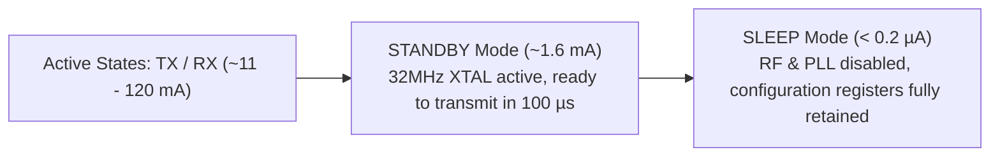
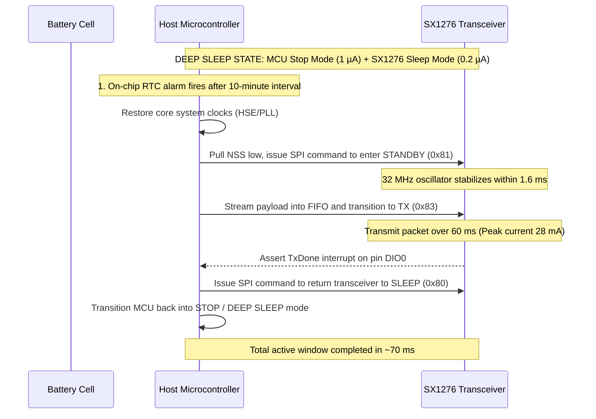

# LESSON 09: ULTRA-LOW-POWER MANAGEMENT STRATEGIES AND SLEEP MODES

> Summary: A quantitative analysis of silicon low-power modes for Semtech LoRa transceivers and host microcontrollers, establishing techniques to eliminate parasitic GPIO pin leakage currents and formulating duty-cycled battery lifespan projections.

---

## 1. Silicon Sleep Operating States of Semtech SX1276

The SX1276 provides distinct low-power states engineered for varied wake-up latency and power budgets:

| Operating State | `RegOpMode` Value | Typical Current | Silicon Block States | Wakeup Latency |
| :--- | :---: | :---: | :--- | :---: |
| **SLEEP** | `0x80` | **0.2 µA (Max 1 µA)** | RF front-end, mixers, ADC, PLL, and crystal oscillator disabled. Register configurations remain fully preserved in static retention latches. | ~1.6 ms |
| **STANDBY** | `0x81` | **1.6 mA** | 32 MHz crystal oscillator active; RF blocks disabled. | ~100 µs |
| **FSTX / FSRX** | `0x82 / 0x84` | **5.8 mA** | PLL synthesizer locked onto the RF carrier channel. | ~60 µs |
| **RX CONTINUOUS** | `0x85` | **10.8 mA – 11.5 mA** | LNA, mixer, ADC, and digital correlation engine fully active. | Instantaneous |
| **TX (+14 dBm)** | `0x83` | **28 mA** | RF power amplifier driven via RFO pin. | Instantaneous |
| **TX (+20 dBm)** | `0x83` | **120 mA** | PA_BOOST high-power regulator circuit engaged. | Instantaneous |

---

## 2. Duty-Cycled Energy Lifecycle Architecture

In industrial battery telemetry, edge nodes spend 99.9% of their operational life in ultra-low-power deep sleep, waking briefly for tens of milliseconds to acquire telemetry and radiate packets:

---

## 3. Eliminating Parasitic GPIO Pin Leakage Currents

A notorious defect causing field batteries to collapse within weeks despite correct `Sleep()` API calls is **parasitic current leakage across floating GPIO pins**:

> [!CAUTION]
> **Hardware & Firmware Zero-Leakage Checklist:**
> 1. **SCK, MOSI, NSS Lines**: Prior to entering core sleep, drive these control lines to deterministic logic states (typically Output Low or configure NSS with an external pull-up) to prevent biasing the transceiver's input stages.
> 2. **MISO Line**: When the SX1276 enters Sleep mode, its MISO pin transitions to high-impedance (High-Z). The host MCU pin must enable internal **Pull-up/Pull-down resistors** or be reconfigured into **Analog Input Mode** to eliminate intermediate floating logic states.
> 3. **Unused Microcontroller Pins**: Reconfigure all unrouted, floating MCU pins into **Analog Mode** to disable internal digital Schmitt-trigger circuits.

---

## 4. Mathematical Modeling of Field Battery Longevity

Average system current consumption ($I_{avg}$) over a repeating operational cycle is governed by duty-cycle integration:

$$I_{avg} = \frac{(I_{sleep} \times T_{sleep}) + (I_{wake} \times T_{wake}) + (I_{tx} \times T_{tx})}{T_{total}}$$

### Concrete Engineering Calculation
Consider a sensor node powered by an industrial **Lithium Thionyl Chloride ($\text{Li-SOCl}_2$)** cell with a nominal rating of $2400\text{ mAh}$ (derated to $1920\text{ mAh}$ factoring 80% practical utilization):
- Transmission Interval: **Once every 15 minutes** ($T_{total} = 900\text{ seconds}$).
- Sleep Duration: $T_{sleep} \approx 899.9\text{ seconds}$ at $I_{sleep} = 2.5\text{ µA}$ (cumulative MCU + LoRa).
- Active Processing Window: $T_{wake} = 30\text{ ms}$ at $I_{wake} = 8\text{ mA}$.
- LoRa Transmission Window: $T_{tx} = 70\text{ ms}$ at $I_{tx} = 30\text{ mA}$ (+14 dBm).

Step-by-Step Energy Profile:
- Quiescent Sleep Charge: $0.0025\text{ mA} \times 899.9\text{ s} = 2.25\text{ mA}\cdot\text{s}$
- Active Processing Charge: $8\text{ mA} \times 0.03\text{ s} = 0.24\text{ mA}\cdot\text{s}$
- RF Transmission Charge: $30\text{ mA} \times 0.07\text{ s} = 2.10\text{ mA}\cdot\text{s}$
- Total Charge per 15-Minute Cycle: $2.25 + 0.24 + 2.10 = 4.59\text{ mA}\cdot\text{s}$
- Average Continuous Current:
  
  $$I_{avg} = \frac{4.59\text{ mA}\cdot\text{s}}{900\text{ s}} \approx 0.0051\text{ mA} = 5.1\text{ µA}$$

- **Projected Operating Lifespan**:
  
  $$\text{Lifespan} = \frac{1920\text{ mAh}}{0.0051\text{ mA}} \approx 376,470\text{ hours} \approx 43\text{ years}!$$
  
  *(In physical reality, operating life is bounded by the battery chemistry's annual self-discharge rate (~1% to 2% per year), yielding a practical operational life of **10 to 15 years**).*

