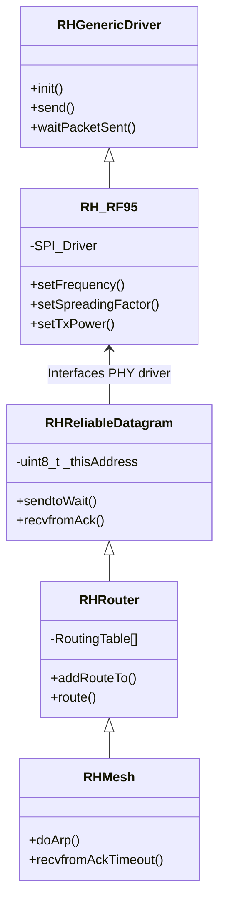
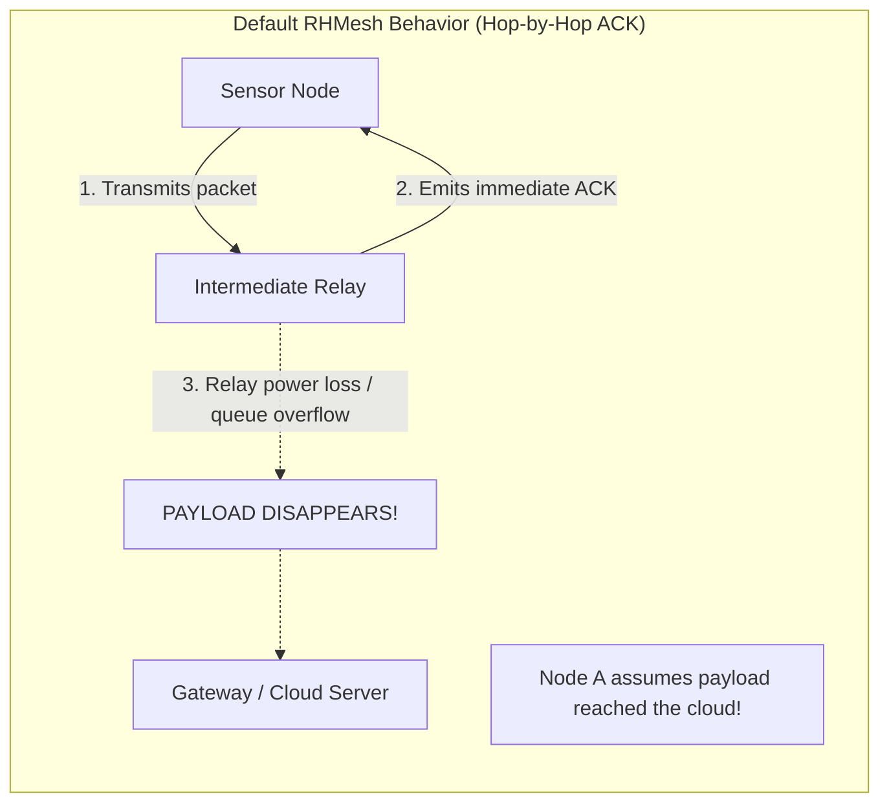

# LESSON 10: ANALYZING LORA MESH SOLUTIONS AND THE HOP-BY-HOP ACK TRAP

> Summary: A structural dissection of the RadioHead RHMesh protocol stack, analyzing on-demand distance vector (AODV) route discovery, uncovering the technical hazards of Hop-by-hop versus End-to-End acknowledgments, and defining the physical scalability boundaries of LoRa mesh networks.

---

## 1. Architectural Hierarchy of the RadioHead Library Stack

In open-source embedded development (across ESP32, STM32, and bare-metal targets), the **RadioHead** library by Mike McCauley represents the predominant framework for constructing ad-hoc LoRa mesh networks:



1. **`RH_RF95`**: Physical layer driver executing register control over the Semtech SX1276 via SPI.
2. **`RHReliableDatagram`**: Introduces device addressing (Source and Destination IDs), packet framing, and link-level hop-by-hop acknowledgments with automated retries.
3. **`RHRouter`**: Manages static routing tables mapping destination nodes to explicit intermediate next-hop addresses.
4. **`RHMesh`**: Implements dynamic route discovery modeled after the reactive Ad hoc On-Demand Distance Vector (AODV) routing algorithm.

---

## 2. Dynamic Route Discovery Mechanics in RHMesh

When a Source Node ($S$) intends to dispatch a payload to a Destination Node ($D$) without an existing route in its internal cache:

```mermaid
sequenceDiagram
    participant S as Source Node (S)
    participant R1 as Intermediate Relay (R1)
    participant D as Destination Node (D)

    Note over S: Route to D absent in local routing table!
    S->>R1: Broadcast Route Request (RREQ: Target = D)
    Note over R1: R1 caches reverse path back to S (Next Hop to S is S)
    R1->>D: Re-broadcasts Route Request (RREQ: Target = D, HopCount = 2)
    Note over D: D receives RREQ; constructs Route Reply (RREP)
    D->>R1: Unicast RREP (Next Hop to D is D)
    Note over R1: R1 updates routing table: Route to D via D
    R1->>S: Unicast RREP forwarded to S
    Note over S: S updates routing table: Route to D via R1. Path locked!
    S->>R1: Transmit unicast Data Payload
    R1->>D: Forward Data Payload to destination
```

### Protocol Header Overhead
Every frame traversing the RHMesh protocol stack accumulates protocol headers:
- `Mesh Header` (4 bytes): `Message Type`, `Source Address`, `Destination Address`, `Hop Count`.
- `Reliable Datagram Header` (4 bytes): `Recipient ID`, `Sender ID`, `Packet Sequence ID`, `Flags / ACK`.
- **System Impact**: Available user payload byte capacity shrinks, extending the physical Time-on-Air across every intermediate hop.

---

## 3. The Technical Trap: Hop-by-Hop ACK vs End-to-End ACK

A crucial systems architecture distinction often examined in engineering interviews is the difference between intermediate link acknowledgments and end-to-end delivery guarantees:



### 3.1 The Semantics of Hop-by-Hop Acknowledgments
- When Node A invokes `sendtoWait()` targeting a distant gateway via intermediate Relay B:
  - Node A transmits the RF frame to B.
  - The instant Relay B demodulates the packet with a valid CRC, **Relay B transmits an immediate RF ACK back to Node A**.
  - Node A's `sendtoWait()` function unblocks and returns `true`.
  - **The Fatal Assumption**: The application engineer assumes the packet arrived safely at the central monitoring server. In reality, the packet is merely buffered in volatile RAM inside Relay B!

### 3.2 Real-World Data Loss Scenarios
If subsequent to issuing the hop ACK:
1. Relay B experiences a power brownout or reboot.
2. Relay B's internal packet queue overflows.
3. The outbound link between Relay B and the Gateway encounters severe RF co-channel interference.
⇒ **The telemetry payload is permanently lost while the originating node assumes successful delivery!**

### 3.3 Engineering Solution: Application-Layer End-to-End ACK
For mission-critical data paths:
- Suppress or disregard link-layer mesh ACKs for final delivery confirmation.
- Embed a monotonic `Message Sequence ID` in the application payload.
- Only after the central Server/Gateway commits the telemetry to persistent storage does it dispatch a dedicated `APP_ACK` packet addressed back to the originating sensor.

---

## 4. Physical Scalability Constraints of LoRa Mesh

While theoretically attractive, multi-hop LoRa mesh architectures exhibit severe physical bottlenecks when scaled:

| Scalability Metric | Physical Bottleneck Analysis |
| :--- | :--- |
| **Relay Node Energy Depletion** | To intercept spontaneous asynchronous RREQ broadcasts from child nodes, intermediate relays **must maintain continuous receiver listening (RX Continuous)**, drawing ~11 mA non-stop. They cannot operate on small primary batteries and require mains power or bulky solar arrays. |
| **Cumulative Multi-Hop Latency** | Each relay hop introduces physical Time-on-Air ($ToA$) delays (50 ms to 500 ms) plus random CSMA backoff jitter to minimize collisions. Traversal across 4 hops easily introduces 2 to 4 seconds of end-to-end latency. |
| **Co-Channel Self-Interference** | When an intermediate relay forwards a child node's packet on the identical RF carrier, it radiates a powerful local transmission that jams and desensitizes adjacent sensor nodes attempting concurrent transmissions. |

---

## 5. Core Engineering Notes & Best Practices

> [!IMPORTANT]
> **Industrial Interview Scenario:** *"Why did your engineering team deploy a LoRa Mesh solution utilizing RadioHead rather than standard LoRaWAN in your previous prototype?"*
> 
> **Authoritative Technical Response:**
> "In that specific deployment, our objective was creating an localized emergency hazard warning system inside an industrial plant with dense reinforced concrete bulkheads and zero external Internet connectivity.
> 1. Because of severe non-line-of-sight (NLOS) structural attenuation, direct single-hop links to a central location were physically unviable. Strategic placement of intermediate relay nodes allowed RF paths to navigate around structural obstacles.
> 2. The installation operated strictly as an air-gapped on-premises closed loop, avoiding external LoRaWAN gateway hardware costs and third-party cloud server subscriptions.
> 
> However, our team was acutely aware of the architecture's inherent constraints: intermediate relays require dedicated line power, and beyond 30 to 50 active nodes, co-channel airtime collisions degrade throughput rapidly, requiring a transition to standard LoRaWAN Star-of-Stars architectures for large-scale deployments."
