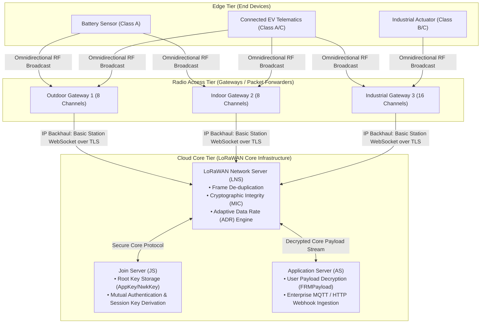
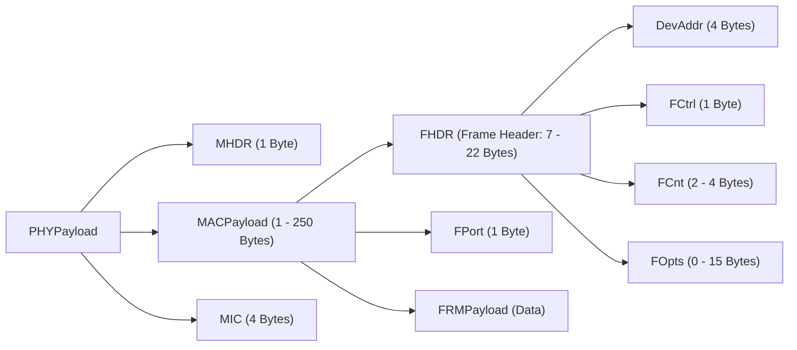

# LESSON 11: COMPREHENSIVE LORAWAN ARCHITECTURE: STAR-OF-STARS TOPOLOGY AND NETWORK ENTITIES

> Summary: An architectural analysis of the LoRaWAN Star-of-Stars networking paradigm, detailing the functional roles of Gateways, Network Servers, Join Servers, and Application Servers, alongside a field-by-field dissection of the LoRaWAN physical and MAC frame structure.

---

## 1. The Star-of-Stars Network Topology

In contrast to complex mesh topologies where constrained battery devices must expend scarce energy routing foreign traffic, **LoRaWAN strictly enforces a Star-of-Stars network topology**:

---

## 2. Functional Roles of LoRaWAN Network Entities

### 2.1 The Gateway (Transparent Packet Forwarder)
- **Architectural Nature**: A LoRaWAN gateway serves as a **strictly transparent RF-to-IP protocol bridge**.
- **Absence of Network State**: Gateways possess zero insight into network encryption, device identities, or routing permissions.
- **Sole Responsibility**: The gateway demodulates physical RF chirps from the ether, encapsulates raw frames alongside physical metadata (**Carrier Frequency, Spreading Factor, RSSI, SNR, and GPS-synchronized timestamps**), and streams them over an IP backhaul (via UDP Packet Forwarder or modern WebSocket **Semtech Basic Station**) directly to the central Network Server.

### 2.2 Network Server (LNS - The Network Brain)
The LNS (e.g., ChirpStack, The Things Stack, AWS IoT Core for LoRaWAN) manages complete network lifecycle state:
1. **Spatial Macro-Diversity & Frame De-duplication**: When an edge node broadcasts an uplink, multiple physical gateways concurrently capture the frame. The LNS correlates timestamps, eliminates duplicate frames, processes a single instance, and records the gateway exhibiting the highest SNR for future downlink targeting.
2. **Cryptographic Integrity Validation (MIC)**: Computes and authenticates the Message Integrity Code using the network session key (`NwkSKey`). Packets failing verification are instantly discarded.
3. **Adaptive Data Rate (ADR) Control**: Analyzes historical RF link margin histograms to dynamically optimize edge device transmit power and Spreading Factors.

### 2.3 Join Server (JS) & Application Server (AS)
- **Join Server**: Secure root-of-trust managing factory root cryptographic credentials (`AppKey`, `NwkKey`). It orchestrates mutual authentication during Over-the-Air Activation (OTAA) handshakes.
- **Application Server**: Secure terminus maintaining the application session key (`AppSKey`). Only the Application Server possesses cryptographic clearance to decrypt the inner user payload (`FRMPayload`), ensuring strict **End-to-End Payload Privacy** even from the telecom entity operating the LNS.

---

## 3. Dissecting the LoRaWAN Frame Structure

LoRaWAN packet framing is engineered for minimal airtime occupancy while maintaining carrier-grade cryptographic security:

### 3.1 MAC Header (MHDR - 1 Byte)
- **Bits [7:5] (MType - Message Type)**:
  - `000`: Join Request (Activation initiation)
  - `001`: Join Accept (Activation response)
  - `010`: Unconfirmed Data Up (Uplink without gateway ACK)
  - `011`: Unconfirmed Data Down (Downlink without node ACK)
  - `100`: Confirmed Data Up (Uplink **demanding immediate Gateway ACK**)
  - `101`: Confirmed Data Down (Downlink **demanding immediate Node ACK**)
- **Bits [1:0] (Major)**: LoRaWAN protocol revision (strictly clamped to `00` for LoRaWAN R1).

### 3.2 Frame Header (FHDR)
- **`DevAddr` (4 bytes)**: Dynamically assigned 32-bit network address allocated upon successful join.
- **`FCtrl` (1 byte)**: Transports link-control flags: `ACK` notification, `FPending` downlink queues, and `ADR` handshake flags.
- **`FCnt` (Frame Counter - 2 to 4 bytes)**: Strictly monotonically increasing packet sequence number. **Serves as the foundational defense against Replay Attacks**. If the LNS intercepts an uplink where `FCnt` is equal to or less than the previous recorded index, the frame is silently dropped.
- **`FOpts` (Frame Options - 0 to 15 bytes)**: Dynamic piggybacked transport carrying MAC Commands (e.g., channel reconfiguration, link checks).

### 3.3 Frame Port (FPort - 1 Byte)
- `FPort = 0`: Informs receiver that the inner payload exclusively transports administrative MAC commands.
- `FPort = 1` through `223`: Dedicated for arbitrary user application data structures.
- `FPort = 224` through `255`: Reserved for protocol compliance and conformance testing.

### 3.4 Message Integrity Code (MIC - 4 Bytes)
A 32-bit cryptographic authentication tag calculated using **AES-CMAC-128** across the entire frame using the Network Session Key (`NwkSKey`) and the monotonic Frame Counter (`FCnt`). Any payload manipulation or corrupted bit toggles invalidate the MIC check, causing instant rejection.

