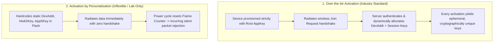
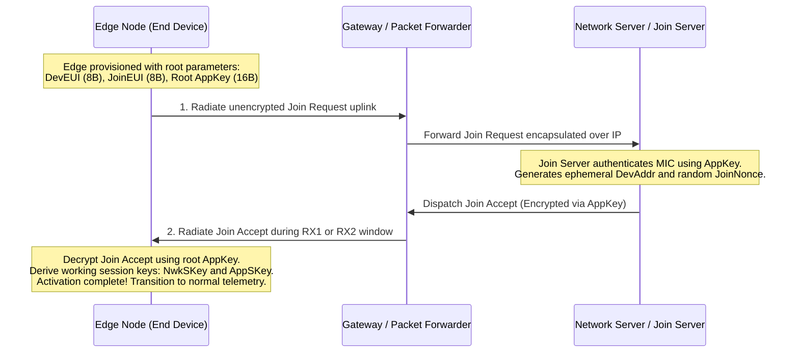
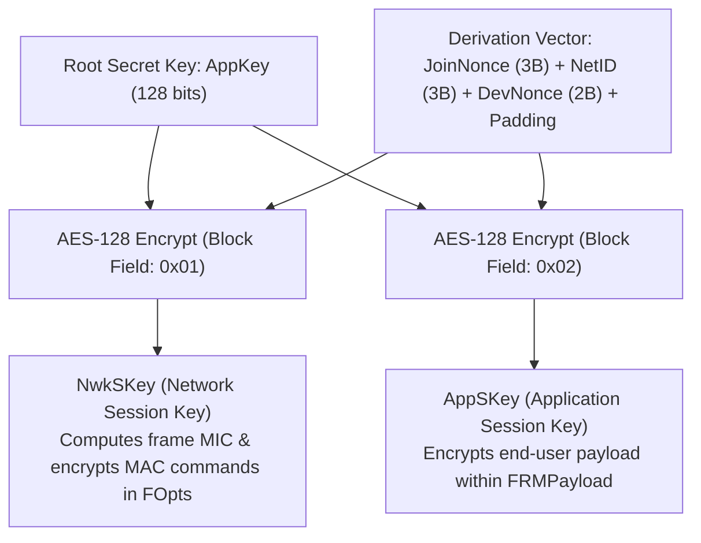

# LESSON 12: DEVICE ACTIVATION MECHANISMS: OTAA VS ABP AND AES-128 ENCRYPTION

> Summary: An architectural deep-dive into Over-the-Air Activation (OTAA) versus Activation by Personalization (ABP), detailing cryptographic session key derivation using AES-128 engines and formulating robust defenses against Frame Counter Desynchronization.

---

## 1. Comparing Activation Paradigms: OTAA vs ABP

Before a LoRaWAN edge node is authorized to stream telemetry through public or private gateways, it must execute device activation to negotiate cryptographic credentials.

| Technical Metric | OTAA (Over-the-Air Activation) | ABP (Activation by Personalization) |
| :--- | :---: | :---: |
| **Cryptographic Security** | **Exceptional**: Ephemeral session keys derived dynamically. | **Weak**: Static symmetric keys vulnerable to physical flash extraction. |
| **Network Portability** | Seamless migration across network providers or servers. | Rigidly bound to hardcoded server cryptographic parameters. |
| **Device Reboot Handling** | Clean renegotiation; safely resets Frame Counter (`FCnt`). | `FCnt` resets to 0, triggering Replay Attack rejections. |
| **Bidirectional Requirement**| Mandatory bidirectional link to capture `Join Accept`. | Operates on strictly simplex (uplink-only) transceivers. |
| **Commercial Adoption** | **>99% of enterprise industrial devices.** | Educational evaluations and lab prototypes. |

---

## 2. The Over-the-Air Activation (OTAA) Handshake Protocol

The OTAA procedure executes an atomic cryptographic handshake between the End Device and the Network Server:

### 2.1 Anatomy of a Join Request Uplink
- **`JoinEUI` (8 bytes)**: Global application provider identifier (formerly designated as `AppEUI`).
- **`DevEUI` (8 bytes)**: Globally unique IEEE EUI-64 device physical identifier.
- **`DevNonce` (2 bytes)**: Monotonically incrementing or pseudo-random integer. The LNS logs historical `DevNonce` values; duplicate tokens trigger immediate rejection to defeat replay attacks.
- **`MIC` (4 bytes)**: Cryptographic signature generated via AES-128-CMAC across all payload bytes using the secret root **`AppKey`**.

### 2.2 Anatomy of a Join Accept Downlink
- The entire payload is **symmetrically encrypted using the root `AppKey`**.
- Encapsulates critical runtime operational parameters:
  - **`JoinNonce` (3 bytes)**: Server-assigned cryptographically random token used for key derivation.
  - **`NetID` (3 bytes)**: LoRa Alliance assigned network identifier.
  - **`DevAddr` (4 bytes)**: Dynamic 32-bit ephemeral network address.
  - **`DLSettings` (1 byte)**: Downlink configuration parameters (RX1 data rate offset, RX2 frequency/DR).
  - **`RxDelay` (1 byte)**: Initial delay prior to opening the first receive window (default 1 second).
  - **`CFList` (16 bytes - Optional)**: Dynamically appends extra regional RF channel frequencies into edge NVRAM.

---

## 3. Cryptographic Session Key Derivation Function (KDF)

Upon validating the decrypted `Join Accept` frame, both endpoints compute dual session keys using an **AES-128 Encryption primitive**:

> [!IMPORTANT]
> **Dual-Key Cryptographic Isolation:**
> - **`NwkSKey`** is terminated at the **Network Server (LNS)**: Allows the telecom operator to validate packet authenticity without exposing private customer application data.
> - **`AppSKey`** is transferred securely to the **Application Server**: Guarantees true **End-to-End Encryption** across intermediate cellular and cloud backhauls.

---

## 4. The Catastrophic Frame Counter Desync Trap in ABP

In devices relying on static ABP provisioning:
1. An edge device operates normally, advancing its frame counter to `FCnt = 1500`.
2. A brownout occurs; the device reboots.
3. Volatile SRAM clears, resetting `FCnt` back to `0`.
4. The node transmits its subsequent payload with `FCnt = 0`.
5. **The Network Server inspects its state database**: $0 \le 1500 \Rightarrow$ Concludes this is an active Replay Attack and **silently drops the frame**!
6. The edge node remains effectively deadlocked from the cloud until its transmission counter exceeds $1500$.

> [!TIP]
> **Engineering Solutions:**
> 1. Always prioritize **OTAA**: Reboots trigger an automated Join sequence, yielding fresh session keys and explicitly resetting the server's `FCnt` baseline to 0.
> 2. If ABP is structurally required: Periodically commit `FCnt` increments to onboard non-volatile Flash/EEPROM, or disable server-side `Frame Counter Validation` (permitted strictly in development testbeds).

