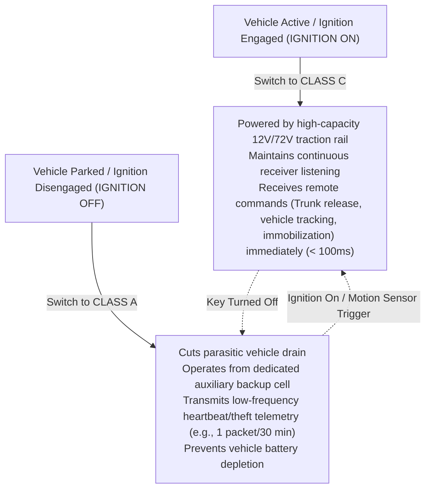

# LESSON 13: LORAWAN OPERATIONAL CLASSES AND RX1/RX2 WINDOW TIMING

> Summary: A comparative evaluation of LoRaWAN device Classes (Class A, Class B, Class C), formulating microsecond-level timing architectures for the RX1 and RX2 downlink reception windows alongside dynamic class-switching strategies for connected automotive telematics.

---

## 1. Taxonomic Classification of LoRaWAN Operating Classes

Depending on downstream command latency requirements and available power budgets, LoRaWAN delineates three mutually distinct device profiles:

```mermaid
flowchart TD
    subgraph CLASSA["1. Class A (Mandatory Baseline for All End Devices)"]
        A1["Maximal energy conservation (5 - 10 year battery life)"] --> A2["Opens receive slots exclusively following an active uplink"]
        A2 --> A3["Server CANNOT spontaneously dispatch unsolicited downlinks"]
    end

    subgraph CLASSB["2. Class B (Beacon-Synchronized Ping Slots)"]
        B1["Deterministic downlink latency (Seconds to tens of seconds)"] --> B2["Gateways broadcast periodic GPS-synchronized time beacons"]
        B2 --> B3["Device periodically opens scheduled micro-windows (Ping Slots)"]
    end

    subgraph CLASSC["3. Class C (Continuous Listening)"]
        C1["Sub-second downstream latency (< 100 ms)"] --> C2["Maintains active RF receiver 100% of the time (except during active TX)"]
        C2 --> C3["Substantial continuous current consumption (~11 mA) -> Requires mains/battery power"]
    end
```



| Operational Metric | Class A (All) | Class B (Beacon) | Class C (Continuous) |
| :--- | :---: | :---: | :---: |
| **Downlink Latency** | High (gated by edge transmission cadence) | Deterministic (governed by Ping Slot period) | **Immediate (< 100 ms)** |
| **Quiescent Power** | **Ultra-Low (< 5 µA)** | Low to Moderate (~50 µA – 200 µA) | **High (~11 mA continuous)** |
| **Power Supply Archetype** | Primary Lithium Cells (CR2032, Li-SOCl2) | Rechargeable Li-Ion with Energy Harvesting | **Grid Power / 12V/72V Vehicle Battery** |
| **Firmware Overhead** | Minimal | High (crystal drift compensation & beacon tracking) | Low |

---

## 2. Microsecond-Level Timing Mechanics of RX1 and RX2 Windows (Class A)

Firmware implementation for Class A transceivers hinges upon microsecond-deterministic reception slot timing following transmission completion ($t_{TX\_Done}$):

```mermaid
sequenceDiagram
    participant ED as Edge Node (Transceiver)
    participant RF as RF Ether
    participant GW as Gateway / Packet Forwarder

    Note over ED: 1. Edge concludes physical Uplink airtime (Time t = 0)
    Note over ED: Deactivates RF front-end; enters Standby/Sleep
    
    rect rgb(240, 240, 240)
        Note over ED: High-resolution hardware timer counts RECEIVE_DELAY1 (Default: 1000 ms)
    end
    
    Note over ED: 2. Precise Instant t = 1.000 ms: OPEN RX1 WINDOW
    Note over ED: Config: Identical carrier to uplink; Data Rate offset applied
    alt Gateway radiates Downlink at RX1
        GW->>ED: Downlink packet arrives within RX1
        Note over ED: Demodulates payload -> Closes receiver -> COMPLETE!
    else No Preamble correlated within 5-8 symbol periods
        Note over ED: Immediately closes RX1 to preserve microampere-hours!
    end

    rect rgb(240, 240, 240)
        Note over ED: Hardware timer continues to RECEIVE_DELAY2 (Default: 2000 ms from t = 0)
    end

    Note over ED: 3. Precise Instant t = 2.000 ms: OPEN RX2 WINDOW
    Note over ED: Config: Fixed regional frequency & data rate (e.g., 869.525 MHz / SF9)
    alt Gateway radiates Downlink at RX2
        GW->>ED: Downlink arrives within RX2
        Note over ED: Demodulation success -> Closes receiver
    else Channel silent
        Note over ED: Closes RX2 -> Re-enters ultra-low power Deep Sleep
    end
```

### 2.1 The First Downlink Window (RX1)
- **Opening Offset**: Exactly **1.0 second** following uplink completion (`RECEIVE_DELAY1 = 1000 ms`).
- **Channel Frequency**: Matches the uplink channel frequency identically.
- **Modulation Data Rate**: Calculated as an offset (`RX1DROffset`) from the uplink data rate, as dictated by the Network Server.

### 2.2 The Second Downlink Window (RX2)
- **Opening Offset**: Exactly **2.0 seconds** following uplink completion (`RECEIVE_DELAY2 = 2000 ms`, strictly 1.0 second after RX1).
- **Channel Frequency & Data Rate**: Locked to predefined regional default constants or configured via administrative MAC commands (e.g., EU868 default: $869.525\text{ MHz}$, fixed at $SF9 / 125\text{ kHz}$).

> [!WARNING]
> **Crystal Oscillator Drift Compensation:**
> Microcontroller crystal oscillators exhibit temperature-dependent frequency drift ($\pm 20\text{ to } 50\text{ ppm}$). Over a 2-second delay window, clock timing may skew by several milliseconds, potentially causing the receiver to wake up after the gateway preamble has passed.
> **Firmware Defense**: The LoRaWAN MAC stack must compute an **RX Window Timing Widening** margin, initiating hardware receiver listening slightly ahead of the nominal mathematical deadline.

---

## 3. Dynamic Class Switching Architecture for Connected Electric Vehicles

In sophisticated vehicular platforms (such as a Connected EV Smart Instrument Cluster), static class binding is inefficient:



### Protocol-Level Synchronization of Class State
A device cannot transition operating classes silently:
1. The edge transceiver transmits an uplink bearing the MAC command `DeviceModeInd` (encapsulated within `FOpts` or over `FPort 0`) notifying the LNS of its transition to Class C.
2. The Network Server acknowledges with `DeviceModeConf`.
3. Only upon receiving confirmation does the LNS permit queuing and dispatching unsolicited downlinks at arbitrary intervals.

---

## 4. Core Engineering Notes & Best Practices

> [!IMPORTANT]
> **High-Level System Design Interview Question:** *"If an electric vehicle is powered off and parked, operating under Class A to avoid draining the vehicle battery, how can a cloud dispatch an emergency immobilization command to the car?"*
> 
> **Authoritative Technical Response:**
> "Under strict Class A constraints, the cloud **cannot force an instantaneous downlink**, because the vehicle's transceiver is completely asleep with its receiver disabled.
> In high-reliability automotive engineering, we utilize two architectural strategies:
> 1. **High-Cadence Class A Keep-Alives**: While parked, the telemetry node wakes every 60 seconds to transmit a tiny 1-byte status heartbeat. The cloud server queues the immobilization command on the LNS. The moment the 60-second heartbeat concludes, the command is dispatched down within the RX1 or RX2 window, providing a bounded 60-second response window.
> 2. **Dedicated Out-of-Band CAD Wakeup**: An auxiliary ultra-low-power co-processor operates an SX1262 performing 1-second CAD sweeps (as detailed in Lesson 04). To execute an instant emergency immobilize, the gateway radiates an extended-preamble LoRa burst, triggering the co-processor's `CadDetected` interrupt, which trips the vehicle PMIC to boot the primary telematics cluster into Class C immediately."

