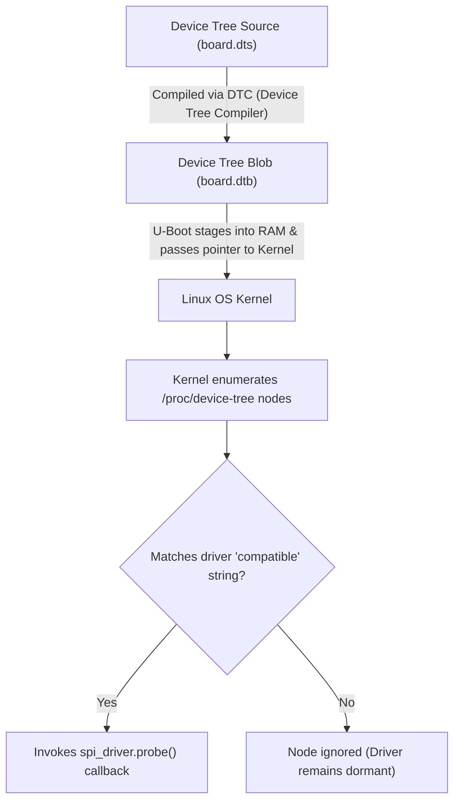

# LESSON 15: DEVICE TREE (DTS) CONFIGURATION FOR RADIO SPI INTERFACE, PINMUX, AND GPIO INTERRUPTS

> Summary: An architectural examination of Linux Device Tree subsystems, engineering production Device Tree Source (DTS) nodes for Semtech SX1276 transceivers over the SPI bus, configuring Pinmux/Pinctrl properties, binding hardware reset and DIO0 interrupt resources, and verifying kernel probe triggers.

---

## 1. Role of the Device Tree in Embedded Linux Architectures

In legacy x86 architectures, expansion buses (PCI, USB) feature runtime self-discovery mechanisms via hardware Vendor and Product IDs. In contrast, modern ARM-based embedded SoCs (such as NXP i.MX8, Rockchip RK3588, Allwinner, or Raspberry Pi), peripheral devices connected via memory-mapped buses or serial interfaces like SPI are **completely non-discoverable**:



The Device Tree serves as a hardware blueprint in plain text, informing the Linux Kernel:
- Which physical SPI bus controller instance (`spi0`, `spi1`, or `spi2`) hosts the LoRa transceiver.
- Maximum permissible SPI clock frequencies.
- Precise physical GPIO bank assignments for hardware `NRESET` lines and `DIO0` interrupt lines.

---

## 2. Production Device Tree Source (DTS) Node for Semtech SX1276

The following `.dts` overlay demonstrates industry-standard declarations for binding an SX1276 transceiver beneath the `spi1` host controller on an ARM processor:

```dts
/dts-v1/;
/plugin/;

&spi1 {
    status = "okay";
    #address-cells = <1>;
    #size-cells = <0>;
    cs-gpios = <&gpio2 12 GPIO_ACTIVE_LOW>; // Software GPIO Chip Select control

    // Instantiate Semtech SX1276 child node on SPI1 bus
    lora_radio: lora@0 {
        compatible = "semtech,sx1276";
        reg = <0>; // Bound to Chip Select 0 (CS0)
        spi-max-frequency = <8000000>; // 8 MHz max clock speed
        spi-cpol = <0>; // Mode 0: CPOL = 0
        spi-cpha = <0>; // Mode 0: CPHA = 0

        // Hardware reset GPIO binding
        reset-gpios = <&gpio1 14 GPIO_ACTIVE_LOW>;

        // Primary hardware interrupt binding (DIO0)
        interrupt-parent = <&gpio1>;
        interrupts = <15 IRQ_TYPE_EDGE_RISING>; // GPIO1_15, active rising-edge

        // (Optional) Secondary interrupt lines for CAD / Timers
        dio1-gpios = <&gpio1 16 GPIO_ACTIVE_HIGH>;

        pinctrl-names = "default";
        pinctrl-0 = <&pinctrl_spi1_lora>;

        status = "okay";
    };
};
```

---

## 3. Pin Multiplexing & Pinctrl Infrastructure

Modern SoC pins are dynamically multiplexed across diverse internal peripheral engines. Pin configurations must explicitly route target physical balls to the SPI controller and GPIO banks via `pinctrl`:

```dts
&iomuxc {
    pinctrl_spi1_lora: lora_spigrp {
        fsl,pins = <
            // SPI1 Bus Lines: MOSI, MISO, SCK
            MX8MQ_IOMUXC_ECSPI1_MISO_ECSPI1_MISO    0x19
            MX8MQ_IOMUXC_ECSPI1_MOSI_ECSPI1_MOSI    0x19
            MX8MQ_IOMUXC_ECSPI1_SCLK_ECSPI1_SCLK    0x19
            
            // Software GPIO Chip Select (NSS)
            MX8MQ_IOMUXC_SD2_RESET_B_GPIO2_IO12     0x19

            // DIO0 Hardware Interrupt Line (Configured with internal Pull-down)
            MX8MQ_IOMUXC_GPIO1_IO15_GPIO1_IO15      0x59

            // Hardware NRESET Line
            MX8MQ_IOMUXC_GPIO1_IO14_GPIO1_IO14      0x19
        >;
    };
};
```

> [!IMPORTANT]
> **Internal Pull-Down Biasing for DIO0:**
> Because the SX1276 `DIO0` line asserts active-high, the host SoC pad must enforce an internal **Pull-down resistor** within the `pinctrl` register configuration. Allowing this pin to float renders the line vulnerable to EMI-induced false triggers, causing a catastrophic Interrupt Storm that starves the Linux kernel scheduler!

---

## 4. Hardware Verification on Target Linux Filesystem

Following kernel boot on your embedded distribution (Yocto, OpenWrt, Debian), verify Device Tree binding integrity via terminal commands:

### 4.1 Inspecting Device Tree Nodes in Sysfs
```bash
# Verify the instantiation of the LoRa node beneath the SPI controller
ls -l /sys/firmware/devicetree/base/soc/spi@30820000/lora@0

# Inspect the active compatible string committed in kernel memory
cat /sys/firmware/devicetree/base/soc/spi@30820000/lora@0/compatible
# Expected Output: semtech,sx1276
```

### 4.2 Verifying Hardware Interrupt Registration
```bash
# Verify kernel interrupt registration
cat /proc/interrupts | grep -i lora
# Expected Output:
# 42:          0  gpio-mxc  15 Edge      lora_irq
```

---

## 5. Core Engineering Notes & Best Practices

> [!TIP]
> **Linux Kernel Driver Interview Question:** *"When authoring a Linux kernel driver for the SX1276, how does the kernel determine which driver's `probe()` callback to execute upon encountering the `lora@0` node in the Device Tree?"*
> 
> **Authoritative Technical Response:**
> "The Linux kernel utilizes the **Open Firmware Device ID (`of_device_id`) matching table**.
> 1. In the Device Tree, we declare: `compatible = "semtech,sx1276";`.
> 2. Inside the C source code of our kernel driver, we export an `of_device_id` table:
>    ```c
>    static const struct of_device_id lora_dt_ids[] = {
>        { .compatible = "semtech,sx1276", },
>        { /* sentinel */ }
>    };
>    MODULE_DEVICE_TABLE(of, lora_dt_ids);
>    ```
> 3. During kernel initialization, the SPI core bus enumerator walks all child device nodes. Upon finding an exact string match between the Device Tree `compatible` property and an entry in the driver's `of_device_id` array, the bus core dynamically instantiates a `struct spi_device` and invokes the driver's `probe(struct spi_device *spi)` function."

