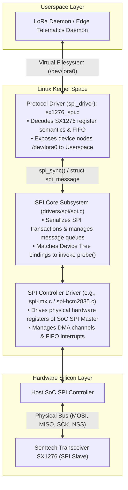
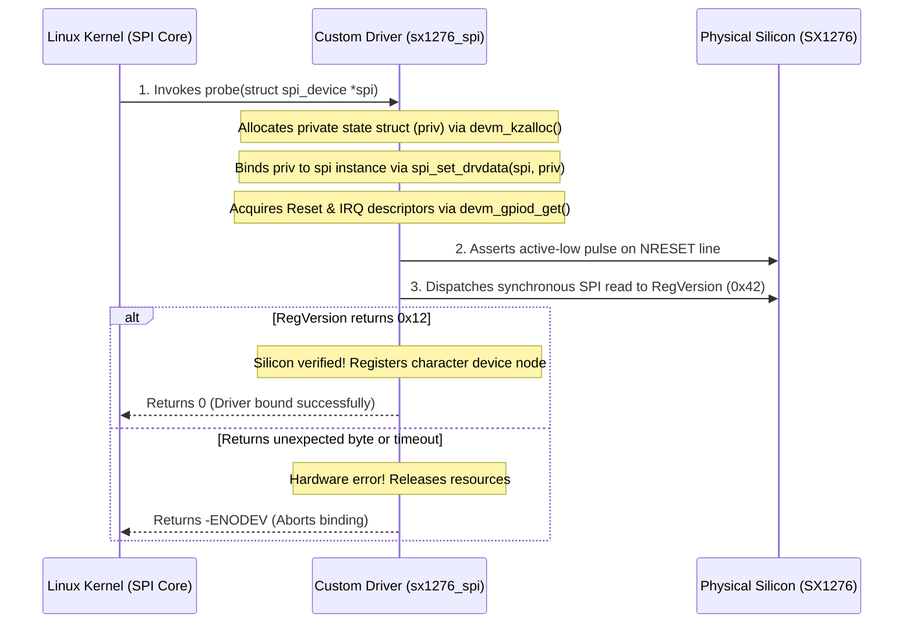

# LESSON 16: LINUX SPI SUBSYSTEM: SPI_DRIVER ARCHITECTURE AND BUS MANAGEMENT

> Summary: An architectural dissection of the Linux SPI subsystem, engineering a production SPI protocol driver utilizing `probe()` and `remove()` lifecycles, analyzing synchronous bus streaming via `spi_sync()` and `struct spi_transfer`, and delivering a fully compilable Linux Kernel Module.

---

## 1. Multi-Tiered Architecture of the Linux SPI Subsystem

Within the Linux kernel, serial peripheral communication is compartmentalized across three decoupled layers to enforce code reusability and hardware isolation:



---

## 2. Driver Lifecycle: The `probe()` and `remove()` Orchestration

When the kernel matches a device node on an enumerated SPI bus against the driver's compatible table, it delegates initialization to the driver's `probe()` callback:



---

## 3. Synchronous Bus Transfers via `spi_sync()`

Kernel SPI transfers are constructed through two primary abstraction objects:
- **`struct spi_transfer`**: Describes an individual atomic buffer sequence, encapsulating pointer references (`tx_buf`, `rx_buf`), and byte capacity (`len`).
- **`struct spi_message`**: Aggregates a sequence of linked `spi_transfer` segments executed atomically while the Chip Select (NSS) line remains asserted.

### Operational Mechanics of `spi_sync()`
The function `spi_sync(struct spi_device *spi, struct spi_message *message)` is fundamentally a **blocking, sleeping function**:
1. Enqueues the message structure into the SPI controller's execution queue.
2. Suspends the calling kernel thread into an interruptible sleep state (**Sleep/Blocked**), yielding CPU execution to the operating system scheduler.
3. The underlying SPI controller engages hardware DMA to stream data across the physical bus.
4. Upon transfer completion, the controller triggers a hardware DMA interrupt, which unblocks and wakes the sleeping driver thread.

---

## 4. Production C Kernel Module Implementation

The following C implementation demonstrates a robust, modern Linux kernel driver for the Semtech SX1276:

```c
#include <linux/module.h>
#include <linux/kernel.h>
#include <linux/spi/spi.h>
#include <linux/of.h>
#include <linux/gpio/consumer.h>
#include <linux/delay.h>

#define SX1276_REG_VERSION 0x42

struct sx1276_priv {
    struct spi_device   *spi;
    struct gpio_desc    *reset_gpio;
    int                  irq;
};

// Synchronous single-register read
static int sx1276_read_reg(struct sx1276_priv *priv, u8 reg, u8 *val) {
    u8 tx_buf[2] = { reg & 0x7F, 0x00 };
    u8 rx_buf[2] = { 0 };
    
    struct spi_transfer t = {
        .tx_buf = tx_buf,
        .rx_buf = rx_buf,
        .len    = 2,
    };
    struct spi_message m;
    int ret;

    spi_message_init(&m);
    spi_message_add_tail(&t, &m);
    
    ret = spi_sync(priv->spi, &m);
    if (ret == 0) {
        *val = rx_buf[1];
    }
    return ret;
}

// Probe callback invoked upon Device Tree matching
static int sx1276_probe(struct spi_device *spi) {
    struct sx1276_priv *priv;
    u8 version = 0;
    int ret;

    dev_info(&spi->dev, "Initializing SX1276 LoRa Driver...\n");

    priv = devm_kzalloc(&spi->dev, sizeof(*priv), GFP_KERNEL);
    if (!priv) return -ENOMEM;

    priv->spi = spi;
    spi_set_drvdata(spi, priv);

    // Retrieve hardware reset line from Device Tree
    priv->reset_gpio = devm_gpiod_get_optional(&spi->dev, "reset", GPIOD_OUT_LOW);
    if (IS_ERR(priv->reset_gpio)) {
        dev_err(&spi->dev, "Failed to acquire reset-gpios from Device Tree\n");
        return PTR_ERR(priv->reset_gpio);
    }

    // Hardware power-on reset pulse
    if (priv->reset_gpio) {
        gpiod_set_value_cansleep(priv->reset_gpio, 1); // Assert reset low
        usleep_range(1000, 2000);
        gpiod_set_value_cansleep(priv->reset_gpio, 0); // Release reset high
        msleep(5);
    }

    // Verify transceiver silicon identity
    ret = sx1276_read_reg(priv, SX1276_REG_VERSION, &version);
    if (ret < 0 || version != 0x12) {
        dev_err(&spi->dev, "Invalid silicon identity: 0x%02X (Expected: 0x12)\n", version);
        return -ENODEV;
    }

    dev_info(&spi->dev, "SX1276 silicon detected successfully (Version: 0x%02X)!\n", version);
    return 0;
}

// Remove callback invoked on module unload
static void sx1276_remove(struct spi_device *spi) {
    dev_info(&spi->dev, "Unloading SX1276 LoRa Driver\n");
}

// Open Firmware Device Matching Table
static const struct of_device_id sx1276_dt_ids[] = {
    { .compatible = "semtech,sx1276", },
    { /* sentinel */ }
};
MODULE_DEVICE_TABLE(of, sx1276_dt_ids);

static struct spi_driver sx1276_driver = {
    .driver = {
        .name           = "sx1276",
        .of_match_table = sx1276_dt_ids,
    },
    .probe  = sx1276_probe,
    .remove = sx1276_remove,
};

module_spi_driver(sx1276_driver);

MODULE_LICENSE("GPL");
MODULE_AUTHOR("Antigravity Embedded Team");
MODULE_DESCRIPTION("Semtech SX1276 LoRa Linux SPI Kernel Driver");
```

---

## 5. Core Engineering Notes & Best Practices

> [!IMPORTANT]
> **Linux Kernel Memory & GPIO Interview Question:** *"Why should embedded driver engineers prioritize `devm_kzalloc()` over `kmalloc()`, and what dictates the selection between `gpiod_set_value()` and `gpiod_set_value_cansleep()`?"*
> 
> **Authoritative Technical Response:**
> 1. **`devm_kzalloc()`**: Represents a **Device-Managed Allocation**. Memory allocated via `devm_*` APIs is tightly bound to the `struct device` container. If the `probe()` routine fails mid-execution or when the module is detached via `remove()`, the kernel core automatically reclaims the allocation, structurally eliminating memory leaks without requiring manual `kfree()` cleanup.
> 2. **`gpiod_set_value_cansleep()`**: If a physical GPIO line is routed through an external I2C/SPI bus expander chip rather than memory-mapped on-chip SoC silicon, toggling the line requires executing a secondary bus transaction that must sleep. Utilizing the `_cansleep()` variant ensures robust compatibility regardless of underlying hardware routing.

