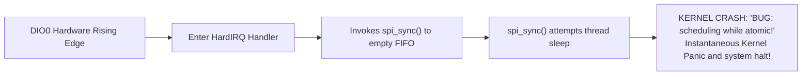
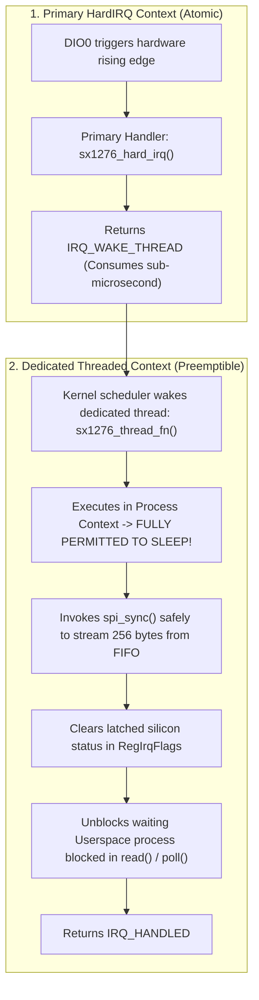

# LESSON 17: LINUX RADIO INTERRUPT ARCHITECTURE: TOP-HALF AND THREADED IRQS

> Summary: Resolving the architectural deadlock between non-sleeping atomic HardIRQ contexts and blocking Linux SPI bus transactions, engineering production-grade `request_threaded_irq()` mechanics, evaluating the mandatory `IRQF_ONESHOT` flag, and unblocking userspace consumers via kernel Wait Queues.

---

## 1. The Fundamental Concurrency Conflict in Linux SPI Drivers

Authoring high-performance Linux kernel drivers for Semtech LoRa transceivers exposes a fundamental operating system concurrency dilemma:
1. **Latching Behavior of DIO0**: When the radio demodulates a packet (`RxDone`), the physical `DIO0` line asserts high and **remains locked high** until the CPU explicitly clears `RegIrqFlags` via an SPI write.
2. **HardIRQ Inviolability**: Standard top-half interrupt service routines execute in **Atomic Context** with local interrupts masked; invoking sleeping operations is fundamentally illegal.
3. **The Nature of Linux SPI Bus Calls**: Demodulating FIFO bytes requires `spi_sync()`, which enqueues a transaction and suspends the calling thread (**Sleep/Blocked**) until the SPI controller's DMA engine issues a transfer complete interrupt.



---

## 2. The Architectural Solution: `request_threaded_irq()`

To resolve this conflict cleanly without ad-hoc workarounds, the Linux kernel interrupt subsystem standardizes **Threaded Interrupt Handlers**:



### The Mandatory Role of the `IRQF_ONESHOT` Flag
When binding a threaded handler to a level- or latch-sensitive line like LoRa DIO0, the `IRQF_ONESHOT` flag is **strictly non-negotiable**:
- Without `IRQF_ONESHOT`: The moment the tiny top-half `sx1276_hard_irq()` concludes, the hardware interrupt line is unmasked. Because `DIO0` remains asserted high (the register has not yet been cleared over SPI), the SoC interrupt controller **immediately re-triggers the HardIRQ handler in an infinite loop**, creating an Interrupt Storm that starves the CPU before the kernel thread can execute!
- With `IRQF_ONESHOT`: The Linux kernel core keeps the physical GPIO interrupt masked across the SoC, releasing it only after `sx1276_thread_fn()` finishes its SPI transactions and returns `IRQ_HANDLED`.

---

## 3. Production C Implementation of Threaded IRQs

```c
#include <linux/interrupt.h>
#include <linux/wait.h>
#include <linux/sched.h>
#include <linux/spi/spi.h>

struct sx1276_dev {
    struct spi_device   *spi;
    int                  irq;
    wait_queue_head_t    rx_wait_queue; // Synchronizes blocking userspace read/poll calls
    bool                 data_ready;
    u8                   rx_buffer[256];
    size_t               rx_len;
};

// ========================================================
// 1. PRIMARY HANDLER: Runs in Atomic HardIRQ Context
// ========================================================
static irqreturn_t sx1276_hard_irq(int irq, void *dev_id) {
    // Zero heavy lifting; strictly notify the scheduler to wake the thread
    return IRQ_WAKE_THREAD;
}

// ========================================================
// 2. THREADED HANDLER: Runs in Process Context (Can Sleep)
// ========================================================
static irqreturn_t sx1276_thread_fn(int irq, void *dev_id) {
    struct sx1276_dev *dev = dev_id;
    u8 irq_flags = 0;
    u8 current_addr = 0;
    u8 nb_bytes = 0;

    // 100% safe to execute sleeping spi_sync() calls
    sx1276_read_reg(dev, 0x12, &irq_flags);

    if (irq_flags & 0x40) { // TxDone
        sx1276_write_reg(dev, 0x12, 0x40); // Clear TxDone flag
        dev_info(&dev->spi->dev, "TxDone event verified!\n");
    }

    if (irq_flags & 0x20) { // RxDone
        // Retrieve frame starting address in hardware FIFO
        sx1276_read_reg(dev, 0x10, &current_addr);
        sx1276_write_reg(dev, 0x0D, current_addr); // Update FifoAddrPtr

        // Extract received byte count
        sx1276_read_reg(dev, 0x13, &nb_bytes);
        dev->rx_len = nb_bytes;

        // Burst-read payload directly into driver memory
        sx1276_burst_read(dev, 0x00, dev->rx_buffer, nb_bytes);

        // Clear RxDone flag via write-1-to-clear
        sx1276_write_reg(dev, 0x12, 0x20);

        // Flag data readiness and unblock userspace daemons waiting in read()
        dev->data_ready = true;
        wake_up_interruptible(&dev->rx_wait_queue);
    }

    return IRQ_HANDLED;
}

// ========================================================
// 3. REGISTRATION ROUTINE IN PROBE CALLBACK
// ========================================================
int sx1276_setup_interrupt(struct sx1276_dev *dev) {
    int ret;

    init_waitqueue_head(&dev->rx_wait_queue);
    dev->data_ready = false;

    dev->irq = dev->spi->irq;
    if (dev->irq < 0) {
        dev_err(&dev->spi->dev, "Failed to resolve IRQ line from Device Tree!\n");
        return dev->irq;
    }

    // Register Threaded IRQ with mandatory IRQF_ONESHOT
    ret = devm_request_threaded_irq(
        &dev->spi->dev,
        dev->irq,
        sx1276_hard_irq,    // Top-half
        sx1276_thread_fn,   // Bottom-half (Kernel Thread)
        IRQF_TRIGGER_RISING | IRQF_ONESHOT,
        "sx1276_lora_irq",
        dev
    );

    if (ret) {
        dev_err(&dev->spi->dev, "devm_request_threaded_irq failed: %d\n", ret);
        return ret;
    }

    dev_info(&dev->spi->dev, "Threaded IRQ registered successfully (IRQ line %d)\n", dev->irq);
    return 0;
}
```

---

## 4. Core Engineering Notes & Best Practices

> [!TIP]
> **Kernel Architecture Interview Question:** *"Why would an engineer select Threaded IRQs over Linux Tasklets or Workqueues when building a LoRa radio subsystem?"*
> 
> **Authoritative Technical Response:**
> "1. **Comparison with Tasklets**: Tasklets execute in Software Interrupt Context (SoftIRQ). SoftIRQs remain atomic contexts where **sleeping is strictly forbidden**. Calling `spi_sync()` inside a tasklet triggers a kernel crash identically to calling it in HardIRQ.
> 2. **Comparison with Workqueues**: Workqueues execute in process context and can sleep, but work items contend for shared system `kworker` threads alongside arbitrary kernel background tasks, introducing non-deterministic scheduling latency (jitter).
> 3. **Threaded IRQs**: Represent the modern Linux kernel standard for slow-bus peripherals. The kernel provisions a dedicated kernel thread running with real-time priority (`SCHED_FIFO`), delivering minimal scheduling latency between the physical rising-edge trigger and the execution of SPI read transactions."

