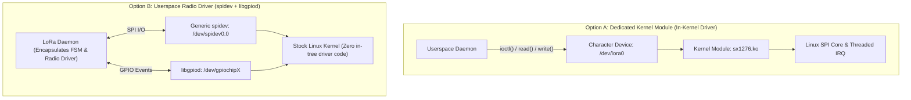
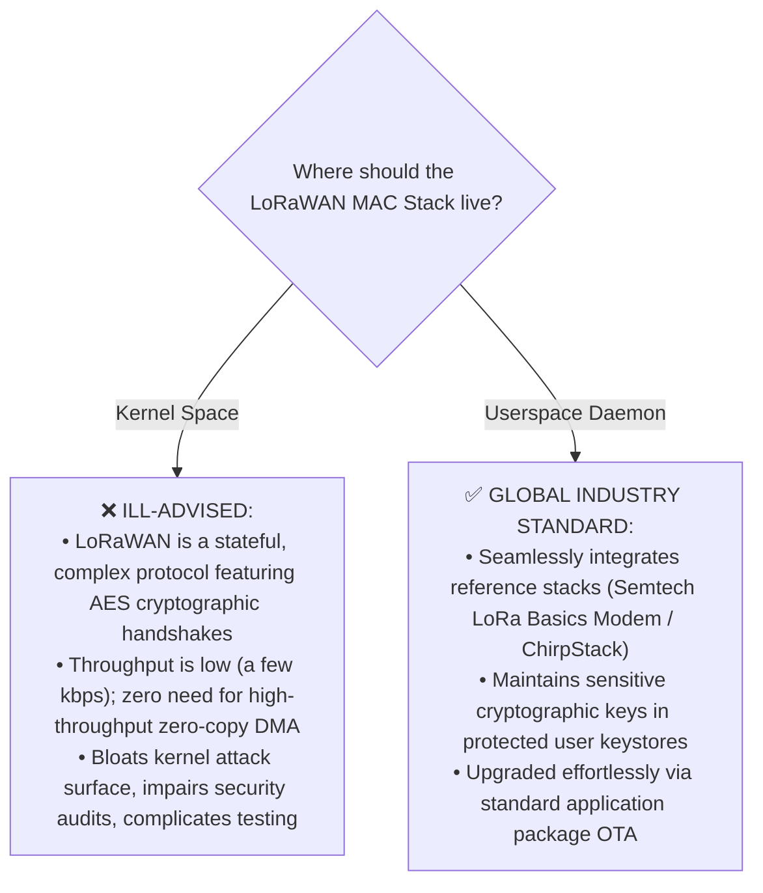

# LESSON 19: ARCHITECTURE COMPARISON: DEDICATED KERNEL DRIVER VS USERSPACE SPIDEV

> Summary: A comparative architectural evaluation of Linux radio integration strategies: authoring custom in-kernel modules (`.ko`) versus orchestrating userspace drivers via `spidev` and `libgpiod`, assessing interrupt latencies, fault domain isolation, and protocol stack boundaries.

---

## 1. Two Architectural Paradigms for LoRa on Linux

When integrating a Semtech LoRa transceiver (SX1276 or SX1262) into an embedded Linux platform (such as an automotive NXP i.MX8 or industrial compute module), software architects face a strategic crossroad:

---

## 2. Comprehensive Architectural Trade-Off Matrix

| Architectural Metric | Option A: In-Kernel Driver (`sx1276.ko`) | Option B: Userspace Driver (`spidev` + `libgpiod`) |
| :--- | :--- | :--- |
| **Development Complexity** | **Very High**: Demands deep proficiency in C kernel internals, Device Tree, atomic locks, and memory barriers. | **Low**: Authored in modern C++, Rust, or Python utilizing standardized POSIX APIs. |
| **Fault Blast Radius (Crash Impact)** | **Severe**: Memory corruptions, race conditions, or null pointers trigger immediate **Kernel Panics, halting the OS**! | **Isolated**: A software defect crashes only the local daemon; `systemd` or Android `init` revives it within milliseconds. |
| **Interrupt Latency** | **Sub-microsecond (< 10 µs)**: Threaded IRQs are scheduled with real-time kernel priority to empty FIFO bytes instantly. | **Moderate (50 µs – 200 µs)**: Hardware interrupt propagates through kernel before waking the userspace `epoll` listener. |
| **Kernel Upgrade Resilience** | **Fragile**: Kernel minor version updates frequently break internal driver APIs, necessitating DKMS rebuilds. | **Exceptional**: Standard userspace VFS interfaces remain stable across kernel versions 4.x, 5.x, and 6.x. |
| **Time-to-Market** | Substantial engineering weeks dedicated to driver stabilization and validation. | Rapid bring-up completed within days. |

---

## 3. Protocol Stack Placement: Kernel vs Userspace?

A pivotal architectural question arises: *Should the high-level LoRaWAN MAC stack reside in kernel space (similar to Linux Wi-Fi `mac80211` or Bluetooth `bluez`) or within userspace?*

> [!IMPORTANT]
> **Industrial Consensus:**
> Across tier-one industrial LoRaWAN gateway and telematics manufacturers (Multitech, Kerlink, Cisco, RAKwireless), the **entire LoRaWAN MAC engine operates strictly in Userspace**.
> The Linux kernel functions solely as an efficient transport pipe for raw hardware SPI transactions.

---

## 4. Decision Framework for System Architects

### When to Mandate Option A (Dedicated Kernel Driver)
1. **Deterministic Microsecond Latency Requirements**: The application demands microsecond-accurate hardware packet timestamping (e.g., Time Difference of Arrival [TDoA] geolocation).
2. **Clean Hardware Abstraction for Third Parties**: You need to package the radio hardware into a clean, unified `/dev/lora0` node, insulating higher-tier application developers from low-level SPI opcodes or GPIO mappings.
3. **Automotive / Hardened Environments**: Host SELinux security policies explicitly prohibit userspace applications from accessing unconstrained, generic `/dev/spidev` or `/dev/mem` nodes.

### When to Select Option B (`spidev` + `libgpiod`)
1. **LoRaWAN Gateway Installations**: Standard gateway packet forwarders (such as Semtech SX1302/03 HAL) are engineered natively to run on top of generic `spidev`.
2. **Rapid Prototyping and Proof-of-Concepts (PoC)**: Validating connected electric vehicle telematics feasibility without modifying base kernel builds.
3. **Frequent Kernel Maintenance Deployments**: Decoupling radio software updates from rolling operating system kernel security patches.

---

## 5. Core Engineering Notes & Best Practices

> [!TIP]
> **Distinguished Systems Architect Interview Question:** *"If tasked with integrating LoRa into an automotive Linux Smart Instrument Cluster, would you author a dedicated kernel driver or utilize userspace spidev? Defend your architecture."*
> 
> **Authoritative Technical Response:**
> "I would advocate for an **Engineered Hybrid Architecture**:
> 1. **At the Foundation Layer**: Author a **minimalist, hardened Character Driver in Kernel Space (`sx1276_spi`)** utilizing `request_threaded_irq()`. This driver has two focused responsibilities: deterministic hardware DIO0 interrupt handling without dropped frames under heavy CPU load, and presenting a unified `/dev/lora0` interface locked down by strict Android/Linux SELinux domain policies.
> 2. **At the Middleware Layer**: Host the entire LoRa/LoRaWAN protocol state machine, packet queues, retry/backoff engines, and cryptographic keys inside a dedicated **Userspace Edge Daemon**.
> This hybrid model combines the sub-microsecond determinism and hardware access security of a kernel driver with the fault-domain isolation of userspace — ensuring that a software defect in the telemetry protocol stack can never trigger a Kernel Panic on the automotive instrument cluster display!"

