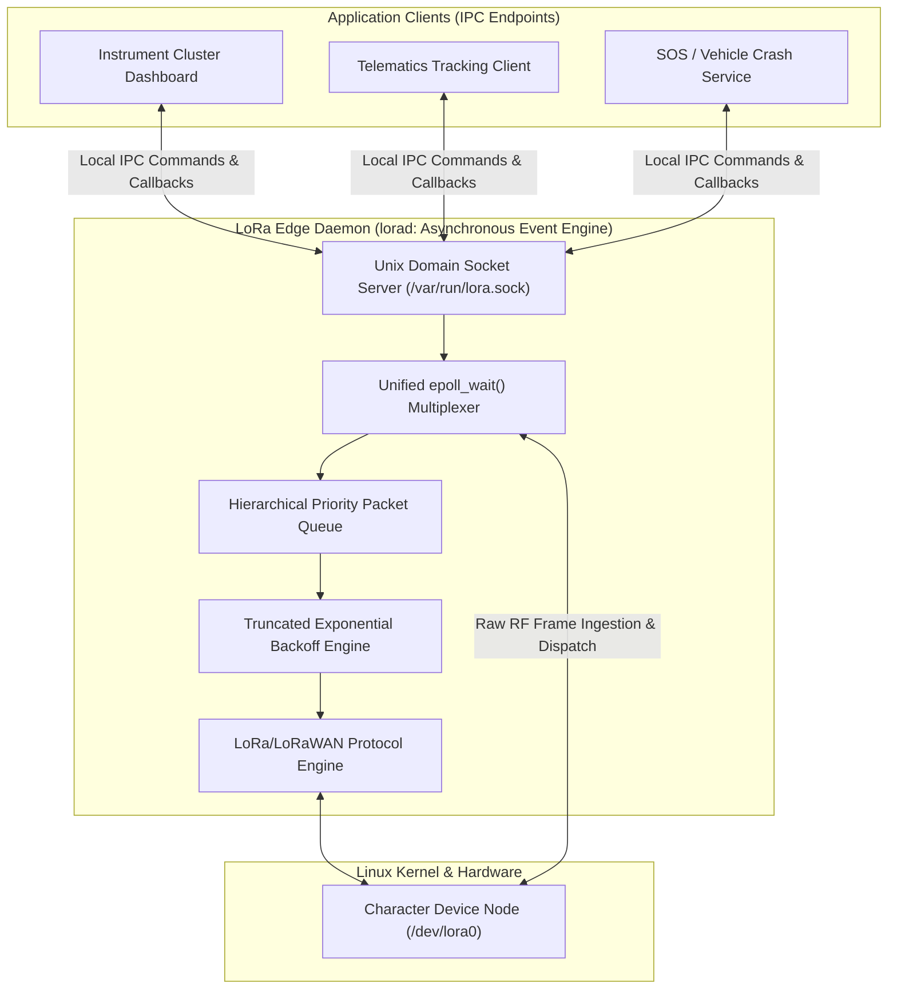
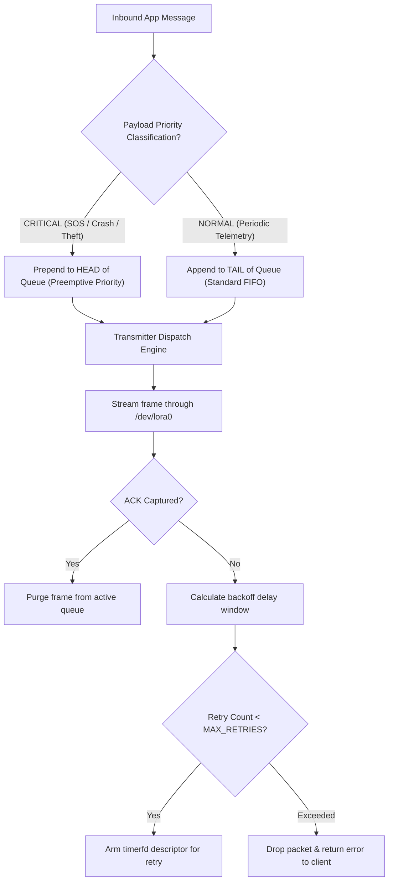

# LESSON 20: LINUX LORA EDGE DAEMON ARCHITECTURE: EPOLL EVENT LOOPS AND PACKET QUEUES

> Summary: Engineering an industrial-grade Linux userspace LoRa edge daemon (`lorad`), mastering asynchronous event multiplexing via `epoll_wait()`, implementing hierarchical message queues with randomized exponential backoff, and establishing systemd service lifecycle orchestration.

---

## 1. Architectural Role of a Linux Edge Daemon

In embedded automotive platforms (such as an Android Instrument Cluster or Linux Telematics Box), high-level user interface and cloud services do not interface directly with the raw `/dev/lora0` device node. Instead, all low-level RF transactions are centralized within an isolated system daemon: **The LoRa Edge Daemon (`lorad`)**:



---

## 2. High-Performance Event Multiplexing via `epoll`

Rather than spawning dozens of OS threads that introduce context-switching penalties and race conditions, production daemons adopt a single-threaded asynchronous reactor loop centered upon **`epoll_wait()`**.

A single `epoll` instance monitors four concurrent event streams:
1. **Radio Device Node (`/dev/lora0`)**: Fires `EPOLLIN` when incoming RF frames are latched in kernel memory.
2. **Unix Domain Socket (`/var/run/lora.sock`)**: Accepts local IPC connections from client applications requesting packet transmissions.
3. **Kernel Timer Descriptor (`timerfd`)**: Emits deterministic tick events to process retry timeouts and keep-alive heartbeats.
4. **Signal Descriptor (`signalfd`)**: Intercepts POSIX process signals (`SIGTERM`, `SIGINT`) synchronously, ensuring zero-leakage shutdowns.

---

## 3. Priority Queues and Truncated Exponential Backoff with Jitter

When multiple system components contend for radio airtime or when frames fail link-layer delivery:



### Exponential Backoff Formulation with Random Jitter
If an RF network interruption occurs, simultaneous retransmissions across synchronized nodes induce destructive packet collisions (the Avalanche Effect). Incorporating pseudo-random jitter is mathematically mandatory:

$$T_{delay} = \min\left(T_{max}, T_{base} \times 2^{retry}\right) \pm \text{Random\_Jitter}$$

---

## 4. Production C++ Daemon Implementation Utilizing `epoll`

```cpp
#include <iostream>
#include <vector>
#include <cstring>
#include <unistd.h>
#include <fcntl.h>
#include <sys/epoll.h>
#include <sys/socket.h>
#include <sys/un.h>
#include <sys/timerfd.h>

#define MAX_EPOLL_EVENTS 10
#define LORA_DEV_PATH    "/dev/lora0"
#define LORA_SOCKET_PATH "/var/run/lora.sock"

int main() {
    std::cout << "[lorad] Booting LoRa Edge Daemon..." << std::endl;

    // 1. Open non-blocking character device descriptor
    int lora_fd = open(LORA_DEV_PATH, O_RDWR | O_NONBLOCK);
    if (lora_fd < 0) {
        std::cerr << "Failed to open " << LORA_DEV_PATH << std::endl;
        return 1;
    }

    // 2. Establish Unix Domain Socket server for local IPC
    unlink(LORA_SOCKET_PATH);
    int server_sock = socket(AF_UNIX, SOCK_STREAM | SOCK_NONBLOCK, 0);
    struct sockaddr_un addr{};
    addr.sun_family = AF_UNIX;
    strncpy(addr.sun_path, LORA_SOCKET_PATH, sizeof(addr.sun_path) - 1);
    bind(server_sock, (struct sockaddr*)&addr, sizeof(addr));
    listen(server_sock, 5);

    // 3. Initialize epoll controller
    int epoll_fd = epoll_create1(0);
    struct epoll_event ev{}, events[MAX_EPOLL_EVENTS];

    // Register radio descriptor
    ev.events = EPOLLIN;
    ev.data.fd = lora_fd;
    epoll_ctl(epoll_fd, EPOLL_CTL_ADD, lora_fd, &ev);

    // Register IPC server socket descriptor
    ev.events = EPOLLIN;
    ev.data.fd = server_sock;
    epoll_ctl(epoll_fd, EPOLL_CTL_ADD, server_sock, &ev);

    std::cout << "[lorad] Listening on asynchronous epoll reactor loop..." << std::endl;

    // 4. Primary Reactor Loop (Consumes 0% CPU when quiescent)
    while (true) {
        int nfds = epoll_wait(epoll_fd, events, MAX_EPOLL_EVENTS, -1);
        for (int i = 0; i < nfds; ++i) {
            if (events[i].data.fd == lora_fd) {
                // Inbound RF packet detected
                uint8_t rx_buf[256];
                ssize_t bytes_read = read(lora_fd, rx_buf, sizeof(rx_buf));
                if (bytes_read > 0) {
                    std::cout << "[lorad] Demodulated LoRa frame: " << bytes_read << " bytes" << std::endl;
                    // Forward payload to connected IPC client sessions
                }
            } else if (events[i].data.fd == server_sock) {
                // Client application connecting to dispatch outbound payload
                int client_fd = accept(server_sock, nullptr, nullptr);
                std::cout << "[lorad] Client application connected via IPC" << std::endl;
                close(client_fd);
            }
        }
    }

    close(lora_fd);
    close(server_sock);
    close(epoll_fd);
    return 0;
}
```

---

## 5. Systemd Lifecycle Management Integration

To enforce automatic service recovery following transient hardware crashes, configure a systemd unit at `/etc/systemd/system/lorad.service`:

```ini
[Unit]
Description=LoRa Edge Telematics Daemon
After=network.target

[Service]
Type=simple
ExecStart=/usr/bin/lorad
Restart=always
RestartSec=3s
WatchdogSec=30s
User=root
StandardOutput=journal
StandardError=journal

[Install]
WantedBy=multi-user.target
```

