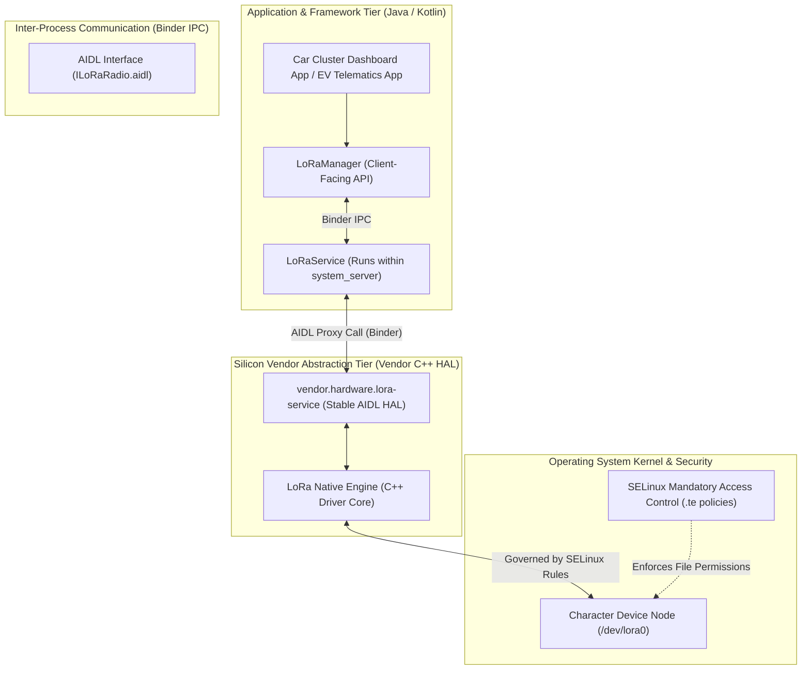

# LESSON 21: ANDROID AOSP INTEGRATION ARCHITECTURE: RADIO HAL, AIDL, AND SELINUX

> Summary: An architectural deep-dive into Android Open Source Project (AOSP) hardware integration, authoring modern Stable AIDL Hardware Abstraction Layers (HAL), orchestrating service initialization via `init.rc`, and configuring robust SELinux Type Enforcement security policies for automotive telematics clusters.

---

## 1. Multi-Tiered AOSP Architecture for Radio Subsystems

Within mission-critical Android Automotive setups (such as a Connected EV Smart Instrument Cluster), untrusted user-space applications are strictly prohibited from directly manipulating filesystem nodes like `/dev/lora0`. Software architecture mandates strict adherence to the **Android Open Source Project (AOSP)** multi-tier stack:



---

## 2. Engineering the Stable AIDL Hardware Abstraction Layer

Beginning with Android 11, Google deprecated legacy HIDL in favor of **Stable AIDL**. We define the hardware interface within `ILoRaRadio.aidl`:

```aidl
package android.hardware.lora;

import android.hardware.lora.ILoRaCallback;
import android.hardware.lora.LoRaConfig;

@VintfStability
interface ILoRaRadio {
    // Dispatch outbound radio payload
    void sendPayload(in byte[] payload);

    // Reconfigure physical layer parameters dynamically
    void configureModem(in LoRaConfig config);

    // Bind asynchronous packet reception listener
    void registerCallback(in ILoRaCallback callback);
}
```

The corresponding asynchronous callback definition `ILoRaCallback.aidl`:

```aidl
package android.hardware.lora;

@VintfStability
oneway interface ILoRaCallback {
    // Invoked by the HAL daemon when an incoming RF frame is captured
    void onPacketReceived(in byte[] payload, in int rssi, in int snr);
}
```

---

## 3. Early-Boot Daemon Initialization via `init.rc`

To guarantee that the native HAL service boots early in the Android lifecycle, provision an initialization script at `/vendor/etc/init/android.hardware.lora-service.rc`:

```rc
service vendor.lora-service /vendor/bin/hw/android.hardware.lora-service
    class hal
    user system
    group system
    capabilities NET_ADMIN
    shutdown critical
```

---

## 4. Hardening Device Nodes with SELinux Type Enforcement

Android enforces Mandatory Access Control via **Security-Enhanced Linux (SELinux)**. When operating in `Enforcing` mode, any unprivileged process attempting to access `/dev/lora0` triggers an immediate permission denial.

### 4.1 Labeling Physical Device Nodes in `file_contexts`
Located at `device/<vendor>/<product>/sepolicy/file_contexts`:
```text
/dev/lora[0-9]*    u:object_r:lora_device:s0
```

### 4.2 Provisioning Access Control Rules in `hal_lora.te`
Located at `device/<vendor>/<product>/sepolicy/hal_lora.te`:
```text
# 1. Declare domain identifiers for HAL executable
type hal_lora_default, domain;
type hal_lora_default_exec, exec_type, vendor_file_type, file_type;

init_daemon_domain(hal_lora_default)

# 2. Declare character device type
type lora_device, dev_type;

# 3. Grant explicit read/write/ioctl access to /dev/lora0
allow hal_lora_default lora_device:chr_file { open read write ioctl };

# 4. Authorize system_server to locate and bind HAL services via ServiceManager
binder_use(hal_lora_default)
binder_call(system_server, hal_lora_default)
allow system_server hal_lora_service:service_manager find;
```

---

## 5. Core Engineering Notes & Best Practices

> [!IMPORTANT]
> **Android Automotive / AOSP Architecture Question:** *"Why shouldn't an Android vehicle cluster application directly open `/dev/lora0` to radiate frames, instead of routing traffic through ServiceManager and an AIDL HAL?"*
> 
> **Authoritative Technical Response:**
> "Bypassing the framework violates three foundational operating system principles:
> 1. **SELinux Sandboxing and Least Privilege**: Application processes execute under unprivileged user IDs (`u0_a...`). SELinux strictly prohibits standard apps from opening raw character devices in `/dev`. Only designated Vendor HAL domains possess hardware access rights.
> 2. **Elimination of Resource Contention**: If concurrent applications (such as a GPS Tracker, Emergency SOS Monitor, and Battery Management daemon) open `/dev/lora0` concurrently, unsynchronized SPI writes will interleave and corrupt radio registers. A centralized System Service manages a serialized transmission queue.
> 3. **Hardware Decoupling (Portability)**: Upgrading transceiver silicon from an SX1276 to an SX1262 requires authoring changes strictly within the C++ Vendor HAL. Higher-tier Java/Kotlin framework and application code remain completely insulated from hardware modifications!"

