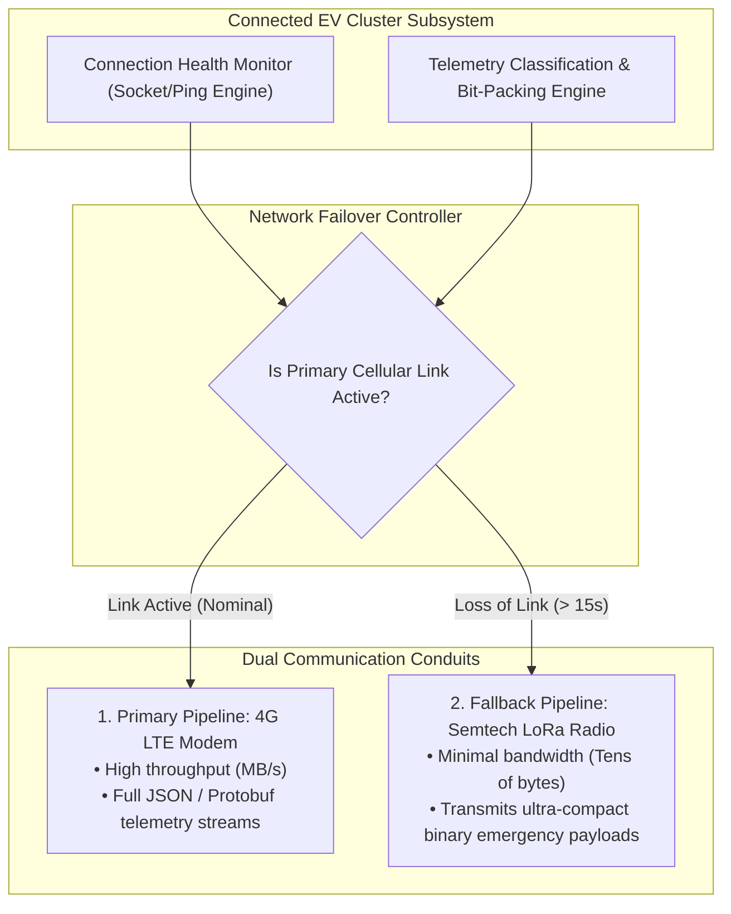
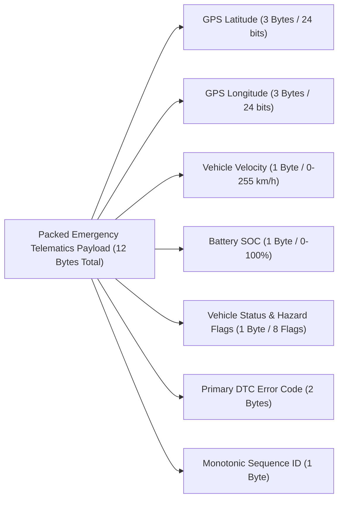
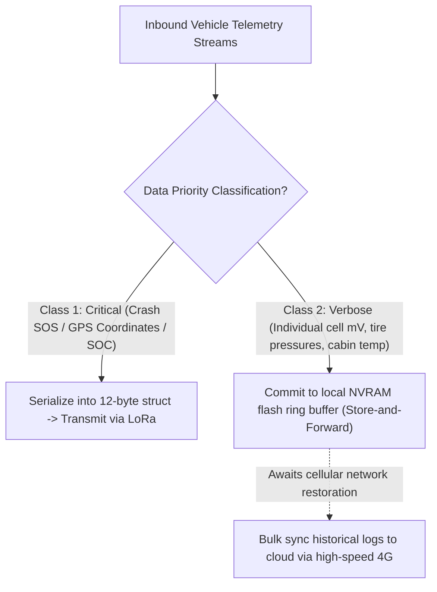

# LESSON 22: DESIGNING TELEMATICS FALLBACK SYSTEMS FOR SMART EVS DURING CELLULAR OUTAGES

> Summary: Engineering an automated failover switching architecture from 4G LTE/5G to LoRa for connected electric vehicles (EVs), implementing extreme binary bit-packing to compress critical vehicle telemetry below 16 bytes, and establishing store-and-forward queue throttles for RF spectrum compliance.

---

## 1. The Challenge: Cellular Dead-Zones in Automotive Telematics

Modern Connected Electric Vehicles (EVs) continuously radiate extensive telemetry streams (traction motor RPM, GPS coordinates, battery State of Charge [SOC], individual cell temperatures, and Diagnostic Trouble Codes [DTC]) over commercial **Cellular 4G LTE / 5G networks**.

However, cellular connectivity possesses inescapable physical dead zones:
- Subterranean concrete parking facilities and multi-level underground garages.
- High-altitude mountain highways and isolated rural valleys lacking cellular base stations (BTS).
- Catastrophic regional power grid collapses caused by severe weather events.



---

## 2. Extreme Binary Bit-Packing Architecture

Over a 4G pipeline, streaming a **1500-byte JSON payload** introduces negligible channel penalty. Over a LoRa physical link, however, transmitting 1500 bytes is physically impossible due to receiver limits and regional 1% Duty Cycle laws.

Firmware engineers must employ **Binary Bit-Packing** to compress the entire operational state of the vehicle into **less than 16 bytes**:



### 2.1 Compressing GPS Coordinates to 24 Bits (3 Bytes)
- Latitude spans $-90^\circ$ to $+90^\circ$ (a dynamic span of $180^\circ$).
- Allocating an unsigned 24-bit integer ($2^{24} = 16,777,216$ discreet steps):
  
  $$\text{Spatial Resolution} = \frac{180^\circ}{16,777,216} \approx 0.0000107^\circ \approx 1.1\text{ meters}!$$

- With only **3 bytes**, we achieve meter-level positioning accuracy, yielding an 85% payload compression relative to double-precision floats or ASCII strings.

### 2.2 Production C Packed Struct Definition

```c
#include <stdint.h>

// Enforce tight byte packing without compiler padding alignment
struct __attribute__((__packed__)) ev_telemetry_lora_payload {
    uint32_t lat_packed : 24;  // GPS Latitude serialized in 24 bits
    uint32_t lon_packed : 24;  // GPS Longitude serialized in 24 bits
    uint8_t  speed_kmh;        // Velocity: 0 to 255 km/h
    uint8_t  battery_soc;      // Battery state of charge: 0% to 100%
    uint8_t  vehicle_flags;    // Bitfield: [0: Ignition, 1: Door Open, 2: SOS Crash...]
    uint16_t primary_dtc;      // Most severe Diagnostic Trouble Code
    uint8_t  sequence_id;      // Rolling packet counter
};
// Total struct size matches exactly 12 bytes!
```

---

## 3. Store-and-Forward Telemetry Partitioning

When the primary cellular link collapses, telemetry streams must be dynamically partitioned:



> [!IMPORTANT]
> **Spectrum Airtime Throttling during Fallback:**
> Even in emergency fallback mode, firmware must respect regional spectrum compliance:
> - Throttle LoRa transmissions to **once every 60 to 120 seconds** while the vehicle is in motion.
> - Expand the transmission window to **once every 15 to 30 minutes** if the vehicle is immobilized.

---

## 4. Core Engineering Notes & Best Practices

> [!TIP]
> **Automotive Telematics System Design Question:** *"When designing a failover mechanism switching between 4G and LoRa on an electric vehicle, how do you prevent rapid, unstable connection toggling (Network Flapping) along fringe cellular boundaries?"*
> 
> **Authoritative Technical Response:**
> "We prevent network flapping by incorporating **Hysteresis Timing Windows** into the connection state machine:
> 1. **Cellular-to-LoRa Transition Criteria**: Do not trigger failover on an instantaneous drop. Require confirmation of total carrier loss across a continuous observation window (e.g., DNS socket ping failures for **15 consecutive seconds**).
> 2. **LoRa-to-Cellular Reversion Criteria**: When the 4G modem reacquires carrier signal, do not immediately disable the LoRa fallback pipe. Require the cellular link to demonstrate unbroken connectivity and successfully complete three handshake pings over a **minimum 30-second stabilization window**.
> This state hysteresis prevents high-frequency hardware switching oscillations along weak signal boundaries."

