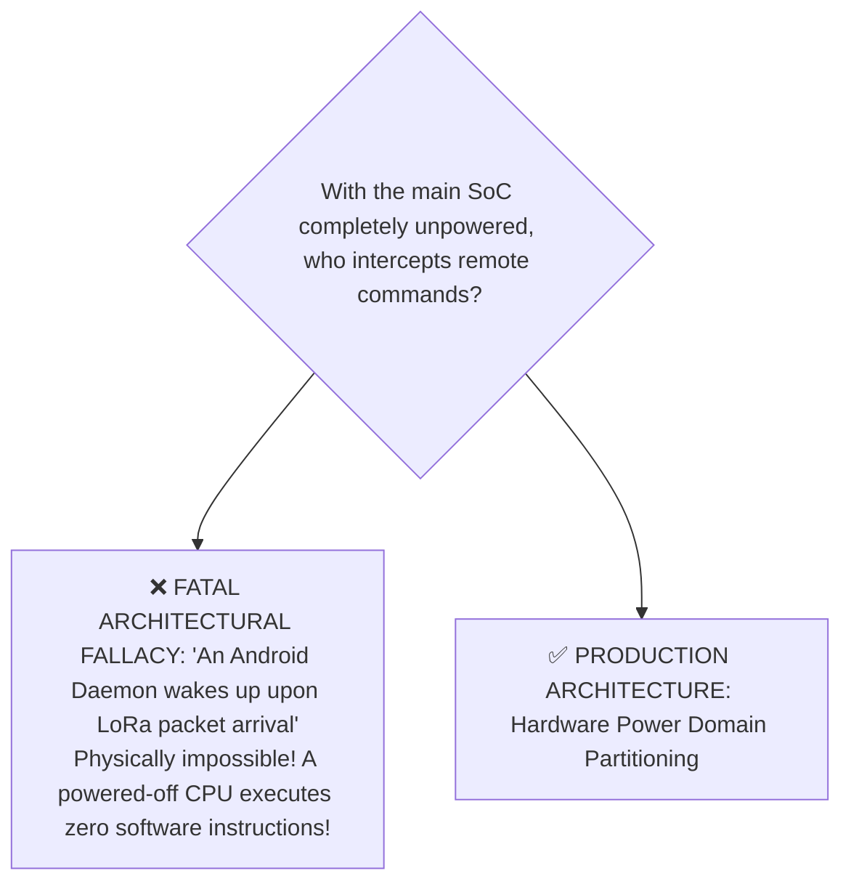
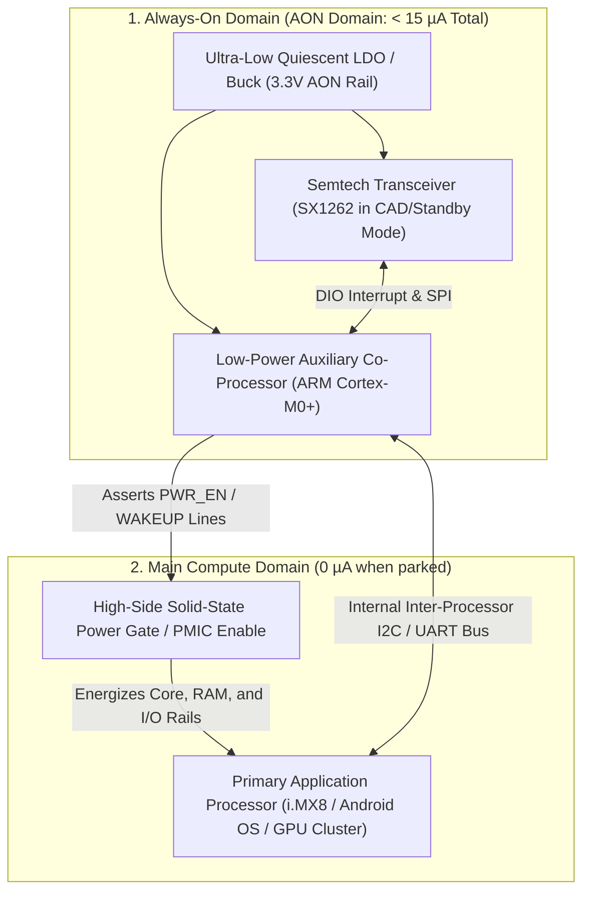

# LESSON 23: REMOTE WAKE-UP ARCHITECTURE AND POWER DOMAIN MANAGEMENT FOR SMART EVS

> Summary: Architectural design of isolated power domains in connected electric vehicles (EVs), detailing out-of-band LoRa remote wake-up mechanics, hardware PMIC sequencing, and cryptographic challenge-response defenses against battery-draining denial-of-service exploits.

---

## 1. The Parasitic Drain Dilemma in Parked Electric Vehicles

In high-performance automotive instrument clusters (running Android Automotive or Linux across multi-core SoCs such as the NXP i.MX8 or Qualcomm Snapdragon), active system compute demands between **2W and 8W** of continuous electrical power:
- If the primary application processor remains energized while parked to monitor unsolicited cloud commands, the vehicle's 12V auxiliary battery collapses completely within **3 to 5 days** (Vampire Drain).
- Consequently, upon vehicle ignition shut-off, the main computing core must enter total **Deep Power-Off** or deep **Suspend-to-RAM**.



---

## 2. Hardware Power Domain Partitioning Architecture

To achieve zero parasitic vampire drain while guaranteeing immediate responsiveness to remote telematics triggers, the cluster architecture physically segregates hardware into two discrete power domains:



### 2.1 Always-On Domain (AON Domain)
- Continuously biased by an ultra-low quiescent current LDO directly from the vehicle 12V battery rail.
- Houses a dedicated low-power co-processor (e.g., STM32L0 or integrated Cortex-M0+) and an SX1262 LoRa transceiver.
- The entire domain consumes a negligible **10 µA to 15 µA**, preserving vehicle battery state of charge across months of storage.

### 2.2 Main Compute Domain
- Encapsulates the application processor (SoC), LPDDR4 memory modules, eMMC/UFS storage, and display backlights.
- While the vehicle is locked and parked, high-side power switches sever all supply rails to this domain, driving current consumption to **precisely 0 Watts**.

---

## 3. Remote Wake-Up Signaling Protocol

When a vehicle owner issues a command via their smartphone application (such as *"Unlock Trunk"* or *"Pre-condition Climate Control"*):

```mermaid
sequenceDiagram
    participant CLOUD as Cloud / LoRa Roadside Gateway
    participant SX as SX1262 Transceiver
    participant MCU as Auxiliary Co-Processor (Cortex-M0+)
    participant PMIC as Power Management IC (PMIC)
    participant SOC as Primary Application SoC (Android)

    Note over SX,MCU: Vehicle Parked: SoC fully unpowered; Co-processor sleeping (10 µA)
    CLOUD->>SX: 1. Dispatches remote wake-up packet with extended preamble
    Note over SX: Internal CAD engine correlates preamble; asserts DIO1
    SX-->>MCU: 2. Wakes co-processor via EXTI rising-edge interrupt
    MCU->>SX: Reads command frame from FIFO over SPI
    
    Note over MCU: 3. VALIDATES CRYPTOGRAPHIC TOKEN (AES-CMAC / HMAC-SHA256)
    alt Cryptographic Signature INVALID (RF Noise or Spoofing Exploit)
        Note over MCU: Frame discarded! Co-processor re-enters deep sleep.<br>Main SoC remains completely protected!
    else Cryptographic Signature VALID
        MCU->>PMIC: 4. Asserts hardware PWR_EN line high
        Note over PMIC: Executes deterministic rail sequencing (Core, RAM, I/O)
        PMIC->>SOC: 5. Boots Android OS Kernel (2-3 second cold boot)
        SOC->>MCU: Queries wake-up cause and payload over internal I2C bus
        Note over SOC: Executes action: Triggers trunk solenoid / Starts AC compressor
    end
```

---

## 4. Defense Against Battery-Draining Denial-of-Service Attacks

> [!CAUTION]
> **Severe Automotive Security Vulnerability:**
> If an embedded system adopts a naive trigger: *"Power up the main computing SoC whenever any LoRa energy is detected"*, an attacker adjacent to the vehicle could broadcast continuous garbage LoRa packets.
> The vehicle cluster would boot and shut down hundreds of times overnight, totally depleting the 12V lead-acid battery and stranding the driver the following morning!

### Mandatory Co-Processor Defensive Controls
1. **Cryptographic Challenge-Response Verification**: Every downlink must transport a dynamic monotonic timestamp or counter signed with a pre-shared cryptographic key using **HMAC-SHA256** or **AES-128-CMAC**.
2. **Immediate Co-Processor Enforcement**: The tiny Cortex-M0+ validates the signature mathematically within 5 milliseconds. Malicious or corrupt frames are discarded immediately without energizing the power-hungry main SoC.
3. **Hardware Rate Limiting**: If three consecutive signature validation failures are logged, the co-processor enforces an exponential lockout window (e.g., ignoring wakeups for 15 minutes), neutralizing RF denial-of-service attacks.

---

## 5. Core Engineering Notes & Best Practices

> [!IMPORTANT]
> **Distinguished Automotive Embedded Interview Question:** *"In your remote wake-up architecture, because the primary Android SoC was completely unpowered when the wireless packet arrived, how does the Android operating system know what command was issued once it finishes booting?"*
> 
> **Authoritative Technical Response:**
> "We resolve this inter-domain state handoff through a **Dedicated Co-Processor Command Mailbox**:
> 1. The validated command frame is stored in the **retained static RAM of the auxiliary co-processor**, which remains continuously energized within the Always-On domain.
> 2. Once the co-processor asserts `PWR_EN` and the Android kernel completes early userspace initialization, a native hardware daemon (`lora-telematics-daemon`) opens an internal **I2C/UART bus link** to the co-processor.
> 3. The Android daemon dispatches a `GET_WAKEUP_REASON` query. The co-processor transfers the cached command payload across the internal bus for execution.
> 4. Upon task completion, if no physical occupant presence is sensed, the Android OS issues an `ENTER_SLEEP` handshake to the co-processor, which deasserts the PMIC `PWR_EN` pin, cleanly returning the vehicle to the 10 µA quiescent state."

