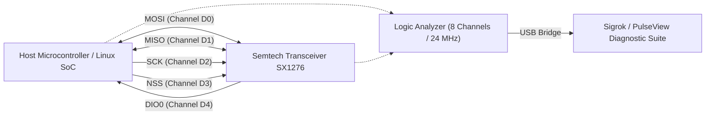
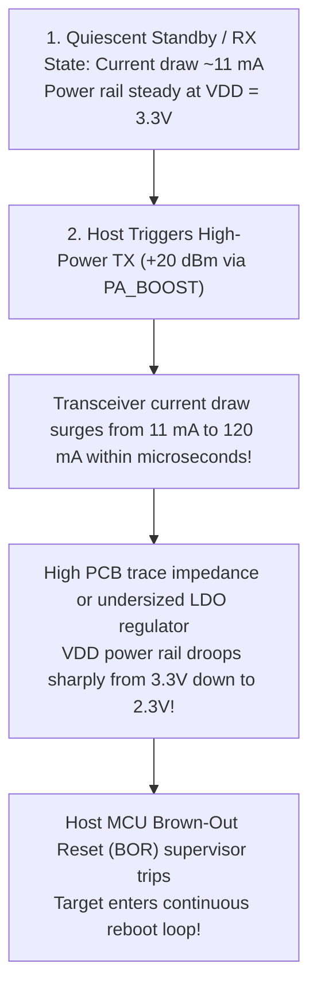
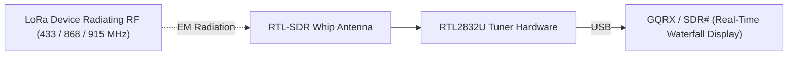

# LESSON 24: HARDWARE MEASUREMENT AND DEBUGGING: LOGIC ANALYZERS, SPI BUS, AND RF DIAGNOSTICS

> Summary: A practical laboratory instrumentation guide for diagnosing embedded LoRa hardware faults: configuring logic analyzer SPI protocol decoders, identifying power-rail brownout transients using oscilloscopes, and conducting RF spectral analysis utilizing low-cost Software Defined Radios (SDR).

---

## 1. SPI Bus Protocol Decoding via Logic Analyzers

When SPI communication between the host processor and the LoRa transceiver fails (such as reads constantly returning `0x00` or `0xFF`), the most deterministic diagnostic instrument is a **Multi-Channel Logic Analyzer (e.g., Saleae Logic or USB Logic Analyzers paired with open-source Sigrok / PulseView)**:

### 1.1 SPI Protocol Decoder Parameterization
Within the logic analyzer capture software, configure the SPI protocol decoder properties:
- **Clock Polarity (CPOL)**: `0` (Idle Low)
- **Clock Phase (CPHA)**: `0` (Sample on Leading/Rising Edge)
- **Bit Transmission Order**: `MSB First`
- **Data Word Length**: `8 bits`
- **Chip Select Line (Enable)**: `Active Low`

### 1.2 Waveform Anomaly Diagnostic Guide
1. **MISO Rail Clamped Permanently to 0V**:
   - Inspect the NSS line with a scope probe. If NSS fails to transition to a true $0\text{V}$ ground potential, the SX1276 internally clamps its MISO output in high-impedance (High-Z) mode.
2. **MISO Data Bits Shifted by Half a Clock Period**:
   - Indicates an SPI Mode mismatch (e.g., the host master is operating in Mode 1 or Mode 3, whereas the SX1276 demands strict **Mode 0**).
3. **DIO0 Never Transitions High Following Airtime**:
   - The interrupt mask register `RegIrqFlagsMask` (`0x11`) has bits asserted high, blocking silicon IRQ assertion, or `RegDioMapping1` maps an alternate pin function.

---

## 2. Oscilloscope Transient Analysis: The Power Rail Brownout Trap

A classic embedded hardware defect: *Firmware reads and writes SPI registers with zero bit errors, but initiating an RF transmission instantly triggers a host microcontroller crash or spontaneous reboot!*

> [!CAUTION]
> **Hardware Decoupling Design Rules:**
> 1. Place a high-capacity bulk electrolytic or tantalum capacitor ($47\text{ µF}$ to $100\text{ µF}$) in parallel with a $100\text{ nF}$ ceramic capacitor **immediately adjacent to the VDD power pins of the LoRa module** to provide instantaneous current reservoir charge during RF ramp-up.
> 2. Ensure the 3.3V voltage regulator possesses a minimum continuous rating of **$300\text{ mA}$ to $500\text{ mA}$**. Never power LoRa transmission stages directly from the 3.3V auxiliary output of cheap USB-to-UART bridge dongles (typically limited to 50 mA).

---

## 3. Wireless Spectrum Diagnostics via Software Defined Radio (SDR)

To verify whether the LoRa silicon is actually radiating energy over the air without expensive benchtop spectrum analyzers, connect a low-cost **RTL-SDR dongle (RTL2832U)** to a PC running **GQRX** or **SDR#**:

### What to Observe on the Spectral Waterfall Display
1. **Nominal Chirp Signatures**: Observe ascending diagonal frequency sweeps (Up-chirps) during the unmodulated preamble interval, followed by discontinuous instantaneous frequency wraps during modulated payload transmission.
2. **Quantifying Crystal Frequency Offset ($\Delta f$)**: If the observed carrier center deviates from configuration (e.g., programmed for 433.000 MHz but the spectral energy centers at 433.045 MHz), the onboard crystal oscillator exhibits a substantial $\Delta f = 45\text{ kHz}$ error. Re-evaluate the 32 MHz crystal load capacitance ($C_L$) matching network.

---

## 4. Antenna Impedance Matching via Vector Network Analyzers (NanoVNA)

If an antenna matching network fails to present an impedance of $50\ \Omega$ at the operational center frequency:
- Radiated power reflects back into the silicon.
- Voltage Standing Wave Ratio ($VSWR$) degrades, reducing range by over 80% and risking power amplifier destruction.

### Evaluation Criteria on a NanoVNA
- Return Loss ($S_{11}$) at Center Carrier Frequency:
  - $S_{11} < -10\text{ dB}$: Marginally acceptable threshold (~90% of forward power radiated).
  - $S_{11} < -20\text{ dB}$: **Optimal industrial match** (>99% of forward power radiated).
  - Standing Wave Ratio: $VSWR \le 1.5:1$.

