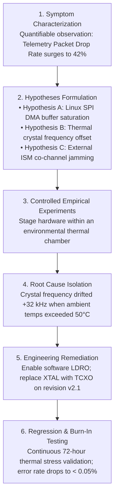
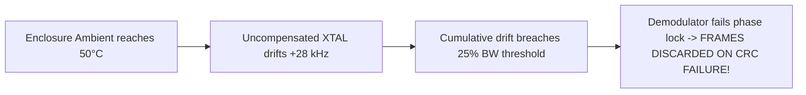
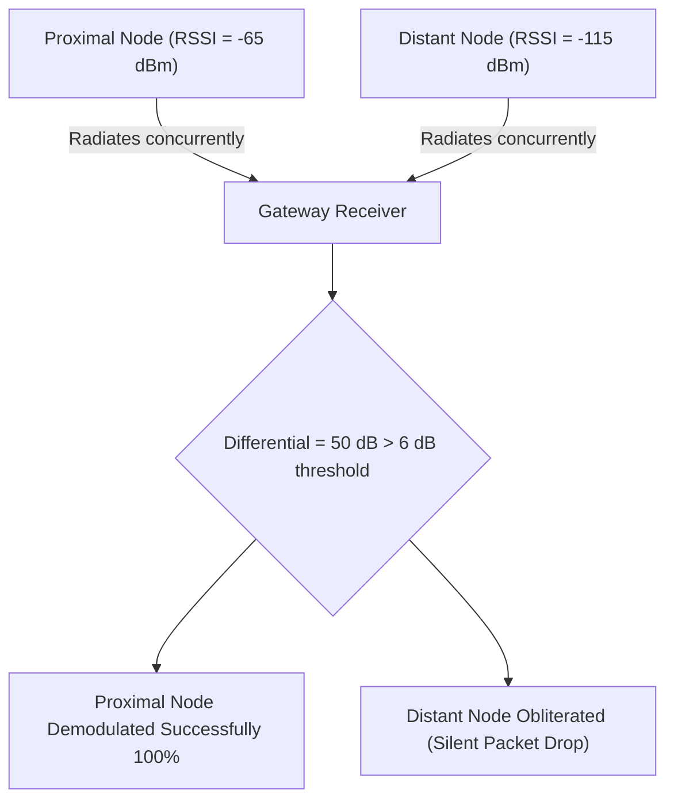

# LESSON 25: ROOT CAUSE ANALYSIS: INVESTIGATING PACKET DROPS AND FREQUENCY DRIFT

> Summary: Formulating a structured Root Cause Analysis (RCA) methodology for embedded wireless systems, examining real-world field case studies in thermal frequency drift and RF capture effect collisions, and establishing industrial technical post-mortem templates.

---

## 1. Structured Root Cause Analysis (RCA) Methodology

When mission-critical embedded hardware experiences field failures, senior systems engineers distinguish themselves through **disciplined, structured diagnostic methodology**:



---

## 2. Field Case Study 1: Mysterious High-Temperature Packet Drops

### 2.1 The Observable Symptom
An outdoor municipal deployment of 200 LoRa telemetry sensors operates with 99.8% reliability during the cool night ($22^\circ\text{C}$). However, during peak solar irradiance ($45^\circ\text{C}$ to $55^\circ\text{C}$ internal enclosure ambient), **packet loss rates spike above 45%**.

### 2.2 Forensic Investigation & Physical Principles
1. **Spectral Analysis via SDR**: Measuring the radiated center frequency of degraded nodes inside the thermal chamber at $50^\circ\text{C}$ reveals an acute frequency shift:
   
   $$\Delta f = +28\text{ kHz}$$
2. **Underlying Physics**:
   - The PCB design utilized uncompensated quartz crystals (XTAL) with a $\pm 30\text{ ppm}$ thermal coefficient.
   - At a carrier frequency of $868\text{ MHz}$, the thermal offset reaches:
     
     $$\Delta f_{drift} = 868\text{ MHz} \times 30\text{ ppm} \approx \pm 26\text{ kHz}$$
   - At a configuration of $BW = 125\text{ kHz}$, the Semtech LoRa demodulation engine tolerates a maximum carrier frequency offset of **$25\% \times BW \approx 31.25\text{ kHz}$**.
   - Compounding transmitter crystal offset with receiver gateway crystal offset pushes cumulative frequency error beyond $31.25\text{ kHz}$, causing the baseband correlation engine to lose phase lock!



### 2.3 Corrective Engineering Actions
1. **Immediate Firmware Patch**: Assert the `LowDataRateOptimize` (LDRO) bitfield within `RegModemConfig3` to expand demodulator frequency tolerance.
2. **Permanent Hardware Revamp**: Transition the bill-of-materials from standard crystals to a **Temperature Compensated Crystal Oscillator (TCXO)** featuring $\pm 1.0\text{ ppm}$ stability across $-40^\circ\text{C}$ to $+85^\circ\text{C}$.

---

## 3. Field Case Study 2: The LoRa RF Capture Effect & Near-Far Collisions

### 3.1 The Observable Symptom
In an industrial complex featuring 50 smart monitoring nodes: Nodes within 200 meters of the gateway achieve a 100% packet arrival rate, whereas perimeter nodes situated 2 to 3 km away experience persistent packet drops, despite benchtop verification confirming full link budget margins.

### 3.2 Physical Mechanics of the LoRa Capture Effect
LoRa exhibits an intrinsic RF characteristic known as the **Capture Effect**:
- When two concurrent transmissions collide on the identical channel frequency and Spreading Factor:
  - If the received power of Frame A exceeds Frame B by at least **$6\text{ dB}$** ($RSSI_A - RSSI_B \ge 6\text{ dB}$):
  - The gateway's digital receiver **drops the weaker frame and locks cleanly onto the stronger transmission**!
- **System Consequence**: High-power transmissions from proximal nodes systematically "consume" and blindfold the gateway from detecting distant perimeter nodes (The Classic Near-Far Problem).



### 3.3 Engineering Remediation
1. **Engage Adaptive Data Rate (ADR)**: Compel proximal nodes to attenuate transmission power down to $+2\text{ dBm}$ and accelerate to $SF7$, liberating airtime and receiver dynamic range for distant edge nodes.
2. **Enforce Asynchronous Transmission Jitter**: Introduce pseudo-random delay intervals to stagger transmission times and eliminate concurrent packet collisions.

---

## 4. Engineering Post-Mortem Incident Report Template

When conducting technical post-mortems for leadership or customer engineering audits, structure findings using international post-mortem reporting standards:

```text
================================================================================
ROOT CAUSE ANALYSIS (RCA) INCIDENT REPORT
Incident ID: INC-LORA-2026-08
Target System: Connected EV Smart Instrument Cluster
================================================================================

1. SYMPTOM CHARACTERIZATION:
   - Telemetry packet drop rate exhibited an anomalous surge to 42% occurring 
     daily between 11:30 and 14:00 local time.

2. INVESTIGATION HYPOTHESES:
   - [Refuted] Linux SPI DMA buffer saturation: Kernel buffers remained 85% free.
   - [Confirmed] Thermal frequency drift: Cluster temperature sensors logged 68°C 
     coinciding precisely with packet drop telemetry intervals.

3. ROOT CAUSE ISOLATION:
   - The 32 MHz crystal oscillator on the SX1276 daughtercard drifted +32 kHz 
     under elevated temperatures, breaching the demodulator's 25% BW tolerance ceiling.

4. CORRECTIVE ENGINEERING ACTIONS:
   - Software (Short-Term): Dispatched an OTA firmware update setting the 
     LowDataRateOptimize (LDRO) bit across all active production vehicles.
   - Hardware (Long-Term): Revised PCB schematic (v2.1) specifying a high-stability 
     ±1.0 ppm TCXO reference.

5. REGRESSION VERIFICATION:
   - 48-hour continuous thermal chamber burn-in at 75°C confirmed zero packet loss, 
     yielding a residual error rate of 0.02% (Fully compliant with QA standards).
================================================================================
```

