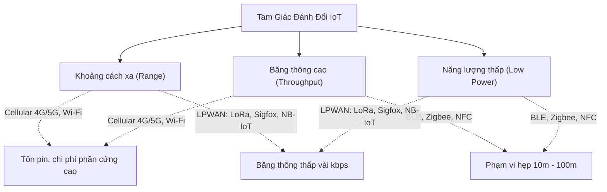
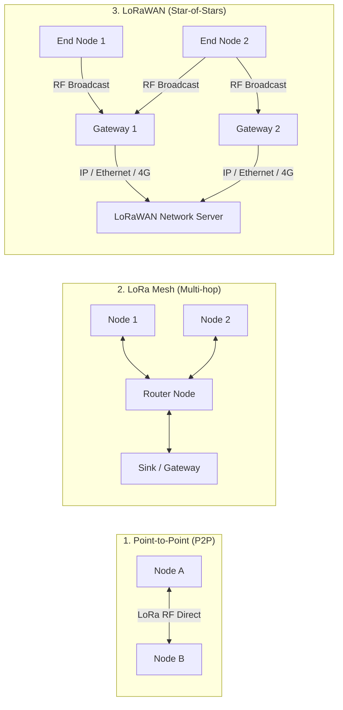
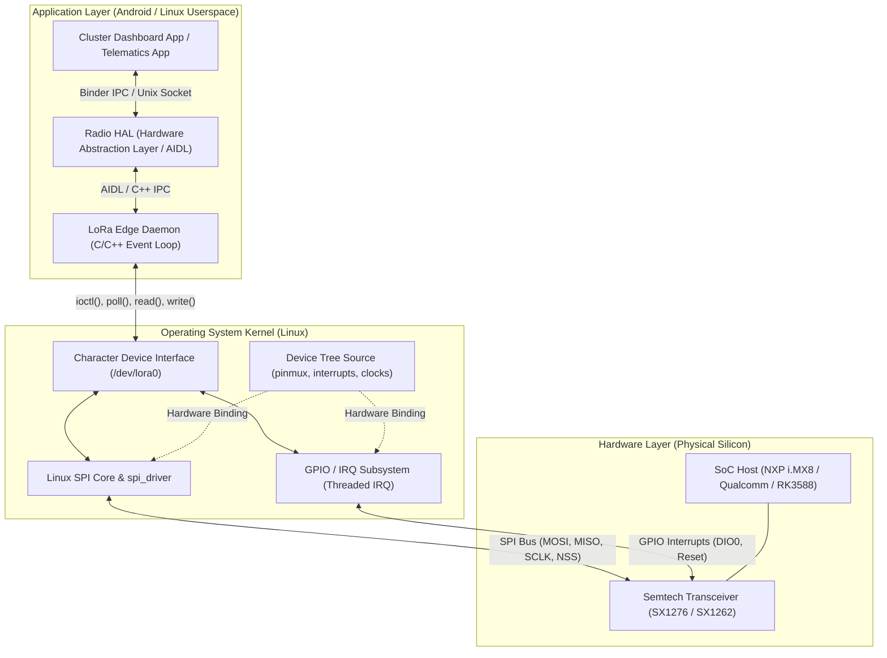

# BÀI 01: TỔNG QUAN LORA, LORAWAN VÀ HỆ SINH THÁI KẾT NỐI KHÔNG DÂY CÔNG NGHIỆP

> Tóm tắt: Phân tích bối cảnh phát triển của mạng diện rộng công suất thấp LPWAN, phân định rõ ràng ranh giới kỹ thuật giữa tầng vật lý LoRa và giao thức mạng LoRaWAN, đồng thời so sánh chi tiết các topo mạng Point-to-Point, Mesh và Star-of-Stars trong ứng dụng công nghiệp và viễn thông xe điện.

---

## 1. Bối Cảnh Ra Đời Của LPWAN Và Tam Giác Đánh Đổi IoT

Trong thiết kế hệ thống nhúng không dây (Embedded Wireless Systems), kỹ sư luôn phải đối mặt với **Tam giác đánh đổi cốt lõi (The IoT Trilemma)** giữa 3 yếu tố:
1. **Khoảng cách truyền dẫn (Range / Coverage)**.
2. **Băng thông dữ liệu (Data Rate / Throughput)**.
3. **Mức tiêu thụ năng lượng (Power Consumption)**.

Trước khi công nghệ **LPWAN (Low-Power Wide-Area Network)** xuất hiện:
- Các giao thức vô tuyến cự ly ngắn (Short-range) như **Bluetooth/BLE**, **Zigbee**, **Z-Wave** đạt mức tiết kiệm pin tuyệt vời nhưng bị giới hạn nghiêm ngặt về cự ly (thường dưới 100m).
- Các mạng di động viễn thông (Cellular) như **2G/3G/4G LTE** có thể truyền đi hàng chục cây số với băng thông rất lớn, nhưng module phần cứng đắt đỏ, đòi hỏi cấp nguồn liên tục hàng trăm mA và phụ thuộc chặt chẽ vào hạ tầng trạm phát sóng viễn thông cùng chi phí SIM hàng tháng.

**LPWAN ra đời để giải quyết khoảng trống này**: Cung cấp khả năng kết nối hàng chục km (vùng ngoại ô) hoặc 2–5 km (đô thị mật độ cao) với dòng tiêu thụ ở chế độ ngủ chỉ dưới vài microampere (µA), cho phép thiết bị vận hành liên tục 5–10 năm chỉ bằng một viên pin lithium đơn giản, với sự đánh đổi duy nhất là băng thông thấp (từ vài trăm bps đến vài chục kbps).

| Tiêu Chí So Sánh | Short-Range (BLE / Zigbee) | Cellular (4G / 5G) | LPWAN (LoRa / LoRaWAN) |
| :--- | :---: | :---: | :---: |
| **Cự ly truyền** | 10 m – 100 m | Toàn quốc (theo trạm BTS) | 2 km – 15 km (LOS) |
| **Băng thông** | 250 kbps – 2 Mbps | 10 Mbps – 1 Gbps | 300 bps – 50 kbps |
| **Dòng tiêu thụ đỉnh** | 10 mA – 30 mA | 200 mA – 2000 mA | 20 mA – 120 mA (khi TX) |
| **Dòng Sleep** | 1 µA – 5 µA | 10 mA – 50 mA | < 1 µA – 2 µA |
| **Tuổi thọ pin** | Vài tháng – 2 năm | Vài ngày – Vài tuần | 3 năm – 10 năm |
| **Chi phí hạ tầng** | Cục bộ trong nhà / xưởng | Phí viễn thông hàng tháng | Tự dựng Gateway hoặc dùng mạng công cộng |

---

## 2. Phân Định Ranh Giới Kỹ Thuật: LoRa PHY vs LoRaWAN MAC vs LoRa Mesh

Một trong những sai lầm kinh điển nhất của kỹ sư khi đi phỏng vấn hoặc triển khai dự án là **đồng nhất khái niệm LoRa với LoRaWAN**. Trong kỹ thuật viễn thông nhúng, chúng thuộc về các tầng hoàn toàn độc lập:

  

### 2.1 LoRa (Lớp Vật Lý - Physical Layer)
- **Bản chất**: LoRa (viết tắt của **Long Range**) là một công nghệ điều chế vô tuyến độc quyền được phát triển bởi Cycleo và được Semtech mua lại vào năm 2012.
- **Tầng OSI**: Thuộc **Tầng 1 (Physical Layer)**.
- **Đặc trưng**: Sử dụng kỹ thuật điều chế **Chirp Spread Spectrum (CSS)** biến đổi tần số theo thời gian để đạt độ nhạy thu cực cao (lên tới -148 dBm), có khả năng giải mã tín hiệu nằm sâu dưới mức nhiễu nền (Negative SNR).
- **Phần cứng**: Được hiện thực trực tiếp trong chip phần cứng của Semtech (ví dụ dòng transceiver SX1272, SX1276, SX1278, SX1261, SX1262).
- **Trách nhiệm**: Chuyển đổi các byte nhị phân thành sóng vô tuyến RF và ngược lại. LoRa **hoàn toàn không quan tâm** đến việc gói tin được gửi cho ai, định tuyến ra sao hay quản lý địa chỉ mạng như thế nào.

### 2.2 LoRaWAN (Giao Thức Tầng Liên Kết & Mạng - MAC & Network Layer)
- **Bản chất**: Là một đặc tả giao thức mạng mở (Open Standard) được quản lý và tiêu chuẩn hóa bởi liên minh **LoRa Alliance**.
- **Tầng OSI**: Thuộc **Tầng 2 (Data Link / MAC Layer)** và **Tầng 3 (Network Layer)**, chạy phía trên lớp vật lý LoRa.
- **Đặc trưng**: Thiết lập kiến trúc mạng dạng sao mở rộng (**Star-of-Stars**). Quản lý cơ chế kích hoạt thiết bị (OTAA / ABP), mã hóa hai tầng độc lập bằng chuẩn AES-128 (Network Session Key và Application Session Key), chia lịch thu nhận (Class A, Class B, Class C) và tự động thích ứng tốc độ phát (ADR - Adaptive Data Rate).
- **Thực thể mạng**: Định nghĩa rõ ràng vai trò của End Device, Gateway (Packet Forwarder), Network Server (LNS), Join Server và Application Server.

### 2.3 LoRa Mesh (Mạng Ad-hoc Tùy Biến)
- **Bản chất**: Là các giao thức mạng tự tổ chức nhiều chặng (Multi-hop) được xây dựng dựa trên lớp vật lý LoRa thông thường, phổ biến nhất là thư viện mã nguồn mở **RadioHead RHMesh** (dựa trên thuật toán định tuyến AODV rút gọn).
- **Đặc điểm**: Mỗi node LoRa vừa đóng vai trò thiết bị đầu cuối (End Node), vừa đóng vai trò chuyển tiếp (Router / Relay).
- **Không phải LoRaWAN**: LoRa Mesh không sử dụng hạ tầng Gateway hay Network Server của LoRa Alliance. Mạng hoạt động hoàn toàn cục bộ, phù hợp cho các khu vực bị khuất sóng vật lý sâu (hầm mỏ, rừng núi) nơi không thể dựng Gateway trung tâm.

> [!IMPORTANT]
> **Ranh giới bắt buộc phải ghi nhớ:**
> - LoRa là **công nghệ điều chế vô tuyến (PHY)** do Semtech sở hữu.
> - LoRaWAN là **chuẩn giao thức mạng (MAC)** do LoRa Alliance quản lý.
> - RadioHead RHMesh là **giao thức định tuyến đa chặng độc lập**, sử dụng LoRa PHY nhưng **không tương thích và không kết nối trực tiếp** vào mạng LoRaWAN tiêu chuẩn.

---

## 3. So Sánh Chi Tiết Các Topo Mạng Không Dây

Để lựa chọn đúng kiến trúc cho sản phẩm nhúng, kỹ sư cần phân tích ưu nhược điểm kỹ thuật của 3 cấu trúc mạng chính:

### 3.1 Point-to-Point (Điểm - Điểm)
* **Cơ chế**: Hai thiết bị cấu hình cùng tần số, cùng Spreading Factor, Bandwidth và Sync Word để truyền nhận trực tiếp dữ liệu thô cho nhau.
* **Ưu điểm**:
  * Cực kỳ đơn giản, không tốn tài nguyên RAM/Flash của MCU để chứa protocol stack.
  * Độ trễ tối thiểu (gần như tức thì sau khi phát sóng xong).
* **Nhược điểm**:
  * Không thể mở rộng quy mô (Scalability kém). Khi số lượng node tăng lên, xung đột kênh truyền (Packet Collision) phá vỡ toàn bộ hệ thống.
  * Không có cơ chế bảo mật mạng chuẩn hóa (phải tự viết mã hóa).
* **Ứng dụng**: Điều khiển từ xa công nghiệp (Pendant Controller), kết nối 1 cặp thiết bị truyền nhận chuyên biệt.

### 3.2 Mesh Network (Mạng Lưới Đa Chặng - RHMesh)
* **Cơ chế**: Dữ liệu đi từ Node nguồn, truyền qua một hoặc nhiều node trung gian (Hops) bằng thuật toán tìm đường (Route Discovery) để đến đích (Sink).
* **Ưu điểm**:
  * Vượt qua các chướng ngại vật địa hình lớn (núi non, kết cấu bê tông dày) bằng cách đặt các node chuyển tiếp quanh khúc quanh.
  * Tự tái lập đường đi (Self-healing) nếu một node trung gian bị chết.
* **Nhược điểm kỹ thuật cốt lõi**:
  * **Hao pin khủng khiếp ở các node Router**: Để có thể chuyển tiếp gói tin bất kỳ lúc nào, các node router phải mở bộ thu RX liên tục hoặc chu kỳ thức rất dày, triệt tiêu ưu thế tiết kiệm năng lượng của LoRa.
  * **Độ trễ tích lũy (Cumulative Latency)**: Mỗi chặng chuyển tiếp tốn thêm một khoảng Time-on-Air và thời gian xử lý hàng đợi.
  * **Xung đột băng tần nội bộ**: Khi node router phát lại gói tin của node con, sóng RF phát ra có thể gây nghẽn và can nhiễu chính các node lân cận.
  * **Giới hạn dung lượng**: Băng thông LoRa vốn rất thấp, việc truyền nhiều hop làm suy giảm nhanh chóng thông lượng toàn mạng.

### 3.3 Star-of-Stars (Hình Sao Mở Rộng - Chuẩn LoRaWAN)
* **Cơ chế**: Mọi End Node đều phát bản tin dưới dạng Broadcast không dây. **Tất cả các Gateway** nằm trong tầm phủ sóng nhận được gói tin đều chuyển tiếp nguyên vẹn (cùng metadata: RSSI, SNR, Timestamp) qua đường mạng IP (Ethernet, 4G, Wi-Fi) về một **Network Server trung tâm**. Network Server sẽ chịu trách nhiệm lọc trùng (De-duplication), xác thực tính toàn vẹn (MIC check) và giải mã.
* **Ưu điểm**:
  * **Tối ưu năng lượng tuyệt đối cho End Device**: Node phát xong có thể ngủ sâu ngay lập tức mà không phải thức dậy định tuyến hộ thiết bị khác.
  * **Tính dự phòng cao (Macro-diversity)**: Một gói tin phát ra có thể được 3–5 Gateway khác nhau cùng thu nhận. Nếu 1 Gateway mất điện, dữ liệu vẫn không bị thất thoát.
  * **Khả năng mở rộng khổng lồ**: Một cụm Gateway có thể phục vụ hàng triệu gói tin mỗi ngày từ hàng chục nghìn cảm biến.
* **Nhược điểm**:
  * Phụ thuộc vào hạ tầng Gateway kết nối Internet.
  * Chi phí triển khai ban đầu cao hơn so với mô hình P2P tự phát.

---

## 4. Kiến Trúc Tích Hợp Công Nghiệp: Từ MCU Đến Linux & AOSP

Trong các hệ thống công nghiệp hiện đại hoặc các thiết bị ô tô / xe điện thông minh (Connected EV Smart Instrument Cluster), module thu phát LoRa không chỉ giao tiếp đơn giản với một vi điều khiển nhỏ, mà được tích hợp sâu vào kiến trúc phần mềm nhiều tầng:

### Vai trò của LoRa trong Hệ thống Xe Điện Thông Minh (Connected EV)
1. **Kênh cứu hộ khẩn cấp (Emergency / SOS Telematics)**: Khi xe gặp nạn trong vùng không có sóng điện thoại (hầm đường bộ đèo dốc, núi cao), hệ thống kích hoạt gửi tọa độ GPS và tình trạng khẩn cấp qua LoRa băng tần cứu hộ.
2. **Kênh dự phòng (Cellular Fallback)**: Khi mất sóng 4G/5G, hệ thống gom các thông số trạng thái trọng yếu (Dung lượng pin SOC, áp suất lốp, mã lỗi DTC) thành gói tin nén kích thước nhỏ (vài chục byte) để truyền về trạm điều hành.
3. **Đánh thức từ xa công suất cực thấp (Remote Wake-up)**: Trong khi máy tính bảng điều khiển Android (SoC chính) tắt nguồn hoàn toàn để tiết kiệm ắc quy, module LoRa ở chế độ tiêu thụ dòng siêu nhỏ vẫn có thể bắt tín hiệu lệnh để đánh thức xe thông qua nguồn nuôi PMIC/MCU.

---

## 5. Bài Tập Tự Kiểm Tra & Thực Hành

1. **Phân tích thiết kế**: Giả sử bạn cần thiết kế hệ thống giám sát 500 cột đèn chiếu sáng thông minh trải dài 10 km dọc theo đường cao tốc. Bạn sẽ chọn topo mạng nào: P2P, LoRa Mesh hay LoRaWAN? Hãy phân tích dựa trên tiêu chí chi phí, độ trễ và độ tin cậy.
2. **Kiểm tra kiến trúc**: Liệt kê 4 loại thực thể phần mềm chạy trong không gian người dùng (Userspace) và không gian nhân (Kernel) của Linux khi muốn điều khiển một chip LoRa gắn trên bus SPI.
3. **Tự kiểm tra kiến trúc**: Hãy tự giải thích trong 60 giây sự khác nhau cốt lõi giữa tầng vật lý vô tuyến LoRa và tầng giao thức mạng LoRaWAN một cách gãy gọn, chính xác.

