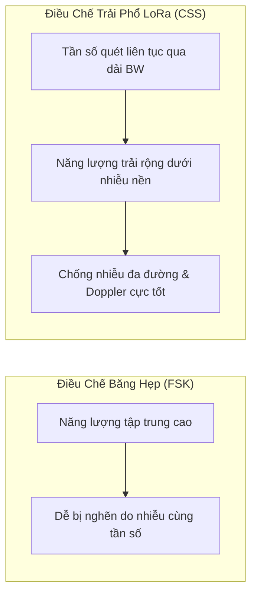
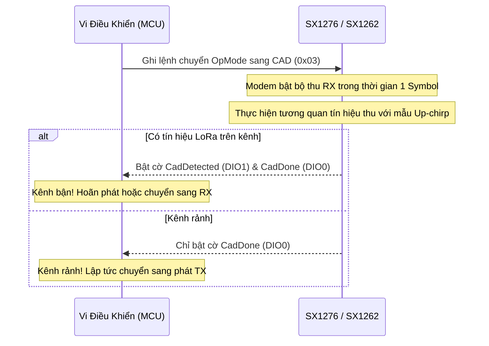

# BÀI 02: PHÂN TÍCH CHUYÊN SÂU LORA PHY: SPREADING FACTOR, BANDWIDTH VÀ LINK BUDGET

> Tóm tắt: Phân tích bản chất toán học và vật lý của điều chế Chirp Spread Spectrum (CSS), tính toán chi tiết các tham số cốt lõi SF, BW, CR, và cung cấp phương pháp xác định Time-on-Air cùng Link Budget trong thiết kế hệ thống nhúng vô tuyến thực tế.

---

## 1. Bản Chất Kỹ Thuật Của Điều Chế Chirp Spread Spectrum (CSS)

Khác với các công nghệ vô tuyến băng hẹp (Narrowband) truyền thống như FSK (Frequency Shift Keying) hay OOK (On-Off Keying) vốn tập trung toàn bộ năng lượng vào một tần số cố định rất hẹp, **LoRa sử dụng công nghệ trải phổ tiếng ríu (Chirp Spread Spectrum - CSS)**.

### 1.1 Khái Niệm Tín Hiệu Chirp
Một tín hiệu **Chirp** là một xung sóng hình sin có tần số thay đổi liên tục theo thời gian trong một dải băng thông xác định ($BW$):
- **Up-chirp (Chirp tăng tần)**: Tần số xuất phát từ biên dưới tần số ($f_c - BW/2$) quét tuyến tính tăng dần lên biên trên ($f_c + BW/2$).
- **Down-chirp (Chirp giảm tần)**: Tần số quét tuyến tính ngược chiều từ trên đỉnh xuống đáy.
- **Biểu diễn dữ liệu (Data Modulation)**: Trong một biểu tượng LoRa (Symbol), một chuỗi bit nhị phân được mã hóa bằng điểm nhảy tần (Frequency shift / instantaneous phase wrap). Khi chirp chạm đến tần số trần ($f_c + BW/2$), nó sẽ gập tức thì xuống đáy ($f_c - BW/2$) và tiếp tục quét lên.

  

### 1.2 Tại Sao CSS Lại Truyền Cực Xa và Chống Nhiễu Vượt Trội?
1. **Khả năng giải mã dưới mức nhiễu nền (Sub-noise Demodulation)**: Bộ giải điều chế LoRa sử dụng thuật toán tương quan (Correlation). Nhờ trải phổ năng lượng trên dải băng thông rộng, năng lượng tín hiệu có thể thấp hơn cả năng lượng nhiễu nhiệt ($SNR < 0\text{ dB}$). Máy thu vẫn có thể phát hiện và tái tạo chính xác tín hiệu gốc.
2. **Miễn nhiễm với hiệu ứng Đa đường (Multipath Fading Immunity)**: Trong môi trường đô thị hoặc nhà xưởng, sóng phản xạ từ các bức tường sẽ đến trễ hơn sóng trực tiếp. Do tần số của tín hiệu chirp thay đổi liên tục theo thời gian, sóng phản xạ trễ sẽ có tần số khác biệt so với sóng đang thu, cho phép bộ lọc tương quan dễ dàng loại bỏ sóng phản xạ như một nguồn nhiễu thông thường.
3. **Chống chịu hiệu ứng Doppler (Doppler Robustness)**: Sự dịch tần do chuyển động tương đối của vật thể (ví dụ xe ô tô đang chạy) chỉ làm dịch chuyển nhẹ trục thời gian của chirp chứ không phá vỡ cấu trúc giải mã tín hiệu.

---

## 2. Bộ Ba Tham Số Cốt Lõi: SF, BW và CR

Tốc độ truyền dữ liệu, cự ly và độ tin cậy của liên kết LoRa được quyết định hoàn toàn bởi 3 thông số cấu hình phần cứng:

### 2.1 Spreading Factor (Hệ Số Trải Phổ - SF)
- Định nghĩa: $SF$ là số lượng bit nhị phân được mã hóa bên trong một biểu tượng (Symbol). Giá trị $SF$ nằm trong khoảng từ **SF7 đến SF12** (trong một số cấu hình đặc thù có thể mở rộng SF5–SF6).
- Số lượng chip vật lý trên mỗi Symbol:
  
  $$\text{Số Chip} = 2^{SF}$$

  *Ví dụ:*
  * Ở $SF7$: Mỗi symbol chứa $7\text{ bits}$ và được tạo bởi $2^7 = 128\text{ chips}$.
  * Ở $SF12$: Mỗi symbol chứa $12\text{ bits}$ và được tạo bởi $2^{12} = 4096\text{ chips}$.
- **Đánh đổi kỹ thuật**:
  - Khi tăng $SF$: Năng lượng trên mỗi bit dữ liệu tăng gấp bội, độ nhạy máy thu tăng lên (thu được tín hiệu yếu hơn, truyền xa hơn).
  - Ngược lại: Thời gian phát sóng một symbol kéo dài gấp bội, làm giảm tốc độ dữ liệu và làm tăng thời gian chiếm dụng kênh truyền (Time-on-Air).

### 2.2 Bandwidth (Băng Thông Kênh Truyền - BW)
- Các mức băng thông tiêu chuẩn của Semtech: **125 kHz**, **250 kHz**, **500 kHz**.
- Tốc độ phát chip (Chip Rate) luôn bằng chính xác giá trị băng thông:
  
  $$R_c = BW \quad (\text{chips/giây})$$

- Thời gian tồn tại của một Symbol ($T_s$):
  
  $$T_s = \frac{2^{SF}}{BW}$$

  *Ví dụ:* Tại $BW = 125\text{ kHz}$:
  * $SF7$: $T_s = \frac{128}{125000} \approx 1.024\text{ ms}$.
  * $SF12$: $T_s = \frac{4096}{125000} \approx 32.768\text{ ms}$ (chậm hơn 32 lần!).

### 2.3 Coding Rate (Tỷ Lệ Mã Hóa Sửa Lỗi - CR)
LoRa sử dụng thuật toán sửa lỗi trước **Forward Error Correction (FEC)** để khôi phục các bit bị hỏng do xung nhiễu đột ngột mà không cần truyền lại toàn bộ gói tin:
- Ký hiệu: $CR = 4/(4 + n)$ với $n \in \{1, 2, 3, 4\}$, tương ứng với các cấu hình: **4/5, 4/6, 4/7, 4/8**.
- Ý nghĩa: Cứ mỗi 4 bit dữ liệu thực, bộ phát sẽ chèn thêm $n$ bit chẵn lẻ (parity bits).
- Cấu hình phổ biến nhất: **CR 4/5** (chỉ tốn thêm 25% overhead nhưng mang lại độ bền vững tín hiệu cao).

### 2.4 Công Thức Tính Tốc Độ Truyền Dữ Liệu Danh Định (Nominal Bitrate)

$$R_b = SF \times \frac{BW}{2^{SF}} \times CR \quad (\text{bps})$$

| Cấu Hình RF (BW = 125 kHz, CR = 4/5) | Thời Gian 1 Symbol ($T_s$) | Tốc Độ Danh Định ($R_b$) | Độ Nhạy Thu (SX1276) | Ngưỡng SNR Tối Thiểu |
| :--- | :---: | :---: | :---: | :---: |
| **SF7 / 125 kHz** | 1.024 ms | 5469 bps (~5.47 kbps) | -123 dBm | -7.5 dB |
| **SF8 / 125 kHz** | 2.048 ms | 3125 bps (~3.13 kbps) | -126 dBm | -10.0 dB |
| **SF9 / 125 kHz** | 4.096 ms | 1758 bps (~1.76 kbps) | -129 dBm | -12.5 dB |
| **SF10 / 125 kHz** | 8.192 ms | 977 bps (~0.98 kbps) | -132 dBm | -15.0 dB |
| **SF11 / 125 kHz** | 16.384 ms | 537 bps (~0.54 kbps) | -134.5 dBm | -17.5 dB |
| **SF12 / 125 kHz** | 32.768 ms | 293 bps (~0.29 kbps) | -137 dBm | -20.0 dB |

> [!NOTE]
> Bảng số liệu trên chứng minh bản chất cốt lõi: Khi chuyển từ SF7 sang SF12, độ nhạy thu được cải thiện thêm **14 dB** (tương đương cự ly tăng hơn gấp đôi trong không gian tự do), nhưng tốc độ đường truyền giảm từ **5.47 kbps xuống chỉ còn 293 bps**!

---

## 3. Cấu Trúc Khung LoRa & Phân Tích Time-on-Air (ToA)

Hiểu rõ cấu trúc khung truyền giúp kỹ sư tối ưu hóa kích thước payload và đáp ứng các quy chuẩn pháp lý về vô tuyến.

### 3.1 Các Thành Phần Của Một Gói Tin LoRa
1. **Preamble (Tiền đạo)**: Là một chuỗi gồm các Unmodulated Up-chirps (mặc định cấu hình từ 8 đến 12 symbols) dùng để máy thu đồng bộ tần số và thời gian lấy mẫu.
2. **Sync Word (Từ đồng bộ)**:
   - Giá trị `0x12` (mặc định): Dành cho mạng nội bộ riêng tư (LoRa Private Networks / P2P / RadioHead).
   - Giá trị `0x34`: Dành riêng cho mạng công cộng **LoRaWAN Public Networks**.
   - Thiết bị mang giá trị Sync Word khác nhau sẽ tự động lọc bỏ gói tin của nhau ngay từ tầng phần cứng, tránh làm thức giấc CPU.
3. **Header**:
   - **Explicit Header Mode**: Header chứa độ dài payload, tỷ lệ mã hóa CR và cờ bật/tắt CRC của payload. Được dùng khi độ dài gói tin thay đổi linh hoạt.
   - **Implicit Header Mode**: Lược bỏ toàn bộ phần Header để tiết kiệm từng millisecond phát sóng, nhưng cả bên phát và bên thu bắt buộc phải thống nhất cứng từ trước độ dài payload và CR.
4. **Payload & Payload CRC**: Dữ liệu người dùng (từ 1 đến 255 bytes). CRC 16-bit ở đuôi gói tin giúp máy thu phát hiện lỗi toàn vẹn gói.

### 3.2 Tối Ưu Tốc Độ Thấp: Low Data Rate Optimization (LDRO)
Khi thời gian của một symbol vượt quá **16 ms** (xảy ra ở cấu hình **SF11 và SF12 với BW 125 kHz**), sự trôi dạt tần số của dao động thạch anh (Crystal Drift) do biến đổi nhiệt độ có thể làm hỏng việc giải mã.
- Khi bật cờ LDRO (bit `LowDataRateOptimize` trong thanh ghi `RegModemConfig3`), modem sẽ tự động phân bổ thêm 2 bit dịch tần trong mỗi symbol.
- **Quy tắc vàng**: Bắt buộc phải bật LDRO đồng bộ ở cả bên phát và bên thu khi $T_s > 16\text{ ms}$.

### 3.3 Cách Tính Time-on-Air (ToA)
Tổng thời gian chiếm dụng sóng của một gói tin gồm thời gian phát Preamble và thời gian phát Payload:

$$ToA = T_{preamble} + T_{payload}$$

Trong đó:
- $T_{preamble} = (N_{preamble} + 4.25) \times T_s$
- $T_{payload} = N_{payload\_symbols} \times T_s$

Số lượng symbol của phần Payload ($N_{payload\_symbols}$) được tính theo công thức từ tài liệu chính thức của Semtech:

$$N_{payload\_symbols} = 8 + \max\left( \left\lceil \frac{8PL - 4SF + 28 + 16CRC - 20IH}{4(SF - 2DE)} \right\rceil \times (CR + 4), 0 \right)$$

*Giải thích các biến số:*
- $PL$: Số byte của Payload (ví dụ 20 bytes).
- $CRC$: Bằng 1 nếu bật CRC, bằng 0 nếu tắt.
- $IH$: Bằng 1 nếu dùng Implicit Header, bằng 0 nếu dùng Explicit Header.
- $DE$: Bằng 1 nếu bật LDRO (Low Data Rate Optimization), bằng 0 nếu tắt.
- $CR$: Giá trị từ 1 đến 4 (tương ứng với CR 4/5 đến 4/8).

> [!WARNING]
> **Quy định pháp lý về Duty Cycle 1%:**
> Tại các băng tần ISM miễn cấp phép (như 868 MHz ở Châu Âu hoặc 433 MHz ở một số vùng), thiết bị bị giới hạn **Duty Cycle ở mức 1%** (tổng thời gian phát không vượt quá 36 giây trong mỗi giờ).
> * Nếu một gói tin phát ở **SF12** mất $ToA = 1.4\text{ giây}$, thiết bị bắt buộc phải **ngừng phát (Silent Time) ít nhất 138.6 giây** trước khi được phép phát gói tiếp theo!

---

## 4. Đo Lường Tín Hiệu: RSSI, SNR, Link Budget & Hiện Tượng Bão Hòa

Để đánh giá chất lượng liên kết vô tuyến, kỹ sư nhúng phải theo dõi chặt chẽ hai thông số được trả về từ thanh ghi của chip sau mỗi lần thu thành công:

### 4.1 RSSI (Received Signal Strength Indicator)
- **Đơn vị**: dBm (decibel-milliwatts). Thang đo logarit biểu diễn công suất nhận được tại cổng anten máy thu.
- **Khoảng giá trị**: Thường từ **-30 dBm** (tín hiệu cực mạnh, đặt sát cạnh nhau) đến **-135 dBm** (tín hiệu cực yếu, chạm ngưỡng giới hạn thu).
- **Lưu ý thanh ghi SX1276**: Giá trị đọc từ thanh ghi `RegPktRssiValue` cần được cộng với giá trị bù tần số (RSSI Offset):
  
  $$RSSI\ (\text{dBm}) = -157 + \text{RegPktRssiValue} \quad (\text{đối với dải tần cao HF: 868/915 MHz})$$
  
  $$RSSI\ (\text{dBm}) = -164 + \text{RegPktRssiValue} \quad (\text{đối với dải tần thấp LF: 433 MHz})$$

### 4.2 SNR (Signal-to-Noise Ratio)
- **Đơn vị**: dB. Tỷ số giữa công suất tín hiệu nhận được so với công suất nhiễu nền môi trường:
  - $SNR > 0\text{ dB}$: Tín hiệu mạnh hơn nhiễu nền.
  - $SNR < 0\text{ dB}$: Tín hiệu nằm **dưới mức nhiễu nền** (đặc sản độc nhất vô nhị của LoRa!).
- Ở cấu hình **SF12**, SX1276 có thể giải mã chuẩn xác dữ liệu ngay cả khi $SNR = -20\text{ dB}$ (nghĩa là công suất nhiễu lớn gấp 100 lần công suất tín hiệu có ích).

### 4.3 Tính Toán Link Budget (Quỹ Dự Phòng Liên Kết)
Link Budget biểu thị tổng suy hao tối đa cho phép trên đường truyền sóng mà máy thu vẫn có thể bắt được gói tin:

$$\text{Link Budget}\ (\text{dB}) = P_{TX} - \text{Sensitivity}_{RX}$$

*Ví dụ:*
- Công suất phát của SX1276: $P_{TX} = +14\text{ dBm}$ (hoặc tối đa $+20\text{ dBm}$ với chân PA_BOOST).
- Độ nhạy thu ở SF12/125 kHz: $\text{Sensitivity}_{RX} = -137\text{ dBm}$.
- **Link Budget**: $14 - (-137) = 151\text{ dB}$!
- Giá trị Link Budget trên $150\text{ dB}$ cho phép sóng vô tuyến LoRa xuyên qua nhiều tầng bê tông cốt thép hoặc truyền xa hàng chục cây số trong điều kiện tầm nhìn thẳng (LOS).

### 4.4 Hiện Tượng Bão Hòa Máy Thu (Receiver Saturation / Swamping)

> [!CAUTION]
> **Cảnh báo lỗi trong phòng lab:**
> Khi đặt 2 module LoRa cách nhau dưới 1 mét trên bàn làm việc và phát ở công suất cao (+14 đến +20 dBm), mức năng lượng đi vào cổng thu có thể vượt quá **-30 dBm**.
> Điều này làm mạch khuếch đại nhiễu thấp (LNA) của chip bị bão hòa phi tuyến, méo dạng chirp và gây ra tình trạng **rớt gói tin hàng loạt (Packet Drop)**. Kỹ sư thiếu kinh nghiệm thường lầm tưởng do lỗi code SPI hoặc hỏng chip. Luôn giảm công suất phát xuống mức tối thiểu (2–5 dBm) hoặc đặt cách xa nhau ít nhất 2–3 mét khi thử nghiệm trên bàn lab!

---

## 5. Cơ Chế Channel Activity Detection (CAD)

Trong các giao thức vô tuyến thông thường, máy thu dùng bộ phát hiện năng lượng RSSI để xem kênh truyền có đang bận hay không (CSMA/CA). Nhưng với LoRa, tín hiệu thường nằm **dưới mức nhiễu nền**, nên bộ đo năng lượng RSSI hoàn toàn bất lực.

Semtech giải quyết bài toán này bằng tính năng phần cứng độc quyền: **Channel Activity Detection (CAD)**.

### 5.1 Ưu Điểm Tuyệt Đối Của CAD Về Năng Lượng
- Thời gian một chu kỳ CAD chỉ kéo dài tương đương **1 biểu tượng chirp ($T_s$) cộng thêm 32 chips**, tức khoảng vài millisecond.
- Thay vì phải duy trì trạng thái thu liên tục (Continuous RX tiêu tốn dòng ~11 mA liên tục), một node pin chỉ cần định kỳ thức dậy, thực hiện CAD trong ~2 ms (tiêu tốn năng lượng cực nhỏ), nếu không thấy preamble thì lập tức quay về trạng thái Deep Sleep.
- Kỹ thuật này giúp kéo dài tuổi thọ pin của thiết bị lên tới nhiều năm.

### 5.2 CAD Có Đảm Bảo 100% Không Va Chạm Gói Không?
Câu trả lời kỹ thuật dứt khoát là: **KHÔNG**.
1. **Preamble Misalignment**: CAD hoạt động hiệu quả nhất khi bắt được phần Preamble của gói tin. Nếu gói tin của node khác đã truyền đến phần thân payload, khả năng phát hiện của CAD suy giảm.
2. **Race Condition (Hiện tượng tranh chấp đồng thời)**: Hai node A và B có thể cùng thực hiện CAD tại cùng một thời điểm, cả hai cùng thấy kênh rảnh, và cùng quyết định phát sóng ngay sau đó. Kết quả là hai gói tin đâm sầm vào nhau trên không gian vô tuyến.
3. **Ẩn Node (Hidden Node Problem)**: Node A và Node B nằm ngoài tầm phủ sóng của nhau, nhưng cùng nằm trong tầm phủ sóng của Gateway C. Khi cả hai cùng CAD, cả hai đều thấy kênh trống nhưng Gateway C sẽ bị nhiễu và mất cả hai gói.

---

## 6. Tổng Kết Kỹ Thuật & Bài Tập Vận Dụng

### Ghi Nhớ Cốt Lõi (Top 5 Key Takeaways)
1. **SF càng lớn** thì độ nhạy thu càng cao, truyền càng xa, nhưng ToA tăng theo hàm mũ và tốc độ bit giảm mạnh.
2. **LoRa có thể thu dưới mức nhiễu nền** nhờ kỹ thuật tương quan trải phổ CSS ($SNR$ âm, lên tới -20 dB ở SF12).
3. **Bắt buộc bật LDRO** khi thời gian symbol $T_s > 16\text{ ms}$ (điển hình là SF11 và SF12 ở băng thông 125 kHz).
4. **CAD** là phương pháp kiểm tra kênh bận bằng tương quan mẫu chirp, tiết kiệm pin vượt trội so với mở cổng RX liên tục nhưng không thể triệt tiêu 100% va chạm gói.
5. Khi thử nghiệm bàn lab gần nhau, phải **giảm công suất phát** để tránh bão hòa máy thu (Receiver Saturation).

### Bài Tập Tính Toán Thực Hành
Một thiết bị truyền gói tin đo xa dung lượng payload $PL = 24\text{ bytes}$, cấu hình:
- Tần số: 433 MHz, $SF = 7$, $BW = 125\text{ kHz}$, $CR = 4/5$, Preamble = 8 symbols, Explicit Header, có CRC.
- **Yêu cầu:**
  1. Tính thời gian của một symbol $T_s$.
  2. Tính tốc độ bit danh định $R_b$.
  3. Tính tổng thời gian phát sóng Time-on-Air (ToA) của gói tin.
  4. Nếu quy định Duty Cycle là 1%, thiết bị cần ngủ tối thiểu bao nhiêu giây trước khi gửi gói tin kế tiếp?

