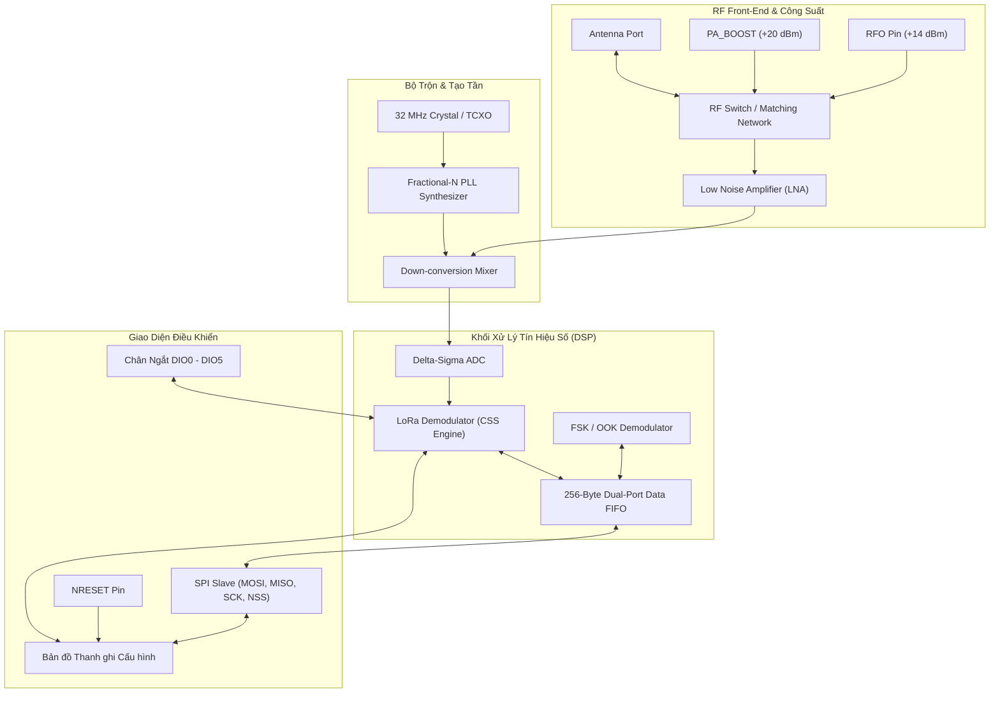
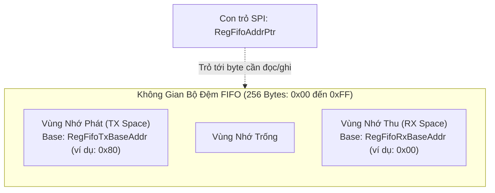
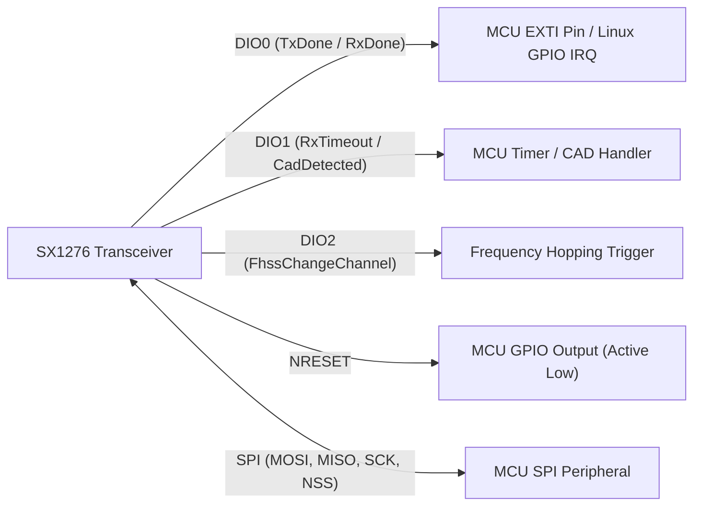

# BÀI 03: GIẢI MÃ TRANSCEIVER SEMTECH SX1276, SX1278 VÀ SX1262

> Tóm tắt: Phân tích kiến trúc vi mạch bán dẫn của dòng chip thu phát LoRa Semtech SX1276/78 và thế hệ mới SX1262, bóc tách toàn diện bản đồ thanh ghi quan trọng, cấu hình đường công suất RF và cơ chế quản lý bộ đệm FIFO 256 bytes qua bus SPI.

---

## 1. Kiến Trúc Phần Cứng Của Semtech Transceiver

Để phát triển driver ở mức thấp hoặc gỡ lỗi giao tiếp SPI, kỹ sư nhúng phải hiểu tường tận sơ đồ khối bên trong của transceiver.



### 1.1 Khối Công Suất Phát: RFO vs PA_BOOST
Dòng chip SX1276/78 cung cấp hai đường ra công suất phát độc lập:
1. **Chân RFO (`RFO_HF` / `RFO_LF`)**:
   - Mức công suất tối đa: $+14\text{ dBm}$ (khoảng $25\text{ mW}$).
   - Hiệu suất năng lượng cao, dòng tiêu thụ vừa phải (~$28\text{ mA}$).
2. **Chân PA_BOOST**:
   - Mức công suất tối đa: $+20\text{ dBm}$ (khoảng $100\text{ mW}$).
   - Dòng tiêu thụ đỉnh có thể lên tới $120\text{ mA}$.
   - Chế độ này bắt buộc phải điều khiển thêm thanh ghi `RegPaDac` để kích hoạt mạch nguồn chuyên dụng.

> [!CAUTION]
> **Rủi ro cháy cổng RF do sai Anten:**
> Không bao giờ kích hoạt chế độ phát sóng (TX) ở mức công suất $+20\text{ dBm}$ khi chưa gắn anten hoặc gắn sai loại anten phù hợp tần số. Sóng phản xạ do mất phối hợp trở kháng ($VSWR$ cao) sẽ dội ngược lại và đánh thủng tầng khuếch đại công suất PA của chip!

---

## 2. Bản Đồ Thanh Ghi Cốt Lõi (Register Map) Của SX1276/78

Giao tiếp với SX1276 được thực hiện hoàn toàn qua việc đọc/ghi các thanh ghi 8-bit trên bus SPI. Dưới đây là các thanh ghi sống còn mà mọi lập trình viên driver phải nắm rõ:

| Địa Chỉ Hex | Tên Thanh Ghi | Bit Trường Quan Trọng | Mô Tả Chức Năng Kỹ Thuật |
| :---: | :--- | :---: | :--- |
| `0x01` | `RegOpMode` | `[7]: LongRangeMode`<br>`[2:0]: Mode` | `0`: FSK/OOK, `1`: LoRa Mode.<br>`000`: Sleep, `001`: Standby, `011`: FSTX, `010`: TX, `101`: RXContinuous. |
| `0x06` - `0x08` | `RegFrfMsb/Mid/Lsb` | `[23:0]: Frf` | Thiết lập tần số sóng mang RF ($F_{RF}$).<br>$F_{RF} = F_{XOSC} \times \text{Frf} / 2^{19}$ (với $F_{XOSC} = 32\text{ MHz}$). |
| `0x09` | `RegPaConfig` | `[7]: PaSelect`<br>`[6:4]: MaxPower`<br>`[3:0]: OutputPower` | Chọn chân phát (`0`: RFO, `1`: PA_BOOST) và định cấu hình công suất phát từ $2\text{ dBm}$ đến $17\text{ dBm}$. |
| `0x0D` | `RegFifoAddrPtr` | `[7:0]: FifoAddrPtr` | Con trỏ SPI trỏ vào địa chỉ của bộ đệm FIFO 256 bytes. |
| `0x0E` | `RegFifoTxBaseAddr` | `[7:0]: FifoTxBaseAddr` | Địa chỉ cơ sở bắt đầu vùng nhớ dành cho gói tin phát TX. |
| `0x0F` | `RegFifoRxBaseAddr` | `[7:0]: FifoRxBaseAddr` | Địa chỉ cơ sở bắt đầu vùng nhớ dành cho gói tin nhận RX. |
| `0x10` | `RegFifoRxCurrentAddr`| `[7:0]: FifoRxCurrentAddr` | Địa chỉ bắt đầu của gói tin LoRa vừa thu được gần nhất. |
| `0x11` | `RegIrqFlagsMask` | `[7:0]: IrqFlagsMask` | Mặt nạ ngắt. Set bit lên `1` để vô hiệu hóa ngắt tương ứng. |
| `0x12` | `RegIrqFlags` | `[6]: TxDone`<br>`[5]: RxDone`<br>`[4]: PayloadCrcError` | Cờ báo trạng thái ngắt. Ghi bit `1` vào để xóa cờ (Clear-on-Write-1). |
| `0x13` | `RegRxNbBytes` | `[7:0]: RxNbBytes` | Số lượng byte dữ liệu thực tế thu được trong gói vừa nhận. |
| `0x1D` | `RegModemConfig1` | `[7:4]: Bw`<br>`[3:1]: CodingRate` | Băng thông ($BW$) và Tỷ lệ mã hóa sửa lỗi ($CR$). |
| `0x1E` | `RegModemConfig2` | `[7:4]: SpreadingFactor`<br>`[2]: RxPayloadCrcOn` | Hệ số trải phổ ($SF7$ – $SF12$) và bật kiểm tra CRC. |
| `0x26` | `RegModemConfig3` | `[3]: LowDataRateOptimize` | Bật LDRO (bắt buộc khi thời gian symbol $T_s > 16\text{ ms}$). |
| `0x42` | `RegVersion` | `[7:0]: Version` | Định danh phiên bản chip. SX1276/78 luôn trả về cố định `0x12`. |

---

## 3. Cơ Chế Quản Lý Bộ Đệm FIFO 256 Bytes

SX1276 trang bị một bộ nhớ RAM tĩnh (SRAM) kích thước đúng **256 bytes**, được chia sẻ chung cho cả chiều truyền phát (TX) và chiều thu nhận (RX).



### 3.1 Quy Trình Nạp Dữ Liệu Vào FIFO Để Phát (TX Sequence)
1. Chuyển chế độ hoạt động sang `STANDBY` qua thanh ghi `RegOpMode`.
2. Đọc giá trị thanh ghi `RegFifoTxBaseAddr` (mặc định thường là `0x80`).
3. Ghi giá trị này vào `RegFifoAddrPtr` để đưa con trỏ SPI về đầu vùng nhớ TX.
4. Ghi độ dài payload vào thanh ghi `RegPayloadLength`.
5. Thực hiện ghi liên tiếp (Burst Write) các byte của payload vào địa chỉ thanh ghi `RegFifo` (`0x00`). Sau mỗi byte được ghi, phần cứng tự động tăng con trỏ `RegFifoAddrPtr` lên 1.
6. Chuyển `RegOpMode` sang chế độ `TX` (`0x03`). Khi phát xong, chip sẽ giương cờ `TxDone` trên chân `DIO0`.

### 3.2 Quy Trình Trích Xuất Dữ Liệu Khỏi FIFO Khi Nhận (RX Sequence)
1. Khi có gói tin hợp lệ đến, phần cứng giương ngắt `RxDone` trên chân `DIO0`.
2. Kiểm tra cờ `PayloadCrcError` trong `RegIrqFlags`. Nếu có lỗi CRC, lập tức xóa cờ ngắt và hủy gói.
3. Đọc thanh ghi `RegFifoRxCurrentAddr` để biết gói tin này bắt đầu lưu từ byte nào trong FIFO.
4. Ghi giá trị đó vào `RegFifoAddrPtr` để chuyển con trỏ đọc về đầu gói tin.
5. Đọc thanh ghi `RegRxNbBytes` để biết độ dài thực tế của payload.
6. Thực hiện đọc liên tiếp (Burst Read) từ thanh ghi `RegFifo` (`0x00`) đúng số byte quy định vào buffer trong RAM vi điều khiển.
7. Ghi đè bit `1` vào cờ `RxDone` trong `RegIrqFlags` để xóa ngắt.

---

## 4. Chân Điều Khiển Ngoại Vi & Ánh Xạ Ngắt DIO

SX1276 có 6 chân ngắt đa năng (Digital Input/Output: `DIO0` đến `DIO5`). Các chân này có thể được ánh xạ linh hoạt bằng thanh ghi `RegDioMapping1` và `RegDioMapping2`:



| Tên Chân DIO | Ánh Xạ Chế Độ LoRa (Mapping = 00) | Ứng Dụng Thực Tế |
| :---: | :--- | :--- |
| **DIO0** | `RxDone` (khi ở chế độ thu) / `TxDone` (khi ở chế độ phát) | **Ngắt quan trọng nhất**, bắt buộc phải nối vào chân ngắt ngoài của vi điều khiển. |
| **DIO1** | `RxTimeout` (hết thời gian chờ nhận) / `CadDetected` (thấy sóng CAD) | Phục vụ máy trạng thái FSM và phát hiện sóng CAD. |
| **DIO2** | `FhssChangeChannel` (báo đổi kênh tần số) | Dùng trong chế độ nhảy tần chống nghe lén/chống nhiễu FHSS. |
| **DIO3** | `CadDone` (quét CAD hoàn tất) / `ValidHeader` | Báo hoàn thành quét CAD để quyết định phát hay ngủ. |

---

## 5. So Sánh Kiến Trúc Thế Hệ Mới: Semtech SX1262 vs SX1276/78

Dòng chip mới **SX1261/SX1262** giải quyết triệt để các hạn chế cố hữu của thế hệ cũ SX1276:

| Đặc Tính Kỹ Thuật | Thế Hệ Cũ (SX1276 / SX1278) | Thế Hệ Mới (SX1261 / SX1262) | Lợi Ích Cải Tiến |
| :--- | :---: | :---: | :--- |
| **Kiểu giao tiếp SPI** | Truy cập trực tiếp thanh ghi (`0x00` - `0x7F`) | Giao thức gói lệnh (Command-based API) | Đóng gói chức năng cao cấp hơn |
| **Chân trạng thái BUSY** | Không có (phải đọc cờ thanh ghi SPI) | **Có chân BUSY phần cứng** | Ngăn chặn việc gửi lệnh SPI khi chip đang bận xử lý nội bộ |
| **Khối nguồn nội tại** | Chỉ có LDO tuyến tính | **Tích hợp DC-DC Buck Converter** | Giảm dòng thu RX từ **11 mA xuống còn 4.2 mA** (tiết kiệm hơn 50% pin!) |
| **Công suất phát tối đa** | +20 dBm (chân PA_BOOST) | **+22 dBm** (tích hợp sẵn bên trong) | Tăng cự ly liên kết vô tuyến |
| **Thời gian khởi động** | ~1.6 ms từ Sleep | ~100 µs từ Sleep | Giảm mạnh năng lượng tiêu thụ khi thức giấc |

---

## 6. Checklist Bring-Up Phần Cứng SX1276 Trên Bàn Lab

Khi cầm một bo mạch mới gắn chip LoRa qua SPI, quy trình xác thực từng bước:

```text
[Bước 1] Kiểm tra nguồn cấp VDD = 3.3V và dao động thạch anh 32 MHz có rung ổn định.
[Bước 2] Kéo chân NRESET xuống mức 0 trong 1 ms, rồi nhả về mức 1, chờ 5 ms.
[Bước 3] Kéo NSS xuống 0 -> Gửi byte 0x42 (đọc RegVersion) -> Đọc byte trả về -> Kéo NSS lên 1.
         -> Nếu nhận đúng 0x12: Kết nối SPI và chip hoạt động hoàn hảo!
         -> Nếu nhận 0x00 hoặc 0xFF: Lỗi đứt đường SPI, sai SPI Mode hoặc chập chân.
[Bước 4] Cấu hình RegOpMode về Sleep (0x80) để chuyển modem sang LoRa mode.
[Bước 5] Cấu hình tần số, công suất phát, SF, BW, CR và mở ngắt DIO0.
```

