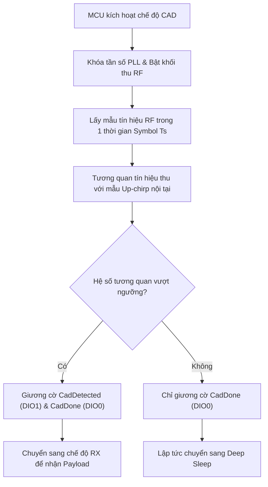

# BÀI 04: KỸ THUẬT CHANNEL ACTIVITY DETECTION (CAD) VÀ TỐI ƯU NĂNG LƯỢNG LỚP VẬT LÝ

> Tóm tắt: Phân tích cơ chế hoạt động của tính năng Channel Activity Detection (CAD) trên vi mạch LoRa, xây dựng công thức tính toán thời gian và năng lượng quét kênh, đồng thời cung cấp mã nguồn C chuẩn công nghiệp để phát hiện tín hiệu không chặn và bảo vệ tuổi thọ pin.

---

## 1. Bản Chất Kỹ Thuật Của Channel Activity Detection (CAD)

Trong các hệ sinh thái IoT vận hành bằng pin, máy thu vô tuyến (Radio Receiver) là một trong những khối tiêu tốn năng lượng khủng khiếp nhất.
- Nếu một node duy trì trạng thái lắng nghe liên tục (**Continuous RX**), dòng tiêu thụ duy trì ở mức **~11 mA**. Một viên pin 2000 mAh sẽ cạn sạch chỉ sau chưa đầy một tuần.
- Với các giao thức như Wi-Fi hay Zigbee, thiết bị đo mức công suất sóng nhận được (RSSI) bằng bộ tách sóng năng lượng trong vài microsecond (Clear Channel Assessment - CCA).
- **Thách thức của LoRa**: Do tín hiệu LoRa thường nằm **dưới mức nhiễu nền** ($SNR < 0\text{ dB}$), việc đo năng lượng RSSI thô là vô nghĩa — máy thu không thể phân biệt được giữa nhiễu nhiệt tự nhiên và một gói tin LoRa hợp lệ đang bay trong không gian.

Để giải quyết mâu thuẫn này, Semtech tích hợp bộ giải mã tương quan phần cứng mang tên **Channel Activity Detection (CAD)**:



---

## 2. Tính Toán Thời Gian & Năng Lượng Tiêu Thụ Trong Chu Kỳ CAD

Thời gian cần thiết để thực hiện một chu kỳ quét CAD phụ thuộc trực tiếp vào Spreading Factor ($SF$) và Băng thông ($BW$):

### 2.1 Công Thức Thời Gian Quét CAD ($T_{CAD}$)
Quá trình CAD bao gồm giai đoạn lấy mẫu sóng vô tuyến kéo dài bằng đúng thời gian 1 symbol ($T_s$) và giai đoạn tính toán tương quan số trong nội bộ DSP (kéo dài khoảng 32 chu kỳ chip):

$$T_{CAD} = \frac{2^{SF} + 32}{BW} \quad (\text{giây})$$

| Cấu Hình Băng Tần (BW = 125 kHz) | Thời Gian Lấy Mẫu ($T_s$) | Thời Gian Toàn Bộ Qu kỳ CAD ($T_{CAD}$) | Dòng Tiêu Thụ Trung Bình |
| :---: | :---: | :---: | :---: |
| **SF7 / 125 kHz** | 1.024 ms | **~1.28 ms** | 10.8 mA trong 1.28 ms |
| **SF8 / 125 kHz** | 2.048 ms | **~2.30 ms** | 10.8 mA trong 2.30 ms |
| **SF9 / 125 kHz** | 4.096 ms | **~4.35 ms** | 10.8 mA trong 4.35 ms |
| **SF10 / 125 kHz** | 8.192 ms | **~8.45 ms** | 10.8 mA trong 8.45 ms |
| **SF11 / 125 kHz** | 16.384 ms | **~16.64 ms** | 10.8 mA trong 16.64 ms |
| **SF12 / 125 kHz** | 32.768 ms | **~33.02 ms** | 10.8 mA trong 33.02 ms |

### 2.2 So Sánh Năng Lượng: Quét CAD Định Kỳ vs Mở Cổng Thu Liên Tục
Giả sử một trạm cảm biến kiểm tra kênh truyền mỗi **1 giây một lần** ở cấu hình SF7 / 125 kHz:
- **Phương án 1 (RX liên tục)**:
  - Dòng tiêu thụ liên tục: $I_{avg} = 11\text{ mA}$.
  - Tiêu thụ năng lượng mỗi ngày: $11\text{ mA} \times 24\text{ h} = 264\text{ mAh}$.
  - Tuổi thọ pin 2000 mAh: **~7.5 ngày**!
- **Phương án 2 (Định kỳ quét CAD mỗi 1 giây, thời gian còn lại Deep Sleep)**:
  - Thời gian thức: $1.28\text{ ms}$ ở dòng $10.8\text{ mA}$.
  - Thời gian ngủ: $998.72\text{ ms}$ ở dòng $0.2\text{ µA}$.
  - Dòng tiêu thụ trung bình:
    
    $$I_{avg} = \frac{(10.8\text{ mA} \times 1.28\text{ ms}) + (0.0002\text{ mA} \times 998.72\text{ ms})}{1000\text{ ms}} \approx 0.014\text{ mA} = 14\text{ µA}$$
  
  - Tiêu thụ năng lượng mỗi ngày: $0.014\text{ mA} \times 24\text{ h} \approx 0.336\text{ mAh}$.
  - Tuổi thọ pin 2000 mAh: **~5950 ngày (> 16 năm)**!

> [!TIP]
> Ứng dụng kỹ thuật quét CAD định kỳ giúp cắt giảm **hơn 99.8% mức tiêu thụ năng lượng** của hệ thống so với phương pháp mở bộ thu liên tục!

---

## 3. Mã Nguồn Mẫu: Hiện Thực CAD Driver Bằng Ngôn Ngữ C

Dưới đây là hàm hiện thực quy trình quét CAD không chặn (Non-blocking) trên vi điều khiển bare-metal hoặc RTOS sử dụng chip Semtech SX1276:

```c
#include <stdint.h>
#include <stdbool.h>

// Định nghĩa thanh ghi SX1276
#define REG_OP_MODE       0x01
#define REG_IRQ_FLAGS     0x12
#define REG_DIO_MAPPING_1 0x40

#define MODE_LORA_STANDBY 0x81
#define MODE_LORA_CAD     0x83

#define IRQ_CAD_DONE_MASK 0x04
#define IRQ_CAD_DET_MASK  0x01

typedef enum {
    CAD_CHANNEL_FREE = 0,
    CAD_CHANNEL_BUSY = 1,
    CAD_TIMEOUT_ERROR = 2
} lora_cad_result_t;

// Hàm nguyên mẫu giao tiếp SPI phụ thuộc phần cứng
extern void lora_spi_write_reg(uint8_t addr, uint8_t val);
extern uint8_t lora_spi_read_reg(uint8_t addr);
extern void delay_ms(uint32_t ms);

lora_cad_result_t lora_perform_cad_scan(uint32_t timeout_ms) {
    // 1. Chuyển chip về chế độ STANDBY để cấu hình
    lora_spi_write_reg(REG_OP_MODE, MODE_LORA_STANDBY);

    // 2. Cấu hình chân DIO0 báo CadDone (Map 10 vào bits [7:6])
    uint8_t dio_map = lora_spi_read_reg(REG_DIO_MAPPING_1);
    dio_map = (dio_map & 0x3F) | (0x02 << 6);
    lora_spi_write_reg(REG_DIO_MAPPING_1, dio_map);

    // 3. Xóa sạch các cờ ngắt cũ
    lora_spi_write_reg(REG_IRQ_FLAGS, 0xFF);

    // 4. Kích hoạt chế độ CAD
    lora_spi_write_reg(REG_OP_MODE, MODE_LORA_CAD);

    // 5. Chờ cờ CadDone hoặc hết thời gian timeout
    uint32_t elapsed = 0;
    while (elapsed < timeout_ms) {
        uint8_t irq_flags = lora_spi_read_reg(REG_IRQ_FLAGS);

        if (irq_flags & IRQ_CAD_DONE_MASK) {
            // Kiểm tra xem có phát hiện sóng hay không
            if (irq_flags & IRQ_CAD_DET_MASK) {
                // Xóa cờ ngắt bằng cách ghi đè 1
                lora_spi_write_reg(REG_IRQ_FLAGS, IRQ_CAD_DONE_MASK | IRQ_CAD_DET_MASK);
                return CAD_CHANNEL_BUSY; // Kênh bận! Có sóng LoRa
            } else {
                lora_spi_write_reg(REG_IRQ_FLAGS, IRQ_CAD_DONE_MASK);
                return CAD_CHANNEL_FREE; // Kênh rảnh hoàn toàn
            }
        }
        delay_ms(1);
        elapsed++;
    }

    return CAD_TIMEOUT_ERROR;
}
```

---

## 4. Các Giới Hạn Cốt Lõi Của CAD Trong Hệ Thống Thực Tế

Mặc dù CAD là một công cụ tối ưu pin tuyệt vời, kỹ sư thiết kế hệ thống phải lường trước các giới hạn vật lý:

1. **Chỉ nhận diện hiệu quả trên Preamble**: Bộ tương quan CAD được thiết kế chuyên biệt để tìm chuỗi Up-chirp tiêu chuẩn của Preamble. Nếu một node khác đã truyền xong Preamble và đang bắn phần Payload, CAD có thể bỏ sót và báo kênh rảnh.
2. **Kích thước Preamble bên phát phải dài hơn chu kỳ ngủ**: Để đảm bảo bên thu thức dậy bắt kịp Preamble bằng CAD, bên phát bắt buộc phải cấu hình độ dài Preamble dài hơn khoảng thời gian giữa hai lần quét CAD của bên thu. Điều này làm tăng Time-on-Air của bên phát.
3. **Hiện tượng Race Condition (Tranh chấp kênh)**:
   - Node A quét CAD: Kênh rảnh.
   - Node B quét CAD cùng lúc: Kênh rảnh.
   - Cả Node A và Node B lập tức chuyển sang TX: Hai gói tin va chạm nhau hoàn toàn trên không gian.
   - **Giải pháp**: Áp dụng cơ chế **Random Jitter / Exponential Backoff** (chờ một khoảng thời gian ngẫu nhiên từ 5–50 ms trước khi phát).

---

## 5. Lưu Ý Kỹ Thuật & Best Practices Thực Chiến

> [!IMPORTANT]
> **Bài toán thiết kế thực chiến:** *"Em hãy trình bày cách thiết kế một node cảm biến chạy pin có thể nhận lệnh từ xa bất kỳ lúc nào mà vẫn duy trì tuổi thọ pin trên 3 năm?"*
> 
> **Giải pháp kiến trúc chuẩn mực:**
> Ta áp dụng kỹ thuật **Preamble Sampling kết hợp CAD**:
> 1. Phía node thu: Cài đặt bộ định thời RTC đánh thức MCU mỗi $1\text{ giây}$. Khi thức dậy, kích hoạt transceiver chạy một chu kỳ CAD (~$1.3\text{ ms}$ ở SF7). Nếu cờ `CadDetected` không bật, lập tức đưa toàn bộ hệ thống về chế độ Deep Sleep.
> 2. Phía gateway/node phát: Khi muốn gửi lệnh, phát một gói tin với độ dài Preamble được kéo dài vượt quá $1.2\text{ giây}$ (ví dụ 1200 symbols ở SF7).
> 3. Đảm bảo rằng dù node thu thức dậy ở bất kỳ thời điểm nào trong chu kỳ 1 giây, nó cũng sẽ chạm phải phần Preamble đang phát, giương ngắt chuyển sang chế độ nhận RX để đón trọn vẹn phần Payload lệnh.

