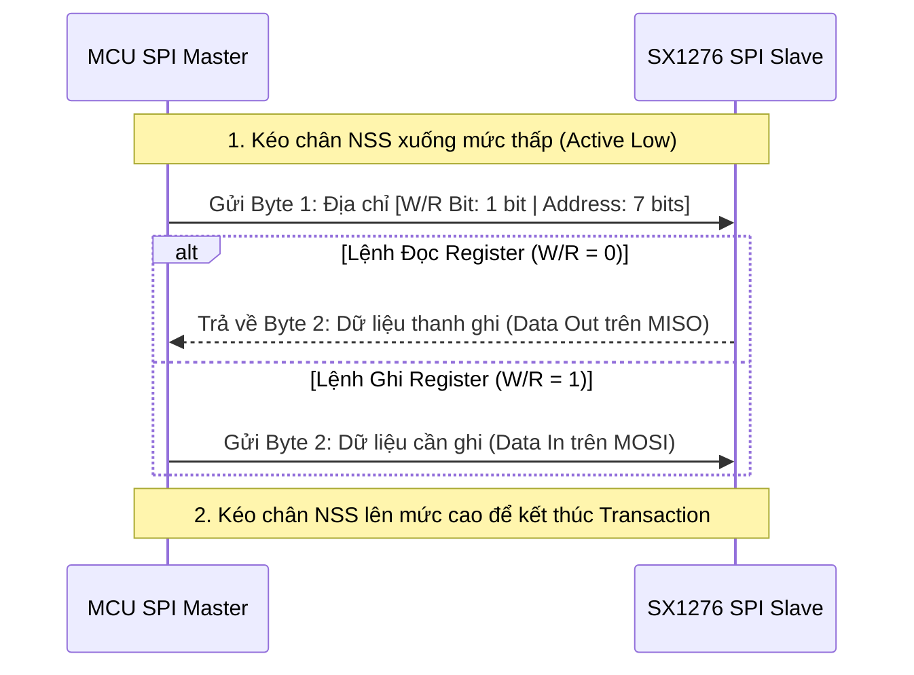
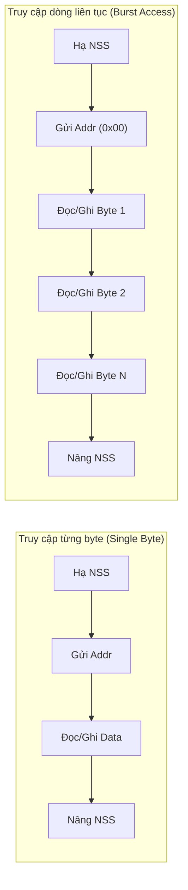

# BÀI 05: GIAO TIẾP SPI TỐC ĐỘ CAO VỚI RADIO TRANSCEIVER

> Tóm tắt: Phân tích chi tiết giao thức bus SPI ở cấp độ tín hiệu phần cứng, kỹ thuật đọc ghi Burst FIFO tối ưu tốc độ, cách quản lý chân Chip Select (NSS) bằng phần mềm, và cung cấp tầng trừu tượng phần cứng (HAL) chuẩn C cho chip Semtech SX1276.

---

## 1. Giao Thức Tín Hiệu SPI Của Chip Semtech LoRa

Bus SPI (Serial Peripheral Interface) là cầu nối duy nhất giữa vi điều khiển (Master) và chip thu phát LoRa (Slave). Hiểu rõ dạng sóng tín hiệu và các ràng buộc thời gian (Timing Specifications) là yêu cầu tiên quyết khi bring-up phần cứng.



### 1.1 Cấu Hình SPI Mode: CPOL và CPHA
- Semtech SX1276 hỗ trợ chuẩn **SPI Mode 0**:
  - **CPOL = 0 (Clock Polarity)**: Đường xung nhịp SCK ở mức thấp (Low) khi bus ở trạng thái rảnh rỗi (Idle).
  - **CPHA = 0 (Clock Phase)**: Dữ liệu được lấy mẫu (Sample) tại **cạnh lên (Rising Edge)** đầu tiên của xung nhịp SCK và được dịch chuyển (Shift) tại cạnh xuống.
- **Tốc độ xung nhịp tối đa**:
  - Truy cập thanh ghi cấu hình: Tối đa **10 MHz**.
  - Đọc/ghi bộ đệm FIFO: Hỗ trợ xung nhịp lên đến **10 MHz**.
  - Khuyến nghị trong thực tế: Đặt tốc độ từ **1 MHz đến 8 MHz** để đảm bảo tính toàn vẹn tín hiệu, đặc biệt khi dây cắm dài hoặc đi qua header kiểm thử.

### 1.2 Cấu Trúc Khung Lệnh 1 Byte Địa Chỉ
Trong byte đầu tiên Master bắn ra trên đường MOSI:
- **Bit 7 (MSB - Read/Write Selector)**:
  - Bit `7 = 0`: Thao tác **Đọc (Read)** dữ liệu.
  - Bit `7 = 1`: Thao tác **Ghi (Write)** dữ liệu.
- **Bits [6:0] (Register Address)**: Địa chỉ 7-bit của thanh ghi (từ `0x00` đến `0x7F`).

---

## 2. Kỹ Thuật Đọc/Ghi Burst FIFO Tối Ưu Tốc Độ

Khi truyền hoặc nhận gói tin LoRa có dung lượng lên tới 255 bytes, nếu mỗi byte đều phải hạ NSS rồi nâng NSS thì phần cứng sẽ tốn một lượng overhead thời gian khổng lồ.



### Quy Tắc Tự Động Tăng Con Trỏ Của SX1276
1. **Đối với thanh ghi thông thường (`0x01` đến `0x7F`)**: Nếu giữ nguyên NSS ở mức 0 và tiếp tục cấp xung SCK, chip sẽ tự động tăng địa chỉ thanh ghi nội tại lên $Addr + 1$.
2. **Riêng đối với thanh ghi FIFO (`0x00`)**: Khi địa chỉ bắt đầu là `0x00`, con trỏ thanh ghi SPI **KHÔNG** tăng lên `0x01`. Thay vào đó, nó giữ nguyên địa chỉ `0x00` và tự động tăng **con trỏ bộ nhớ đệm `RegFifoAddrPtr`** bên trong SRAM. Điều này cho phép đọc/ghi hàng trăm byte payload liên tục với tốc độ bus tối đa!

---

## 3. Quản Lý Chân Chip Select (NSS) Bằng Phần Mềm (Software NSS)

> [!IMPORTANT]
> **Quy tắc thiết kế phần cứng & firmware:**
> Rất nhiều vi điều khiển (như STM32, ESP32) có tính năng Hardware NSS tự động hạ/nâng chân NSS sau mỗi byte truyền đi.
> **Tuyệt đối không dùng Hardware Auto-NSS cho SX1276!** Vì nếu chân NSS bị đẩy lên mức cao giữa chừng, chip LoRa sẽ ngay lập tức hủy bỏ giao dịch Burst FIFO và reset con trỏ SPI.
> **Chuẩn công nghiệp**: Cấu hình chân NSS là một chân **GPIO Output thông thường** do phần mềm tự kéo xuống mức 0 trước khi giao tiếp và nâng lên mức 1 sau khi toàn bộ chuỗi byte đã hoàn tất.

---

## 4. Tầng Trừu Tượng Phần Cứng SPI (Hardware Abstraction Layer - C Code)

Dưới đây là mã nguồn C chuẩn công nghiệp, thiết kế độc lập nền tảng để dễ dàng port giữa STM32 (HAL/LL), ESP-IDF hoặc Linux:

```c
#include <stdint.h>
#include <stddef.h>

// Các hàm GPIO và SPI tầng vật lý do người dùng định nghĩa tùy MCU
extern void bsp_spi_nss_low(void);
extern void bsp_spi_nss_high(void);
extern uint8_t bsp_spi_transfer_byte(uint8_t tx_byte);

// Đọc một thanh ghi đơn lẻ (Single Read)
uint8_t lora_spi_read_reg(uint8_t reg_addr) {
    bsp_spi_nss_low();
    // Bit 7 = 0 để đọc
    bsp_spi_transfer_byte(reg_addr & 0x7F);
    uint8_t reg_value = bsp_spi_transfer_byte(0x00); // Gửi Dummy byte
    bsp_spi_nss_high();
    return reg_value;
}

// Ghi một thanh ghi đơn lẻ (Single Write)
void lora_spi_write_reg(uint8_t reg_addr, uint8_t value) {
    bsp_spi_nss_low();
    // Bit 7 = 1 để ghi
    bsp_spi_transfer_byte(reg_addr | 0x80);
    bsp_spi_transfer_byte(value);
    bsp_spi_nss_high();
}

// Đọc một mảng byte liên tiếp từ FIFO hoặc thanh ghi (Burst Read)
void lora_spi_burst_read(uint8_t start_addr, uint8_t *buffer, size_t length) {
    if (buffer == NULL || length == 0) return;

    bsp_spi_nss_low();
    bsp_spi_transfer_byte(start_addr & 0x7F);
    for (size_t i = 0; i < length; i++) {
        buffer[i] = bsp_spi_transfer_byte(0x00);
    }
    bsp_spi_nss_high();
}

// Ghi một mảng byte liên tiếp vào FIFO (Burst Write)
void lora_spi_burst_write(uint8_t start_addr, const uint8_t *buffer, size_t length) {
    if (buffer == NULL || length == 0) return;

    bsp_spi_nss_low();
    bsp_spi_transfer_byte(start_addr | 0x80);
    for (size_t i = 0; i < length; i++) {
        bsp_spi_transfer_byte(buffer[i]);
    }
    bsp_spi_nss_high();
}
```

---

## 5. Các Lỗi Giao Tiếp SPI Thường Gặp & Phương Pháp Debug

| Hiện Tượng | Nguyên Nhân Gốc Rễ | Phương Pháp Khắc Phục |
| :--- | :--- | :--- |
| **Đọc `RegVersion` luôn ra `0x00`** | Đường MISO bị chập mass (GND) hoặc chip chưa được cấp nguồn VDD. | Kiểm tra đồng hồ vạn năng đo áp VDD tại chân chip; kiểm tra thông mạch đường MISO. |
| **Đọc `RegVersion` luôn ra `0xFF`** | Đường MISO bị đứt ngắt kết nối (Floating) hoặc chân NSS không kéo được xuống mức 0. | Dùng máy hiện sóng (Oscilloscope) kiểm tra tín hiệu NSS có thực sự về 0V khi truyền không. |
| **Dữ liệu đọc ra bị lệch 1 bit** | Cấu hình sai SPI Mode (ví dụ Master dùng Mode 1 hoặc Mode 3 thay vì Mode 0). | Đưa Master về đúng **SPI Mode 0 (CPOL=0, CPHA=0)**. |
| **Burst FIFO đọc sai từ byte thứ 2** | Dùng Hardware Auto-NSS khiến NSS bị giật lên mức cao giữa 2 byte. | Chuyển chân NSS sang chế độ **GPIO Software Output** điều khiển thủ công. |

