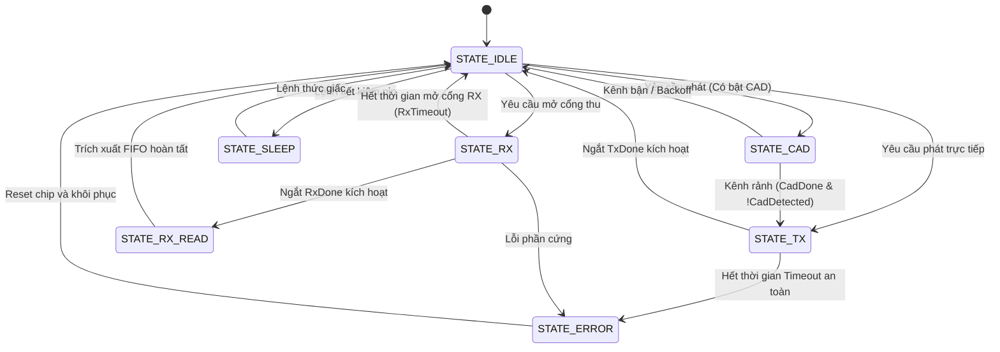

# BÀI 06: THIẾT KẾ MÁY TRẠNG THÁI (FSM) ĐIỀU KHIỂN RADIO KHÔNG CHẶN

> Tóm tắt: Thiết kế kiến trúc máy trạng thái hữu hạn (FSM) phi đồng bộ, không sử dụng vòng lặp chờ nghẽn (Blocking Delay) để điều khiển chip LoRa, kết hợp cơ chế định thời bảo vệ (Software Timeout) chống treo hệ thống nhúng trong môi trường công nghiệp.

---

## 1. Tại Sao Lập Trình Chặn (Blocking Code) Là "Tử Huyệt" Của Hệ Thống Nhúng?

Trong các đoạn mã ví dụ dành cho người mới bắt đầu, chúng ta thường thấy luồng phát gói tin được viết như sau:

```c
// ❌ CÁCH TIẾP CẬN SAI LẦM: GÂY NGHẼN TOÀN BỘ HỆ THỐNG
void bad_lora_send(uint8_t *data, uint8_t len) {
    lora_load_fifo(data, len);
    lora_set_mode_tx();
    while (lora_read_dio0() == 0) {
        // Vòng lặp rỗng chờ phát xong (Busy Wait)
    }
    lora_clear_txdone();
}
```

### Hậu Quả Trong Môi Trường Công Nghiệp
1. **Lãng phí chu kỳ CPU**: Ở cấu hình SF12, thời gian phát một gói tin ($ToA$) có thể lên tới **1.5 giây**. Trong suốt 1.5 giây đó, vi điều khiển bị "bắt cóc" hoàn toàn trong vòng lặp `while`, không thể đọc cảm biến, không thể phản hồi nút bấm, và không thể nhận lệnh qua bus CAN/UART.
2. **Treo hệ thống vĩnh viễn (Deadlock)**: Nếu chip LoRa bị sốc tĩnh điện (ESD), rơi vào trạng thái bão hòa hoặc đường tín hiệu DIO0 bị đứt chập, vòng lặp `while` sẽ chạy vô tận, dẫn tới kích hoạt Watchdog Reset (IWDG) làm sập hệ thống.

---

## 2. Thiết Kế Sơ Đồ Máy Trạng Thái (FSM State Diagram)

Giải pháp kiến trúc chuẩn công nghiệp là chuyển toàn bộ hoạt động của module vô tuyến sang mô hình **Máy trạng thái điều khiển theo sự kiện (Event-Driven Finite State Machine)**:



---

## 3. Mã Nguồn Mẫu Hiện Thực FSM Bằng Ngôn Ngữ C

Dưới đây là khung kiến trúc FSM hoàn chỉnh, có thể gọi định kỳ trong vòng lặp `main()` hoặc bên trong một Task FreeRTOS:

```c
#include <stdint.h>
#include <stdbool.h>

typedef enum {
    LORA_STATE_IDLE,
    LORA_STATE_TX_BUSY,
    LORA_STATE_RX_LISTENING,
    LORA_STATE_ERROR
} lora_fsm_state_t;

typedef struct {
    lora_fsm_state_t current_state;
    uint32_t state_start_time;
    uint32_t state_timeout_ms;
    bool is_tx_done;
    bool is_rx_done;
    bool is_crc_error;
} lora_controller_t;

static lora_controller_t g_lora_fsm;

extern uint32_t bsp_get_system_tick_ms(void);
extern void lora_hardware_reset(void);
extern void lora_start_tx_hardware(const uint8_t *payload, uint8_t len);
extern void lora_read_rx_fifo(void);

// Khởi tạo máy trạng thái
void lora_fsm_init(void) {
    g_lora_fsm.current_state = LORA_STATE_IDLE;
    g_lora_fsm.is_tx_done = false;
    g_lora_fsm.is_rx_done = false;
    g_lora_fsm.is_crc_error = false;
}

// Bắt đầu phát gói tin theo cơ chế Non-blocking
bool lora_fsm_send_async(const uint8_t *payload, uint8_t len, uint32_t timeout_ms) {
    if (g_lora_fsm.current_state != LORA_STATE_IDLE) {
        return false; // Radio đang bận xử lý tác vụ khác!
    }

    g_lora_fsm.is_tx_done = false;
    lora_start_tx_hardware(payload, len);
    
    g_lora_fsm.current_state = LORA_STATE_TX_BUSY;
    g_lora_fsm.state_start_time = bsp_get_system_tick_ms();
    g_lora_fsm.state_timeout_ms = timeout_ms;
    return true;
}

// Hàm ISR bắt ngắt DIO0 (Top-Half)
void lora_fsm_dio0_isr_handler(void) {
    if (g_lora_fsm.current_state == LORA_STATE_TX_BUSY) {
        g_lora_fsm.is_tx_done = true;
    } else if (g_lora_fsm.current_state == LORA_STATE_RX_LISTENING) {
        g_lora_fsm.is_rx_done = true;
    }
}

// Vòng lặp cập nhật máy trạng thái (Non-blocking Process)
void lora_fsm_process(void) {
    uint32_t now = bsp_get_system_tick_ms();
    uint32_t elapsed = now - g_lora_fsm.state_start_time;

    switch (g_lora_fsm.current_state) {
        case LORA_STATE_IDLE:
            // Không làm gì, chờ lệnh tiếp theo
            break;

        case LORA_STATE_TX_BUSY:
            if (g_lora_fsm.is_tx_done) {
                // Sự kiện phát thành công
                g_lora_fsm.current_state = LORA_STATE_IDLE;
                // Gọi callback thông báo phát xong cho ứng dụng tầng trên
            } else if (elapsed > g_lora_fsm.state_timeout_ms) {
                // Sự kiện quá thời gian Timeout: Có sự cố phần cứng!
                g_lora_fsm.current_state = LORA_STATE_ERROR;
            }
            break;

        case LORA_STATE_RX_LISTENING:
            if (g_lora_fsm.is_rx_done) {
                lora_read_rx_fifo(); // Trích xuất dữ liệu
                g_lora_fsm.current_state = LORA_STATE_IDLE;
            } else if (elapsed > g_lora_fsm.state_timeout_ms) {
                g_lora_fsm.current_state = LORA_STATE_IDLE; // Hết cửa sổ nhận RX
            }
            break;

        case LORA_STATE_ERROR:
            // Khắc phục sự cố: Hard Reset chip qua chân NRESET và re-init
            lora_hardware_reset();
            g_lora_fsm.current_state = LORA_STATE_IDLE;
            break;
    }
}
```

---

## 4. Cơ Chế Guard Timer & Xử Lý Treo Phần Cứng

> [!WARNING]
> **Quy tắc bất di bất dịch về Timeout:**
> Luôn luôn tính toán thời gian `state_timeout_ms` dựa trên công thức Time-on-Air thực tế của gói tin cộng thêm một khoảng dung sai an toàn (Margin):
> 
> $$\text{Timeout} = ToA + 100\text{ ms}$$
> 
> Nếu sau khoảng thời gian này mà ngắt `TxDone` không giương lên, driver phải cưỡng chế chuyển sang `STATE_ERROR` và kích hoạt xung Reset phần cứng trên chân `NRESET`, tuyệt đối không để CPU chờ đợi mù quáng.

