# BÀI 07: QUẢN LÝ NGẮT NGOẠI VI (DIO INTERRUPTS) VÀ ĐỒNG BỘ ISR

> Tóm tắt: Phân tích cơ chế ngắt phần cứng của chip LoRa, thiết kế mô hình phân tách ngắt hai tầng (Top-Half và Bottom-Half), giải thích lý do cấm tuyệt đối gọi bus SPI trong trình phục vụ ngắt (ISR), và cung cấp kỹ thuật đồng bộ hóa an toàn tránh xung đột biến (Race Condition).

---

## 1. Bản Chất Tín Hiệu Ngắt DIO Của SX1276

Các chân `DIO0` đến `DIO5` của SX1276 là các ngõ ra số (Digital Outputs) tích cực mức cao (**Active High**):
- Khi sự kiện (như `TxDone` hoặc `RxDone`) xuất phát từ modem nội bộ, chân DIO tương ứng sẽ chuyển trạng thái điện áp từ $0\text{V}$ lên $3.3\text{V}$.
- **Cấu hình EXTI trên vi điều khiển**: Do đó, khối ngắt ngoài của MCU (STM32 EXTI, ESP32 GPIO Interrupt) bắt buộc phải được cấu hình bắt theo **Cạnh lên (Rising Edge Trigger)**.
- **Cơ chế chốt ngắt (Latching)**: Tín hiệu trên chân DIO sẽ **giữ nguyên ở mức cao** cho đến khi vi điều khiển chủ động xóa cờ ngắt tương ứng trong thanh ghi `RegIrqFlags` thông qua giao tiếp SPI (bằng cách ghi đè bit `1` vào cờ ngắt).

---

## 2. Mô Hình Hai Tầng: Top-Half vs Bottom-Half

Một trong những sai lầm phổ biến nhất của kỹ sư mới làm quen với hệ thống nhúng là thực hiện đọc dữ liệu gói tin qua SPI ngay bên trong hàm phục vụ ngắt (ISR).

```mermaid
flowchart TD
    subgraph WRONG["❌ THIẾT KẾ SAI LẦM (GÂY CRASH HỆ THỐNG)"]
        A1["Ngắt EXTI Cạnh Lên"] --> A2["Vào hàm ISR"]
        A2 --> A3["Gọi lora_spi_burst_read() trong ISR"]
        A3 --> A4["Xử lý logic ứng dụng nặng trong ISR"]
        A4 --> A5["Thoát ISR (Chiếm dụng CPU hàng chục ms)"]
    end

    subgraph CORRECT["✅ THIẾT KẾ CHUẨN CÔNG NGHIỆP (HAI TẦNG)"]
        B1["Ngắt EXTI Cạnh Lên"] --> B2["Top-Half (ISR): Cực ngắn (vài µs)"]
        B2 --> B3["Lưu cờ / Gửi Task Notification"]
        B3 --> B4["Thoát ISR ngay lập tức!"]
        B4 --> B5["Bottom-Half (Thread Context) thức giấc"]
        B5 --> B6["Đọc FIFO qua SPI & Xử lý Payload"]
    end
```



### Tại Sao Cấm Gọi Giao Tiếp SPI Bên Trong ISR?
1. **Thời gian khóa ngắt quá dài (Interrupt Latency)**: Việc đọc 256 bytes qua SPI ở tốc độ 1 MHz mất tới **~2.5 ms**. Trong suốt 2.5 ms đó, các ngắt tối quan trọng khác của hệ thống (như ngắt động cơ PWM, ngắt timer điều khiển dòng điện, ngắt truyền thông CAN khẩn cấp) bị phong tỏa, dẫn tới mất gói tin hoặc cháy hỏng phần cứng công suất.
2. **Nghẽn tài nguyên dùng chung (Re-entrancy / Mutex Violation)**: Bus SPI thường được chia sẻ giữa nhiều chip trên cùng một bo mạch (Flash, Màn hình, LoRa). Nếu luồng chính đang giữ Mutex của SPI mà bị ngắt nhảy vào gọi SPI tiếp, hệ thống sẽ rơi vào tình trạng **Nghẽn vĩnh viễn (Deadlock)**.
3. **Vi phạm kiến trúc RTOS/Linux**: Trong hệ điều hành FreeRTOS hoặc Linux Kernel, các hàm khóa (blocking/sleep) như `spi_sync()` hoặc `vTaskDelay()` **tuyệt đối bị cấm gọi trong Interrupt Context**.

---

## 3. Mã Nguồn Mẫu Phân Tách Hai Tầng Bằng Ngôn Ngữ C

Dưới đây là phương pháp đồng bộ hóa an toàn sử dụng cờ nguyên tử (Atomic Flag) cho hệ thống bare-metal hoặc RTOS:

```c
#include <stdint.h>
#include <stdbool.h>

// Định nghĩa biến cờ sự kiện. 'volatile' bắt buộc để chống trình biên dịch tối ưu hóa
static volatile bool g_lora_dio0_event_flag = false;
static volatile uint32_t g_dio0_timestamp_ms = 0;

extern uint32_t bsp_get_tick_ms(void);
extern void lora_handle_rx_packet_bottom_half(void);
extern void lora_handle_tx_complete_bottom_half(void);

// ========================================================
// 1. TẦNG TOP-HALF: CHẠY TRONG INTERRUPT CONTEXT (< 2 microsecond)
// ========================================================
void EXTI_DIO0_IRQHandler(void) {
    // Lưu lại mốc thời gian nhận ngắt chính xác
    g_dio0_timestamp_ms = bsp_get_tick_ms();
    
    // Đánh dấu cờ sự kiện cho tầng Bottom-Half
    g_lora_dio0_event_flag = true;

    // Xóa cờ ngắt ngoại vi trên thanh ghi vi điều khiển (ví dụ EXTI_PR của STM32)
    // EXTI->PR = (1 << DIO0_PIN);
}

// ========================================================
// 2. TẦNG BOTTOM-HALF: CHẠY TRONG THREAD / MAIN LOOP CONTEXT
// ========================================================
void lora_event_dispatcher_process(void) {
    // Kiểm tra cờ sự kiện một cách an toàn
    if (g_lora_dio0_event_flag) {
        // Vùng bảo vệ nguyên tử (Critical Section): Xóa cờ
        __disable_irq();
        g_lora_dio0_event_flag = false;
        __enable_irq();

        // Bây giờ an toàn 100% để gọi bus SPI đọc thanh ghi chip
        uint8_t irq_flags = lora_spi_read_reg(0x12); // Đọc RegIrqFlags

        if (irq_flags & 0x40) { // Bit 6: TxDone
            lora_spi_write_reg(0x12, 0x40); // Xóa cờ TxDone
            lora_handle_tx_complete_bottom_half();
        }

        if (irq_flags & 0x20) { // Bit 5: RxDone
            if (irq_flags & 0x20) { // Kiểm tra CRC
                lora_handle_rx_packet_bottom_half(); // Đọc Burst FIFO qua SPI
            }
            lora_spi_write_reg(0x12, 0x20); // Xóa cờ RxDone
        }
    }
}
```

---

## 4. Xử Lý Vấn Đề Chống Dội Ngắt (Interrupt Debouncing & Glitch Filtering)

Trong các môi trường công nghiệp có biến tần, rơ-le đóng cắt hoặc động cơ xe điện (EV Inverter), nhiễu điện từ trường (EMI) rất dễ kích hoạt tín hiệu giả (Spurious Interrupts) trên chân DIO0:
- **Lọc phần cứng**: Đặt một tụ lọc gốm nhỏ ($10\text{ pF}$ đến $47\text{ pF}$) gần chân vi điều khiển để dập tắt các gai nhiễu cao tần (Glitches).
- **Lọc phần mềm trong Bottom-Half**: Sau khi nhận ngắt cạnh lên, trong tầng Bottom-Half, driver luôn phải **đọc lại thanh ghi `RegIrqFlags` qua SPI**. Nếu các cờ ngắt nội tại của chip đều bằng `0`, chứng tỏ ngắt vừa xảy ra chỉ là nhiễu cảm ứng trên dây dẫn, driver hủy bỏ xử lý mà không làm sập luồng chương trình.

---

## 5. Lưu Ý Kỹ Thuật & Best Practices Thực Chiến

> [!IMPORTANT]
> **Bài toán thiết kế thực chiến:** *"Tại sao trong Linux Kernel Driver người ta phải dùng `request_threaded_irq()` thay vì `request_irq()` khi viết driver cho chip LoRa SX1276?"*
> 
> **Giải pháp kiến trúc chuẩn mực:**
> Vì khi chip LoRa báo ngắt (ví dụ `RxDone`), nhân Linux bắt buộc phải giao tiếp qua bus SPI (`spi_sync()`) để đọc thanh ghi `RegIrqFlags` và trích xuất dữ liệu trong FIFO. Bản chất của hàm `spi_sync()` trong Linux là **chờ đợi đồng bộ (Sleeping/Blocking)**.
> Hàm ngắt cứng thông thường của `request_irq()` chạy trong Hardware Interrupt Context không được phép Sleep (nếu gọi `spi_sync()` sẽ gây ra Kernel Panic lập tức). Do đó, ta bắt buộc phải dùng `request_threaded_irq()` để chuyển việc đọc SPI sang một Kernel Thread riêng biệt chạy trong Process Context có quyền Sleep!

