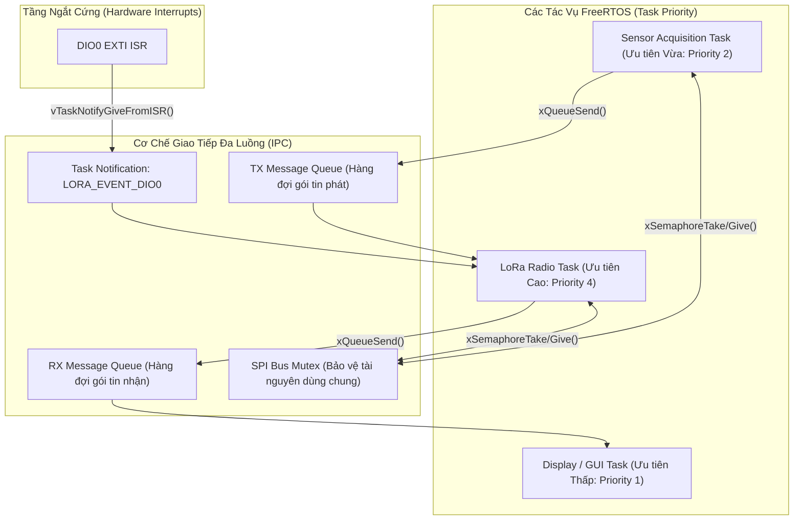

# BÀI 08: TÍCH HỢP LORA DRIVER VÀO HỆ ĐIỀU HÀNH THỜI GIAN THỰC FREERTOS

> Tóm tắt: Xây dựng kiến trúc đa tác vụ (Multi-tasking) trên FreeRTOS để quản lý chip LoRa, ứng dụng Task Notifications để đánh thức luồng với độ trễ thấp, kết hợp hàng đợi (Queue) chống nghẽn gói tin và Mutex bảo vệ bus SPI dùng chung.

---

## 1. Kiến Trúc Phân Tầng Đa Tác Vụ (Multi-Task Architecture)

Trong một hệ thống nhúng phức tạp (như thiết bị định vị GPS hoặc cụm đồng hồ xe điện Smart EV Cluster), vi điều khiển phải đồng thời thực hiện nhiều tác vụ: đọc cảm biến, cập nhật màn hình, xử lý bus CAN, và gửi nhận vô tuyến LoRa.



---

## 2. Các Cơ Chế Đồng Bộ Hóa IPC Cần Sử Dụng

### 2.1 Task Notifications (Đánh thức siêu tốc thay thế Semaphore)
- Thay vì sử dụng Binary Semaphore tốn bộ nhớ RAM để cấp phát Control Block, ta sử dụng tính năng **Task Notifications** tích hợp sẵn trong mỗi TCB (Task Control Block) của FreeRTOS.
- Trong hàm ngắt `DIO0_IRQHandler`:
  ```c
  BaseType_t xHigherPriorityTaskWoken = pdFALSE;
  vTaskNotifyGiveFromISR(g_lora_task_handle, &xHigherPriorityTaskWoken);
  portYIELD_FROM_ISR(xHigherPriorityTaskWoken);
  ```
- Hàm này đánh thức `LoRa_Task` gần như tức thì với chi phí CPU chỉ vài chu kỳ lệnh.

### 2.2 Hàng Đợi Gói Tin (TX / RX Queues)
- Khi xe điện hoặc cảm biến cần gửi dữ liệu, `Sensor_Task` không gọi trực tiếp hàm phát vô tuyến. Thay vào đó, nó đóng gói payload thành cấu trúc `lora_packet_t` và đẩy vào `g_lora_tx_queue`.
- `LoRa_Task` lấy từng gói tin ra phát theo thứ tự FIFO (First-In, First-Out), đảm bảo không bao giờ xảy ra tình trạng hai tác vụ tranh chấp phát sóng cùng lúc.

### 2.3 Bảo Vệ Bus SPI Bằng Mutex Có Thừa Kế Mức Ưu Tiên (Priority Inheritance)
- Nếu bus SPI được dùng chung giữa chip LoRa và thẻ nhớ SD hoặc Flash nội:
  - Bắt buộc phải tạo Mutex bằng hàm `xSemaphoreCreateMutex()`.
  - Mutex của FreeRTOS hỗ trợ cơ chế thừa kế mức ưu tiên (**Priority Inheritance**), ngăn chặn triệt để thảm họa **Đảo ngược mức ưu tiên (Priority Inversion)** có thể làm sập hệ thống.

---

## 3. Mã Nguồn Mẫu Hoàn Chỉnh Trên FreeRTOS Bằng C

```c
#include "FreeRTOS.h"
#include "task.h"
#include "queue.h"
#include "semphr.h"
#include <string.h>

#define LORA_MAX_PAYLOAD_SIZE 64
#define LORA_QUEUE_LENGTH     8

typedef struct {
    uint8_t length;
    uint8_t data[LORA_MAX_PAYLOAD_SIZE];
} lora_packet_t;

static TaskHandle_t      g_lora_task_handle = NULL;
static QueueHandle_t     g_lora_tx_queue    = NULL;
static SemaphoreHandle_t g_spi_mutex        = NULL;

extern void lora_hardware_init(void);
extern void lora_send_packet_blocking(const uint8_t *buf, uint8_t len);
extern void lora_read_rx_fifo_packet(lora_packet_t *pkt);

// ========================================================
// 1. TÁC VỤ ĐIỀU KHIỂN RADIO LORA
// ========================================================
void vLoRaRadioTask(void *pvParameters) {
    lora_hardware_init();
    lora_packet_t tx_pkt;

    for (;;) {
        // Kiểm tra xem có gói tin nào cần phát không (Chờ tối đa 50ms)
        if (xQueueReceive(g_lora_tx_queue, &tx_pkt, pdMS_TO_TICKS(50)) == pdPASS) {
            // Chiếm quyền truy cập bus SPI an toàn
            if (xSemaphoreTake(g_spi_mutex, portMAX_DELAY) == pdTRUE) {
                // Kích hoạt phát sóng
                lora_send_packet_blocking(tx_pkt.data, tx_pkt.length);
                xSemaphoreGive(g_spi_mutex);
            }
        }

        // Chờ sự kiện ngắt từ chân DIO0 (RxDone hoặc TxDone)
        // Block tác vụ hoàn toàn (0% CPU) cho đến khi ngắt đến
        uint32_t ulNotificationValue = ulTaskNotifyTake(pdTRUE, pdMS_TO_TICKS(10));
        if (ulNotificationValue > 0) {
            if (xSemaphoreTake(g_spi_mutex, portMAX_DELAY) == pdTRUE) {
                // Xử lý gói tin nhận hoặc xác nhận phát hoàn tất
                // lora_process_events();
                xSemaphoreGive(g_spi_mutex);
            }
        }
    }
}

// ========================================================
// 2. KHỞI TẠO TÀI NGUYÊN HỆ THỐNG
// ========================================================
void lora_freertos_system_init(void) {
    g_spi_mutex = xSemaphoreCreateMutex();
    g_lora_tx_queue = xQueueCreate(LORA_QUEUE_LENGTH, sizeof(lora_packet_t));

    xTaskCreate(
        vLoRaRadioTask,
        "LoRaRadio",
        configMINIMAL_STACK_SIZE + 256,
        NULL,
        tskIDLE_PRIORITY + 3, // Mức ưu tiên cao
        &g_lora_task_handle
    );
}

// ========================================================
// 3. API ĐẨY GÓI TIN VÀO HÀNG ĐỢI CHO CÁC TÁC VỤ KHÁC DÙNG
// ========================================================
bool lora_enqueue_telemetry(const uint8_t *data, uint8_t len) {
    if (len > LORA_MAX_PAYLOAD_SIZE || g_lora_tx_queue == NULL) {
        return false;
    }
    lora_packet_t pkt;
    pkt.length = len;
    memcpy(pkt.data, data, len);

    // Gửi vào hàng đợi, nếu hàng đợi đầy thì chờ tối đa 10ms
    return (xQueueSend(g_lora_tx_queue, &pkt, pdMS_TO_TICKS(10)) == pdPASS);
}
```

---

## 4. Lưu Ý Kỹ Thuật & Best Practices Thực Chiến

> [!TIP]
> **Bài toán thiết kế thực chiến:** *"Khi phát gói tin LoRa qua FreeRTOS, em xử lý thế nào để tác vụ giao diện người dùng (GUI/Display) không bị khựng đơ?"*
> 
> **Giải pháp kiến trúc chuẩn mực:**
> Ta cô lập hoàn toàn việc giao tiếp vô tuyến vào một tác vụ riêng biệt mang tên `LoRaRadioTask`.
> Khi người dùng bấm nút gửi dữ liệu trên màn hình, tác vụ `GUITask` chỉ đơn giản ghi dữ liệu vào một hàng đợi **FreeRTOS Queue** mất chưa đầy $2\text{ µs}$ rồi lập tức quay lại vẽ màn hình ở tần số 60 FPS.
> `LoRaRadioTask` chạy ở chế độ nền sẽ đón nhận phần tử từ Queue, đưa chip vào chế độ phát và chuyển sang trạng thái Block chờ Task Notification từ ngắt phần cứng, hoàn toàn không chiếm dụng bất kỳ chu kỳ xử lý nào của giao diện!

