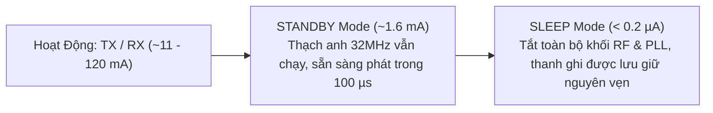
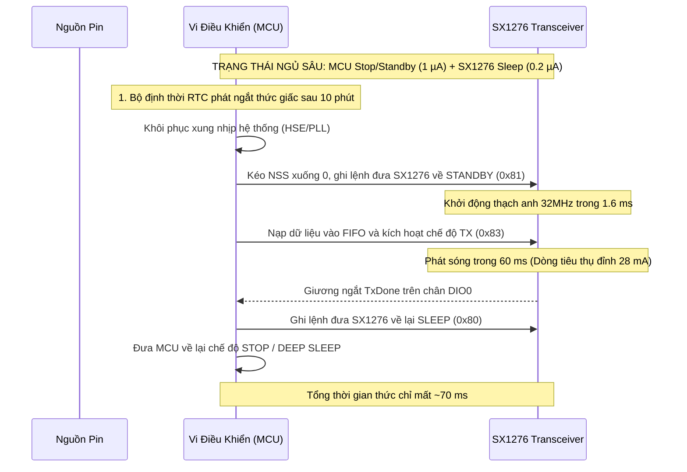
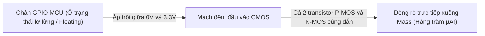

# BÀI 09: CHIẾN LƯỢC QUẢN LÝ NGUỒN ĐIỆN CỰC THẤP (LOW-POWER & SLEEP MODES)

> Tóm tắt: Phân tích các chế độ tiết kiệm năng lượng của vi mạch LoRa và vi điều khiển, phương pháp loại bỏ dòng rò rỉ trên các chân GPIO, tính toán thời lượng pin bằng mô hình tiêu thụ năng lượng theo chu kỳ (Duty-Cycled Energy Model), và kỹ thuật thức giấc qua RTC.

---

## 1. Các Chế Độ Tiết Kiệm Năng Lượng Của Chip Semtech SX1276

SX1276 cung cấp hai trạng thái ngủ với mức tiêu thụ năng lượng khác nhau rõ rệt:

| Chế Độ Hoạt Động | Giá Trị `RegOpMode` | Dòng Tiêu Thụ Điển Hình | Trạng Thái Khối Nội Bộ | Thời Gian Thức Giấc |
| :--- | :---: | :---: | :--- | :---: |
| **SLEEP** | `0x80` | **0.2 µA (tối đa 1 µA)** | Tắt toàn bộ RF, mixer, ADC, PLL và mạch dao động thạch anh. Toàn bộ thanh ghi cấu hình vẫn được giữ nguyên vẹn trong bộ nhớ tĩnh. | ~1.6 ms |
| **STANDBY** | `0x81` | **1.6 mA** | Mạch dao động thạch anh 32 MHz vẫn hoạt động, các khối RF tắt. | ~100 µs |
| **FSTX / FSRX** | `0x82 / 0x84` | **5.8 mA** | Bộ tổng hợp tần số PLL đã khóa sẵn vào kênh sóng mang RF. | ~60 µs |
| **RX CONTINUOUS** | `0x85` | **10.8 mA – 11.5 mA** | Bật trọn vẹn LNA, mixer, ADC và bộ lọc tương quan LoRa. | Tức thì |
| **TX (+14 dBm)** | `0x83` | **28 mA** | Khuếch đại công suất qua chân RFO. | Tức thì |
| **TX (+20 dBm)** | `0x83` | **120 mA** | Kích hoạt mạch tăng áp PA_BOOST mức cực đại. | Tức thì |

---

## 2. Vòng Đời Năng Lượng Chu Kỳ (Duty-Cycled Power Lifecycle)

Trong các ứng dụng cảm biến đo xa công nghiệp, 99.9% thời gian thiết bị nằm ở trạng thái ngủ sâu, chỉ thức dậy trong vài chục millisecond để thu thập dữ liệu và phát sóng:

---

## 3. "Tử Huyệt" Dòng Rò Rỉ Qua Chân GPIO (Floating Pin Leakage)

Một trong những nguyên nhân khiến thiết bị cạn pin chỉ sau vài tuần dù code đã gọi hàm `Sleep()` là **Dòng rò rỉ qua các chân GPIO**:

> [!CAUTION]
> **Checklist triệt tiêu dòng rò phần cứng:**
> 1. **Chân SCK, MOSI, NSS**: Trước khi đưa MCU vào Deep Sleep, kéo các chân này về trạng thái logic xác định (thường là Output Low hoặc cấu hình chân NSS thành Pull-up) để không làm kích hoạt mạch đệm đầu vào của chip LoRa.
> 2. **Chân MISO**: Khi chip LoRa ở chế độ Sleep, chân MISO chuyển sang trạng thái trở kháng cao (High-Z). Phía MCU bắt buộc phải bật điện trở kéo nội (**Pull-up** hoặc **Pull-down**) hoặc chuyển chân sang chế độ **Analog Input**, tuyệt đối không để chân MISO ở trạng thái Floating!
> 3. **Tất cả chân GPIO không dùng trên mạch**: Chuyển toàn bộ sang chế độ **Analog Input** để ngắt toàn bộ mạch schmitt-trigger tiêu thụ dòng rò.

---

## 4. Công Thức Tính Toán Tuổi Thọ Pin Trong Thiết Kế Thực Tế

Dòng điện tiêu thụ trung bình ($I_{avg}$) được tính theo công thức tích phân chu kỳ:

$$I_{avg} = \frac{(I_{sleep} \times T_{sleep}) + (I_{wake} \times T_{wake}) + (I_{tx} \times T_{tx})}{T_{total}}$$

### Ví Dụ Tính Toán Thực Tế
Giả sử thiết bị sử dụng một viên pin **Li-SOCl2 (Lithium Thionyl Chloride)** dung lượng danh định $2400\text{ mAh}$ (hệ số sử dụng thực tế an toàn 80% do tự xả và nhiệt độ = $1920\text{ mAh}$):
- Chu kỳ phát tin: **15 phút một lần** ($T_{total} = 900\text{ giây}$).
- Thời gian ngủ: $T_{sleep} \approx 899.9\text{ giây}$, dòng ngủ $I_{sleep} = 2.5\text{ µA}$ (gồm cả MCU và LoRa).
- Thời gian thức xử lý: $T_{wake} = 30\text{ ms}$ ở dòng $8\text{ mA}$.
- Thời gian phát sóng LoRa: $T_{tx} = 70\text{ ms}$ ở dòng $30\text{ mA}$ (+14 dBm).

Tính toán:
- Năng lượng pha ngủ: $0.0025\text{ mA} \times 899.9\text{ s} = 2.25\text{ mA}\cdot\text{s}$
- Năng lượng pha thức: $8\text{ mA} \times 0.03\text{ s} = 0.24\text{ mA}\cdot\text{s}$
- Năng lượng pha phát: $30\text{ mA} \times 0.07\text{ s} = 2.10\text{ mA}\cdot\text{s}$
- Tổng điện lượng một chu kỳ: $2.25 + 0.24 + 2.10 = 4.59\text{ mA}\cdot\text{s}$
- Dòng tiêu thụ trung bình:
  
  $$I_{avg} = \frac{4.59\text{ mA}\cdot\text{s}}{900\text{ s}} \approx 0.0051\text{ mA} = 5.1\text{ µA}$$

- **Tuổi thọ pin dự kiến**:
  
  $$\text{Tuổi thọ} = \frac{1920\text{ mAh}}{0.0051\text{ mA}} \approx 376,470\text{ giờ} \approx 43\text{ năm}!$$
  
  *(Trong thực tế, tuổi thọ sẽ bị giới hạn bởi độ tự xả tự nhiên của hóa chất pin, thường đạt tối đa từ **10 đến 15 năm**).*

