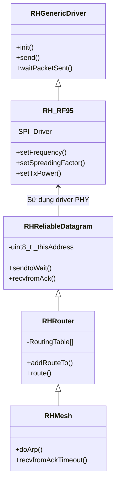
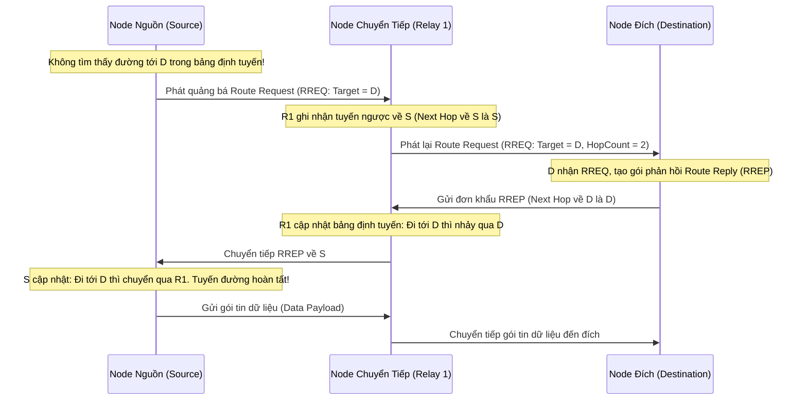
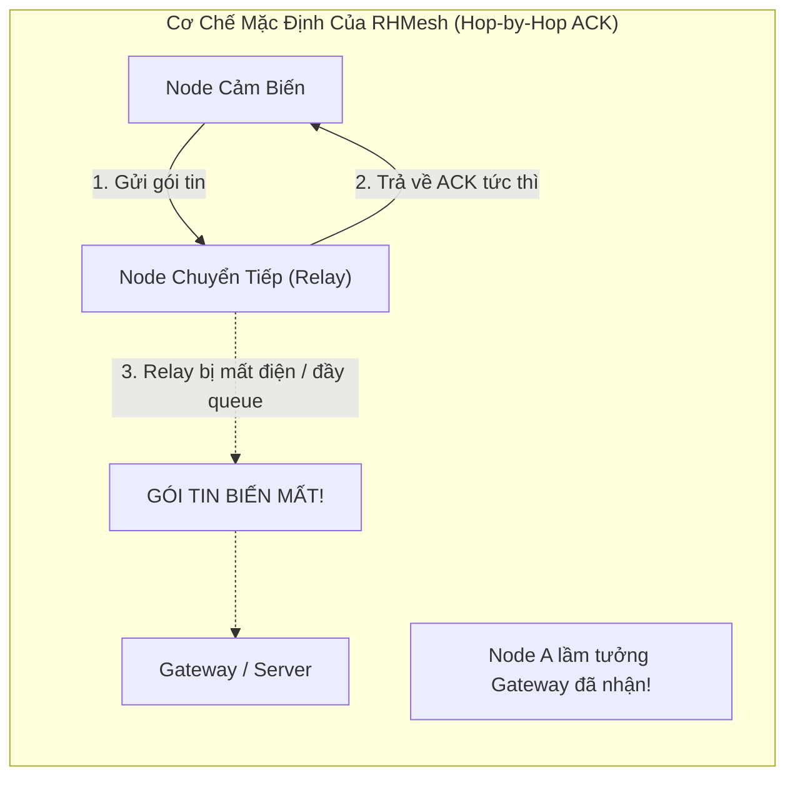

# BÀI 10: PHÂN TÍCH GIẢI PHÁP MẠNG LORA MESH VÀ BẪY ACK TỪNG CHẶNG

> Tóm tắt: Phân tích kiến trúc phân tầng của thư viện RadioHead RHMesh, bóc tách thuật toán định tuyến tìm đường nhiều chặng (AODV Routing), vạch trần cạm bẫy kỹ thuật giữa Hop-by-hop ACK và End-to-End ACK, đồng thời đánh giá giới hạn quy mô của mạng LoRa Mesh.

---

## 1. Kiến Trúc Phân Tầng Của Thư Viện RadioHead

Trong hệ sinh thái mã nguồn mở cho vi điều khiển (như ESP32, STM32, Arduino), thư viện **RadioHead** do Mike McCauley phát triển là giải pháp phổ biến nhất để xây dựng mạng LoRa Ad-hoc. Kiến trúc của thư viện được tổ chức theo mô hình kế thừa hướng đối tượng nghiêm ngặt:

1. **`RH_RF95`**: Điều khiển trực tiếp chip phần cứng Semtech SX1276 qua SPI (Tầng 1 - Physical Layer).
2. **`RHReliableDatagram`**: Bổ sung địa chỉ nguồn (Source), địa chỉ đích (Destination) và cơ chế gửi lại kèm xác nhận (Hop-by-hop ACK và Retries).
3. **`RHRouter`**: Quản lý bảng định tuyến tĩnh (Static Routing Table) với danh sách các node chuyển tiếp (Next Hop).
4. **`RHMesh`**: Bổ sung thuật toán tự động tìm đường động (Dynamic Route Discovery) tương tự như giao thức AODV (Ad hoc On-Demand Distance Vector).

---

## 2. Thuật Toán Tìm Đường Của RHMesh

Khi một Node nguồn ($S$) muốn gửi dữ liệu tới Node đích ($D$) nhưng chưa có tuyến đường lưu trong bảng định tuyến:

### Chi Phí Tiêu Hao Của Gói Tin (Header Overhead)
Mỗi gói tin khi chạy qua tầng RHMesh đều phải gánh thêm các byte header:
- `Mesh Header` (4 bytes): `Mesh Message Type`, `Source Address`, `Destination Address`, `Hop Count`.
- `Reliable Datagram Header` (4 bytes): `To`, `From`, `Packet ID`, `Flags / ACK`.
- **Hệ quả**: Băng thông khả dụng cho payload người dùng bị co hẹp lại, làm tăng Time-on-Air trên mỗi chặng phát sóng.

---

## 3. "Cạm Bẫy" Kỹ Thuật: Hop-by-Hop ACK vs End-to-End ACK

Đây là một trong những câu hỏi phỏng vấn kinh điển nhằm phân loại kỹ sư có kinh nghiệm thực chiến hay chỉ mới đọc tutorial trên mạng:

### 3.1 Bản Chất Của Hop-by-Hop ACK Trong RHMesh
- Khi Node A gọi hàm `sendtoWait()` gửi dữ liệu cho Node đích thông qua Node chuyển tiếp B:
  - Node A truyền gói tin cho B.
  - Ngay khi Node B thu nhận xong và giải mã đúng CRC, **Node B lập tức phát một gói ACK trả về cho A**.
  - Hàm `sendtoWait()` trên Node A trả về `true`.
  - **Sự ngộ nhận tai hại**: Lập trình viên tưởng rằng gói tin đã đến được Gateway trung tâm, nhưng thực chất gói tin mới chỉ nằm trong bộ nhớ RAM của node chuyển tiếp B!

### 3.2 Kịch Bản Rớt Dữ Liệu Thực Tế
Nếu ngay sau đó:
1. Node B bị sập nguồn hoặc reset do sụt áp pin.
2. Hàng đợi của Node B bị tràn (Queue Overflow).
3. Đường truyền giữa B và Gateway bị nghẽn sóng hoặc khoảng cách quá xa.
⇒ **Gói tin sẽ vĩnh viễn biến mất mà Node nguồn A hoàn toàn không hề hay biết!**

### 3.3 Giải Pháp: Xây Dựng Application End-to-End ACK
Nếu hệ thống bắt buộc phải đảm bảo dữ liệu đến được máy chủ trung tâm:
- Vô hiệu hóa hoặc bỏ qua cờ xác nhận ở tầng Mesh.
- Thiết kế một trường `Message Sequence Number` trong Payload tầng ứng dụng.
- Sau khi Gateway/Server nhận được và lưu vào cơ sở dữ liệu, Gateway mới phát một gói tin phản hồi mang mã `APP_ACK` gửi ngược về chính xác Node nguồn ban đầu.

---

## 4. Giới Hạn Vật Lý Và Sự Suy Giảm Quy Mô Của LoRa Mesh

Mặc dù nghe rất hấp dẫn trên lý thuyết, mô hình LoRa Mesh bộc lộ các nhược điểm chết người khi triển khai quy mô lớn:

| Giới Hạn Kỹ Thuật | Phân Tích Bản Chất Vật Lý |
| :--- | :--- |
| **Hao pin khủng khiếp ở các node Relay** | Để có thể bắt được các gói tin RREQ bất kỳ lúc nào, các node chuyển tiếp **bắt buộc phải mở bộ thu liên tục (Continuous RX)** tiêu tốn ~11 mA. Chúng không thể dùng pin mà phải cắm nguồn điện lưới hoặc pin mặt trời lớn. |
| **Độ trễ tích lũy (Cumulative Latency)** | Qua mỗi hop, gói tin mất thêm thời gian $ToA$ (từ 50 ms đến 500 ms) cộng với thời gian định thời ngẫu nhiên (Backoff) để tránh xung đột. Mạng 4–5 hops có thể trễ tới 3–5 giây. |
| **Xung đột sóng cục bộ (Self-Interference)** | Khi Node Relay phát lại gói tin của node con trên cùng một tần số, nó vô tình tạo ra nguồn nhiễu cực mạnh đè bẹp các node xung quanh đang cố gắng truyền thông. |

---

## 5. Lưu Ý Kỹ Thuật & Best Practices Thực Chiến

> [!IMPORTANT]
> **Bài toán thiết kế thực chiến:** *"Tại sao trong dự án trước em lại chọn giải pháp LoRa Mesh bằng RadioHead thay vì chọn chuẩn LoRaWAN?"*
> 
> **Giải pháp kiến trúc chuẩn mực:**
> "trong dự án đó mục tiêu là xây dựng hệ thống cảnh báo cháy trong môi trường công xưởng có kết cấu bê tông cốt thép dày đặc và không có kết nối Internet sẵn có.
> 1. Do địa hình nhiều góc khuất sâu (NLOS), sóng LoRa không thể truyền một mạch từ cảm biến về trung tâm. Việc bố trí các node Mesh chuyển tiếp giúp tín hiệu bọc vòng qua các vách ngăn cơ học.
> 2. Hệ thống hoạt động độc lập, khép kín tại chỗ (Closed-loop / On-premises), không phụ thuộc vào hạ tầng Gateway đắt đỏ hay dịch vụ đám mây LoRaWAN Network Server của bên thứ ba.
> 
> Tuy nhiên, em nhận thức rất rõ giới hạn của giải pháp này: Các node chuyển tiếp tiêu tốn năng lượng rất lớn nên phải cấp nguồn Adapter cố định, và khi số lượng node vượt quá 30–50 thiết bị, hiện tượng va chạm kênh truyền tăng mạnh, đòi hỏi phải chuyển sang kiến trúc sao mở rộng (Star-of-Stars) của chuẩn LoRaWAN."
