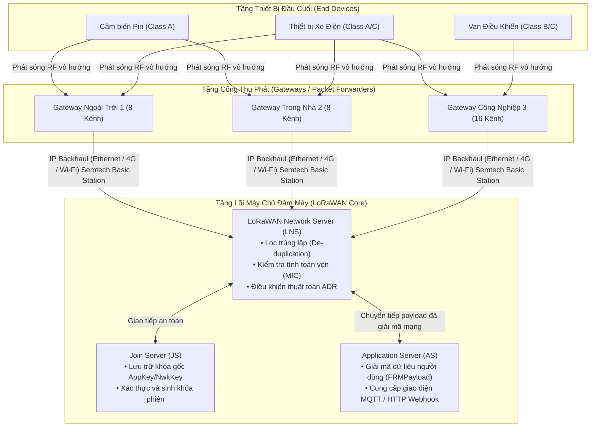
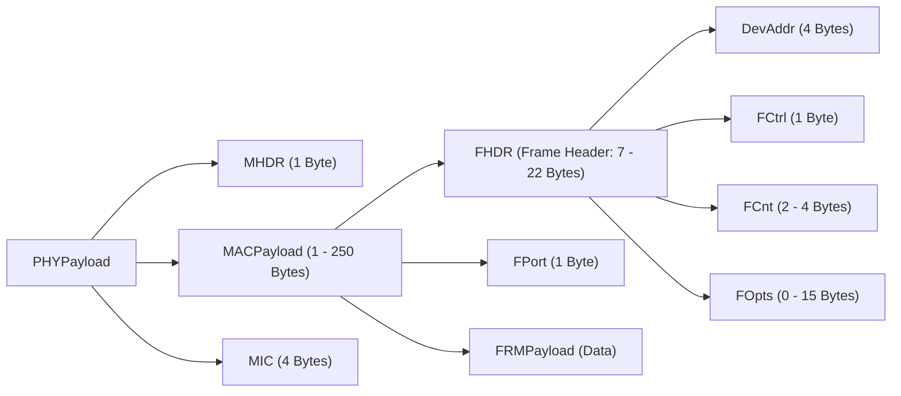

# BÀI 11: KIẾN TRÚC MẠNG LORAWAN TOÀN DIỆN

> Tóm tắt: Phân tích sâu kiến trúc mạng hình sao mở rộng (Star-of-Stars Topology), bóc tách vai trò các thực thể mạng Gateway, Network Server, Join Server, Application Server, và giải mã từng trường bit trong cấu trúc khung truyền LoRaWAN.

---

## 1. Kiến Trúc Hình Sao Mở Rộng (Star-of-Stars Topology)

Trái ngược với cấu trúc mạng lưới (Mesh) phức tạp nơi các node phải chia sẻ quyền định tuyến cho nhau, **chuẩn LoRaWAN áp dụng triệt để kiến trúc hình sao mở rộng (Star-of-Stars)**:

---

## 2. Vai Trò Của Từng Thực Thể Mạng Trong LoRaWAN

### 2.1 Cổng Thu Phát (Gateway - Packet Forwarder)
- **Bản chất**: Gateway LoRaWAN hoạt động như một **bộ chuyển đổi sóng vô tuyến RF sang gói tin IP hoàn toàn trong suốt (Transparent Bridge)**.
- **Không có trí thông minh mạng**: Gateway không biết gói tin vừa thu được là của ai, không giải mã dữ liệu, và không kiểm tra mật khẩu.
- **Nhiệm vụ duy nhất**: Lấy khung dữ liệu RF thô vừa giải điều chế được, đóng gói kèm theo các siêu dữ liệu vật lý (**Metadata: Tần số, Spreading Factor, RSSI, SNR, Dấu thời gian GPS chính xác**) và bắn thẳng về Network Server qua giao thức IP (sử dụng UDP Semtech Packet Forwarder cổ điển hoặc WebSocket **Semtech Basic Station** hiện đại).

### 2.2 Network Server (LNS - Trái Tim Của Hệ Thống)
LNS (ví dụ: ChirpStack, The Things Stack) chịu trách nhiệm vận hành toàn bộ mạng:
1. **Lọc bỏ gói tin trùng lặp (De-duplication)**: Nhờ cơ chế phát sóng vô hướng, một gói tin phát ra có thể được 3 Gateway cùng thu được. LNS sẽ gom cả 3 bản tin này lại, chỉ giữ lại một bản duy nhất để xử lý, đồng thời phân tích Gateway nào có SNR tốt nhất để chọn làm trạm phát nếu cần gửi gói tin Downlink phản hồi.
2. **Kiểm tra tính toàn vẹn dữ liệu (MIC Verification)**: Sử dụng khóa mạng `NwkSKey` để tính toán lại mã MIC. Nếu sai một bit, gói tin bị hủy ngay lập tức.
3. **Thực thi thuật toán ADR**: Phân tích lịch sử chất lượng sóng của thiết bị để ra lệnh tăng/giảm công suất phát và Spreading Factor.

### 2.3 Join Server (JS) & Application Server (AS)
- **Join Server**: Nơi lưu giữ các khóa bí mật cấp cao nhất (`AppKey`, `NwkKey`). Chịu trách nhiệm xác thực danh tính thiết bị khi thực hiện quá trình gia nhập mạng OTAA.
- **Application Server**: Nơi nắm giữ khóa ứng dụng `AppSKey`. Chỉ duy nhất Application Server mới có quyền giải mã nội dung thực sự của gói tin (`FRMPayload`), đảm bảo nhà mạng viễn thông vận hành LNS cũng không thể đọc trộm dữ liệu nhạy cảm của khách hàng (Mã hóa đầu cuối - End-to-End Encryption).

---

## 3. Giải Mã Cấu Trúc Khung Truyền LoRaWAN (Frame Structure)

Một khung truyền LoRaWAN hoàn chỉnh được đóng gói chặt chẽ để tiết kiệm từng byte băng thông:

### 3.1 MAC Header (MHDR - 1 Byte)
- **Bits [7:5] (MType - Message Type)**:
  - `000`: Join Request (Gói xin gia nhập mạng)
  - `001`: Join Accept (Gói đồng ý gia nhập)
  - `010`: Unconfirmed Data Up (Dữ liệu gửi lên không cần ACK)
  - `011`: Unconfirmed Data Down (Dữ liệu gửi xuống không cần ACK)
  - `100`: Confirmed Data Up (Dữ liệu gửi lên **bắt buộc Gateway gửi ACK**)
  - `101`: Confirmed Data Down (Dữ liệu gửi xuống **bắt buộc Node gửi ACK**)
- **Bits [1:0] (Major)**: Phiên bản đặc tả LoRaWAN (luôn cố định là `00` cho LoRaWAN R1).

### 3.2 Frame Header (FHDR)
- **`DevAddr` (4 bytes)**: Địa chỉ mạng tạm thời của thiết bị được cấp sau khi Join.
- **`FCtrl` (1 byte)**: Chứa cờ báo yêu cầu xác nhận `ACK`, cờ báo có dữ liệu Downlink đang chờ (`FPending`), và cờ điều khiển thích ứng tốc độ (`ADR`).
- **`FCnt` (Frame Counter - 2 đến 4 bytes)**: Bộ đếm gói tin tăng dần đều sau mỗi lần phát. **Đây là vũ khí quan trọng nhất để chống lại tấn công phát lại (Replay Attack)**. Nếu LNS nhận được gói tin có `FCnt` nhỏ hơn hoặc bằng giá trị đã nhận trước đó, gói tin lập tức bị xóa bỏ!
- **`FOpts` (Frame Options - 0 đến 15 bytes)**: Chứa các lệnh điều khiển cấu hình mạng MAC commands (như đổi kênh tần số, đổi công suất phát).

### 3.3 Frame Port (FPort - 1 Byte)
- `FPort = 0`: Payload bên trong chứa các lệnh quản trị mạng MAC Commands.
- `FPort = 1` đến `223`: Cổng dữ liệu người dùng của ứng dụng (Application Specific).
- `FPort = 224` đến `255`: Dành riêng cho kiểm thử và chứng nhận hợp chuẩn.

### 3.4 Message Integrity Code (MIC - 4 Bytes)
Mã bảo vệ toàn vẹn được tính toán bằng thuật toán chuẩn mật mã **AES-CMAC-128** trên toàn bộ nội dung của gói tin kết hợp với khóa mạng `NwkSKey` và bộ đếm `FCnt`. Chỉ cần một bit trong gói tin bị méo hoặc bị hacker can thiệp sửa đổi, mã MIC sẽ sai lệch hoàn toàn và gói tin bị loại bỏ.

