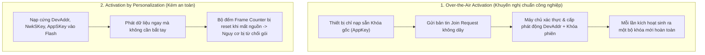
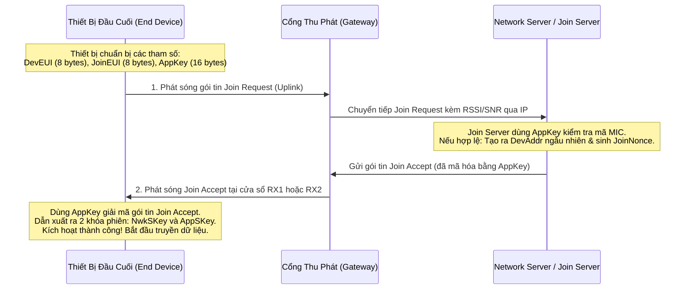
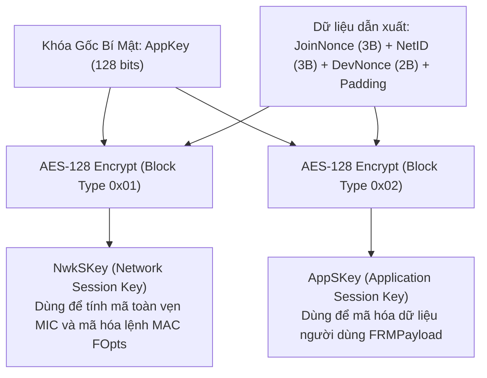

# BÀI 12: CƠ CHẾ KÍCH HOẠT THIẾT BỊ: OTAA VS ABP VÀ BẢO MẬT AES-128

> Tóm tắt: Phân tích chi tiết quy trình bắt tay Over-the-Air Activation (OTAA) và Activation by Personalization (ABP), bóc tách thuật toán dẫn xuất khóa phiên bảo mật hai tầng AES-128, và giải quyết triệt để lỗi mất đồng bộ bộ đếm gói tin (Frame Counter Desynchronization).

---

## 1. So Sánh Hai Cơ Chế Kích Hoạt: OTAA vs ABP

Trước khi một thiết bị LoRaWAN có thể gửi dữ liệu lên mạng, nó phải trải qua quá trình kích hoạt để xác thực và thiết lập các khóa phiên mã hóa.

| Tiêu Chí Kỹ Thuật | OTAA (Over-the-Air Activation) | ABP (Activation by Personalization) |
| :--- | :---: | :---: |
| **Độ an toàn bảo mật** | **Rất cao**: Khóa phiên thay đổi sau mỗi lần Join. | **Thấp**: Khóa phiên cố định vĩnh viễn trong Flash. |
| **Tính linh hoạt hạ tầng** | Chuyển đổi nhà mạng hoặc Server dễ dàng. | Bị khóa cứng (Hard-coded) vào một mạng duy nhất. |
| **Xử lý khi thiết bị reboot** | Bắt tay Join lại, reset bộ đếm `FCnt` an toàn. | `FCnt` bị reset về 0 làm Server chặn gói tin (Replay Attack). |
| **Yêu cầu kết nối hai chiều** | Bắt buộc phải thu được gói Downlink `Join Accept`. | Không cần thu, chỉ cần một chiều phát (Uplink-only). |
| **Ứng dụng thực tế** | **99% thiết bị sản xuất thương mại.** | Phục vụ demo, kiểm thử trong phòng lab. |

---

## 2. Quy Trình Bắt Tay Kích Hoạt OTAA Chi Tiết

Quá trình OTAA bao gồm một cặp bản tin trao đổi duy nhất giữa End Device và Network Server:

### 2.1 Cấu Trúc Bản Tin Join Request (Gửi Lên)
- **`JoinEUI` (8 bytes)**: Định danh toàn cầu của máy chủ quản lý tài khoản (trước đây gọi là `AppEUI`).
- **`DevEUI` (8 bytes)**: Địa chỉ MAC vật lý duy nhất toàn cầu của thiết bị (tương tự địa chỉ MAC Ethernet do IEEE cấp).
- **`DevNonce` (2 bytes)**: Một số ngẫu nhiên do thiết bị sinh ra. LNS sẽ ghi nhớ danh sách các `DevNonce` đã dùng để ngăn chặn kẻ xấu thu lại gói Join Request rồi phát lại.
- **`MIC` (4 bytes)**: Tính toán bằng thuật toán AES-128-CMAC trên toàn bộ gói tin sử dụng khóa gốc bí mật **`AppKey`**.

### 2.2 Cấu Trúc Bản Tin Join Accept (Trả Về)
- Toàn bộ gói tin Join Accept được **mã hóa trực tiếp bằng khóa `AppKey`**.
- Chứa các thông số sống còn:
  - **`JoinNonce` (3 bytes)**: Số ngẫu nhiên từ máy chủ phục vụ tính khóa phiên.
  - **`NetID` (3 bytes)**: Mã định danh mạng của nhà mạng LoRaWAN.
  - **`DevAddr` (4 bytes)**: Địa chỉ mạng 32-bit cấp riêng cho thiết bị trong phiên làm việc này.
  - **`DLSettings` (1 byte)**: Cấu hình thông số đường xuống (tốc độ RX1, tần số RX2).
  - **`RxDelay` (1 byte)**: Thời gian trễ mở cửa sổ nhận (mặc định 1 giây cho RX1).
  - **`CFList` (16 bytes - Tùy chọn)**: Danh sách các kênh tần số mới được bổ sung vào modem.

---

## 3. Thuật Toán Dẫn Xuất Khóa Phiên (Key Derivation Function)

Sau khi nhận được gói `Join Accept` hợp lệ, cả thiết bị và máy chủ đều sử dụng thuật toán mật mã tiêu chuẩn **AES-128 Encrypt** để độc lập tính toán ra hai khóa phiên làm việc:

> [!IMPORTANT]
> **Mô hình bảo mật hai tầng độc lập:**
> - **`NwkSKey`** nằm tại **Network Server (LNS)**: Giúp nhà mạng xác thực tính hợp lệ của gói tin và quản lý mạng mà **hoàn toàn không thể đọc trộm được nội dung dữ liệu**.
> - **`AppSKey`** chỉ được chuyển tiếp về **Application Server**: Giúp doanh nghiệp bảo mật tuyệt đối dữ liệu cảm biến / hành trình xe điện trước mắt nhà cung cấp mạng viễn thông.

---

## 4. Thảm Họa Mất Đồng Bộ Bộ Đếm Gói Tin (Frame Counter Desync) Trên ABP

Trong các thiết bị sử dụng cơ chế ABP:
1. Thiết bị đang chạy đến `FCnt = 1500`.
2. Thiết bị bất ngờ bị rút nguồn hoặc sập pin khởi động lại.
3. Khi khởi động lại, biến `FCnt` trong RAM bị reset về `0`.
4. Thiết bị phát gói tin có `FCnt = 0`.
5. **Máy chủ Network Server so sánh**: $0 \le 1500 \Rightarrow$ Coi đây là một cuộc tấn công phát lại (Replay Attack) và **âm thầm vứt bỏ gói tin vào sọt rác**!
6. Thiết bị phát hàng nghìn gói tin tiếp theo vẫn bị chặn hoàn toàn cho đến khi `FCnt` vượt qua mốc $1500$.

> [!TIP]
> **Giải pháp khắc phục:**
> 1. Luôn ưu tiên dùng **OTAA**: Mỗi lần khởi động lại, thiết bị thực hiện Join mới, tạo ra bộ khóa mới và LNS tự động đồng ý reset `FCnt` về 0.
> 2. Nếu bắt buộc phải dùng ABP: Phải lưu `FCnt` vào bộ nhớ Flash nội (EEPROM) sau mỗi vài gói tin, hoặc tắt tính năng kiểm tra `Frame Counter Validation` trên Server (chỉ khuyến nghị trong phòng thí nghiệm).

