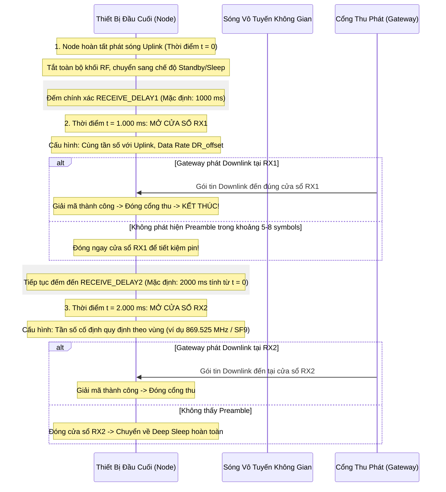
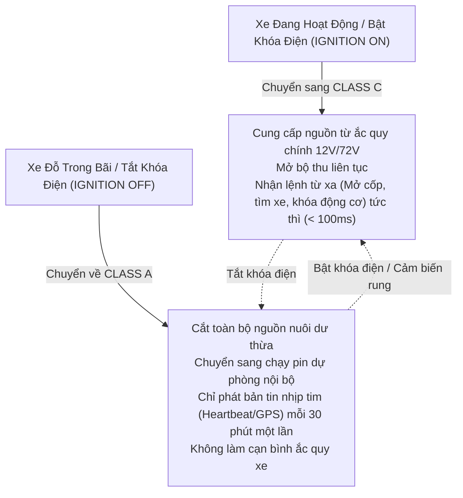

# BÀI 13: VẬN HÀNH LORAWAN: THIẾT BỊ LỚP A, LỚP B, LỚP C VÀ TIMING CỬA SỔ RX1/RX2

> Tóm tắt: Phân tích chi tiết ba lớp vận hành thiết bị Class A, Class B, Class C trong chuẩn LoRaWAN, bóc tách chính xác giản đồ thời gian (Timing Diagram) của hai cửa sổ thu nhận RX1/RX2, và kỹ thuật chuyển đổi lớp linh hoạt trong hệ thống xe điện thông minh.

---

## 1. Phân Loại Ba Lớp Vận Hành Thiết Bị Trong LoRaWAN

Tùy thuộc vào yêu cầu về độ trễ nhận lệnh điều khiển từ máy chủ (Downlink Latency) và nguồn cấp điện, chuẩn LoRaWAN phân chia thiết bị thành 3 lớp riêng biệt:

```mermaid
flowchart TD
    subgraph CLASSA["1. Class A (Mọi thiết bị bắt buộc phải hỗ trợ)"]
        A1["Tiết kiệm pin tối đa (Chạy pin 5-10 năm)"] --> A2["Chỉ mở cửa sổ thu sau khi vừa phát xong một gói Uplink"]
        A2 --> A3["Máy chủ KHÔNG THỂ chủ động gửi lệnh xuống bất kỳ lúc nào"]
    end

    subgraph CLASSB["2. Class B (Beacon-synchronized)"]
        B1["Độ trễ trung bình (Vài giây đến hàng chục giây)"] --> B2["Gateway định kỳ phát sóng Beacon để đồng bộ thời gian"]
        B2 --> B3["Thiết bị định kỳ mở các cửa sổ thu ngắn (Ping Slots)"]
    end

    subgraph CLASSC["3. Class C (Continuous Listening)"]
        C1["Độ trễ tối thiểu (Gần như tức thì)"] --> C2["Mở bộ thu liên tục 100% thời gian (trừ lúc đang phát)"]
        C2 --> C3["Tốn điện khủng khiếp (~11 mA liên tục) -> Bắt buộc dùng nguồn ngoài"]
    end
```

| Tiêu Chí So Sánh | Class A (All) | Class B (Beacon) | Class C (Continuous) |
| :--- | :---: | :---: | :---: |
| **Độ trễ Downlink** | Rất cao (phải chờ lần phát tiếp theo của Node) | Vừa phải (phụ thuộc chu kỳ Ping Slot) | **Gần như tức thì (< 100 ms)** |
| **Dòng tiêu thụ trung bình** | **Siêu thấp (< 5 µA)** | Thấp đến trung bình (~50 µA – 200 µA) | **Cao (~11 mA liên tục)** |
| **Nguồn cấp phù hợp** | Pin Lithium đơn (CR2032, Li-SOCl2) | Pin lớn hoặc pin mặt trời | **Nguồn điện lưới / Ắc quy xe điện** |
| **Độ phức tạp Firmware** | Cơ bản | Phức tạp (xử lý trôi thời gian và bắt Beacon) | Trung bình |

---

## 2. Giản Đồ Thời Gian Chính Xác Của Cửa Sổ RX1 Và RX2 (Class A)

Trọng tâm thiết kế firmware LoRaWAN cho thiết bị Class A nằm ở việc căn chỉnh thời gian mở cổng thu chính xác đến từng microsecond sau khi kết thúc phát sóng ($t_{TX\_Done}$):

### 2.1 Cửa Sổ Thu Nhận Thứ Nhất (RX1 Window)
- **Thời điểm mở**: Chính xác sau **1.0 giây** tính từ khi kết thúc truyền gói Uplink (`RECEIVE_DELAY1 = 1000 ms`).
- **Tần số**: Trùng khớp với kênh tần số mà thiết bị vừa sử dụng để phát gói Uplink.
- **Tốc độ truyền (Data Rate)**: Được tính dựa trên Data Rate của Uplink trừ đi một hệ số bù (`RX1DROffset`) do Network Server chỉ định.

### 2.2 Cửa Sổ Thu Nhận Thứ Hai (RX2 Window)
- **Thời điểm mở**: Chính xác sau **2.0 giây** tính từ khi kết thúc truyền gói Uplink (`RECEIVE_DELAY2 = 2000 ms`, tức đúng 1.0 giây sau khi mở RX1).
- **Tần số & Tốc độ**: Cố định hoàn toàn theo thông số mặc định của khu vực (Regional Parameters) hoặc do lệnh MAC từ Server cập nhật (ví dụ tại EU868: Tần số cố định $869.525\text{ MHz}$, tốc độ cố định $SF9 / 125\text{ kHz}$).

> [!WARNING]
> **Rủi ro trôi dạt xung nhịp (Crystal Drift):**
> Bộ dao động thạch anh trên vi điều khiển luôn có sai số (ví dụ $\pm 20\text{ ppm}$). Sau 1 đến 2 giây trễ, thời điểm mở cửa sổ RX có thể bị lệch vài millisecond, dẫn đến việc bỏ lỡ phần Preamble của gói tin từ Gateway.
> **Giải pháp kỹ thuật**: Firmware phải mở rộng độ rộng cửa sổ thu (RX Window Expansion) sớm hơn vài millisecond trước mốc thời gian lý thuyết để bù trừ sai số nhiệt độ của thạch anh.

---

## 3. Chiến Lược Chuyển Đổi Lớp Linh Hoạt Trong Hệ Thống Xe Điện (Connected EV)

Trong các thiết bị thông minh như Cụm đồng hồ xe điện (Connected EV Smart Cluster), việc cố định một lớp duy nhất là không tối ưu:

### Cơ Chế Đồng Bộ Lớp Giữa Thiết Bị Và Máy Chủ
Khi xe chuyển từ Class A sang Class C (hoặc ngược lại), thiết bị không thể tự ý chuyển một cách âm thầm:
1. Thiết bị gửi một gói tin Uplink mang lệnh MAC `DeviceModeInd` (trong trường `FOpts` hoặc `FPort 0`) để thông báo cho Network Server biết nó đã chuyển sang Class C.
2. Network Server phản hồi lại bằng lệnh `DeviceModeConf`.
3. Chỉ sau khi hoàn tất trao đổi này, Network Server mới bắt đầu bắn các gói tin Downlink bất kỳ lúc nào mà không cần chờ gói tin Uplink từ xe.

---

## 4. Lưu Ý Kỹ Thuật & Best Practices Thực Chiến

> [!IMPORTANT]
> **Bài toán thiết kế thực chiến:** *"Nếu xe điện đang đỗ tắt máy và ở Class A để tiết kiệm điện, làm thế nào máy chủ có thể gửi lệnh khẩn cấp (như khóa xe từ xa) cho xe?"*
> 
> **Giải pháp kiến trúc chuẩn mực:**
> "Ở Class A, máy chủ **về mặt nguyên tắc không thể ép xe nhận lệnh tức thì** vì xe đang ở chế độ Deep Sleep và cổng thu đã đóng hoàn toàn.
> Để giải quyết bài toán này trong thực tế công nghiệp, chúng ta có 2 phương án:
> 1. **Cấu hình chu kỳ Uplink ngắn (Periodic Keep-alive)**: Cứ mỗi 1–2 phút xe thức dậy phát một gói tin trạng thái siêu nhỏ (1 byte). Khi đó, máy chủ sẽ xếp sẵn lệnh khóa xe vào hàng đợi (Downlink Queue) trên LNS. Ngay khi xe vừa phát gói nhịp tim xong, lệnh khóa sẽ được bắn xuống ngay tại cửa sổ RX1 hoặc RX2.
> 2. **Kiến trúc đánh thức phần cứng qua LoRa CAD**: Sử dụng một vi điều khiển công suất cực thấp phụ trợ chạy kèm chip LoRa luôn thực hiện quét CAD định kỳ mỗi 1 giây (như đã phân tích ở Bài 04). Khi máy chủ cần khóa xe khẩn cấp, Gateway phát một gói tin có Preamble kéo dài để đánh thức xe chuyển sang Class C ngay lập tức."

