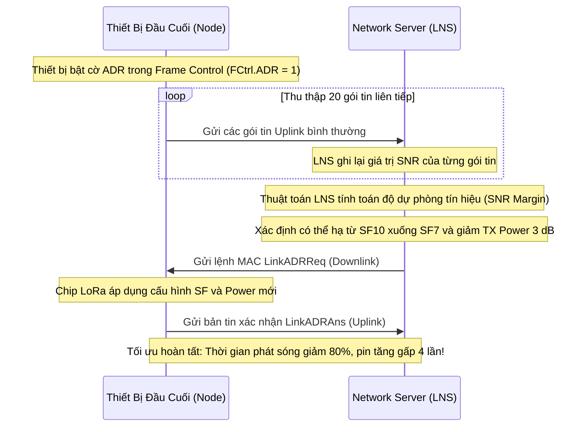

# BÀI 14: KỸ THUẬT ADAPTIVE DATA RATE (ADR) VÀ QUY CHUẨN TẦN SỐ KHU VỰC

> Tóm tắt: Phân tích thuật toán tự động thích ứng tốc độ Adaptive Data Rate (ADR) trong chuẩn LoRaWAN, bóc tách luồng lệnh MAC LinkADRReq/Ans, chỉ rõ trường hợp cấm dùng ADR đối với thiết bị di động, và tổng hợp quy chuẩn tần số vô tuyến theo từng khu vực địa lý.

---

## 1. Cơ Chế Thích Ứng Tốc Độ Dữ Liệu (Adaptive Data Rate - ADR)

Trong một mạng diện rộng, các thiết bị đầu cuối nằm rải rác ở các khoảng cách khác nhau tới Gateway:
- Thiết bị ở rất gần Gateway (ví dụ 100 mét) nếu vẫn phát ở cấu hình $SF12$ với công suất cực đại $+14\text{ dBm}$ sẽ là một sự **lãng phí pin nghiêm trọng** và gây ô nhiễm băng tần vô tuyến không cần thiết.
- Thiết bị ở xa (vài km) cần $SF12$ để bảo đảm link budget xuyên qua vật cản.

**Adaptive Data Rate (ADR)** là thuật toán điều khiển vòng kín (Closed-loop Control) giữa End Device và Network Server nhằm tối ưu hóa liên tục hai thông số: **Spreading Factor (SF)** và **Công suất phát (TX Power)**.

---

## 2. Thuật Toán Tính Toán ADR Trên Máy Chủ Network Server

Máy chủ LNS thường áp dụng giải pháp tính toán tiêu chuẩn do LoRa Alliance khuyến nghị:

1. **Thu thập mẫu**: LNS lấy danh sách giá trị SNR của **20 gói tin Uplink gần nhất**.
2. **Tính SNR đại diện**: Lấy giá trị $SNR_{max}$ hoặc trung bình trừ đi một khoảng dao động chuẩn.
3. **Tính toán biên độ dự phòng an toàn (SNR Margin)**:
   
   $$SNR_{margin} = SNR_{measured} - SNR_{limit}(DR) - Margin_{safety}$$
   
   *(Trong đó: $SNR_{limit}(DR)$ là ngưỡng SNR tối thiểu để giải mã được tốc độ đó; $Margin_{safety}$ là biên độ dự phòng an toàn, thường lấy cố định là **$10\text{ dB}$**).*
4. **Tính số bước tối ưu ($N_{steps}$)**:
   
   $$N_{steps} = \left\lfloor \frac{SNR_{margin}}{3\text{ dB}} \right\rfloor$$

5. **Quy tắc phân bổ từng bước**:
   - **Ưu tiên 1**: Dùng các bước $N_{steps}$ để **giảm Spreading Factor** (từ SF12 xuống SF11 → SF10 → ... → SF7) để giảm mạnh Time-on-Air.
   - **Ưu tiên 2**: Nếu đã đạt mức tốc độ cao nhất (SF7), các bước $N_{steps}$ còn lại sẽ được dùng để **giảm công suất phát TX Power** (từ 14 dBm xuống 11 dBm → 8 dBm → ... → 2 dBm).

---

## 3. Cạm Bẫy Chết Người: Khi Nào TUYỆT ĐỐI CẤM Dùng ADR?

> [!CAUTION]
> **Quy tắc vàng của kỹ sư thiết kế:**
> Thuật toán ADR được xây dựng dựa trên tiền đề toán học là **kênh truyền sóng tĩnh hoặc bán tĩnh (Static Channel)** — nghĩa là vị trí địa lý của thiết bị và Gateway không thay đổi theo thời gian (ví dụ: công tơ điện nước gắn trên tường nhà).
> 
> **TUYỆT ĐỐI KHÔNG BẬT ADR CHO THIẾT BỊ DI ĐỘNG (Connected EV, Ô tô, Thiết bị định vị Tracker, Vòng cổ gia súc)!**

### Hậu Quả Khi Bật ADR Cho Thiết Bị Di Động
1. Chiếc xe điện dừng đèn đỏ ngay sát cạnh Gateway. Chất lượng sóng cực tốt ($SNR = +10\text{ dB}$).
2. LNS tính toán thấy tín hiệu quá mạnh, lập tức hạ xe xuống cấu hình nhanh nhất: **SF7 và công suất phát cực tiểu 2 dBm**.
3. Xe điện tăng ga di chuyển ra xa, chui vào đường hầm hoặc đi ra khu vực ngoại ô cách Gateway 5 km.
4. Với cấu hình yếu ớt $SF7 / 2\text{ dBm}$, sóng vô tuyến từ xe **hoàn toàn không thể chạm tới bất kỳ Gateway nào nữa**.
5. Do không nhận được tín hiệu Downlink từ Server, xe bị mất kết nối vĩnh viễn (Blackout) cho đến khi cơ chế Fallback của ADR timeout (thường mất từ 64 đến 96 gói tin phát hỏng).

---

## 4. Bảng Quy Chuẩn Tần Số Vô Tuyến Khu Vực (Regional Parameters)

Mỗi quốc gia và vùng lãnh thổ trên thế giới áp dụng các quy định ngặt nghèo về dải tần số vô tuyến miễn cấp phép (ISM Band):

| Khu Vực / Quốc Gia | Dải Tần Số ISM | Số Kênh Mặc Định | Giới Hạn Duty Cycle / Dwell Time | Công Suất Phát Tối Đa (EIRP) |
| :--- | :---: | :---: | :---: | :---: |
| **Châu Âu (EU868)** | 863 MHz – 870 MHz | 8 Kênh (125 kHz) | **Duty Cycle 1%** (kênh phụ 0.1%) | +14 dBm (25 mW) |
| **Bắc Mỹ (US915)** | 902 MHz – 928 MHz | 64 Kênh Uplink (125 kHz) + 8 Kênh Uplink (500 kHz) | Không áp Duty Cycle. **Max Dwell Time = 400 ms** | +30 dBm (1 Watt) |
| **Châu Á / Thái Bình Dương (AS923)** | 920 MHz – 925 MHz | 2 Kênh mặc định + 14 Kênh tùy chọn | Tùy quốc gia (Nhật Bản áp LBT; VN áp Duty Cycle) | +16 dBm |
| **Việt Nam (VN)** | **433 MHz** (thử nghiệm) **920 – 923 MHz** (AS923-2) | Tuân thủ thông tư Bộ Thông tin & Truyền thông | Giới hạn công suất bức xạ tối đa và thời gian chiếm kênh | Thường $\le +14\text{ dBm}$ (25 mW) |

> [!NOTE]
> **Sự khác biệt giữa Duty Cycle và Dwell Time:**
> - **Châu Âu (Duty Cycle 1%)**: Giới hạn tổng thời gian phát sóng tích lũy (không quá 36 giây mỗi giờ).
> - **Mỹ (Dwell Time 400 ms)**: Mỗi gói tin phát ra **không được phép chiếm dụng kênh quá 400 millisecond**. Do đó tại Mỹ, chuẩn LoRaWAN cấm dùng cấu hình SF11 và SF12 ở băng thông 125 kHz vì thời gian ToA của chúng vượt quá 400 ms!
