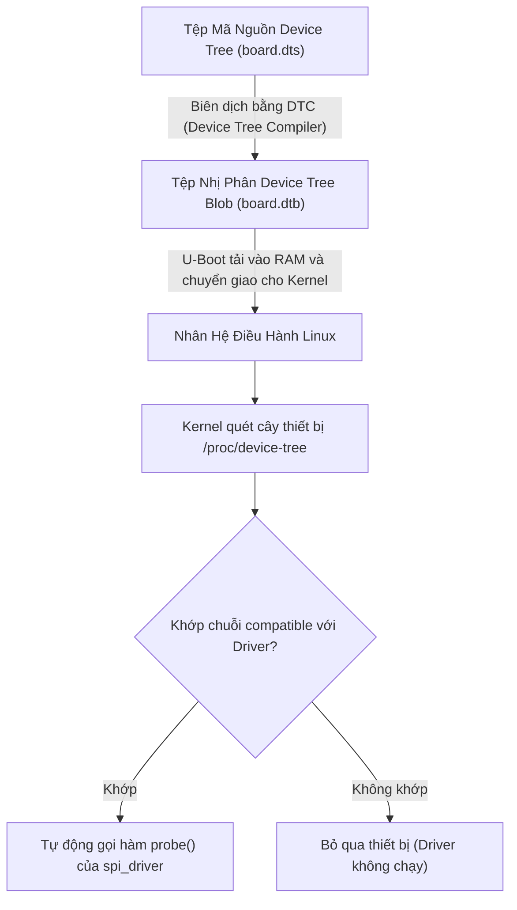

# BÀI 15: CẤU HÌNH DEVICE TREE (DTS) CHO GIAO DIỆN SPI VÀ GPIO RADIO

> Tóm tắt: Phân tích kiến trúc Device Tree trong nhân Linux, thiết kế Device Tree Source (DTS) hoàn chỉnh để khai báo chip LoRa SX1276 trên bus SPI, cấu hình Pinmux/Pinctrl, gán chân ngắt DIO0 và chân Reset, đồng thời kiểm tra tính tương thích với cơ chế tự động nạp driver của Kernel.

---

## 1. Vai Trò Của Device Tree Trong Hệ Thống Linux Nhúng

Trong kiến trúc x86 truyền thống, các thiết bị ngoại vi thường có khả năng tự khai báo danh tính (như PCI, USB có Vendor ID và Product ID). Nhưng trong các hệ thống nhúng (ARM SoC như NXP i.MX8, Allwinner, Rockchip, Raspberry Pi), chip LoRa gắn qua bus SPI là một **thiết bị không thể tự nhận diện (Non-discoverable Hardware)**.



Device Tree đóng vai trò là một "bản vẽ phần cứng" dạng văn bản thuần túy, mô tả cho Linux Kernel biết:
- Chip LoRa được cắm vào bộ điều khiển SPI số mấy (`spi0`, `spi1`, hay `spi2`).
- Tốc độ xung nhịp bus SPI tối đa cho phép là bao nhiêu.
- Chân `NRESET` và chân ngắt `DIO0` đang được nối vật lý vào chân GPIO nào trên vi xử lý.

---

## 2. Thiết Kế Node Device Tree Chuẩn Cho Semtech SX1276

Dưới đây là một đoạn mã nguồn Device Tree chuẩn (`.dts`) mô tả chip LoRa SX1276 kết nối vào bộ điều khiển SPI1 của vi xử lý ARM:

```dts
/dts-v1/;
/plugin/;

&spi1 {
    status = "okay";
    #address-cells = <1>;
    #size-cells = <0>;
    cs-gpios = <&gpio2 12 GPIO_ACTIVE_LOW>; // Điều khiển chân CS bằng phần mềm

    // Khai báo chip LoRa SX1276 là thiết bị con trên bus SPI1
    lora_radio: lora@0 {
        compatible = "semtech,sx1276";
        reg = <0>; // Sử dụng Chip Select 0 (CS0)
        spi-max-frequency = <8000000>; // Tần số tối đa 8 MHz
        spi-cpol = <0>; // Mode 0: CPOL = 0
        spi-cpha = <0>; // Mode 0: CPHA = 0

        // Định cấu hình chân Reset phần cứng
        reset-gpios = <&gpio1 14 GPIO_ACTIVE_LOW>;

        // Định cấu hình chân ngắt DIO0
        interrupt-parent = <&gpio1>;
        interrupts = <15 IRQ_TYPE_EDGE_RISING>; // GPIO1_15, bắt ngắt cạnh lên

        // (Tùy chọn) Chân DIO1 phục vụ CAD / Timeout
        dio1-gpios = <&gpio1 16 GPIO_ACTIVE_HIGH>;

        pinctrl-names = "default";
        pinctrl-0 = <&pinctrl_spi1_lora>;

        status = "okay";
    };
};
```

---

## 3. Cấu Hình Pinmux & Pinctrl (Đa Nhiệm Chân Vi Xử Lý)

Các chân vật lý của vi xử lý hiện đại đều có tính năng đa nhiệm (Multiplexing). Ta phải cấu hình khối `pinctrl` để chuyển đổi các chân tương ứng sang chức năng SPI và GPIO:

```dts
&iomuxc {
    pinctrl_spi1_lora: lora_spigrp {
        fsl,pins = <
            // Các chân ngoại vi SPI1: MOSI, MISO, SCK
            MX8MQ_IOMUXC_ECSPI1_MISO_ECSPI1_MISO    0x19
            MX8MQ_IOMUXC_ECSPI1_MOSI_ECSPI1_MOSI    0x19
            MX8MQ_IOMUXC_ECSPI1_SCLK_ECSPI1_SCLK    0x19
            
            // Chân GPIO điều khiển Chip Select (NSS)
            MX8MQ_IOMUXC_SD2_RESET_B_GPIO2_IO12     0x19

            // Chân GPIO ngắt DIO0 (Cần bật trở kéo xuống Pull-down nội)
            MX8MQ_IOMUXC_GPIO1_IO15_GPIO1_IO15      0x59

            // Chân GPIO điều khiển NRESET
            MX8MQ_IOMUXC_GPIO1_IO14_GPIO1_IO14      0x19
        >;
    };
};
```

> [!IMPORTANT]
> **Quy tắc cấu hình điện trở kéo (Pull-down) cho DIO0:**
> Vì chân `DIO0` của SX1276 tích cực mức cao (Active-High), trên đường mạch từ SX1276 về chân vi xử lý phải cấu hình điện trở kéo xuống đất (**Pull-down**) trong `pinctrl`. Nếu để thả nổi (Floating), nhiễu điện từ xung quanh có thể kích hoạt ngắt giả liên tục, làm tê liệt nhân Linux (Interrupt Storm)!

---

## 4. Kiểm Tra & Xác Thực Device Tree Trên Bo Mạch Linux Thực Tế

Sau khi nạp kernel và khởi động hệ thống Linux nhúng (như OpenWrt, Yocto, Debian), kỹ sư sử dụng các công cụ sau trong terminal để kiểm chứng:

### 4.1 Kiểm Tra Cây Thiết Bị Trong Sysfs
```bash
# Kiểm tra xem node LoRa đã xuất hiện trong cây thiết bị của kernel chưa
ls -l /sys/firmware/devicetree/base/soc/spi@30820000/lora@0

# Đọc chuỗi compatible trực tiếp từ bộ nhớ kernel
cat /sys/firmware/devicetree/base/soc/spi@30820000/lora@0/compatible
# Kết quả mong muốn: semtech,sx1276
```

### 4.2 Kiểm Tra Chân Ngắt Đã Được Ghi Nhận Chưa
```bash
# Xem danh sách ngắt đang hoạt động trên hệ thống
cat /proc/interrupts | grep -i lora
# Kết quả hiển thị:
# 42:          0  gpio-mxc  15 Edge      lora_irq
```

---

## 5. Lưu Ý Kỹ Thuật & Best Practices Thực Chiến

> [!TIP]
> **Bài toán thiết kế thực chiến:** *"Khi em viết driver Linux cho SX1276, làm thế nào kernel biết được phải gọi hàm `probe()` của driver nào khi thấy node `lora@0` trong Device Tree?"*
> 
> **Giải pháp kiến trúc chuẩn mực:**
> "nhân Linux sử dụng cơ chế so khớp **Open Firmware Device ID (`of_device_id`)**.
> 1. Trong file Device Tree, ta khai báo chuỗi: `compatible = "semtech,sx1276";`.
> 2. Trong mã nguồn C của kernel driver, ta khai báo mảng bảng khớp:
>    ```c
>    static const struct of_device_id lora_dt_ids[] = {
>        { .compatible = "semtech,sx1276", },
>        { /* sentinel */ }
>    };
>    MODULE_DEVICE_TABLE(of, lora_dt_ids);
>    ```
> 3. Khi kernel khởi động, hệ thống Bus SPI (SPI Core) sẽ quét qua tất cả các node con của bus. Khi thấy chuỗi `compatible` trong Device Tree trùng khớp hoàn toàn với một phần tử trong bảng `of_device_id` của driver, SPI Core sẽ tự động khởi tạo cấu trúc `struct spi_device` và gọi hàm `probe(struct spi_device *spi)` của driver đó!"

