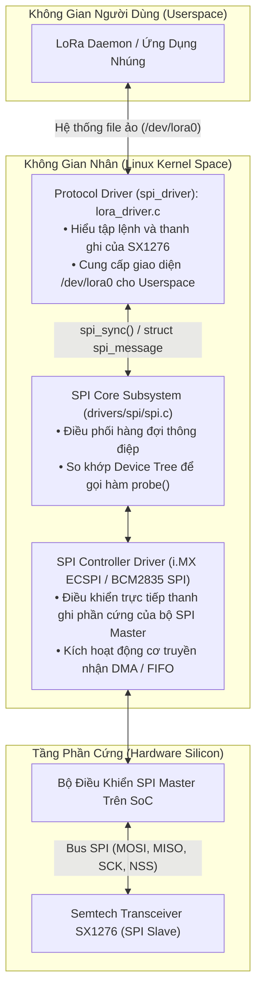
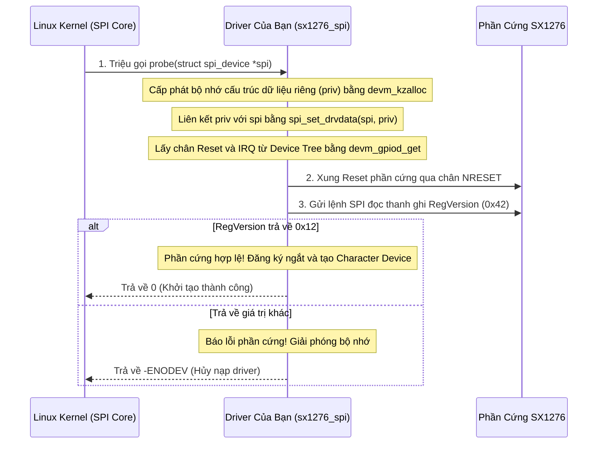

# BÀI 16: LINUX SPI SUBSYSTEM: KIẾN TRÚC SPI_DRIVER VÀ QUẢN LÝ BUS

> Tóm tắt: Phân tích kiến trúc phân tầng của Linux SPI Subsystem, hiện thực vòng đời nạp driver thông qua hàm `probe()` và `remove()`, giải thích cơ chế truyền dữ liệu đồng bộ với `spi_sync()` và `struct spi_transfer`, và cung cấp mã nguồn C hoàn chỉnh của một Kernel Module.

---

## 1. Kiến Trúc Phân Tầng Của Linux SPI Subsystem

Trong nhân Linux, giao tiếp SPI được chia tách thành ba thành phần kiến trúc độc lập để đảm bảo tính module hóa và khả năng tái sử dụng:



---

## 2. Vòng Đời Driver: Hàm `probe()` Và `remove()`

Khi kernel phát hiện một thiết bị trên bus SPI có chuỗi `compatible` khớp với driver, hàm `probe()` sẽ được triệu gọi để cấp phát tài nguyên:



---

## 3. Cơ Chế Truyền Nhận Dữ Liệu Đồng Bộ Với `spi_sync()`

Mọi giao tiếp SPI trong Linux Kernel đều được trừu tượng hóa thông qua hai cấu trúc dữ liệu cốt lõi:
- **`struct spi_transfer`**: Mô tả một đoạn truyền nhận dữ liệu liên tục (chứa con trỏ bộ đệm phát `tx_buf`, bộ đệm thu `rx_buf`, và độ dài `len`).
- **`struct spi_message`**: Đóng gói một chuỗi gồm nhiều `spi_transfer` liên tiếp lại với nhau để thực hiện trong cùng một phiên hạ chân Chip Select (Atomic Transaction).

### Nguyên Lý Vận Hành Của `spi_sync()`
Hàm `spi_sync(struct spi_device *spi, struct spi_message *message)` là một hàm **chờ đợi đồng bộ (Blocking/Sleeping)**:
1. Đẩy gói tin vào hàng đợi của bộ điều khiển SPI.
2. Đưa tiến trình hiện tại vào trạng thái ngủ (**Sleep/Blocked**) để nhường CPU cho các tác vụ khác.
3. Bộ điều khiển SPI sử dụng DMA bắn dữ liệu ra phần cứng.
4. Khi phần cứng truyền xong, ngắt DMA phát sinh, đánh thức tiến trình của chúng ta dậy tiếp tục chạy.

---

## 4. Mã Nguồn Mẫu Hoàn Chỉnh Của Linux SPI Kernel Driver

Dưới đây là khung mã nguồn C chuẩn cho một Kernel Module giao tiếp với SX1276:

```c
#include <linux/module.h>
#include <linux/kernel.h>
#include <linux/spi/spi.h>
#include <linux/of.h>
#include <linux/gpio/consumer.h>
#include <linux/delay.h>

#define SX1276_REG_VERSION 0x42

struct sx1276_priv {
    struct spi_device   *spi;
    struct gpio_desc    *reset_gpio;
    int                  irq;
};

// Đọc 1 thanh ghi qua bus SPI
static int sx1276_read_reg(struct sx1276_priv *priv, u8 reg, u8 *val) {
    u8 tx_buf[2] = { reg & 0x7F, 0x00 };
    u8 rx_buf[2] = { 0 };
    
    struct spi_transfer t = {
        .tx_buf = tx_buf,
        .rx_buf = rx_buf,
        .len    = 2,
    };
    struct spi_message m;
    int ret;

    spi_message_init(&m);
    spi_message_add_tail(&t, &m);
    
    ret = spi_sync(priv->spi, &m);
    if (ret == 0) {
        *val = rx_buf[1];
    }
    return ret;
}

// Hàm Probe được triệu gọi khi khớp Device Tree
static int sx1276_probe(struct spi_device *spi) {
    struct sx1276_priv *priv;
    u8 version = 0;
    int ret;

    dev_info(&spi->dev, "Dang khoi tao SX1276 LoRa Driver...\n");

    priv = devm_kzalloc(&spi->dev, sizeof(*priv), GFP_KERNEL);
    if (!priv) return -ENOMEM;

    priv->spi = spi;
    spi_set_drvdata(spi, priv);

    // Lấy chân Reset từ Device Tree
    priv->reset_gpio = devm_gpiod_get_optional(&spi->dev, "reset", GPIOD_OUT_LOW);
    if (IS_ERR(priv->reset_gpio)) {
        dev_err(&spi->dev, "Khong the lay chan reset-gpios tu Device Tree\n");
        return PTR_ERR(priv->reset_gpio);
    }

    // Reset phần cứng chip LoRa
    if (priv->reset_gpio) {
        gpiod_set_value_cansleep(priv->reset_gpio, 1); // Kéo chân Reset xuống thấp (Active Low)
        usleep_range(1000, 2000);
        gpiod_set_value_cansleep(priv->reset_gpio, 0); // Nhả Reset
        msleep(5);
    }

    // Kiểm tra định danh phiên bản chip
    ret = sx1276_read_reg(priv, SX1276_REG_VERSION, &version);
    if (ret < 0 || version != 0x12) {
        dev_err(&spi->dev, "Phat hien sai phien ban chip: 0x%02X (Ky vong: 0x12)\n", version);
        return -ENODEV;
    }

    dev_info(&spi->dev, "SX1276 nhan dien thanh cong (Silicon Version: 0x%02X)!\n", version);
    return 0;
}

// Hàm Remove giải phóng tài nguyên
static void sx1276_remove(struct spi_device *spi) {
    dev_info(&spi->dev, "Giai phong SX1276 LoRa Driver\n");
}

// Bảng so khớp Device Tree
static const struct of_device_id sx1276_dt_ids[] = {
    { .compatible = "semtech,sx1276", },
    { /* sentinel */ }
};
MODULE_DEVICE_TABLE(of, sx1276_dt_ids);

static struct spi_driver sx1276_driver = {
    .driver = {
        .name           = "sx1276",
        .of_match_table = sx1276_dt_ids,
    },
    .probe  = sx1276_probe,
    .remove = sx1276_remove,
};

module_spi_driver(sx1276_driver);

MODULE_LICENSE("GPL");
MODULE_AUTHOR("Antigravity Embedded Team");
MODULE_DESCRIPTION("Semtech SX1276 LoRa Linux SPI Kernel Driver");
```

---

## 5. Lưu Ý Kỹ Thuật & Best Practices Thực Chiến

> [!IMPORTANT]
> **Bài toán thiết kế thực chiến:** *"Tại sao trong kernel driver, ta nên dùng hàm `devm_kzalloc()` thay vì `kmalloc()`, và sự khác nhau giữa `gpiod_set_value()` và `gpiod_set_value_cansleep()`?"*
> 
> **Giải pháp kiến trúc chuẩn mực:**
> 1. **`devm_kzalloc()`**: Là cơ chế cấp phát tài nguyên tự động quản lý theo vòng đời thiết bị (**Device Resource Managed**). Khi hàm `probe()` thất bại giữa chừng hoặc khi thiết bị bị gỡ bỏ (`remove`), kernel sẽ tự động giải phóng toàn bộ vùng nhớ này, ngăn chặn triệt để hiện tượng rò rỉ bộ nhớ (Memory Leak) mà không cần lập trình viên phải gọi hàm `kfree()` thủ công.
> 2. **`gpiod_set_value_cansleep()`**: Nếu chân GPIO được nối thông qua một bộ mở rộng I2C/SPI (I/O Expander), việc thay đổi mức logic chân GPIO bắt buộc phải thực hiện qua một giao dịch bus có khả năng ngủ (Sleeping). Do đó, trong môi trường driver tổng quát, ta dùng biến thể `_cansleep()` để đảm bảo tương thích mọi kiến trúc phần cứng.

