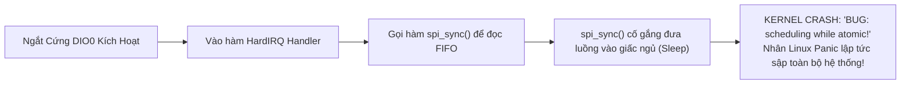
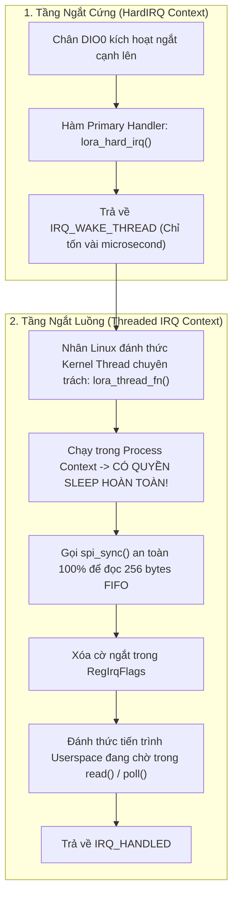

# BÀI 17: XỬ LÝ NGẮT RADIO TRONG LINUX: TOP-HALF VÀ THREADED IRQ

> Tóm tắt: Phân tích cơ chế xử lý ngắt trong nhân Linux, giải thích hiện tượng Kernel Panic "scheduling while atomic" khi gọi SPI trong HardIRQ, hiện thực mô hình ngắt luồng `request_threaded_irq()`, và kỹ thuật đánh thức tiến trình không gian người dùng bằng Wait Queue.

---

## 1. Mâu Thuẫn Cốt Lõi Trong Xử Lý Ngắt SPI Trên Linux

Khi phát triển driver điều khiển chip thu phát LoRa trên Linux, kỹ sư đối mặt với một bài toán hóc búa:
1. **Bản chất của chân DIO0**: Khi chip LoRa nhận được gói tin (`RxDone`), chân DIO0 giương lên mức cao và **chốt cố định ở mức cao** cho đến khi CPU ghi lệnh SPI xóa cờ trong thanh ghi `RegIrqFlags`.
2. **Quy tắc bất khả xâm phạm của HardIRQ**: Trình phục vụ ngắt cứng thông thường (Top-half) chạy trong **Atomic Context** (ngắt bị khóa, không được phép ngủ/sleep).
3. **Bản chất của bus SPI trên Linux**: Hàm đọc dữ liệu SPI `spi_sync()` đưa tiến trình vào giấc ngủ (**Sleep/Blocked**) để chờ phần cứng DMA truyền xong.



---

## 2. Giải Pháp Chuẩn Mực Của Nhân Linux: `request_threaded_irq()`

Để giải quyết triệt để mâu thuẫn này, hệ thống con ngắt của Linux (Linux IRQ Subsystem) cung cấp hàm **`request_threaded_irq()`**:



### Vai Trò Tối Quan Trọng Của Cờ `IRQF_ONESHOT`
Khi đăng ký ngắt luồng cho chip LoRa, cờ `IRQF_ONESHOT` là **bắt buộc 100%**:
- Nếu không có `IRQF_ONESHOT`: Ngay khi hàm ngắt cứng `lora_hard_irq()` vừa chạy xong và nhả quyền, do chân DIO0 vẫn đang ở mức cao (chưa kịp xóa qua SPI), phần cứng GPIO sẽ **lập tức kích hoạt ngắt tiếp theo**, gây ra vòng lặp bão hòa ngắt (Interrupt Storm) treo cứng CPU trước khi Kernel Thread kịp thức dậy!
- Khi bật `IRQF_ONESHOT`: Nhân Linux sẽ **tự động vô hiệu hóa (Mask/Disable) đường ngắt GPIO đó**, chỉ mở lại sau khi hàm Kernel Thread `lora_thread_fn()` đã xử lý xong và xóa cờ thanh ghi qua SPI.

---

## 3. Mã Nguồn Mẫu Hiện Thực Threaded IRQ Bằng Ngôn Ngữ C

```c
#include <linux/interrupt.h>
#include <linux/wait.h>
#include <linux/sched.h>
#include <linux/spi/spi.h>

struct sx1276_dev {
    struct spi_device   *spi;
    int                  irq;
    wait_queue_head_t    rx_wait_queue; // Hàng đợi chờ dữ liệu cho Userspace
    bool                 data_ready;
    u8                   rx_buffer[256];
    size_t               rx_len;
};

// ========================================================
// 1. PRIMARY HANDLER: Chạy trong HardIRQ Atomic Context
// ========================================================
static irqreturn_t sx1276_hard_irq(int irq, void *dev_id) {
    // Không làm gì nặng, không gọi SPI!
    // Trả về lệnh đánh thức Kernel Thread chuyên trách
    return IRQ_WAKE_THREAD;
}

// ========================================================
// 2. THREADED HANDLER: Chạy trong Process Context (Được phép Sleep)
// ========================================================
static irqreturn_t sx1276_thread_fn(int irq, void *dev_id) {
    struct sx1276_dev *dev = dev_id;
    u8 irq_flags = 0;
    u8 current_addr = 0;
    u8 nb_bytes = 0;

    // Đọc thanh ghi RegIrqFlags bằng spi_sync() hoàn toàn an toàn
    sx1276_read_reg(dev, 0x12, &irq_flags);

    if (irq_flags & 0x40) { // TxDone
        // Xóa cờ TxDone
        sx1276_write_reg(dev, 0x12, 0x40);
        dev_info(&dev->spi->dev, "Su kien TxDone hoan tat!\n");
    }

    if (irq_flags & 0x20) { // RxDone
        // Đọc địa chỉ bắt đầu của gói tin trong FIFO
        sx1276_read_reg(dev, 0x10, &current_addr);
        sx1276_write_reg(dev, 0x0D, current_addr); // Chuyển con trỏ FifoAddrPtr

        // Đọc số lượng byte nhận được
        sx1276_read_reg(dev, 0x13, &nb_bytes);
        dev->rx_len = nb_bytes;

        // Đọc toàn bộ Payload qua Burst SPI
        sx1276_burst_read(dev, 0x00, dev->rx_buffer, nb_bytes);

        // Xóa cờ RxDone bằng cách ghi đè 1
        sx1276_write_reg(dev, 0x12, 0x20);

        // Đánh dấu cờ có dữ liệu và đánh thức tiến trình Userspace đang ngủ trong read()
        dev->data_ready = true;
        wake_up_interruptible(&dev->rx_wait_queue);
    }

    return IRQ_HANDLED;
}

// ========================================================
// 3. ĐĂNG KÝ NGẮT TRONG HÀM PROBE
// ========================================================
int sx1276_setup_interrupt(struct sx1276_dev *dev) {
    int ret;

    // Khởi tạo hàng đợi chờ
    init_waitqueue_head(&dev->rx_wait_queue);
    dev->data_ready = false;

    // Lấy số hiệu ngắt ảo từ Device Tree
    dev->irq = dev->spi->irq;
    if (dev->irq < 0) {
        dev_err(&dev->spi->dev, "Khong tim thay IRQ trong Device Tree!\n");
        return dev->irq;
    }

    // Đăng ký Threaded IRQ với cờ bắt buộc IRQF_ONESHOT
    ret = devm_request_threaded_irq(
        &dev->spi->dev,
        dev->irq,
        sx1276_hard_irq,    // Top-half
        sx1276_thread_fn,   // Bottom-half (Kernel Thread)
        IRQF_TRIGGER_RISING | IRQF_ONESHOT,
        "sx1276_lora_irq",
        dev
    );

    if (ret) {
        dev_err(&dev->spi->dev, "Dang ky request_threaded_irq that bai: %d\n", ret);
        return ret;
    }

    dev_info(&dev->spi->dev, "Dang ky Threaded IRQ thanh cong (IRQ %d)\n", dev->irq);
    return 0;
}
```

---

## 4. Lưu Ý Kỹ Thuật & Best Practices Thực Chiến

> [!TIP]
> **Bài toán thiết kế thực chiến:** *"Tại sao em không dùng Tasklet hoặc Workqueue mà lại dùng Threaded IRQ cho driver LoRa?"*
> 
> **Giải pháp kiến trúc chuẩn mực:**
> > 1. **So với Tasklet**: Tasklet chạy trong Software Interrupt Context (SoftIRQ). Bản chất SoftIRQ vẫn là Atomic Context nên **vẫn không được phép Sleep**. Nếu gọi `spi_sync()` trong Tasklet thì hệ thống vẫn Crash y như gọi trong HardIRQ!
> 2. **So với Workqueue**: Workqueue chạy trong Process Context và có quyền Sleep, nhưng Workqueue phải chia sẻ luồng `kworker` chung của toàn hệ thống kernel, dẫn tới độ trễ không tất định (Jitter cao).
> 3. **Threaded IRQ** là giải pháp chuẩn hóa hiện đại nhất của Linux: Nó tạo ra một Kernel Thread riêng biệt có độ ưu tiên thời gian thực (`SCHED_FIFO` nếu cần), giảm thiểu độ trễ tối đa giữa lúc có ngắt phần cứng và lúc bắt đầu đọc FIFO qua SPI!"

