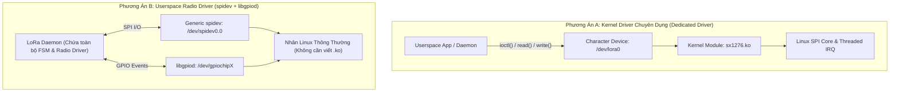
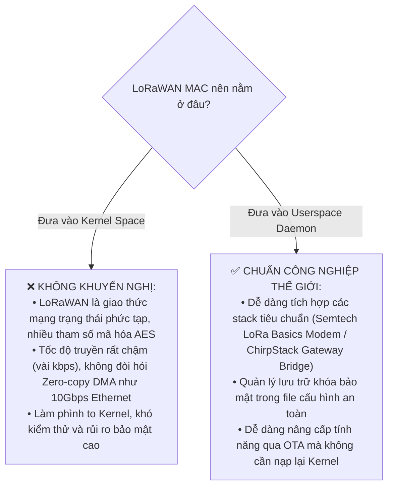

# BÀI 19: SO SÁNH KIẾN TRÚC: KERNEL DRIVER VS USERSPACE SPIDEV

> Tóm tắt: Phân tích so sánh toàn diện hai trường phái tích hợp LoRa trên Linux: Viết Kernel Module chuyên dụng hay sử dụng Userspace SPI (`spidev`) kết hợp `libgpiod`, đánh giá độ trễ ngắt, tính ổn định và định vị tầng chạy LoRaWAN MAC tối ưu.

---

## 1. Hai Trường Phái Tích Hợp LoRa Trên Nền Tảng Linux

Khi nhận một dự án tích hợp chip LoRa (như SX1276 hoặc SX1262) lên bo mạch Linux nhúng (i.MX8, Allwinner, Raspberry Pi CM4), kỹ sư trưởng kiến trúc phần mềm phải đưa ra quyết định chiến lược giữa hai phương án:

---

## 2. Bảng Ma Trận So Sánh Kỹ Thuật Toàn Diện

| Tiêu Chí So Sánh | Phương Án A: Kernel Module (`sx1276.ko`) | Phương Án B: Userspace (`spidev` + `libgpiod`) |
| :--- | :--- | :--- |
| **Độ phức tạp phát triển** | **Rất cao**: Đòi hỏi kỹ năng lập trình nhân C, hiểu sâu Device Tree, Concurrency, Locking. | **Thấp**: Viết bằng C/C++, Rust hoặc Python bằng các thư viện tiêu chuẩn của Linux. |
| **Hậu quả khi xảy ra lỗi (Crash)** | **Nghiêm trọng**: Lỗi con trỏ rác hoặc race condition sẽ làm **Kernel Panic sập toàn bộ hệ điều hành**! | **An toàn**: Nếu daemon bị crash, chỉ tiến trình đó chết và được `systemd` tự động hồi sinh trong vài ms. |
| **Độ trễ ngắt (Interrupt Latency)** | **Cực thấp (< 10 µs)**: Threaded IRQ trong kernel được đánh thức ngay lập tức để xử lý FIFO. | **Trung bình (50 µs – 200 µs)**: Ngắt đi qua kernel rồi mới báo tín hiệu event fd lên Userspace qua `epoll`. |
| **Tính tương thích khi nâng cấp OS** | **Kém**: Mỗi lần cập nhật bản vá bảo mật Kernel, driver có thể bị gãy API, phải build lại bằng DKMS. | **Tuyệt hảo**: Chạy ổn định xuyên suốt từ Kernel 4.x, 5.x đến 6.x mà không cần biên dịch lại. |
| **Thời gian ra mắt sản phẩm (Time-to-Market)**| Tốn hàng tuần đến hàng tháng để debug và ổn định driver. | Chỉ mất vài ngày để hoàn thiện và tích hợp. |

---

## 3. Tầng LoRaWAN MAC Nên Chạy Ở Đâu: Kernel Hay Userspace?

Một câu hỏi mang tính bản lề: *Chúng ta có nên đưa toàn bộ protocol stack LoRaWAN vào trong Linux Kernel (như cách Linux quản lý Wi-Fi `cfg80211` hay Bluetooth `bluez`) hay không?*

> [!IMPORTANT]
> **Sự đồng thuận của ngành công nghiệp nhúng:**
> Toàn bộ các giải pháp Gateway LoRaWAN thương mại hàng đầu thế giới (Multitech, RAKwireless, Kerlink, Cisco) đều đặt **LoRaWAN MAC và Packet Forwarder ở Userspace**.
> Nhân Linux chỉ đóng vai trò cung cấp bus truyền thông phần cứng (thông qua `spidev` hoặc một character driver tối giản).

---

## 4. Khung Quyết Định Lựa Chọn Kiến Trúc (Decision Framework)

### Khi nào BẮT BUỘC chọn Phương án A (Dedicated Kernel Driver)?
1. **Yêu cầu độ trễ ngắt siêu ngặt nghèo (Hard Real-Time)**: Hệ thống đòi hỏi phải bắt và đóng dấu thời gian (Timestamping) gói tin đến với độ chính xác dưới $10\text{ µs}$ (ví dụ: phục vụ định vị TDoA - Time Difference of Arrival).
2. **Đóng gói sản phẩm thương mại khép kín**: Muốn trừu tượng hóa toàn bộ phần cứng thành một device node `/dev/lora0` duy nhất, giúp các lập trình viên ứng dụng tầng trên không cần quan tâm đến thanh ghi SPI hay chân GPIO.
3. **Môi trường Automotive / Chống can thiệp**: Chính sách bảo mật SELinux của hệ thống cấm các ứng dụng Userspace truy cập trực tiếp vào generic `/dev/spidev` hoặc `/dev/gpiochip`.

### Khi nào NÊN chọn Phương án B (`spidev` + `libgpiod`)?
1. **Xây dựng LoRaWAN Gateway**: Các phần mềm chuẩn như *Semtech SX1302/03 HAL* và *Basic Station* đều được viết sẵn dựa trên `spidev`.
2. **Giai đoạn thử nghiệm (PoC) & Phát triển nhanh**: Cần kiểm chứng giải pháp viễn thông cho xe điện thông minh trong thời gian ngắn mà không làm xáo trộn nhân Linux hiện có.
3. **Hệ thống có chu kỳ nâng cấp Kernel thường xuyên**: Tránh chi phí bảo trì mã nguồn C driver trong cây thư mục Kernel.

---

## 5. Lưu Ý Kỹ Thuật & Best Practices Thực Chiến

> [!TIP]
> **Bài toán thiết kế thực chiến:** *"Nếu được giao tích hợp LoRa trên Linux cho cụm đồng hồ xe điện (EV Cluster), em sẽ chọn viết Kernel Driver riêng hay dùng spidev ở Userspace? Vì sao?"*
> 
> **Giải pháp kiến trúc chuẩn mực:**
> "em sẽ đề xuất **Phương án lai (Hybrid Architecture)**:
> 1. **Ở lớp dưới cùng**: Em ưu tiên viết một **Character Driver tối giản trong Kernel (`sx1276_spi`)** sử dụng `request_threaded_irq()`. Driver này chỉ làm đúng 2 việc: quản lý ngắt DIO0 một cách tất định và đưa dữ liệu thô lên thiết bị ký tự `/dev/lora0`. Cách làm này triệt tiêu hoàn toàn rủi ro mất ngắt khi CPU bị tải nặng, đồng thời khóa chặt quyền truy cập bằng chính sách bảo mật SELinux của Android/Linux.
> 2. **Ở lớp trên**: Toàn bộ logic máy trạng thái, xử lý hàng đợi, quản lý khóa bảo mật và thuật toán viễn thông LoRa/LoRaWAN sẽ được đặt trọn vẹn trong một **Edge Daemon chạy ở Userspace**.
> Mô hình này vừa đảm bảo hiệu năng và độ ổn định phần cứng của Kernel, vừa giữ cho hệ thống an toàn tuyệt đối, nếu daemon ứng dụng có bị lỗi cũng không bao giờ làm sập hệ điều hành của cụm đồng hồ xe!"

