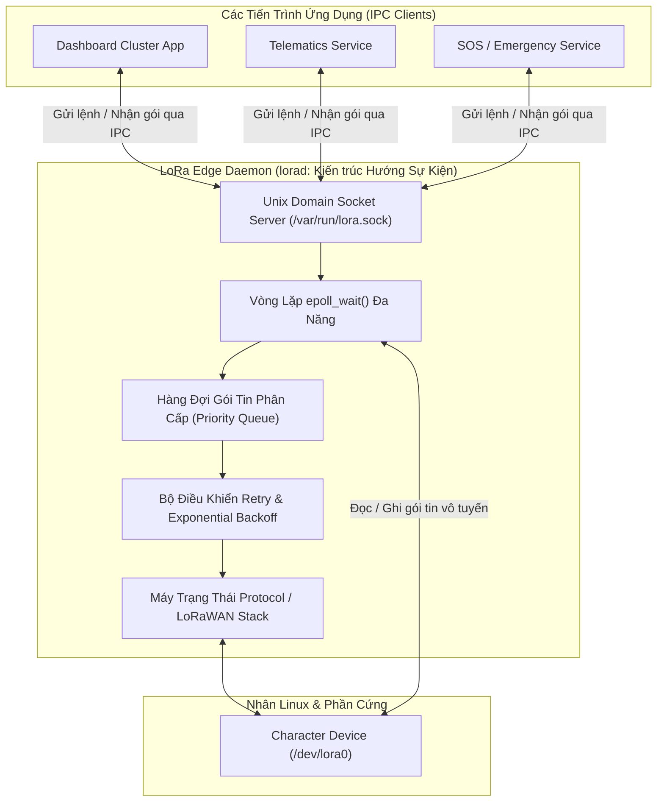
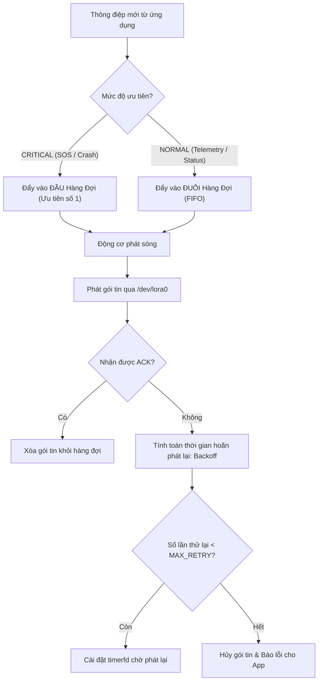

# BÀI 20: THIẾT KẾ LORA EDGE DAEMON TRÊN LINUX: VÒNG LẶP EPOLL VÀ HÀNG ĐỢI GÓI TIN

> Tóm tắt: Xây dựng tiến trình nền LoRa Edge Daemon chuyên trách trên Linux, làm chủ kỹ thuật dồn kênh sự kiện đa luồng bằng `epoll`, hiện thực hàng đợi gói tin có phân cấp độ ưu tiên, thuật toán ngẫu nhiên hóa thời gian chờ (Exponential Backoff with Jitter), và đóng gói dịch vụ với `systemd`.

---

## 1. Kiến Trúc Của Một LoRa Edge Daemon Công Nghiệp

Trên hệ điều hành Linux nhúng, các ứng dụng người dùng tầng cao (như giao diện Android Instrument Cluster, dịch vụ Telematics, MQTT Client) không bao giờ trực tiếp thao tác với tệp thiết bị `/dev/lora0`. Thay vào đó, toàn bộ việc giao tiếp vô tuyến được ủy quyền cho một tiến trình nền duy nhất mang tên **LoRa Edge Daemon (`lorad`)**:



---

## 2. Dồn Kênh Sự Kiện Đa Năng Với Vòng Lặp `epoll`

Thay vì tạo hàng chục luồng (threads) gây tốn bộ nhớ và phát sinh lỗi tranh chấp tài nguyên (Race Condition), một Daemon chuẩn công nghiệp sử dụng kiến trúc đơn luồng bất đồng bộ (Single-threaded Event-driven) xoay quanh hàm **`epoll_wait()`**.

Một vòng lặp `epoll` duy nhất có thể đồng thời theo dõi 4 nguồn sự kiện:
1. **Tệp thiết bị `/dev/lora0`**: Đón nhận sự kiện `EPOLLIN` khi có gói tin vô tuyến đáp xuống.
2. **Unix Domain Socket `/var/run/lora.sock`**: Đón nhận kết nối IPC từ các ứng dụng nội bộ gửi yêu cầu phát dữ liệu.
3. **Bộ định thời Kernel (`timerfd`)**: Bắn sự kiện định kỳ để kiểm tra hàng đợi phát lại (Retries) và nhịp tim (Heartbeat).
4. **Bộ xử lý tín hiệu OS (`signalfd`)**: Bắt các tín hiệu `SIGTERM`, `SIGINT` một cách đồng bộ và an toàn để tắt daemon mà không gây rò rỉ bộ nhớ.

---

## 3. Thuật Toán Hàng Đợi Ưu Tiên & Trì Hoãn Ngẫu Nhiên (Exponential Backoff with Jitter)

Khi nhiều ứng dụng cùng yêu cầu gửi tin hoặc khi gói tin phát đi bị thất lạc (không nhận được ACK):



### Công Thức Exponential Backoff Có Jitter
Nếu nhiều thiết bị cùng bị mất kết nối và cùng thử lại ở các khoảng thời gian cố định ($2\text{s}, 4\text{s}, 8\text{s}$), các gói tin sẽ tiếp tục đâm sầm vào nhau (Hiệu ứng tuyết lở - Avalanche Effect). Ta bắt buộc phải cộng thêm thành phần ngẫu nhiên (Jitter):

$$T_{delay} = \min\left(T_{max}, T_{base} \times 2^{retry}\right) \pm \text{Random\_Jitter}$$

---

## 4. Mã Nguồn Mẫu Khung Daemon C++ Sử Dụng `epoll`

```cpp
#include <iostream>
#include <vector>
#include <cstring>
#include <unistd.h>
#include <fcntl.h>
#include <sys/epoll.h>
#include <sys/socket.h>
#include <sys/un.h>
#include <sys/timerfd.h>

#define MAX_EPOLL_EVENTS 10
#define LORA_DEV_PATH    "/dev/lora0"
#define LORA_SOCKET_PATH "/var/run/lora.sock"

int main() {
    std::cout << "[lorad] Khoi dong LoRa Edge Daemon..." << std::endl;

    // 1. Mo tệp thiết bị lora
    int lora_fd = open(LORA_DEV_PATH, O_RDWR | O_NONBLOCK);
    if (lora_fd < 0) {
        std::cerr << "Khong the mo " << LORA_DEV_PATH << std::endl;
        return 1;
    }

    // 2. Tao Unix Domain Socket cho IPC
    unlink(LORA_SOCKET_PATH);
    int server_sock = socket(AF_UNIX, SOCK_STREAM | SOCK_NONBLOCK, 0);
    struct sockaddr_un addr{};
    addr.sun_family = AF_UNIX;
    strncpy(addr.sun_path, LORA_SOCKET_PATH, sizeof(addr.sun_path) - 1);
    bind(server_sock, (struct sockaddr*)&addr, sizeof(addr));
    listen(server_sock, 5);

    // 3. Khoi tao epoll
    int epoll_fd = epoll_create1(0);
    struct epoll_event ev{}, events[MAX_EPOLL_EVENTS];

    // Dang ky lora_fd vao epoll
    ev.events = EPOLLIN;
    ev.data.fd = lora_fd;
    epoll_ctl(epoll_fd, EPOLL_CTL_ADD, lora_fd, &ev);

    // Dang ky server_sock vao epoll
    ev.events = EPOLLIN;
    ev.data.fd = server_sock;
    epoll_ctl(epoll_fd, EPOLL_CTL_ADD, server_sock, &ev);

    std::cout << "[lorad] San sang lang nghe su kien trong vong lap epoll!" << std::endl;

    // 4. Vong lap su kien chinh (0% CPU khi khong co su kien)
    while (true) {
        int nfds = epoll_wait(epoll_fd, events, MAX_EPOLL_EVENTS, -1);
        for (int i = 0; i < nfds; ++i) {
            if (events[i].data.fd == lora_fd) {
                // Su kien co goi tin vo tuyen den!
                uint8_t rx_buf[256];
                ssize_t bytes_read = read(lora_fd, rx_buf, sizeof(rx_buf));
                if (bytes_read > 0) {
                    std::cout << "[lorad] Nhan goi tin LoRa: " << bytes_read << " bytes" << std::endl;
                    // Chuyen tiep goi tin toi cac client dang ket noi
                }
            } else if (events[i].data.fd == server_sock) {
                // Co ung dung muon ket noi vao daemon de gui payload
                int client_fd = accept(server_sock, nullptr, nullptr);
                std::cout << "[lorad] Chap nhan ket noi IPC moi tu ung dung" << std::endl;
                close(client_fd);
            }
        }
    }

    close(lora_fd);
    close(server_sock);
    close(epoll_fd);
    return 0;
}
```

---

## 5. Quản Lý Dịch Vụ Hệ Thống Với `systemd`

Để đảm bảo daemon tự động khởi động cùng hệ điều hành và tự hồi sinh nếu xảy ra sự cố, ta tạo tệp cấu hình `/etc/systemd/system/lorad.service`:

```ini
[Unit]
Description=LoRa Edge Telematics Daemon
After=network.target

[Service]
Type=simple
ExecStart=/usr/bin/lorad
Restart=always
RestartSec=3s
WatchdogSec=30s
User=root
StandardOutput=journal
StandardError=journal

[Install]
WantedBy=multi-user.target
```

