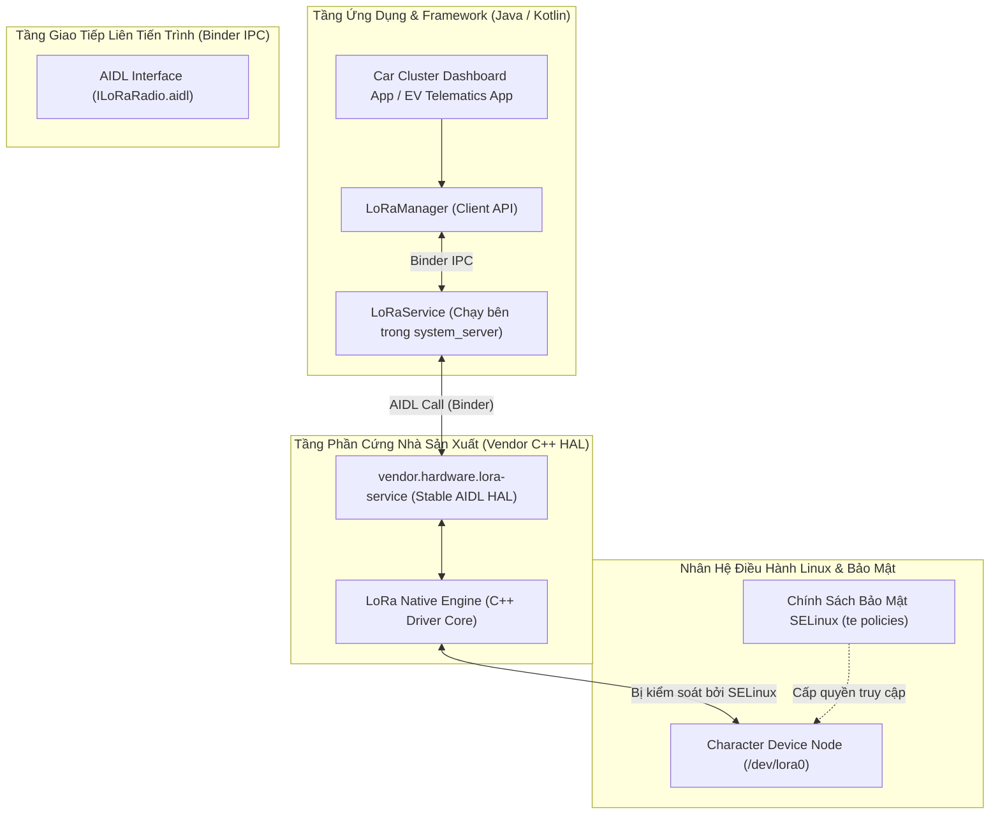

# BÀI 21: KIẾN TRÚC TÍCH HỢP ANDROID / AOSP: RADIO HAL, AIDL VÀ SELINUX

> Tóm tắt: Phân tích kiến trúc tích hợp phần cứng trên Android Open Source Project (AOSP), thiết kế giao diện Hardware Abstraction Layer (HAL) chuẩn AIDL hiện đại, cấu hình khởi động dịch vụ qua `init.rc`, và thiết lập chính sách bảo mật SELinux cho thiết bị viễn thông xe điện.

---

## 1. Phân Tầng Kiến Trúc Tích Hợp Trên Nền Tảng AOSP

Trong các hệ thống thông tin giải trí và cụm đồng hồ xe điện thông minh (Connected EV Android Instrument Cluster), ứng dụng Android không được phép can thiệp trực tiếp vào file hệ thống `/dev/lora0`. Thay vào đó, kiến trúc bắt buộc phải tuân thủ mô hình phân lớp nghiêm ngặt của **Android Open Source Project (AOSP)**:



---

## 2. Thiết Kế Giao Diện AIDL Chuẩn (Stable AIDL Interface)

Kể từ Android 11, Google chính thức khai tử cơ chế HIDL cổ điển và thay thế hoàn toàn bằng **Stable AIDL**. Chúng ta định nghĩa file giao diện `ILoRaRadio.aidl`:

```aidl
package android.hardware.lora;

import android.hardware.lora.ILoRaCallback;
import android.hardware.lora.LoRaConfig;

@VintfStability
interface ILoRaRadio {
    // Gửi gói tin dữ liệu vô tuyến
    void sendPayload(in byte[] payload);

    // Cấu hình tham số lớp vật lý RF
    void configureModem(in LoRaConfig config);

    // Đăng ký Callback lắng nghe gói tin thu được từ xa
    void registerCallback(in ILoRaCallback callback);
}
```

File callback nhận dữ liệu bất đồng bộ `ILoRaCallback.aidl`:

```aidl
package android.hardware.lora;

@VintfStability
oneway interface ILoRaCallback {
    // Được HAL triệu gọi khi có gói tin đáp xuống
    void onPacketReceived(in byte[] payload, in int rssi, in int snr);
}
```

---

## 3. Khởi Tạo Dịch Vụ Với Android `init.rc`

Để dịch vụ HAL tự động chạy cùng hệ điều hành Android ngay từ giai đoạn khởi động (Early Boot), ta khai báo kịch bản khởi chạy tại `/vendor/etc/init/android.hardware.lora-service.rc`:

```rc
service vendor.lora-service /vendor/bin/hw/android.hardware.lora-service
    class hal
    user system
    group system
    capabilities NET_ADMIN
    shutdown critical
```

---

## 4. Thiết Lập Chính Sách Bảo Mật Nghiêm Ngặt Với SELinux

Android bảo vệ tài nguyên phần cứng bằng hệ thống **SELinux (Security-Enhanced Linux)**. Mặc định ở chế độ `Enforcing`, mọi tiến trình cố tình truy cập vào `/dev/lora0` sẽ bị chặn đứng (Permission Denied).

### 4.1 Khai Báo Nhãn Thiết Bị Trong `file_contexts`
Định vị tại `device/<vendor>/<product>/sepolicy/file_contexts`:
```text
/dev/lora[0-9]*    u:object_r:lora_device:s0
```

### 4.2 Thiết Lập Luật Phân Quyền Trong `hal_lora.te`
Định vị tại `device/<vendor>/<product>/sepolicy/hal_lora.te`:
```text
# 1. Định nghĩa miền thực thi của tiến trình HAL
type hal_lora_default, domain;
type hal_lora_default_exec, exec_type, vendor_file_type, file_type;

init_daemon_domain(hal_lora_default)

# 2. Định nghĩa kiểu nhãn thiết bị
type lora_device, dev_type;

# 3. Cấp phép cho HAL đọc, ghi, mở và gọi ioctl trên /dev/lora0
allow hal_lora_default lora_device:chr_file { open read write ioctl };

# 4. Cho phép System Server tìm kiếm và liên kết dịch vụ HAL qua Service Manager
binder_use(hal_lora_default)
binder_call(system_server, hal_lora_default)
allow system_server hal_lora_service:service_manager find;
```

---

## 5. Lưu Ý Kỹ Thuật & Best Practices Thực Chiến

> [!IMPORTANT]
> **Bài toán thiết kế thực chiến:** *"Tại sao ứng dụng giao diện xe điện (Car UI App) không nên trực tiếp mở file `/dev/lora0` để phát sóng, mà bắt buộc phải đi qua Service Manager và AIDL HAL?"*
> 
> **Giải pháp kiến trúc chuẩn mực:**
> "vì 3 lý do sống còn về mặt kiến trúc hệ điều hành:
> 1. **Bảo mật và Phân quyền (SELinux & Sandbox)**: Các ứng dụng Android chạy dưới quyền tài khoản riêng biệt (UID app). SELinux cấm hoàn toàn các ứng dụng thông thường mở trực tiếp tệp thiết bị ký tự trong `/dev`. Chỉ có tiến trình Vendor HAL được cấp nhãn bảo mật mới có quyền truy cập phần cứng.
> 2. **Tránh xung đột tài nguyên (Resource Contention)**: Nếu nhiều ứng dụng (App định vị GPS, App cảnh báo SOS, App theo dõi áp suất lốp) cùng mở `/dev/lora0`, các câu lệnh ghi SPI sẽ dẫm đạp lên nhau làm hỏng khung truyền. Tầng System Service đóng vai trò là một điều phối viên trung tâm quản lý hàng đợi tập trung.
> 3. **Tính độc lập phần cứng (Hardware Abstraction)**: Khi nâng cấp phần cứng từ chip SX1276 sang SX1262 hoặc module LoRa khác, ta chỉ cần viết lại tầng C++ HAL. Toàn bộ mã nguồn ứng dụng Java/Kotlin ở tầng trên hoàn toàn không bị ảnh hưởng!"

