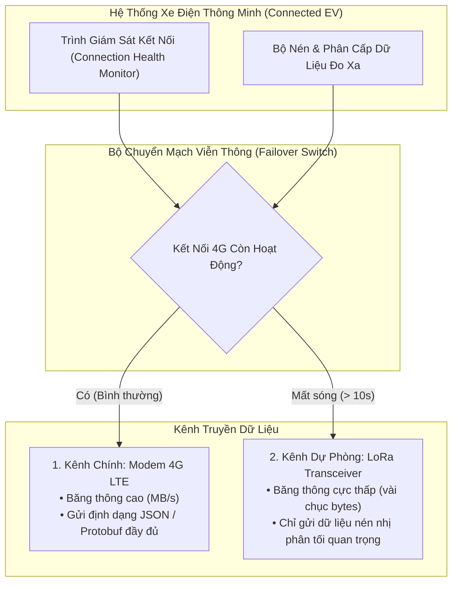
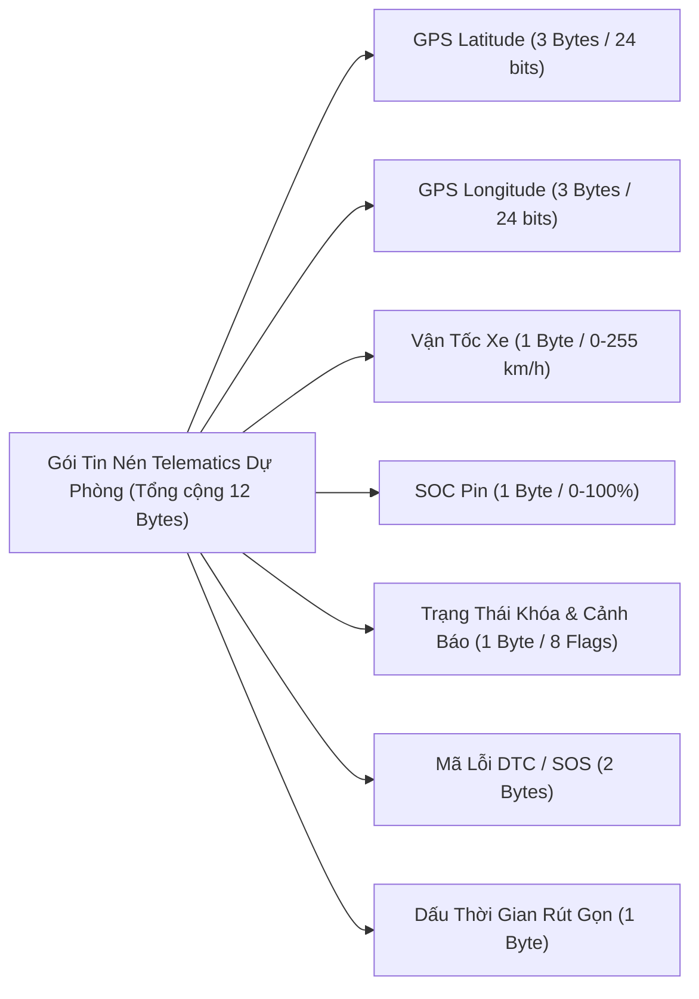
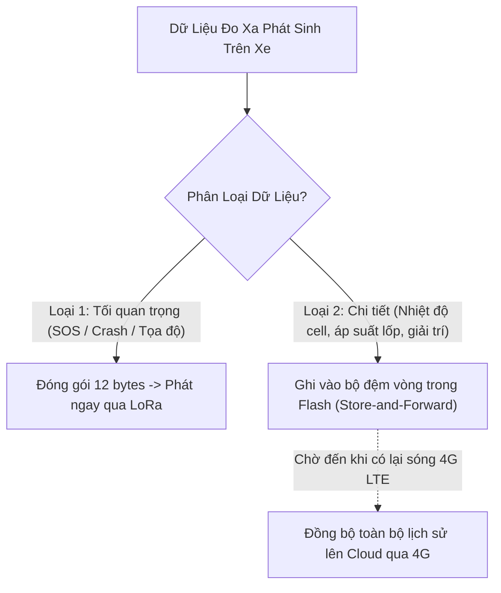

# BÀI 22: THIẾT KẾ HỆ THỐNG TELEMATICS FALLBACK CHO SMART EV KHI MẤT SÓNG CELLULAR

> Tóm tắt: Thiết kế kiến trúc chuyển mạch dự phòng (Failover) từ mạng di động 4G/5G sang LoRa trên xe điện thông minh, kỹ thuật nén và đóng gói dữ liệu đo xa (Telemetry Bit-packing) xuống dưới 16 bytes, và cơ chế quản lý hàng đợi chống nghẽn băng thông vô tuyến.

---

## 1. Bài Toán Thực Tế: Điểm Mù Viễn Thông Của Xe Điện Thông Minh

Trong các dòng xe điện thông minh hiện đại (Connected Electric Vehicle - EV), bộ điều khiển trung tâm liên tục truyền hàng nghìn thông số đo xa (Telemetry: Tốc độ, tọa độ GPS, dung lượng pin SOC, nhiệt độ Cell pin, mã lỗi chẩn đoán DTC) lên máy chủ đám mây qua mạng di động **Cellular 4G LTE / 5G**.

Tuy nhiên, kết nối Cellular có những "tử huyệt" địa lý không thể tránh khỏi:
- Xe di chuyển vào **hầm ngầm chung cư, hầm gửi xe bê tông cốt thép nhiều tầng**.
- Xe gặp sự cố trên các cung đường đèo núi hẻo lánh, vùng sâu vùng xa ngoài tầm phủ sóng của trạm BTS.
- Trạm thu phát sóng viễn thông bị sập nguồn khi xảy ra bão lũ, thiên tai.



---

## 2. Kỹ Thuật Nén Nhị Phân Cực Hạn (Telemetry Bit-Packing)

Trên đường truyền 4G, việc gửi một bản tin JSON kích thước **1000 đến 2000 bytes** là hoàn toàn bình thường. Nhưng trên mạng LoRa, một gói tin 2000 bytes là **bất khả thi về mặt vật lý** (vượt quá giới hạn MTU 255 bytes và vi phạm luật chiếm dụng kênh Duty Cycle).

Kỹ sư bắt buộc phải sử dụng kỹ thuật **Đóng gói bit nhị phân (Binary Bit-Packing)** để nén toàn bộ trạng thái xe xuống dưới **16 bytes**:



### 2.1 Thuật Toán Nén Tọa Độ GPS Xuống 3 Bytes (24 Bits)
- Vĩ độ (Latitude) nằm trong khoảng $-90^\circ$ đến $+90^\circ$ (khoảng biến thiên $180^\circ$).
- Độ phân giải của số nguyên 24-bit ($2^{24} = 16,777,216$ giá trị):
  
  $$\text{Độ chính xác} = \frac{180^\circ}{16,777,216} \approx 0.0000107^\circ \approx 1.1\text{ mét}!$$

- Chỉ với **3 bytes**, ta đạt được độ chính xác định vị tới từng mét, cắt giảm hơn 80% dung lượng so với việc gửi chuỗi ASCII hoặc số thực `double` (8 bytes).

### 2.2 Cấu Trúc Khung Nhị Phân Viết Bằng Ngôn Ngữ C (Packed Struct)

```c
#include <stdint.h>

// Sử dụng attribute packed để trình biên dịch không chèn padding byte
struct __attribute__((__packed__)) ev_telemetry_lora_payload {
    uint32_t lat_packed : 24;  // Vĩ độ GPS nén trong 24 bits
    uint32_t lon_packed : 24;  // Kinh độ GPS nén trong 24 bits
    uint8_t  speed_kmh;        // Vận tốc từ 0 đến 255 km/h
    uint8_t  battery_soc;      // Dung lượng pin từ 0% đến 100%
    uint8_t  vehicle_flags;    // Bit 0: Khóa điện, Bit 1: Cửa mở, Bit 2: SOS Crash...
    uint16_t primary_dtc;      // Mã lỗi hệ thống khẩn cấp
    uint8_t  sequence_id;      // Số thứ tự gói tin
};
// Tổng kích thước cấu trúc đúng bằng 12 bytes!
```

---

## 3. Quản Lý Hàng Đợi Lưu Đệm (Store-and-Forward Queue)

Khi xe mất sóng Cellular, không phải dữ liệu nào cũng được phép đẩy lên LoRa:



> [!IMPORTANT]
> **Tuân thủ quy định Airtime khi kích hoạt Fallback:**
> Dù xe đang ở chế độ khẩn cấp, firmware vẫn bắt buộc phải tôn trọng quy định tần số vô tuyến:
> - Chỉ gửi gói tin LoRa với tần suất từ **1 đến 2 phút một lần** (ở trạng thái xe đang di chuyển).
> - Giãn cách chu kỳ gửi lên **15 đến 30 phút một lần** (nếu xe đang dừng đỗ không lăn bánh).

---

## 4. Lưu Ý Kỹ Thuật & Best Practices Thực Chiến

> [!TIP]
> **Bài toán thiết kế thực chiến:** *"Khi thiết kế cơ chế chuyển kênh dự phòng từ 4G sang LoRa cho xe điện, em xử lý thế nào để hệ thống không bị chuyển mạch liên tục (Flapping) khi xe đi qua vùng sóng 4G chập chờn?"*
> 
> **Giải pháp kiến trúc chuẩn mực:**
> "đây là hiện tượng **Network Flapping**. Để khắc phục, em áp dụng cơ chế **Trễ từ trễ (Hysteresis Timer)** trong máy trạng thái:
> 1. **Điều kiện chuyển từ 4G sang LoRa**: Không chỉ dựa vào tín hiệu mất kết nối tức thì, mà phải xác nhận mất liên lạc hoàn toàn trong một cửa sổ thời gian liên tục (ví dụ: ping Gateway không phản hồi trong **15 giây liên tiếp**).
> 2. **Điều kiện chuyển ngược từ LoRa về 4G**: Khi modem 4G báo có sóng trở lại, ta không vội ngắt LoRa ngay, mà bắt buộc đường truyền 4G phải duy trì kết nối ổn định và gửi thành công ít nhất 3 gói tin kiểm tra sức khỏe mạng liên tục trong **30 giây**.
> Cách làm này giúp bộ điều khiển viễn thông hoạt động mượt mà, tránh việc phần mềm liên tục đảo qua đảo lại giữa hai module phần cứng!"

