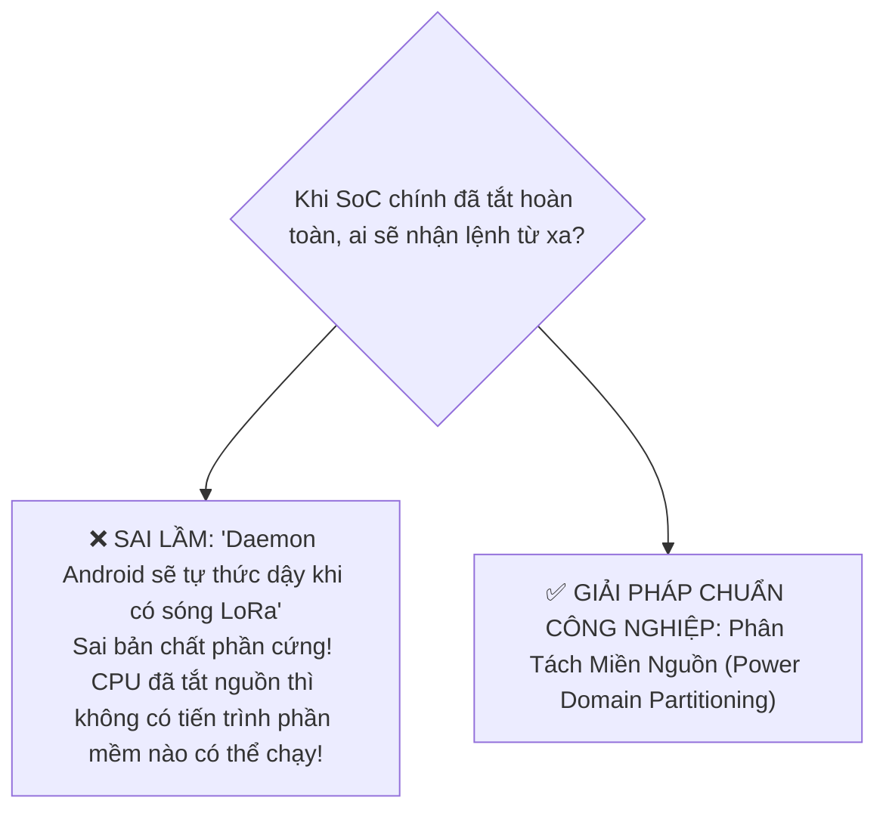
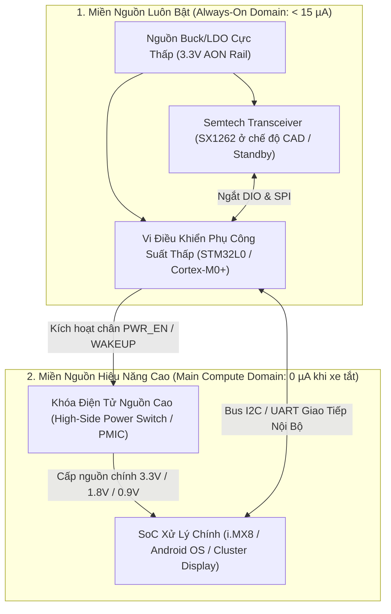
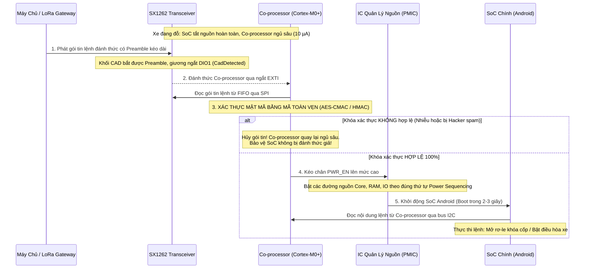

# BÀI 23: KIẾN TRÚC ĐÁNH THỨC TỪ XA (REMOTE WAKE-UP) VÀ QUẢN LÝ MIỀN NGUỒN

> Tóm tắt: Thiết kế kiến trúc phân tách miền nguồn (Power Domains) cho hệ thống xe điện thông minh, phân tích luồng đánh thức từ xa qua sóng LoRa, cơ chế xác thực mã khóa chống tấn công làm cạn kiệt ắc quy (Battery Draining Attack), và kỹ thuật điều khiển PMIC bật nguồn SoC chính.

---

## 1. Bài Toán Tiêu Hao Năng Lượng Ắc Quy Khi Xe Đỗ (Vampire Drain)

Trên một chiếc xe điện thông minh, máy tính trung tâm điều khiển cụm đồng hồ (chạy Android hoặc Linux trên các chip đa nhân hiệu năng cao như NXP i.MX8, Qualcomm Snapdragon, RK3588) tiêu thụ công suất từ **2W đến 8W** khi đang hoạt động:
- Nếu giữ cho bộ vi xử lý chính này luôn bật để lắng nghe lệnh điều khiển từ xa, bình ắc quy phụ $12\text{V}$ của xe sẽ bị cạn sạch chỉ sau **3 đến 5 ngày** đỗ xe trong bãi (Hiện tượng tiêu hao ma cà rồng - Vampire Drain).
- Do đó, khi người dùng tắt khóa xe, SoC chính **bắt buộc phải được cắt nguồn hoàn toàn (Deep Power-Off)** hoặc đưa vào trạng thái **Suspend-to-RAM**.

---

## 2. Kiến Trúc Phân Tách Hai Miền Nguồn Độc Lập

Để xe vừa có thể ngủ sâu vừa có thể phản hồi lệnh từ xa ngay lập tức, kiến trúc phần cứng của cụm đồng hồ được chia tách thành hai miền nguồn riêng biệt:

### 2.1 Miền Nguồn Luôn Bật (Always-On Domain)
- Được nuôi liên tục bằng một đường nguồn LDO tĩnh siêu nhỏ từ ắc quy xe.
- Bao gồm một vi điều khiển tiết kiệm điện phụ trợ (Low-Power Co-processor) và chip thu phát LoRa SX1262.
- Toàn bộ miền nguồn này chỉ tiêu thụ dòng điện cực nhỏ (**$10\text{ µA}$ đến $15\text{ µA}$**), xe có thể đỗ liên tục hàng năm mà không sợ hao bình.

### 2.2 Miền Nguồn Hiệu Năng Cao (Main Compute Domain)
- Chứa vi xử lý ứng dụng chính (SoC Android), chip nhớ RAM LPDDR4, bộ nhớ eMMC/UFS và màn hình hiển thị.
- Khi xe tắt máy, các rơ-le bán dẫn (MOSFET) ngắt hoàn toàn nguồn điện đi vào miền này, đưa mức tiêu thụ năng lượng về **chính xác $0\text{ Watts}$**.

---

## 3. Luồng Tín Hiệu Đánh Thức Từ Xa (Remote Wake-Up Sequence)

Khi người dùng mở ứng dụng di động trên điện thoại và bấm nút: *"Mở cốp xe"* hoặc *"Khởi động điều hòa trước"*:

---

## 4. Chống Tấn Công Làm Cạn Kiệt Bình Ắc Quy (Battery Draining Attack)

> [!CAUTION]
> **Lỗ hổng bảo mật chết người trong thiết kế IoT:**
> Nếu kiến trúc chỉ đơn thuần: *"Cứ thấy có sóng LoRa là bật nguồn SoC chính"*, một kẻ tấn công ở gần xe chỉ cần dùng một mạch phát LoRa liên tục bắn các gói tin rác.
> Hậu quả: Chiếc xe sẽ liên tục bị đánh thức bật nguồn rồi tắt nguồn hàng trăm lần trong đêm, làm cạn sạch bình ắc quy $12\text{V}$ và người dùng sáng hôm sau không thể nổ máy khởi động xe!

### Biện Pháp Phòng Vệ Bắt Buộc Ở Tầng Co-Processor
1. **Xác thực mã bảo mật Challenge-Response**: Gói tin gửi xuống bắt buộc phải mang theo một giá trị thời gian (Timestamp) hoặc bộ đếm ngẫu nhiên được mã hóa bằng chuẩn **HMAC-SHA256** hoặc **AES-128-CMAC**.
2. **Kiểm tra tức thì tại Co-processor**: Vi điều khiển phụ Cortex-M0+ thực hiện xác thực mã chữ ký mật mã này ngay lập tức. Nếu sai lệch, nó hủy gói tin ngay mà **tuyệt đối không bật nguồn SoC chính**.
3. **Cơ chế giới hạn tần suất đánh thức (Rate Limiting)**: Nếu phát hiện liên tục 3 lần nhận mã sai, Co-processor sẽ tự động khóa cửa sổ nhận trong vòng 15 phút để chống lại các cuộc tấn công từ chối dịch vụ (DoS).

---

## 5. Lưu Ý Kỹ Thuật & Best Practices Thực Chiến

> [!IMPORTANT]
> **Bài toán thiết kế thực chiến:** *"Khi em thiết kế tính năng Remote Wake-up bằng LoRa cho xe điện, nếu SoC chính đã bị tắt nguồn hoàn toàn, làm sao ứng dụng Android trên xe biết được lệnh mà người dùng vừa gửi là lệnh gì sau khi khởi động xong?"*
> 
> **Giải pháp kiến trúc chuẩn mực:**
> "để giải quyết bài toán chuyển giao ngữ cảnh (Context Handoff) này:
> 1. Toàn bộ gói tin lệnh được **lưu tạm trong bộ nhớ RAM tĩnh của Co-processor phụ** (vốn luôn được duy trì nguồn nuôi).
> 2. Sau khi Co-processor kích hoạt PMIC bật nguồn và hệ điều hành Android hoàn tất quá trình boot kernel, một tiến trình nền trong Android (Hardware Daemon) sẽ tự động mở giao tiếp bus **I2C hoặc UART nội bộ** kết nối tới Co-processor.
> 3. Daemon gửi lệnh truy vấn: *'Lý do đánh thức xe vừa rồi là gì?'*. Co-processor sẽ truyền toàn bộ payload lệnh đã lưu qua bus I2C cho Android xử lý. Sau khi thực thi xong, nếu không có tương tác người dùng, hệ điều hành Android sẽ gửi lệnh cho Co-processor cho phép cắt nguồn để xe tiếp tục ngủ sâu!"

