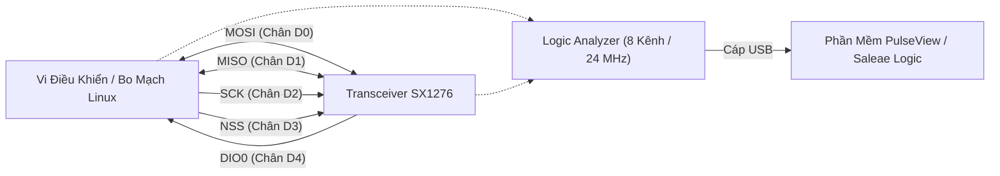
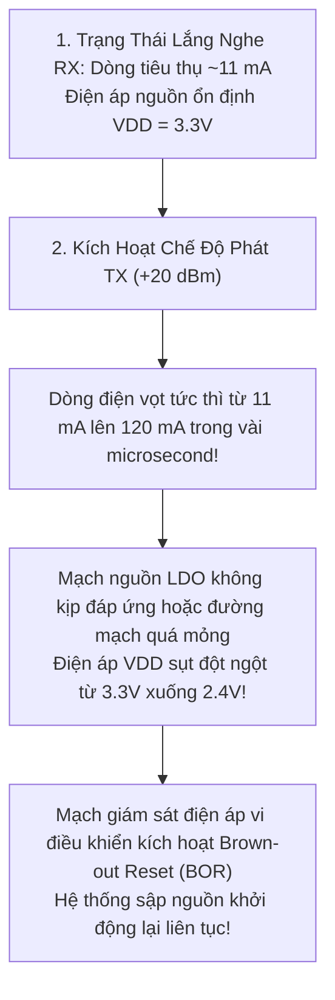
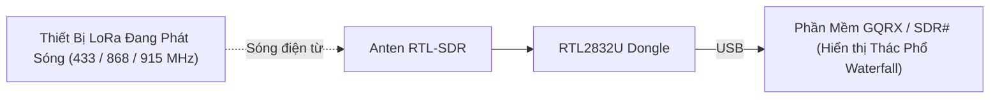

# BÀI 24: KỸ THUẬT ĐO KIỂM & DEBUGGING PHẦN CỨNG: LOGIC ANALYZER VÀ RF

> Tóm tắt: Hướng dẫn kỹ thuật sử dụng máy phân tích logic (Logic Analyzer) để giải mã bus SPI, kiểm tra chất lượng dạng sóng bằng máy hiện sóng (Oscilloscope), phát hiện sụt áp nguồn khi phát công suất cao, và đo kiểm phổ vô tuyến LoRa bằng thiết bị SDR.

---

## 1. Thiết Lập Máy Phân Tích Logic (Logic Analyzer) Để Bắt Gói SPI

Khi giao tiếp SPI giữa vi xử lý và chip LoRa gặp sự cố (ví dụ đọc thanh ghi toàn ra `0x00` hoặc `0xFF`), công cụ chẩn đoán nhanh và chính xác nhất là **Máy phân tích logic (Saleae Logic hoặc USB Logic Analyzer giá rẻ kết hợp phần mềm mã nguồn mở PulseView / Sigrok)**:

### 1.1 Cấu Hình Bộ Giải Mã Giao Thức (SPI Protocol Decoder)
Trong phần mềm phân tích logic, ta thêm bộ giải mã `SPI Decoder` với các thông số bắt buộc:
- **Clock Polarity (CPOL)**: `0` (Idle Low)
- **Clock Phase (CPHA)**: `0` (Sample on Leading/Rising Edge)
- **Bit Order**: `Most Significant Bit First (MSB First)`
- **Data Word Length**: `8 bits`
- **Enable line (CS)**: `Active Low`

### 1.2 Dấu Hiệu Nhận Biết Lỗi Trên Giản Đồ Tín Hiệu (Waveform Diagnosis)
1. **MISO luôn ở mức 0V phẳng lì**:
   - Kiểm tra chân NSS có thực sự kéo xuống mức $0\text{V}$ khi truyền không. Nếu chân NSS bị treo ở $3.3\text{V}$, chip LoRa sẽ không bao giờ nhả chân MISO ra khỏi trạng thái trở kháng cao (High-Z).
2. **Dữ liệu trên MISO bị trễ nửa chu kỳ xung nhịp**:
   - Vi điều khiển cấu hình sai SPI Mode (ví dụ MCU chạy Mode 1 hoặc Mode 3 trong khi SX1276 bắt buộc chạy **Mode 0**).
3. **Chân DIO0 không bao giờ bật lên mức cao**:
   - Thanh ghi mặt nạ ngắt `RegIrqFlagsMask` (địa chỉ `0x11`) đang bị set bit chặn ngắt, hoặc cấu hình sai thanh ghi ánh xạ chân `RegDioMapping1`.

---

## 2. Đo Kiểm Bằng Máy Hiện Sóng: "Thủ Phạm" Sụt Áp Nguồn Khi Phát TX

Một lỗi phần cứng kinh điển làm đau đầu rất nhiều kỹ sư nhúng: *Driver đọc ghi thanh ghi qua SPI hoàn toàn trơn tru, nhưng cứ gọi lệnh phát sóng TX là hệ thống bị treo hoặc vi điều khiển tự động Reset khởi động lại!*

> [!CAUTION]
> **Giải pháp khắc phục phần cứng:**
> 1. Đặt một tụ điện hóa (hoặc Tantalum) dung lượng lớn ($47\text{ µF}$ đến $100\text{ µF}$) kết hợp song song một tụ gốm $100\text{ nF}$ đặt **sát ngay chân cấp nguồn VDD của chip LoRa** để đóng vai trò bình tích trữ năng lượng tức thời khi phát sóng.
> 2. Đảm bảo IC nguồn LDO cung cấp dòng liên tục tối thiểu là **$300\text{ mA}$ đến $500\text{ mA}$**. Tuyệt đối không dùng chung đường nguồn 3.3V xuất ra từ các mạch nạp USB-to-UART giá rẻ (chỉ cấp được tối đa 50 mA).

---

## 3. Đo Kiểm Sóng Vô Tuyến Bằng Thiết Bị SDR (Software Defined Radio)

Để kiểm chứng xem chip LoRa có thực sự bức xạ sóng ra không gian hay không mà không cần máy phân tích phổ đắt tiền (Spectrum Analyzer), kỹ sư có thể sử dụng một chiếc USB **RTL-SDR** (giá chỉ vài trăm nghìn đồng) kết hợp phần mềm **SDR# (SDR Sharp)** hoặc **GQRX**:

### Các Đặc Điểm Cần Quan Sát Trên Thác Phổ (Waterfall Display)
1. **Hình dạng sóng Chirp chuẩn**: Quan sát thấy các vệt quét tần số chéo tuyến tính từ dưới lên trên (Up-chirps) trong phần Preamble, sau đó là các đoạn nhảy tần đột ngột của phần Payload.
2. **Kiểm tra độ trôi tần số (Center Frequency Offset)**: Nếu sóng phát ra bị lệch so với tần số cấu hình (ví dụ đặt 433.0 MHz mà đỉnh phổ nằm ở 433.050 MHz), thạch anh trên bo mạch đang bị sai số $\Delta f = 50\text{ kHz}$. Cần kiểm tra lại tụ tải (Load Capacitors) của thạch anh $32\text{ MHz}$.

---

## 4. Đo Phối Hợp Trở Kháng Anten Bằng Máy Đo NanoVNA

Nếu anten không được phối hợp trở kháng chuẩn $50\ \Omega$ tại tần số hoạt động:
- Hầu hết công suất phát sẽ bị dội ngược lại (Sóng phản xạ).
- Hệ số phản xạ sóng đứng ($VSWR$) tăng cao làm giảm 90% cự ly phát sóng và có nguy cơ phá hỏng tầng khuếch đại công suất PA.

### Tiêu Chuẩn Đánh Giá Bằng Máy Phân Tích Mạng Vector (NanoVNA)
- Tham số sóng phản xạ $S_{11}$ tại tần số trung tâm:
  - $S_{11} < -10\text{ dB}$: Mức chấp nhận được (khoảng 90% công suất được bức xạ).
  - $S_{11} < -20\text{ dB}$: **Mức lý tưởng tuyệt hảo** (trên 99% công suất được đưa ra anten).
  - Hệ số sóng đứng: $VSWR \le 1.5:1$.

