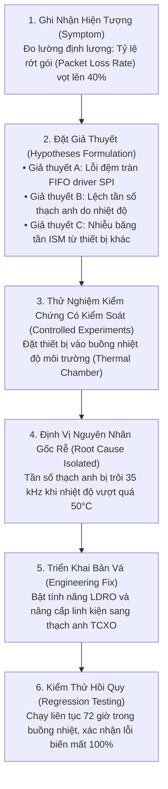
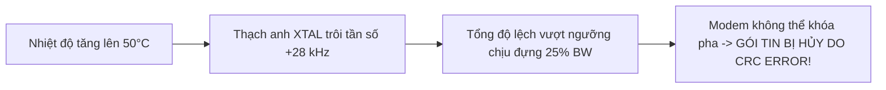
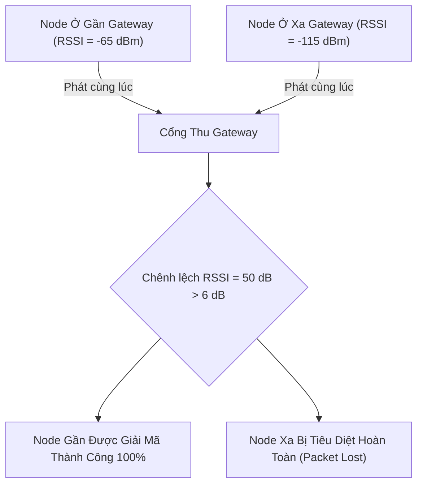

# BÀI 25: ROOT CAUSE ANALYSIS: ĐIỀU TRA SỰ CỐ MẤT GÓI VÀ TRÔI TẦN SỐ

> Tóm tắt: Xây dựng phương pháp luận phân tích nguyên nhân gốc rễ (Root Cause Analysis - RCA) cho hệ thống nhúng vô tuyến, mổ xẻ hai ca sự cố thực tế kinh điển: Rớt gói tin do trôi dạt tần số nhiệt độ và nghẽn mạng do hiệu ứng chiếm đoạt (Capture Effect), cùng biểu mẫu báo cáo kỹ thuật chuyên nghiệp.

---

## 1. Phương Pháp Luận Phân Tích Nguyên Nhân Gốc Rễ (RCA)

Khi một sản phẩm nhúng gặp sự cố tại hiện trường (Field Issue), sự khác biệt giữa một kỹ sư mới vào nghề và một kỹ sư cao cấp nằm ở **phương pháp điều tra có cấu trúc**:



---

## 2. Ca Sự Cố Thực Tế 1: Rớt Gói Tin Bí Ẩn Khi Nhiệt Độ Môi Trường Tăng Cao

### 2.1 Hiện Tượng
Một hệ thống cảm biến LoRa lắp đặt ngoài trời hoạt động hoàn hảo vào ban đêm ($22^\circ\text{C}$), nhưng cứ đến buổi trưa nắng gắt ($45^\circ\text{C}$ đến $55^\circ\text{C}$ bên trong hộp kín), **tỷ lệ mất gói tin vọt lên trên 50%**.

### 2.2 Quá Trình Điều Tra & Bản Chất Vật Lý
1. **Kiểm tra tín hiệu bằng SDR**: Đo tần số phát của node cảm biến ở $50^\circ\text{C}$, phát hiện tần số trung tâm bị dịch chuyển:
   
   $$\Delta f = +28\text{ kHz}$$
2. **Nguyên nhân cốt lõi**:
   - Mạch sử dụng thạch anh thường (XTAL) giá rẻ có hệ số trôi nhiệt $\pm 30\text{ ppm}$.
   - Ở tần số sóng mang $868\text{ MHz}$, độ dịch tần số tối đa do nhiệt độ gây ra là:
     
     $$\Delta f_{drift} = 868\text{ MHz} \times 30\text{ ppm} \approx \pm 26\text{ kHz}$$
   - Ở cấu hình $BW = 125\text{ kHz}$, bộ giải điều chế LoRa của Semtech chỉ chịu được độ lệch tần số tối đa bằng **$25\% \times BW \approx 31.25\text{ kHz}$**.
   - Khi cộng dồn sai số thạch anh của bên phát và bên thu, tổng độ lệch tần số vượt ngưỡng $31.25\text{ kHz}$, khiến bộ tương quan modem không thể khóa pha giải mã symbol!



### 2.3 Bản Vá Kỹ Thuật (Engineering Fix)
1. **Bản vá phần mềm tức thì**: Bật cờ `LowDataRateOptimize` (LDRO) trong thanh ghi `RegModemConfig3` để tăng số bit dự phòng tần số cho modem.
2. **Bản vá phần cứng vĩnh viễn**: Thay thế thạch anh thường (XTAL) bằng **thạch anh bù nhiệt độ chuyên dụng (TCXO - Temperature Compensated Crystal Oscillator)** với sai số cực nhỏ dưới $\pm 1.5\text{ ppm}$.

---

## 3. Ca Sự Cố Thực Tế 2: Hiệu Ứng Chiếm Đoạt Sóng (Capture Effect)

### 3.1 Hiện Tượng
Trong một khu công nghiệp có 50 trạm quan trắc LoRa: Các trạm ở gần Gateway luôn gửi dữ liệu thành công $100\%$, trong khi các trạm ở xa (cách 2–3 km) bị mất gói dữ liệu liên tục mặc dù kiểm tra từng trạm đơn lẻ đều hoạt động tốt.

### 3.2 Bản Chất Vật Lý Của Hiệu Ứng Capture Effect
LoRa có một đặc tính vô tuyến độc đáo: **Hiệu ứng chiếm đoạt (Capture Effect)**.
- Nếu hai gói tin LoRa phát cùng tần số, cùng Spreading Factor và đâm vào nhau (Collision) tại cùng một thời điểm:
  - Nếu công suất của gói tin A mạnh hơn gói tin B một khoảng ít nhất **$6\text{ dB}$** ($RSSI_A - RSSI_B \ge 6\text{ dB}$):
  - Bộ thu của Gateway sẽ **"bỏ rơi" gói tin yếu B và khóa chặt giải mã thành công gói tin mạnh A**!
- **Hệ quả**: Các node ở gần Gateway luôn luôn "đè bẹp" và "nuốt chửng" các gói tin của các node ở xa (Bài toán Near-Far Problem).



### 3.3 Giải Pháp Khắc Phục
1. **Bật thuật toán ADR (Adaptive Data Rate)**: Buộc các node ở gần Gateway phải tự động giảm công suất phát (từ 14 dBm xuống 2 dBm) và chuyển sang dùng SF7, nhường dải SF cao hơn và công suất cho các node ở xa.
2. **Thêm thành phần ngẫu nhiên hóa thời gian phát (Random TX Jitter)** để triệt tiêu việc hai node vô tình phát trùng thời điểm.

---

## 4. Biểu Mẫu Báo Cáo Kỹ Thuật (Technical Post-Mortem Template)

Khi phân tích sự cố kỹ thuật hoặc báo cáo cho đối tác và khách hàng, hãy trình bày sự cố theo khung tiêu chuẩn quốc tế:

```text
================================================================================
BÁO CÁO PHÂN TÍCH NGUYÊN NHÂN GỐC RỄ (ROOT CAUSE ANALYSIS REPORT)
Mã Sự Cố: INC-LORA-2026-08
Thiết Bị: Cụm Đồng Hồ Xe Điện Thông Minh (Connected EV Smart Instrument Cluster)
================================================================================

1. HIỆN TƯỢNG (SYMPTOM):
   - Tỷ lệ rớt gói tin telemetry LoRa tăng đột biến lên 42% trong khung giờ từ 11:30 đến 14:00 hàng ngày.

2. CÁC GIẢ THUYẾT ĐÃ KIỂM CHỨNG (INVESTIGATION):
   - [Bác bỏ] Giả thuyết tràn hàng đợi SPI driver: Bộ đệm DMA của Linux kernel vẫn trống 85%.
   - [Xác nhận] Giả thuyết trôi nhiệt độ: Kiểm tra log nhiệt độ bo mạch ghi nhận mức 68°C tại thời điểm rớt gói.

3. NGUYÊN NHÂN GỐC RỄ (ROOT CAUSE):
   - Thạch anh 32 MHz trên bo mạch SX1276 bị trôi tần số +32 kHz do nhiệt độ hộp kín tăng cao, vượt quá ngưỡng dung sai 25% Bandwidth của bộ giải điều chế LoRa.

4. HÀNH ĐỘNG KHẮC PHỤC (CORRECTIVE ACTIONS):
   - Ngắn hạn: Nạp bản vá Firmware bật cờ LowDataRateOptimize (LDRO) cho toàn bộ 500 xe qua OTA.
   - Dài hạn: Cập nhật sơ đồ nguyên lý mạch (Schematic v2.1) thay đổi sang linh kiện TCXO ±1.0 ppm.

5. KIỂM THỬ HỒI QUY (VERIFICATION):
   - Chạy kiểm thử gia tốc nhiệt độ (Burn-in Test) ở 75°C trong 48 giờ liên tục. Tỷ lệ lỗi gói tin giảm về mức 0.02% (Đạt tiêu chuẩn xuất xưởng).
================================================================================
```

